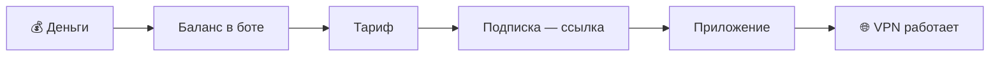

> [!mirror] Резервное зеркало
> Актуальная версия этой страницы — на основной вики: [wiki.zapret.moe/Zapret/premium](https://wiki.zapret.moe/Zapret/premium)

# 🧭 Zapret VPN: как купить и подключить — гайд для новичка
[[home|На главную]]

> [!info] О чём заметка
> Как начать пользоваться VPN через бота [@zapretvpns_bot](https://t.me/zapretvpns_bot): оплатить, получить ссылку, добавить её в приложение и включить. Статья разбита на части — читать подряд не обязательно, нужный раздел найдёте в [[#Навигация|навигации]]. Скриншоты, цены и состав тарифов сверены с ботом 15 октября 2026 года; актуальные цены бот всегда показывает при покупке.

> [!warning] Для VPN код из Zapret GUI (Zapret 2) не нужен
> VPN и программа Zapret GUI для Windows — **две разные вещи**. Чтобы подключить VPN, ничего из программы в бот отправлять не надо: только **баланс → тариф → ссылка → приложение**.
>
> Код из Zapret GUI нужен лишь тем, кто хочет премиальное оформление самой программы на Windows. Его отправляют **после** покупки тарифа, и это необязательно — подробно в [[#Дополнительно: Premium для программы Zapret GUI|последней части]].

## Навигация

### Что вы хотите сделать

| Хочу | Куда идти |
|---|---|
| подключить VPN на телефон или компьютер | [[Zapret/premium#Часть 1. VPN за четыре шага\|Часть 1: четыре шага]] — от оплаты до работающего VPN |
| узнать, сколько стоит и какой тариф брать | [[Zapret/premium#Тарифы и цены\|Тарифы и цены]] |
| настроить Android по картинкам | [[premium/android\|VPN на Android: ZapretKVN по шагам]] |
| найти приложение для своего устройства | [[premium/apps\|Приложения для VPN]] |
| чтобы работал только Telegram | [[Zapret/premium#Только Telegram\|Только Telegram]] |
| VPN для игр или выбрать протокол | [[Zapret/premium#Какой VPN выбрать\|Какой VPN выбрать]] |
| VPN не работает | [[Zapret/premium#Если не работает\|Если не работает]] |
| продлить, повысить тариф, вернуть деньги | [[Zapret/premium#Продление, повышение, возврат\|Продление, повышение, возврат]] |
| премиальное оформление программы Zapret GUI | [[Zapret/premium#Дополнительно: Premium для программы Zapret GUI\|Premium для Zapret GUI]] — необязательно |
| найти любую другую инструкцию | [[premium/guides\|📚 Все инструкции]] — оглавление всех статей |

### Оглавление

**Начало**
- [[#Если коротко: что скачать и сколько стоит|Если коротко: что скачать и сколько стоит]]
- [[#TL;DR|TL;DR]]

**Часть 1. VPN за четыре шага**
- [[#Шаг 1. Пополните баланс|Шаг 1. Пополните баланс]]
- [[#Шаг 2. Купите тариф|Шаг 2. Купите тариф]]
- [[#Шаг 3. Получите подписку в боте|Шаг 3. Получите подписку в боте]]
- [[#Шаг 4. Добавьте подписку в приложение и включите VPN|Шаг 4. Добавьте подписку в приложение и включите VPN]]
- [[#Готово. Что дальше|Готово. Что дальше]]

**Часть 2. Справочник**
- [[#Карта бота: что за какой кнопкой|Карта бота]]
- [[#Что есть что: шесть похожих названий|Что есть что: шесть похожих названий]]
- [[#Тарифы и цены|Тарифы и цены]]
- [[#Продление, повышение, возврат|Продление, повышение, возврат]]
- [[#Подписка, ключи и серверы|Подписка, ключи и серверы]]
- [[#Какой VPN выбрать|Какой VPN выбрать]]
- [[#Только Telegram|Только Telegram]]
- [[#Если не работает|Если не работает]]

**Часть 3. Необязательно**
- [[#Дополнительно: Premium для программы Zapret GUI|Premium для программы Zapret GUI]]

---

## Если коротко: что скачать и сколько стоит

Нужен VPN, чтобы работали YouTube, Telegram, Instagram и всё остальное? Купите в боте тариф 💎 **Vless MAX — 199 ₽ в месяц**: в нём 15 серверов вместо 2 — если один заблокируют или он перегружен, есть куда переключиться, — и все прокси для Telegram. Самый дешёвый VPN — ⚡ MasterVless за 99 ₽ в месяц, попробовать его можно за 9 ₽ на день. Дальше поставьте одно приложение:

| У вас | Скачайте | Что взять в боте | Пошагово |
|---|---|---|---|
| 🤖 Android | [ZapretKVN](https://git.zapret.moe/zapretkvn/ZapretKVN-android/releases/latest), файл `…-arm64-v8a.apk` | Xray-подписку | [[premium/android\|инструкция со скриншотами]] |
| 🍏 iPhone, iPad | [Clash Mi](https://clashmi.app/download) | Mihomo-подписку | [[premium/apps#iPhone и iPad\|приложения для iPhone]] |
| 🖥 Windows | [Zapret KVN](https://git.zapret.moe/zapretkvn/zapret-kvn) | Xray-подписку | [[premium/apps#Windows\|приложения для Windows]] |
| 💻 Mac, Linux | [Clash Verge Rev](https://github.com/clash-verge-rev/clash-verge-rev) | Mihomo-подписку | [[premium/apps#macOS и Linux\|приложения для Mac и Linux]] |
| ✈️ Telegram (Android, Windows) | [ZaStoGram](https://t.me/zastogram) — наш Telegram, работает и без VPN | ничего, он бесплатный | [[premium/android#ZaStoGram: Telegram, которому не нужен VPN\|что это]] |

Программа Zapret GUI для этого не нужна, и код из неё отправлять не надо.

## TL;DR

- **Порядок для VPN:** пополнить баланс → купить тариф → получить в боте ссылку-подписку → вставить её в приложение → включить. Больше ничего не нужно.
- **Код из Zapret GUI для VPN не нужен.** Он только для оформления программы Zapret GUI на Windows и делается по желанию, после покупки тарифа.
- **Какой тариф брать:** по умолчанию 💎 Vless MAX (199 ₽ в месяц) — 15 серверов и все прокси для Telegram. Подешевле — ⚡ MasterVless (99 ₽), самый полный — 👑 Vless ULTRA (249 ₽). Попробовать — MasterVless на 1 день за 9 ₽.
- **Приложение:** Android и Windows — ZapretKVN и Xray-подписка; iPhone и Mac — Clash Mi или Clash Verge Rev и Mihomo-подписка.
- **Бот нужен в начале и при продлении.** Новые серверы приходят по той же ссылке, когда приложение обновляет подписку (ZapretKVN с версии 0.5.5 делает это сам раз в сутки).
- **Для игр** добавьте Hysteria 2-подписку. **Если ничего не подключается** — AWG 3.0 в AmneziaVPN 5.0.0.5 или новее.
- **Для Telegram** — наш клиент [ZaStoGram](https://t.me/zastogram): обходит блокировку сам, даже без VPN.

> [!tip] Три слова, которые нужны с самого начала
> **Приложение (клиент)** — программа на телефоне или компьютере, которая включает VPN.
>
> **Подписка** — постоянная ссылка вида `https://…`, из которой приложение берёт свежий список серверов.
>
> **Протокол** — способ, которым приложение разговаривает с сервером. Названия вроде VLESS, Hysteria 2 и AWG — это протоколы. Новичку выбирать между ними не нужно: бот сам скажет, что поставить.

---

## Часть 1. VPN за четыре шага

Кнопок в боте много, но для старта нужны четыре действия. Займёт это минут десять. Понадобятся телефон или компьютер, банковское приложение с оплатой по СБП и Telegram.

| Шаг | Где | Что нажать | Что получите |
|---|---|---|---|
| [[Zapret/premium#Шаг 1. Пополните баланс\|1. Пополнить баланс]] | бот | «💳 Подписка и баланс» → «💰 Пополнить» → сумма → оплата по СБП | деньги на счёте в боте |
| [[Zapret/premium#Шаг 2. Купите тариф\|2. Купить тариф]] | бот | там же «🛒 Купить / продлить» → тариф → срок → подтвердить | активную подписку |
| [[Zapret/premium#Шаг 3. Получите подписку в боте\|3. Взять подписку]] | бот | «🚀 Подключить устройство» → «🌐 Весь интернет (VPN)» → своё устройство → кнопка подписки | ссылку `https://…` |
| [[Zapret/premium#Шаг 4. Добавьте подписку в приложение и включите VPN\|4. Добавить в приложение]] | приложение | вставить ссылку → включить | работающий VPN |

### Шаг 1. Пополните баланс

Деньги не уходят сразу «за VPN». Сначала они попадают на ваш счёт в боте — баланс, — а уже с него вы покупаете тариф. Так автопродление и повышение тарифа работают без повторной оплаты.

По порядку:

1. Откройте бота [@zapretvpns_bot](https://t.me/zapretvpns_bot) и нажмите «Запустить» (или отправьте `/start`).
2. Нажмите **«💳 Подписка и баланс»** — откроется экран с вашим тарифом и балансом.
3. Нажмите **«💰 Пополнить»**.
4. Выберите сумму кнопкой (200, 300, 500, 1000, 2000 или 5000 ₽) или напишите её цифрами, например `199` — ровно на месяц Vless MAX.
5. Бот предложит два варианта оплаты. Обычная кнопка вида **«💳 Pally 199₽»** — на баланс придёт ровно эта сумма, комиссию платит проект. Кнопка «💝 … (N ₽ + донат)» — то же самое плюс добровольная поддержка проекта.
6. Откройте ссылку на оплату и оплатите через СБП в приложении своего банка.
7. Вернитесь в бот: деньги зачислятся сами через несколько секунд. Если за минуту баланс не изменился — нажмите «🔄 Проверить оплату».

Так выглядит экран «💳 Подписка и баланс»:

![[bot-account.png|420]]

На нём видно, какой у вас тариф и до какого числа он действует, включено ли автопродление, что входит в тариф («✨ Что входит в тариф») и сколько денег на балансе.

| Что | Как |
|---|---|
| Сумма за раз | от 10 до 10 000 ₽ |
| Способ | СБП (Система быстрых платежей) — из приложения любого банка |
| Комиссия | обычная оплата — без комиссии, её покрывает проект. Кнопка «💝 … (N ₽ + донат)» добавляет 7,4 % + 2 ₽ — это добровольная поддержка; на баланс в обоих случаях придёт ровно N ₽ |
| Карта | бот её не хранит и без вашего платежа ничего не списывает; исключение — автопополнения, если вы сами их включите («🔁 Автопополнения») |

### Шаг 2. Купите тариф

1. На том же экране нажмите **«🛒 Купить / продлить»**.
2. Бот покажет все тарифы сразу: что в каждый входит и сколько стоят день, месяц и год. Если не знаете, что выбрать, — **💎 Vless MAX**.
3. Нажмите кнопку тарифа внизу — откроется выбор срока.
4. Выберите срок. Значок ✅ на кнопке — денег хватает, 💸 — нужно пополнить баланс.
5. Подтвердите покупку. Деньги спишутся только после подтверждения.

Экран выбора тарифа. Каждый следующий тариф включает всё из предыдущего, поэтому у него перечислено только новое («Всё из тарифа …, плюс:»):

![[bot-shop-levels.png|420]]

| Строка у тарифа | Что значит |
|---|---|
| 🌐 VPN: … | какие протоколы открывает тариф |
| 🚫 Без VPN | в тарифе нет VPN — это 🔒 Запретик, для VPN он не подходит |
| 🌍 Серверов VLESS | сколько серверов будет доступно |
| ✈️ Прокси для Telegram | какие прокси добавляются |
| ⭐ Zapret Premium в Zapret GUI | оформление для программы Zapret GUI — есть во всех тарифах, для VPN значения не имеет |
| 💳 день · месяц · год | цены за основные сроки |

Экран выбора срока:

![[bot-shop-terms.png|420]]

Все тарифы с ценами на любой срок — в разделе [[#Тарифы и цены|Тарифы и цены]].

### Шаг 3. Получите подписку в боте

Проще всего не выбирать протокол самому, а нажать в главном меню бота зелёную кнопку **«🚀 Подключить устройство»**. Мастер задаст два вопроса и выдаст одно проверенное сочетание приложения и ссылки.

**Вопрос 1: что нужно.** Нажмите «🌐 Весь интернет (VPN)». Вариант «✈️ Только Telegram» — прокси прямо в Telegram, без отдельных приложений ([[#Только Telegram|о нём ниже]]).

![[bot-onboarding-goal.png|420]]

**Вопрос 2: какое устройство.** От ответа зависит, какое приложение и какую подписку посоветует бот:

![[bot-onboarding-device.png|420]]

**Ответ: три шага для вашего устройства.** Например, для Android бот советует поставить ZapretKVN, взять Xray-подписку и добавить её в приложение. Ниже — запасные варианты, а зелёная кнопка под сообщением сразу выдаёт нужную подписку:

![[bot-onboarding-android.png|420]]

Что советует мастер для каждого устройства:

| Устройство | Приложение | Что взять в боте | Если не подошло | Другие приложения |
|---|---|---|---|---|
| 🤖 Android | [ZapretKVN](https://git.zapret.moe/zapretkvn/ZapretKVN-android) | Xray-подписку | Hysteria 2, Mihomo-подписку | v2rayNG, Happ, FlClash, Clash Mi, AmneziaVPN |
| 🖥 Windows | [Zapret KVN](https://git.zapret.moe/zapretkvn/zapret-kvn) | Xray-подписку | Hysteria 2, Mihomo-подписку | v2rayN, Happ, Clash Verge Rev, AmneziaVPN |
| 🍏 iPhone / iPad | [Clash Mi](https://clashmi.app/download) | Mihomo-подписку | WireGuard | Happ, V2RayTun, AmneziaVPN, WireGuard |
| 💻 macOS / Linux | [Clash Verge Rev](https://github.com/clash-verge-rev/clash-verge-rev) | Mihomo-подписку | Xray-подписку, Hysteria 2 | Happ, V2Box, Throne, AmneziaVPN |
| 📡 Роутер | прошивка с WireGuard | WireGuard-конфиг | AWG 2.0, если роутер поддерживает AmneziaWG; AWG 3.0 — если прошивка знает третье поколение | — |

На всех устройствах, кроме роутера, при «не подключается» мастер советует AWG 3.0 в AmneziaVPN 5.0.0.5 или новее. Какую ссылку читает каждое приложение — в заметке [[premium/apps|Приложения для VPN]].

**Карточка подписки.** После нажатия «🔗 Получить Xray-подписку» бот присылает карточку. Ссылка на скриншоте закрашена: у каждого она своя.

![[bot-xray-subscription.png|420]]

| Кнопка или строка | Что делает |
|---|---|
| адрес `https://…` | **нажмите на него — Telegram скопирует ссылку**; это всё, что нужно для шага 4 |
| 📲 Импортировать | страница с кнопкой «🌐 Открыть URL» (долгое нажатие на неё — «Копировать») и QR-кодом |
| 📲 QR-код | код для другого устройства: бот открыт на компьютере, а подписку добавляете в телефон |
| ⚙️ Состав | какие серверы попадут в подписку: только те, где вы уже создали ключи, выбранные или все серверы тарифа |
| ⋯ Ещё → ♻️ Сменить ссылку | новая ссылка вместо утёкшей; старая перестанет работать |
| 🟢 Работает · N ключей | подписка в порядке, в ней сейчас N ключей |

> [!warning] Подписка — это ваш пропуск
> По ссылке подписки любой человек сможет пользоваться вашим VPN. Не публикуйте её в чатах и не показывайте на скриншотах.

### Шаг 4. Добавьте подписку в приложение и включите VPN

Куда вставлять ссылку, зависит от приложения:

| Приложение | Куда вставить | Подробно |
|---|---|---|
| ZapretKVN (Android) | «Серверы» → «Ссылка» → вставить → «Загрузить preview» → «Один профиль-группа» | [[premium/android\|по шагам со скриншотами]] |
| Zapret KVN (Windows), v2rayN | добавить подписку по ссылке, обновить подписки | [[premium/v2rayn\|v2rayN со скриншотами]] |
| Clash Mi, Clash Verge Rev, FlClash | «Профили» → добавить по ссылке | [[premium/apps\|по приложениям]] |
| Happ, V2RayTun | «+» → вставить из буфера обмена | [[premium/apps\|по приложениям]] |

Дальше:

- [ ] Откройте приложение и выберите добавленную подписку.
- [ ] Если серверов в списке нет, обновите подписку (обычно значок круговой стрелки или пункт «Обновить»).
- [ ] Нажмите большую кнопку подключения.
- [ ] Android и iPhone при первом включении спросят разрешение на VPN — разрешите.
- [ ] Проверьте: с включённым VPN откройте YouTube или сайт, который без него не открывается.
- [ ] В ZapretKVN через VPN идут только отмеченные приложения: проверьте список во вкладке «Маршруты» → «Выбрать приложения» ([[premium/android#Шаг 5. Проверьте, какие приложения идут через VPN|подробно]]).

Значок ключа или надпись «VPN» в строке состояния телефона значит, что соединение есть.

### Готово. Что дальше

- **В бот заходить не нужно** до конца подписки. Подписка — это ссылка на список ваших серверов, а не сами серверы: появился новый сервер или сменился адрес старого — приложение узнает об этом при обновлении подписки. Многие приложения обновляют её сами; ZapretKVN для Android — раз в сутки с версии 0.5.5, а вручную — «Серверы» → «Сменить» → «⋮» → «Обновить (без кэша)».
- **Продлить** — пополнить баланс и включить автопродление или купить срок заново; ссылка остаётся той же. Подробно — в [[#Продление, повышение, возврат|продлении]].
- **Новый телефон или потерялась ссылка.** Подписка живёт в вашем аккаунте бота, а не в приложении. На новом устройстве нажмите «🚀 Подключить устройство» и добавьте ту же подписку заново. Привязки к железу нет, старое устройство отключать не обязательно.
- **Ссылка попала в чужие руки** — «⋯ Ещё» → «♻️ Сменить ссылку», затем обновите её во всех своих приложениях.

---

## Часть 2. Справочник

Разделы ниже читать не обязательно — сюда стоит заглянуть, если появился вопрос.

## Карта бота: что за какой кнопкой

Так выглядит главный экран бота. Сверху — ваша подписка, срок и баланс, ниже — кнопки разделов:

![[bot-main-menu.png|420]]

| Кнопка | Что внутри | Когда нужна |
|---|---|---|
| 🚀 Подключить устройство | мастер: спросит устройство и выдаст подходящую подписку | при первом подключении и на новом устройстве |
| 🌐 VPN, WireGuard и Telegram | все протоколы по отдельности и прокси для Telegram | если хотите выбрать протокол или сервер сами |
| 💳 Подписка и баланс | срок подписки, баланс, покупка, автопродление, история | оплатить и продлить |
| ⭐ Zapret Premium | оформление программы Zapret GUI на Windows | только если пользуетесь Zapret GUI; для VPN не нужна |
| 🎁 Рефералы | ваша ссылка-приглашение и бонусы за друзей | по желанию |
| 💝 Донат | добровольная поддержка проекта, на баланс не зачисляется | по желанию |
| ⚙️ Настройки | передача подписки другому человеку | редко |
| 📖 О сервисе | правила, приватность, чем Zapret отличается от VPN | один раз прочитать |
| 💬 Поддержка | обращение в поддержку | если что-то не работает |
| 📖 Гайд для новичков | эта статья | — |

Зелёные кнопки — «🚀 Подключить устройство» и «📖 Гайд для новичков» — два главных шага для новичка.

## Что есть что: шесть похожих названий

У проекта несколько продуктов с похожими именами. Отсюда и путаница «сначала код, потом VPN»: это разные продукты.

| Название | Что это | Где работает | Нужно для VPN? |
|---|---|---|---|
| **Zapret VPN** | настоящий VPN на серверах проекта | телефон, компьютер, роутер | это и есть VPN; тарифы от ⚡ MasterVless |
| **Бот** [@zapretvpns_bot](https://t.me/zapretvpns_bot) | касса и выдача ссылок | Telegram | да |
| **ZapretKVN / Zapret KVN** | наше приложение для включения VPN | Android, Windows | да (или другое приложение) |
| **ZaStoGram** | наш Telegram со встроенным обходом блокировки | Android, Windows | нет, работает и без VPN |
| **Zapret GUI** (программа на базе Zapret 2) | бесплатно обходит блокировки без VPN | Windows | нет |
| **Zapret Premium** | премиальное оформление программы Zapret GUI | Windows | нет; входит в любой тариф |

### Zapret VPN: настоящий VPN

Устройство шифрует весь трафик и отправляет его на сервер проекта, а сервер уже ходит в интернет от своего имени. Провайдер видит одно зашифрованное соединение и не знает, какие сайты вы открываете.

У VPN три преимущества перед программой Zapret GUI:

- работает на любом устройстве — телефоне, компьютере, роутере, приставке;
- открывает вообще всё, а не только отдельные сайты;
- даёт зарубежный адрес — это нужно сервисам, которые сами не пускают пользователей из России.

### ZapretKVN: приложение для VPN

Наш клиент — [ZapretKVN для Android](https://git.zapret.moe/zapretkvn/ZapretKVN-android) и [Zapret KVN для Windows](https://git.zapret.moe/zapretkvn/zapret-kvn). Подписки бота работают в любом совместимом приложении, но ZapretKVN лучше всего подходит под серверы проекта. Как настроить его на телефоне — в [[premium/android|пошаговой инструкции для Android]].

### ZaStoGram: Telegram без VPN

[ZaStoGram](https://t.me/zastogram) — наш клиент Telegram для Android и Windows. Внутри те же чаты и аккаунты, что в обычном Telegram, но он сам обходит блокировку через официальные веб-шлюзы Telegram и в большинстве сетей работает без VPN. Прокси из бота работают в нём стабильнее всего. Подробнее — в [[premium/android#ZaStoGram: Telegram, которому не нужен VPN|инструкции для Android]].

### Zapret GUI: обход без VPN

Провайдер в России пропускает ваш трафик через систему фильтрации — ТСПУ (Технические Средства Противодействия Угрозам). Она смотрит на первые пакеты каждого соединения, узнаёт по ним сайт и обрывает или замедляет соединение с запрещённым сайтом.

Программа Zapret GUI изменяет эти первые пакеты так, чтобы фильтр не смог их распознать. Сам трафик при этом идёт напрямую к сайту, без чужого сервера. Поэтому программа бесплатна: у проекта нет расходов на серверы для неё. Работает она только на Windows и только для отдельных сайтов — YouTube, Discord и подобных.

![[zapret-gui-main.png|760]]

Подробно о программе — в [[Zapret2|заметке о Zapret 2]], скачать её можно по [[Zapret/download|инструкции]].

### Zapret Premium: оформление программы

Premium не меняет работу обхода блокировок и к VPN отношения не имеет. Он открывает в программе Zapret GUI фоны «AMOLED — чёрный» и «РКН Тян», новогодние гирлянду и снежинки и плашку Premium. Входит в любой тариф бота. Как включить — в [[#Дополнительно: Premium для программы Zapret GUI|последней части]].

## Тарифы и цены

### Что даёт каждый тариф

Каждый следующий тариф включает всё из предыдущего и добавляет своё.

| Тариф | VPN | Серверов VLESS | Прокси для Telegram | Ещё |
|---|---|---|---|---|
| 🔒 Запретик | ❌ | — | «Белые списки» | только Premium для Zapret GUI |
| ⚡ MasterVless | ✅ все протоколы | 2 | + MTProxy, MTProxy Zig | — |
| 🚀 MasterVless Plus | ✅ | 3 | — | премиум-поддержка: отдельная группа и контакты сотрудников |
| 💎 Vless MAX — **советуем** | ✅ | 15 | + TeleMT, MTG | WARP+, WARP MAX, Sub VPN (каталог сторонних VPN-подписок) |
| 👑 Vless ULTRA | ✅ | 26 | — | самый полный: всё из Vless MAX, больше всего серверов и поддержка проекта |

Premium для программы Zapret GUI есть во всех тарифах. Число серверов — на 15 октября 2026 года; при покупке бот показывает текущее.

### Цены на все сроки

| Тариф | 1 день | 1 месяц | 3 месяца | 6 месяцев | 1 год | 2 года |
|---|---|---|---|---|---|---|
| 🔒 Запретик | 9 ₽ | 49 ₽ | 147 ₽ | 294 ₽ | 588 ₽ | 1176 ₽ |
| ⚡ MasterVless | 9 ₽ | 99 ₽ | 297 ₽ | 594 ₽ | 1188 ₽ | 2376 ₽ |
| 🚀 MasterVless Plus | 19 ₽ | 149 ₽ | 447 ₽ | 894 ₽ | 1788 ₽ | 3576 ₽ |
| 💎 Vless MAX | 29 ₽ | 199 ₽ | 597 ₽ | 1194 ₽ | 2388 ₽ | 4776 ₽ |
| 👑 Vless ULTRA | 39 ₽ | 249 ₽ | 747 ₽ | 1494 ₽ | 2988 ₽ | 5976 ₽ |

Длинный срок стоит столько же, сколько месяцы по отдельности: скидки за срок нет, зато не нужно помнить о продлении. Месяц в боте — 30 дней, год — 365.

### Какой тариф взять

| Мне нужно | Тариф |
|---|---|
| VPN для телефона и компьютера — **если не знаете, что выбрать** | 💎 Vless MAX |
| VPN подешевле, 2 сервера | ⚡ MasterVless |
| VPN подешевле, 3 сервера и премиум-поддержка | 🚀 MasterVless Plus |
| всё, что есть в боте: 26 серверов, и поддержать проект | 👑 Vless ULTRA |
| VPN на пробу | ⚡ MasterVless на 1 день — 9 ₽ |
| только Telegram, и сеть пускает лишь «белые списки» | 🔒 Запретик |
| только оформление для программы Zapret GUI, VPN не нужен | 🔒 Запретик |

> [!question] Vless ULTRA — самый топовый?
> Да: 👑 Vless ULTRA включает всё из остальных тарифов и больше всего серверов (26 против 15 у Vless MAX). Отличие от MAX — только число серверов; новых протоколов и прокси ULTRA не добавляет. По умолчанию советуем 💎 Vless MAX: 15 серверов хватает с запасом, и в нём есть все прокси для Telegram. ⚡ MasterVless дешевле и даёт те же протоколы, но серверов в нём только два: если оба окажутся заблокированы или перегружены, переключиться будет некуда.

### Значки на кнопках бота

| Значок | Что значит |
|---|---|
| 🔒 | функция есть, но не входит в ваш тариф; при нажатии бот покажет, какой тариф её открывает и сколько стоит |
| ⚠️ | функция входит в тариф, но сейчас недоступна (сервер временно не отвечает) или устарела, и бот предлагает замену — при нажатии он объяснит |
| ⛔ | временная блокировка; причину бот покажет при нажатии |
| 🚧 | сервер работает, но его вход сейчас не открывается из части российских сетей |

## Продление, повышение, возврат

Всё — в разделе «💳 Подписка и баланс».

| Что нужно | Как сделать |
|---|---|
| Продлевать автоматически | «🔄 Автопродление: ✅ Вкл» (кнопка видна при активной подписке) — спишет с баланса в 00:00 по Москве, когда срок подходит к концу. Держите на балансе сумму на следующий период |
| Выключить автопродление | та же кнопка; оплаченный срок сохранится |
| Выбрать, какую подписку продлевать | «🎯 Что автопродлевать» (если подписок несколько) |
| Перейти на тариф выше | «⬆️ Повысить тариф» — доплата только разницы цен за оставшиеся дни |
| Передать подписку другому | «⚙️ Настройки» |
| Посмотреть все платежи | «📜 История» |
| Тариф закончился | VPN перестанет пускать в интернет. Продлите тариф — и обновите подписку в приложении |
| Посмотреть все тарифы с ценами | «📋 Все тарифы» |
| Вернуть ошибочный платёж | «💬 Поддержка» → «🎫 Создать тикет» → «Возврат платежа»: бот спросит сумму, дату и время оплаты и попросит описать ситуацию |

## Подписка, ключи и серверы

### Подписка или отдельный ключ

| | Подписка | Отдельный ключ |
|---|---|---|
| Что это | одна ссылка на все ваши серверы | настройки одного сервера |
| Обновляется | да, по той же ссылке | нет |
| Вид | `https://…` | `vless://…`, файл WireGuard или AWG |
| Когда брать | почти всегда | для роутера или приложения без подписок |

### Если хотите выбрать сервер сами

Раздел «🌐 VPN, WireGuard и Telegram» — каталог всех протоколов с кратким описанием каждого:

![[bot-vpn-menu.png|420]]

В разделе VLESS — список серверов и кнопка «🔗 Подписка»:

![[bot-vless-menu.png|420]]

| Значок | Что значит |
|---|---|
| ✅ | у вас уже есть ключ на этом сервере |
| ➕ | ключ можно создать |
| 🟢 / 🟡 | сервер свободен / за последние сутки упирался в канал или процессор |
| число | сколько людей сейчас на сервере |
| флаг | страна сервера — для игр и звонков берите ближайший |

### Любой клиент, без привязки к устройству

Бот не требует обязательного приложения и не привязывает подписку к железу телефона или компьютера (HWID — аппаратный идентификатор устройства). Подписки работают в v2rayN, Happ, V2RayTun, Clash-клиентах, AmneziaVPN, на роутере. Подробнее — в заметке [[premium/zapret-vpn-bot|Как устроен Zapret VPN-бот]].

| Вопрос | Ответ |
|---|---|
| У меня уже есть AmneziaVPN — нужен ли ZapretKVN? | Нет: AmneziaVPN подходит для AWG 3.0, AWG 2.0 и WireGuard. Для VLESS и Hysteria 2 удобнее ZapretKVN |
| На скольких устройствах можно пользоваться? | Подписку можно добавить на несколько своих устройств; для отдельных ключей есть до 10 «слотов» — это просто номер конфига |
| Есть исключения? | Один файл WARP — на одно устройство: на двух они выбивают друг друга |

## Какой VPN выбрать

Протокол — это «язык», на котором приложение разговаривает с сервером. От него зависит скорость и то, насколько легко провайдеру распознать VPN. Все протоколы входят в один тариф, поэтому вопрос не «какой лучше», а «что мне нужно». Если просто нужен VPN — ничего не выбирайте, мастер «🚀 Подключить устройство» уже сделал это за вас.

### Коротко: что брать

| Мне нужно | Берите |
|---|---|
| VPN для всего, без лишних настроек | Xray-подписку (Android, Windows) или Mihomo-подписку (iPhone, Mac) |
| игры, звонки, мобильный интернет | Hysteria 2 |
| VPN на роутер | WireGuard, если блокируют — AWG 2.0 (или AWG 3.0, если прошивка его знает) |
| ничего не подключается | AWG 3.0 в AmneziaVPN 5.0.0.5 или новее |
| всё сразу одной ссылкой | Mihomo-подписку |
| запасной выход | WARP |

### Все протоколы

| Протокол | Когда брать | Приложение |
|---|---|---|
| 🖥 **VLESS / Xray** | основной VPN; лучше всех прячется от блокировок | ZapretKVN, v2rayN, Happ, V2RayTun |
| ⚡ **Hysteria 2** | игры, звонки, нестабильный интернет | ZapretKVN, v2rayN, Clash-клиенты через Mihomo-подписку |
| 🛡 **WireGuard** | роутер, простая настройка, низкая задержка | WireGuard, встроенный в iOS, Android, Windows, macOS |
| 🗝 **AWG 3.0** | WireGuard с маскировкой, текущее поколение — когда остальное не подключается | AmneziaVPN 5.0.0.5+, Throne 1.2.2+, Mihomo 1.19.30+ |
| 🔐 **AWG 2.0** | прошлое поколение AWG — для старых приложений и роутеров | AmneziaVPN, AmneziaWG, WG Tunnel |
| 🌀 **WARP** | запасной маршрут через сеть Cloudflare | WireGuard, AmneziaVPN |
| 🧭 **Mihomo-подписка** | все ваши протоколы одной ссылкой | Clash Mi, Clash Verge Rev, FlClash |

### Почему VLESS — основной

VLESS с технологией REALITY маскирует VPN-соединение под обращение к обычному популярному сайту. Для системы фильтрации подключение выглядит как заход на чужой HTTPS-сайт. Поэтому его сложнее всего заблокировать. Подробнее — в заметках про [[xray/vless|VLESS]] и [[xray/reality|REALITY]].

### Чем Hysteria 2 отличается от WireGuard

Оба протокола работают поверх UDP — способа передачи, при котором пакеты отправляются без ожидания подтверждения каждого. Это даёт низкую задержку, поэтому оба хороши для игр и звонков.

| | Hysteria 2 | WireGuard |
|---|---|---|
| Основа | QUIC — транспорт, на котором работают современные сайты (HTTP/3) | собственный простой протокол |
| Плохая сеть с потерями | держит скорость, досылает потерянное | скорость падает сильнее |
| Заметность для блокировок | маскируется под HTTP/3 | легко узнать; в России часто блокируют |
| Где удобнее | телефон и компьютер | роутер и встроенные клиенты |

Если сеть блокирует весь UDP, не заработает ни один из двух — тогда берите VLESS: он идёт по TCP, как обычные сайты.

Итого: Hysteria 2 — для игр на нестабильном интернете, WireGuard — для роутера и мест, где его не блокируют, AWG 3.0 — когда WireGuard блокируют.

> [!question] Почему в боте есть AWG 2.0, если вышел AWG 3.1?
> AWG 2.0 — прошлое поколение (сентябрь 2025), оно оставлено для старых приложений и роутеров. Новичку нужен AWG 3.0. А 3.1 — не отдельный протокол, а обновление внутри третьего поколения (август 2026) с тем же форматом пакетов: наши серверы AWG 3.0 уже собраны на коде линии 3.1. Сравнение поколений — в заметке [[premium/apps#AWG 3.0 или AWG 2.0|Приложения для VPN]].

Подробнее — в [[Hysteria/00-overview|обзоре Hysteria 2]], заметках про [[amnezia-2-0/amnezia-2-0|AmneziaWG 2.0]] и [[amnezia-3-0/amnezia-3-0|AmneziaWG 3.0]].

### «Мне и для игр, и для всего остального»

Не нужно выбирать один протокол.

- **Android и Windows:** в ZapretKVN добавьте две подписки — Xray для повседневного интернета и Hysteria 2 для игр. Переключаться можно прямо в приложении.
- **iPhone и Mac:** возьмите Mihomo-подписку. В ней уже есть и VLESS, и Hysteria 2, а клиент сам выберет рабочий сервер.

Задержка в игре зависит и от расстояния до сервера: сначала пробуйте ближайший.

### Российские сайты при включённом VPN

Mihomo-подписка отправляет российские сервисы — банки, Госуслуги, маркетплейсы — напрямую, мимо VPN, а заблокированные в России сайты — через VPN. С ней VPN можно не выключать, чтобы открыть банк. ZapretKVN по умолчанию пускает через VPN только выбранные приложения, а российские сайты — напрямую. В v2rayN для этого есть [[premium/v2rayn|шаблон маршрутизации]] «VPnBot: Всё, кроме российских сайтов».

## Только Telegram

Если нужен только Telegram, VPN не обязателен.

**Самый простой путь — наш клиент [ZaStoGram](https://t.me/zastogram)** (Android и Windows). Он сам обходит блокировку через официальные веб-шлюзы Telegram, поэтому ни VPN, ни прокси обычно не нужны, и он бесплатный. В одном приложении можно держать до трёх аккаунтов. Как поставить — в [[premium/android#ZaStoGram: Telegram, которому не нужен VPN|инструкции для Android]].

**Прокси из бота.** MTProto-прокси (MTProto — собственный протокол Telegram) включается прямо в Telegram: нажимаете ссылку, Telegram спрашивает «Подключить прокси?» — и всё. Остальной интернет идёт как обычно. Выключить прокси можно в настройках Telegram → «Данные и память» → «Прокси». Стабильнее всего прокси работают в ZaStoGram.

В боте это раздел «🌐 VPN, WireGuard и Telegram» → «📱 Прокси для Telegram» или ветка «✈️ Только Telegram» в мастере подключения:

![[bot-telegram-menu.png|420]]

| Прокси | Что это | Тариф |
|---|---|---|
| 🏳 Белые списки | общие готовые ссылки для режима «белых списков» у мобильных операторов | любой, от 🔒 Запретика |
| 📡 MTProxy, ⚡ MTProxy Zig | личный прокси только для вас | от ⚡ MasterVless |
| 🔷 TeleMT | личный прокси с маскировкой под обычный HTTPS-сайт | от 💎 Vless MAX |
| 🟢 MTG | общий прокси с маскировкой под HTTPS; бот помечает его ⚠️ и советует перейти на TeleMT или MTProxy | от 💎 Vless MAX |

«Белые списки» — режим, в котором мобильный оператор пропускает только заранее одобренные сервисы. Общие ссылки этого раздела подобраны так, чтобы проходить в таком режиме. Личный прокси выдаётся только вам и поэтому реже попадает под блокировку.

Не публикуйте личную ссылку прокси: ею смогут пользоваться посторонние.

## Если не работает

Сначала загляните на [status.zapret.moe](https://status.zapret.moe): там открыто показано состояние каждого сервера и протокола. Возможно, проблема на конкретном сервере, и достаточно переключиться на другой.

| Что происходит | Что сделать |
|---|---|
| в боте нет кнопки подписки или она с 🔒 | VPN нет в тарифе: 🔒 Запретик его не включает. Купите тариф с VPN — по умолчанию 💎 Vless MAX |
| деньги ушли, а баланс не изменился | «🔄 Проверить оплату» на экране платежа; через несколько минут — «💬 Поддержка» |
| VPN перестал подключаться | проверьте срок в «💳 Подписка и баланс»; обновите подписку в приложении |
| не работает один сервер | выберите другой и посмотрите его состояние на status.zapret.moe |
| не работает VLESS | попробуйте Hysteria 2 |
| YouTube работает, а Telegram (или второй Telegram) — нет | в ZapretKVN отметьте приложение во вкладке «Маршруты»; копии в «Двойных приложениях» VPN не видят — [[premium/android#Один Telegram работает, а второй нет\|разбор]] |
| не работает ничего | AWG 3.0 в AmneziaVPN 5.0.0.5+ — кнопка «🆘 Не подключается? AWG 3.0» в мастере |
| Hysteria 2 на Windows нестабильна | временно выключите winws2 — движок обхода Zapret 2 на компьютере: он мешает этому протоколу |
| v2rayN показывает ошибку у всех серверов при проверке | не верьте массовой проверке задержки; включите VPN и откройте сайт |
| российский сайт открывается без VPN | так задумано — он идёт напрямую |
| ничего не помогло | «💬 Поддержка» или `/support`: напишите устройство, приложение, протокол и сервер |

---

## Дополнительно: Premium для программы Zapret GUI

> [!note] Эта часть необязательна
> Она нужна только тем, кто пользуется бесплатной программой Zapret GUI на Windows и хочет её премиальное оформление. **Для VPN этот раздел не нужен** — VPN работает без всякого кода.

Premium открывает в программе фоны «AMOLED — чёрный» и «РКН Тян», новогодние гирлянду и снежинки и плашку Premium. Обход блокировок он не меняет. Отдельно не покупается: входит в любой тариф бота, даже в 🔒 Запретик. Премиум-поддержка — отдельная группа и контакты сотрудников — даётся не с Premium, а с тарифа 🚀 MasterVless Plus. Подробно — в [[premium/premium|заметке о Premium]].

### Зачем нужен код

Подписку вы покупаете в Telegram, а Premium работает в программе на компьютере. Программа не знает, кто вы в Telegram: логина и пароля в Zapret GUI нет.

Код привязки решает это. Программа создаёт короткий одноразовый код, вы пересылаете его боту, и бот запоминает: «этот компьютер принадлежит этому человеку». Дальше программа сама, без кода, проверяет подписку — обычно раз в несколько часов, а кнопка «Обновить статус» проверяет сразу.

Код — это не ключ и не оплата. Он не открывает VPN и не нужен для покупки. Делается один раз на каждый компьютер.

### Порядок: сначала тариф, потом код

- [ ] Купите в боте любой тариф — по [[#Шаг 1. Пополните баланс|шагам 1 и 2]] выше. Если нужен и VPN, сразу берите тариф с VPN.
- [ ] В Zapret GUI откройте в меню слева пункт **«Донат»** — это страница Premium.
- [ ] Нажмите **«Создать код»** — появится код из 8 символов. Он действует 10 минут и срабатывает один раз.
- [ ] Отправьте этот код боту [@zapretvpns_bot](https://t.me/zapretvpns_bot) обычным сообщением и вернитесь в программу: статус обновится сам.

Так выглядит страница Premium сразу после нажатия «Создать код»:

![[zapret-gui-premium-code.png|760]]

### Что будет дальше

| Событие | Что происходит с Premium |
|---|---|
| продлили тариф в боте | продлится сам |
| тариф закончился | выключится; компьютер останется привязанным, бесплатный обход продолжит работать |
| нажали «Сбросить активацию» | компьютер отвяжется, статус «Привязка сброшена»; чтобы вернуть — новый код |
| привязываете шестой компьютер | бот предложит заменить самый старый: лимит — 5 компьютеров |

Все ответы бота, статусы и что делать, если не получилось, — в заметке [[premium/zapret_premium|Как привязать Zapret Premium]].

---

## Источники

- [Бот @zapretvpns_bot](https://t.me/zapretvpns_bot) — тарифы, цены, правила доступа, мастер подключения, пополнение и все скриншоты сняты в боте 15 октября 2026 года
- [ZapretKVN для Android](https://git.zapret.moe/zapretkvn/ZapretKVN-android) и [Zapret KVN для Windows](https://git.zapret.moe/zapretkvn/zapret-kvn) — наши VPN-клиенты
- [ZaStoGram](https://git.zapret.moe/zastogram/ZaStoGram) — наш Telegram-клиент со встроенным обходом блокировки
- [Clash Mi](https://clashmi.app/download) и [Clash Verge Rev](https://github.com/clash-verge-rev/clash-verge-rev) — клиенты для Mihomo-подписки
- [status.zapret.moe](https://status.zapret.moe) — открытый статус серверов

## 📚 См. также
- [[premium/guides|📚 Все инструкции Zapret VPN]] — оглавление всех статей
- [[premium/android|VPN на Android: ZapretKVN по шагам]] — установка, подписка, список приложений, Telegram и ZaStoGram
- [[premium/apps|Приложения для VPN]] — что поставить на каждое устройство, AWG 3.0 против AWG 2.0
- [[premium/premium|Что даёт Zapret Premium]] — темы, оформление и связь с тарифами
- [[premium/zapret_premium|Как привязать Zapret Premium]] — привязка программы к боту по шагам, ответы бота и статусы
- [[premium/zapret-vpn-bot|Как устроен Zapret VPN-бот]] — подписки, профиль Mihomo, свобода выбора клиента, приватность
- [[premium/v2rayn|v2rayN и режим прокси]] — ручная настройка v2rayN, браузера и Spotify
- [[premium/discord|Discord через VPN]] — Discord через прокси-режим клиента, чем прокси отличается от режима VPN (TUN)
- [[Zapret/download|Как скачать Zapret GUI]] — установка бесплатной программы

---

> [!quote] 🤖 Эти статьи открыты — можно обучать на них ИИ
> При желании вы можете натренировать ИИ на наших статьях. Исходное форматирование доступно в Forgejo: [исходник этой заметки](https://git.zapret.moe/zapretdiscordyoutube/todo/src/branch/main/Zapret/premium.md) · [скачать весь репозиторий одним zip-архивом](https://git.zapret.moe/zapretdiscordyoutube/todo/archive/main.zip).
