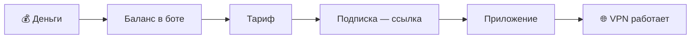

> [!mirror] Резервное зеркало
> Актуальная версия этой страницы — на основной вики: [wiki.zapret.moe/Zapret/premium](https://wiki.zapret.moe/Zapret/premium)

# 🧭 Zapret VPN и Zapret Premium: гайд для новичка
[[home|На главную]]

> [!info] О чём заметка
> Всё, что нужно знать, чтобы начать пользоваться ботом [@zapretvpns_bot](https://t.me/zapretvpns_bot). Сначала — самый короткий путь из четырёх шагов, дальше — подробности для тех, кому интересно. Скриншоты, цены и состав тарифов сверены с ботом 15 октября 2026 года; актуальные цены бот всегда показывает при покупке.

## Если коротко: что скачать и сколько стоит

Нужен VPN, чтобы работали YouTube, Telegram, Instagram и всё остальное? Купите в боте тариф ⚡ **MasterVless — 99 ₽ в месяц** (на пробу — 9 ₽ за день) и поставьте одно приложение:

| У вас | Скачайте | Что взять в боте | Пошагово |
|---|---|---|---|
| 🤖 Android | [ZapretKVN](https://git.zapret.moe/zapretkvn/ZapretKVN-android/releases/latest), файл `…-arm64-v8a.apk` | Xray-подписку | [[premium/android\|инструкция со скриншотами]] |
| 🍏 iPhone, iPad | [Clash Mi](https://clashmi.app/download) | Mihomo-подписку | [[premium/apps#iPhone и iPad\|приложения для iPhone]] |
| 🖥 Windows | [Zapret KVN](https://git.zapret.moe/zapretkvn/zapret-kvn) | Xray-подписку | [[premium/apps#Windows\|приложения для Windows]] |
| 💻 Mac, Linux | [Clash Verge Rev](https://github.com/clash-verge-rev/clash-verge-rev) | Mihomo-подписку | [[premium/apps#macOS и Linux\|приложения для Mac и Linux]] |
| ✈️ Telegram (Android, Windows) | [ZaStoGram](https://t.me/zastogram) — наш Telegram, работает и без VPN | ничего, он бесплатный | [[premium/android#ZaStoGram: Telegram, которому не нужен VPN\|что это]] |

Всё остальное в этой статье — подробности: можно читать, только если что-то не получилось. Другие приложения (v2rayNG, Happ, FlClash, AmneziaVPN и др.) — в заметке [[premium/apps|Приложения для VPN]].

## TL;DR

- **Zapret Premium для VPN покупать не нужно.** В боте одна подписка — тариф. Premium входит в любой тариф, VPN — в тарифы от ⚡ MasterVless.
- **Бот нужен в начале и при продлении.** Купили тариф, добавили подписку в приложение — дальше новые серверы приходят по той же ссылке, когда приложение обновляет подписку (в ZapretKVN — кнопкой «Обновить (без кэша)»). Заново брать ссылку в боте не нужно.
- **Для всего сразу:** Android и Windows — приложение ZapretKVN и Xray-подписка; iPhone и Mac — Clash Mi или Clash Verge Rev и Mihomo-подписка.
- **Для игр** добавьте Hysteria 2-подписку. **Если ничего не подключается** — AWG 3.0 в AmneziaVPN 5.0.0.5 или новее.
- **Для Telegram** — наш клиент [ZaStoGram](https://t.me/zastogram): обходит блокировку сам, даже без VPN.
- **Самый полный тариф** — 👑 Vless ULTRA, но для обычного VPN хватает ⚡ MasterVless.
- **Попробовать — от 9 ₽:** 🔒 Запретик и ⚡ MasterVless можно взять на 1 день за 9 ₽.

> [!tip] Три слова, которые нужны с самого начала
> **Приложение (клиент)** — программа на телефоне или компьютере, которая включает VPN.
>
> **Подписка** — постоянная ссылка, из которой приложение само берёт свежий список серверов.
>
> **Протокол** — способ, которым приложение разговаривает с сервером. Названия вроде VLESS, Hysteria 2 и AWG — это протоколы. Новичку выбирать между ними не нужно: бот сам скажет, что поставить.

---

## Самый короткий путь: четыре шага

Кнопок в боте много, но для старта нужны четыре действия. После них в бот можно не заходить до конца подписки: новые серверы приходят по той же ссылке.

| Шаг | Где | Что нажать | Что получите |
|---|---|---|---|
| 1. Пополнить баланс | бот | «💳 Подписка и баланс» → «💰 Пополнить» | деньги на счёте в боте |
| 2. Купить тариф | бот | там же «🛒 Купить / продлить» → тариф → срок | активную подписку |
| 3. Взять подписку | бот | «🚀 Подключить устройство» → «🌐 Весь интернет (VPN)» → своё устройство | название приложения и кнопку с вашей ссылкой |
| 4. Добавить в приложение | приложение | нажать на адрес в карточке (он скопируется) и вставить его в приложение | VPN по одной постоянной ссылке |

Почему одного раза достаточно: подписка — это ссылка на список ваших серверов, а не сами серверы. Появился новый сервер, сменился адрес старого — приложение узнает об этом при следующем обновлении подписки. Многие приложения обновляют её сами по расписанию; в ZapretKVN для Android это делается вручную: «Серверы» → «Сменить» → «⋮» → «Обновить (без кэша)». После шага 4 вы просто включаете VPN кнопкой в приложении.

Каждый шаг подробно и со скриншотами — ниже: [[#Оплата: баланс, тариф, срок|оплата]], [[#Тарифы|выбор тарифа]], [[#Как подключить VPN за пять минут|подключение]].

---

## Карта бота: что за какой кнопкой

Так выглядит главный экран бота. Сверху — ваша подписка, срок и баланс, ниже — кнопки разделов:

![[bot-main-menu.png|420]]

| Кнопка | Что внутри | Когда нужна |
|---|---|---|
| 🚀 Подключить устройство | мастер: спросит устройство и выдаст подходящую подписку | при первом подключении и на новом устройстве |
| 🌐 VPN, WireGuard и Telegram | все протоколы по отдельности и прокси для Telegram | если хотите выбрать протокол или сервер сами |
| 💳 Подписка и баланс | срок подписки, баланс, покупка, автопродление, история | оплатить и продлить |
| ⭐ Zapret Premium | привязка программы Zapret GUI к подписке | если пользуетесь Zapret GUI |
| 🎁 Рефералы | ваша ссылка-приглашение и бонусы за друзей | по желанию |
| 💝 Донат | добровольная поддержка проекта, на баланс не зачисляется | по желанию |
| ⚙️ Настройки | передача подписки другому человеку | редко |
| 📖 О сервисе | правила, приватность, чем Zapret отличается от VPN | один раз прочитать |
| 💬 Поддержка | обращение в поддержку | если что-то не работает |
| 📖 Гайд для новичков | эта статья | — |

Зелёные кнопки — «🚀 Подключить устройство» и «📖 Гайд для новичков» — два главных шага для новичка.

---

## Что есть что: шесть похожих названий

У проекта несколько продуктов с похожими именами. Вот они в одной таблице:

| Название | Что это | Где работает | Платно? |
|---|---|---|---|
| **Zapret GUI** (программа на базе Zapret 2) | обходит блокировки без VPN | Windows | бесплатно всегда |
| **Zapret Premium** | премиальное оформление этой программы | Windows | входит в любой тариф |
| **Zapret VPN** | настоящий VPN на серверах проекта | телефон, компьютер, роутер | тарифы от MasterVless |
| **ZapretKVN / Zapret KVN** | наше приложение для включения VPN | Android, Windows | бесплатно |
| **ZaStoGram** | наш Telegram со встроенным обходом блокировки | Android, Windows | бесплатно |
| **Бот** [@zapretvpns_bot](https://t.me/zapretvpns_bot) | касса и выдача ссылок | Telegram | — |

### Zapret GUI: обход без VPN

Чтобы понять, чем программа отличается от VPN, нужно знать, как работает блокировка.

Провайдер в России пропускает ваш трафик через систему фильтрации — ТСПУ (Технические Средства Противодействия Угрозам). Она смотрит на первые пакеты каждого соединения, узнаёт по ним сайт и обрывает или замедляет соединение с запрещённым сайтом.

Zapret изменяет эти первые пакеты так, чтобы фильтр не смог их распознать. Сам трафик при этом идёт напрямую к сайту, без чужого сервера. Поэтому программа бесплатна: у проекта нет расходов на серверы для неё.

![[zapret-gui-main.png|760]]

Подробно о программе — в [[Zapret2|заметке о Zapret 2]], скачать её можно по [[Zapret/download|инструкции]].

### Zapret Premium: оформление и поддержка

Premium не меняет работу обхода блокировок. Он открывает фоны «AMOLED — чёрный» и «РКН Тян», новогодние гирлянду и снежинки и плашку Premium. Это способ поблагодарить команду. Премиум-поддержка — отдельная группа поддержки и контакты сотрудников — даётся не с Premium, а с тарифа 🚀 MasterVless Plus. Подробно — в [[premium/premium|заметке о Premium]].

### Zapret VPN: настоящий VPN

VPN работает иначе. Устройство шифрует весь трафик и отправляет его на сервер проекта, а сервер уже ходит в интернет от своего имени. Провайдер видит одно зашифрованное соединение и не знает, какие сайты вы открываете.

У VPN три преимущества перед программой:

- работает на любом устройстве — телефоне, компьютере, роутере, приставке;
- открывает вообще всё, а не только отдельные сайты;
- даёт зарубежный адрес — это нужно сервисам, которые сами не пускают пользователей из России.

### ZapretKVN: приложение для VPN

Наш клиент — [ZapretKVN для Android](https://git.zapret.moe/zapretkvn/ZapretKVN-android) и [Zapret KVN для Windows](https://git.zapret.moe/zapretkvn/zapret-kvn). Подписки бота работают в любом совместимом приложении, но ZapretKVN лучше всего подходит под серверы проекта. Как настроить его на телефоне — в [[premium/android|пошаговой инструкции для Android]].

### ZaStoGram: Telegram без VPN

[ZaStoGram](https://t.me/zastogram) — наш клиент Telegram для Android и Windows. Внутри те же чаты и аккаунты, что в обычном Telegram, но он сам обходит блокировку через официальные веб-шлюзы Telegram и в большинстве сетей работает без VPN. Прокси из бота работают в нём стабильнее всего. Подробнее — в [[premium/android#ZaStoGram: Telegram, которому не нужен VPN|инструкции для Android]].

---

## Оплата: баланс, тариф, срок

### Деньги идут в два шага

Деньги не уходят сразу «за VPN». Сначала они попадают на ваш счёт в боте — баланс, — а уже с него вы покупаете тариф. Так автопродление и повышение тарифа работают без повторной оплаты картой.

Всё, что связано с деньгами, — в разделе «💳 Подписка и баланс»:

![[bot-account.png|420]]

На этом экране видно:

- какой у вас тариф и до какого числа он действует;
- включено ли автопродление;
- что входит в тариф — раскрывающийся блок «✨ Что входит в тариф»;
- сколько денег на балансе.

### Как пополнить баланс

| Что | Как |
|---|---|
| Кнопка | «💰 Пополнить» |
| Сумма за раз | от 10 до 10 000 ₽ |
| Способ | СБП (Система быстрых платежей) — из приложения любого банка |
| Комиссия | обычная оплата — без комиссии, её покрывает проект. Кнопка «💝 … (N ₽ + донат)» добавляет 7,4 % + 2 ₽ — это добровольная поддержка; на баланс в обоих случаях придёт ровно N ₽ |
| Когда зачислится | сама, через несколько секунд после перевода |
| Если не зачислилось за минуту | кнопка «🔄 Проверить оплату» на экране платежа |
| Карта | бот её не хранит и без вашего платежа ничего не списывает; исключение — автопополнения, если вы сами их включите («🔁 Автопополнения») |

Отдельной покупки «сперва Premium, потом VPN» нет: сначала баланс, потом тариф, потом ссылка.

### Выбор тарифа

Нажмите «🛒 Купить / продлить». Бот покажет все тарифы сразу, и у каждого написано, что в него входит и сколько стоят день, месяц и год. Каждый следующий тариф включает всё из предыдущего, поэтому у него перечислено только новое («Всё из тарифа …, плюс:»):

![[bot-shop-levels.png|420]]

Как читать строки у тарифа:

| Строка | Что значит |
|---|---|
| ⭐ Zapret Premium в Zapret GUI | Premium для программы — есть у всех тарифов |
| 🚫 Без VPN | тариф только для программы и Telegram-прокси (Запретик) |
| 🌐 VPN: … | какие протоколы открывает тариф |
| 🌍 Серверов VLESS | сколько серверов будет доступно |
| ✈️ Прокси для Telegram | какие прокси добавляются |
| 💳 день · месяц · год | цены за основные сроки |

### Выбор срока

Нажмите на кнопку нужного тарифа внизу — бот откроет выбор срока:

![[bot-shop-terms.png|420]]

| Значок на кнопке срока | Что значит |
|---|---|
| ✅ | денег на балансе хватает |
| 💸 | нужно пополнить баланс |

После нажатия на срок бот покажет подтверждение покупки. Деньги спишутся только после него.

### Продление, повышение, возврат

| Что нужно | Как сделать |
|---|---|
| Продлевать автоматически | «🔄 Автопродление: ✅ Вкл» (кнопка видна при активной подписке) — спишет с баланса в 00:00 по Москве, когда срок подходит к концу. Держите на балансе сумму на следующий период |
| Выключить автопродление | та же кнопка; оплаченный срок сохранится |
| Выбрать, какую подписку продлевать | «🎯 Что автопродлевать» (если подписок несколько) |
| Перейти на тариф выше | «⬆️ Повысить тариф» — доплата только разницы цен за оставшиеся дни |
| Передать подписку другому | «⚙️ Настройки» |
| Посмотреть все платежи | «📜 История» |
| Тариф закончился | VPN перестанет пускать в интернет. Продлите тариф — и снова обновите подписку в приложении |
| Посмотреть все тарифы с ценами | «📋 Все тарифы» |
| Вернуть ошибочный платёж | «💬 Поддержка» → «🎫 Создать тикет» → «Возврат платежа»: бот спросит сумму, дату и время оплаты и попросит описать ситуацию |

---

## Тарифы

### Что даёт каждый тариф

Каждый следующий тариф включает всё из предыдущего и добавляет своё.

| Тариф | Premium | VPN | Серверов VLESS | Прокси для Telegram | Ещё |
|---|---|---|---|---|---|
| 🔒 Запретик | ✅ | ❌ | — | «Белые списки» | темы Zapret GUI |
| ⚡ MasterVless | ✅ | ✅ все протоколы | 2 | + MTProxy, MTProxy Zig | — |
| 🚀 MasterVless Plus | ✅ | ✅ | 3 | — | премиум-поддержка: отдельная группа и контакты сотрудников |
| 💎 Vless MAX | ✅ | ✅ | 15 | + TeleMT, MTG | WARP+, WARP MAX, Sub VPN (каталог сторонних VPN-подписок) |
| 👑 Vless ULTRA | ✅ | ✅ | 26 | — | самый полный: всё из Vless MAX, больше всего серверов и поддержка проекта |

Число серверов — на 15 октября 2026 года; при покупке бот показывает текущее.

### Цены на все сроки

| Тариф | 1 день | 1 месяц | 3 месяца | 6 месяцев | 1 год | 2 года |
|---|---|---|---|---|---|---|
| 🔒 Запретик | 9 ₽ | 49 ₽ | 147 ₽ | 294 ₽ | 588 ₽ | 1176 ₽ |
| ⚡ MasterVless | 9 ₽ | 99 ₽ | 297 ₽ | 594 ₽ | 1188 ₽ | 2376 ₽ |
| 🚀 MasterVless Plus | 19 ₽ | 149 ₽ | 447 ₽ | 894 ₽ | 1788 ₽ | 3576 ₽ |
| 💎 Vless MAX | 29 ₽ | 199 ₽ | 597 ₽ | 1194 ₽ | 2388 ₽ | 4776 ₽ |
| 👑 Vless ULTRA | 39 ₽ | 249 ₽ | 747 ₽ | 1494 ₽ | 2988 ₽ | 5976 ₽ |

Длинный срок стоит столько же, сколько месяцы по отдельности: скидки за срок нет, зато не нужно помнить о продлении. Месяц в боте — 30 дней, год — 365.

### Какой тариф взять

| Мне нужно | Тариф |
|---|---|
| только Premium для Zapret GUI | 🔒 Запретик |
| только Telegram, и сеть пускает лишь «белые списки» | 🔒 Запретик |
| VPN для телефона и компьютера | ⚡ MasterVless |
| VPN и больше серверов на выбор | 🚀 MasterVless Plus |
| 15 серверов, WARP+ и все виды Telegram-прокси | 💎 Vless MAX |
| всё, что есть в боте: 26 серверов, и поддержать проект | 👑 Vless ULTRA |
| VPN на пробу | ⚡ MasterVless на 1 день — 9 ₽ |

> [!question] Vless ULTRA — самый топовый?
> Да: 👑 Vless ULTRA включает всё из остальных тарифов и больше всего серверов (26 против 15 у Vless MAX). Отличие от MAX — только число серверов; новых протоколов и прокси ULTRA не добавляет. Для обычного VPN на телефоне и компьютере хватает ⚡ MasterVless: протоколы в нём те же, просто серверов меньше.

### Значки на кнопках бота

| Значок | Что значит |
|---|---|
| 🔒 | функция есть, но не входит в ваш тариф; при нажатии бот покажет, какой тариф её открывает и сколько стоит |
| ⚠️ | функция входит в тариф, но сейчас недоступна (сервер временно не отвечает) или устарела, и бот предлагает замену — при нажатии он объяснит |
| ⛔ | временная блокировка; причину бот покажет при нажатии |
| 🚧 | сервер работает, но его вход сейчас не открывается из части российских сетей |

---

## Zapret Premium в Zapret GUI: как привязать

### Зачем нужен код

Подписку вы покупаете в Telegram, а Premium работает в программе на компьютере. Программа не знает, кто вы в Telegram: логина и пароля в Zapret GUI нет.

Код привязки решает это. Программа создаёт короткий одноразовый код, вы пересылаете его боту, и бот запоминает: «этот компьютер принадлежит этому человеку». Дальше программа сама, без кода, проверяет подписку — обычно раз в несколько часов, а кнопка «Обновить статус» проверяет сразу.

Код нужен только для того, чтобы бот узнал, чей это компьютер. Это не ключ и не оплата, и делается он один раз на каждый компьютер.

### Четыре шага

- [ ] Купите в боте любой тариф (хватит 🔒 Запретика).
- [ ] В Zapret GUI откройте в меню слева пункт **«Донат»** — это страница Premium.
- [ ] Нажмите **«Создать код»** — появится код из 8 символов. Он действует 10 минут и срабатывает один раз.
- [ ] Отправьте этот код боту [@zapretvpns_bot](https://t.me/zapretvpns_bot) обычным сообщением и вернитесь в программу: статус обновится сам.

Так выглядит страница Premium сразу после нажатия «Создать код»:

![[zapret-gui-premium-code.png|760]]

### Что будет дальше

| Событие | Что происходит с Premium |
|---|---|
| продлили тариф в боте | продлится сам |
| тариф закончился | выключится; компьютер останется привязанным, бесплатный обход продолжит работать |
| нажали «Сбросить активацию» | компьютер отвяжется, статус «Привязка сброшена»; чтобы вернуть — новый код |
| привязываете шестой компьютер | бот предложит заменить самый старый: лимит — 5 компьютеров |

Все ответы бота, статусы и что делать, если не получилось, — в заметке [[premium/zapret_premium|Как привязать Zapret Premium]].

---

## Как подключить VPN за пять минут

Проще всего не выбирать протокол самому, а нажать в боте зелёную кнопку **«🚀 Подключить устройство»**. Мастер задаст два вопроса и выдаст одно проверенное сочетание приложения и ссылки.

### Вопрос 1: что нужно

«🌐 Весь интернет (VPN)» — VPN для всех сайтов и приложений. «Только Telegram» — прокси прямо в Telegram, без отдельных приложений ([[#Прокси для Telegram без VPN|о нём ниже]]).

![[bot-onboarding-goal.png|420]]

### Вопрос 2: какое устройство

От ответа зависит, какое приложение и какую подписку посоветует бот:

![[bot-onboarding-device.png|420]]

### Ответ: три шага для вашего устройства

Например, для Android бот советует поставить ZapretKVN, взять Xray-подписку и добавить её в приложение. Ниже — запасные варианты, а кнопки под сообщением сразу выдают нужную подписку:

![[bot-onboarding-android.png|420]]

Что советует мастер для каждого устройства:

| Устройство | Приложение | Что взять в боте | Если не подошло | Другие приложения |
|---|---|---|---|---|
| 🤖 Android | [ZapretKVN](https://git.zapret.moe/zapretkvn/ZapretKVN-android) | Xray-подписку | Hysteria 2, Mihomo-подписку | v2rayNG, Happ, FlClash, Clash Mi, AmneziaVPN |
| 🖥 Windows | [Zapret KVN](https://git.zapret.moe/zapretkvn/zapret-kvn) | Xray-подписку | Hysteria 2, Mihomo-подписку | v2rayN, Happ, Clash Verge Rev, AmneziaVPN |
| 🍏 iPhone / iPad | [Clash Mi](https://clashmi.app/download) | Mihomo-подписку | WireGuard | Happ, V2RayTun, AmneziaVPN, WireGuard |
| 💻 macOS / Linux | [Clash Verge Rev](https://github.com/clash-verge-rev/clash-verge-rev) | Mihomo-подписку | Xray-подписку, Hysteria 2 | Happ, V2Box, Throne, AmneziaVPN |
| 📡 Роутер | прошивка с WireGuard | WireGuard-конфиг | AWG 2.0, если роутер поддерживает AmneziaWG; AWG 3.0 — если прошивка знает третье поколение | — |

Какую ссылку читает каждое приложение и куда её вставить — в заметке [[premium/apps|Приложения для VPN]]. На всех устройствах, кроме роутера, при «не подключается» мастер советует AWG 3.0 в AmneziaVPN 5.0.0.5 или новее.

### Карточка подписки и её кнопки

После нажатия «Получить Xray-подписку» бот присылает карточку. Ссылка на скриншоте закрашена: у каждого она своя.

![[bot-xray-subscription.png|420]]

| Кнопка или строка | Что делает |
|---|---|
| адрес `https://…` | нажмите на него — Telegram скопирует ссылку; дальше вставьте её в приложение |
| 📲 Импортировать | страница с кнопкой «🌐 Открыть URL» (долгое нажатие на неё — «Копировать») и QR-кодом |
| 📲 QR-код | код для другого устройства: бот открыт на компьютере, а подписку добавляете в телефон |
| ⚙️ Состав | какие серверы попадут в подписку: только те, где вы уже создали ключи, выбранные или все серверы тарифа |
| ⋯ Ещё → ♻️ Сменить ссылку | новая ссылка вместо утёкшей; старая перестанет работать |
| 🟢 Работает · N ключей | подписка в порядке, в ней сейчас N ключей |

Куда вставлять ссылку, зависит от приложения: в ZapretKVN — «Серверы» → «Ссылка» ([[premium/android|по шагам со скриншотами]]), в других — «Подписки → +», «Add subscription», «Импорт по URL» ([[premium/apps|по приложениям]]). Подробная настройка v2rayN — в [[premium/v2rayn|отдельной заметке]].

> [!warning] Подписка — это ваш пропуск
> По ссылке подписки любой человек сможет пользоваться вашим VPN. Не публикуйте её в чатах и не показывайте на скриншотах.

### После импорта: включить и проверить

- [ ] Откройте приложение и выберите добавленную подписку.
- [ ] Если серверов в списке нет, нажмите «Обновить подписку» (обычно значок круговой стрелки).
- [ ] Нажмите большую кнопку подключения.
- [ ] Android и iPhone при первом включении спросят разрешение на VPN — разрешите.
- [ ] Проверьте: с включённым VPN откройте сайт, который без него не открывается.
- [ ] В ZapretKVN через VPN идут только отмеченные приложения: проверьте список во вкладке «Маршруты» → «Выбрать приложения» ([[premium/android#Шаг 5. Проверьте, какие приложения идут через VPN|подробно]]).

Значок ключа или надпись «VPN» в строке состояния телефона значит, что соединение есть.

### Новый телефон или потерялась ссылка

Подписка живёт в вашем аккаунте бота, а не в приложении. На новом устройстве откройте бота, нажмите «🚀 Подключить устройство» и добавьте ту же подписку в приложение заново. Привязки к железу нет, поэтому старое устройство отключать не обязательно. Если ссылка попала в чужие руки — «⋯ Ещё» → «♻️ Сменить ссылку», а потом обновите её во всех своих приложениях.

### Подписка или отдельный ключ

| | Подписка | Отдельный ключ |
|---|---|---|
| Что это | одна ссылка на все ваши серверы | настройки одного сервера |
| Обновляется сама | да | нет |
| Вид | `https://…` | `vless://…`, файл WireGuard или AWG |
| Когда брать | почти всегда | для роутера или приложения без подписок |

### Если хотите выбрать сервер сами

Раздел «🌐 VPN, WireGuard и Telegram» — каталог всех протоколов с кратким описанием каждого:

![[bot-vpn-menu.png|420]]

В разделе VLESS — список серверов и кнопка «🔗 Подписка»:

![[bot-vless-menu.png|420]]

| Значок | Что значит |
|---|---|
| ✅ | у вас уже есть ключ на этом сервере |
| ➕ | ключ можно создать |
| 🟢 / 🟡 | сервер свободен / за последние сутки упирался в канал или процессор |
| число | сколько людей сейчас на сервере |
| флаг | страна сервера — для игр и звонков берите ближайший |

### Любой клиент, без привязки к устройству

Бот не требует обязательного приложения и не привязывает подписку к железу телефона или компьютера (HWID — аппаратный идентификатор устройства). Подписки работают в v2rayN, Happ, V2RayTun, Clash-клиентах, AmneziaVPN, на роутере. Подробнее — в заметке [[premium/zapret-vpn-bot|Как устроен Zapret VPN-бот]].

| Вопрос | Ответ |
|---|---|
| У меня уже есть AmneziaVPN — нужен ли ZapretKVN? | Нет: AmneziaVPN подходит для AWG 2.0, AWG 3.0 и WireGuard. Для VLESS и Hysteria 2 удобнее ZapretKVN |
| На скольких устройствах можно пользоваться? | Подписку можно добавить на несколько своих устройств; для отдельных ключей есть до 10 «слотов» — это просто номер конфига |
| Есть исключения? | Один файл WARP — на одно устройство: на двух они выбивают друг друга |

---

## Какой VPN выбрать

Протокол — это «язык», на котором приложение разговаривает с сервером. От него зависит скорость и то, насколько легко провайдеру распознать VPN. Все протоколы входят в один тариф, поэтому вопрос не «какой лучше», а «что мне нужно».

### Коротко: что брать

| Мне нужно | Берите |
|---|---|
| VPN для всего, без лишних настроек | Xray-подписку (Android, Windows) или Mihomo-подписку (iPhone, Mac) |
| игры, звонки, мобильный интернет | Hysteria 2 |
| VPN на роутер | WireGuard, если блокируют — AWG 2.0 (или AWG 3.0, если прошивка его знает) |
| ничего не подключается | AWG 3.0 в AmneziaVPN 5.0.0.5 или новее |
| всё сразу одной ссылкой | Mihomo-подписку |
| запасной выход | WARP |

### Все протоколы

| Протокол | Когда брать | Приложение |
|---|---|---|
| 🖥 **VLESS / Xray** | основной VPN; лучше всех прячется от блокировок | ZapretKVN, v2rayN, Happ, V2RayTun |
| ⚡ **Hysteria 2** | игры, звонки, нестабильный интернет | ZapretKVN, v2rayN, Clash-клиенты через Mihomo-подписку |
| 🛡 **WireGuard** | роутер, простая настройка, низкая задержка | WireGuard, встроенный в iOS, Android, Windows, macOS |
| 🗝 **AWG 3.0** | WireGuard с маскировкой, текущее поколение — когда остальное не подключается | AmneziaVPN 5.0.0.5+, Throne 1.2.2+, Mihomo 1.19.30+ |
| 🔐 **AWG 2.0** | прошлое поколение AWG — для старых приложений и роутеров | AmneziaVPN, AmneziaWG, WG Tunnel |
| 🌀 **WARP** | запасной маршрут через сеть Cloudflare | WireGuard, AmneziaVPN |
| 🧭 **Mihomo-подписка** | все ваши протоколы одной ссылкой | Clash Mi, Clash Verge Rev, FlClash |

### Почему VLESS — основной

VLESS с технологией REALITY маскирует VPN-соединение под обращение к обычному популярному сайту. Для системы фильтрации подключение выглядит как заход на чужой HTTPS-сайт. Поэтому его сложнее всего заблокировать. Подробнее — в заметках про [[xray/vless|VLESS]] и [[xray/reality|REALITY]].

### Чем Hysteria 2 отличается от WireGuard

Оба протокола работают поверх UDP — способа передачи, при котором пакеты отправляются без ожидания подтверждения каждого. Это даёт низкую задержку, поэтому оба хороши для игр и звонков.

| | Hysteria 2 | WireGuard |
|---|---|---|
| Основа | QUIC — транспорт, на котором работают современные сайты (HTTP/3) | собственный простой протокол |
| Плохая сеть с потерями | держит скорость, досылает потерянное | скорость падает сильнее |
| Заметность для блокировок | маскируется под HTTP/3 | легко узнать; в России часто блокируют |
| Где удобнее | телефон и компьютер | роутер и встроенные клиенты |

Если сеть блокирует весь UDP, не заработает ни один из двух — тогда берите VLESS: он идёт по TCP, как обычные сайты.

Итого: Hysteria 2 — для игр на нестабильном интернете, WireGuard — для роутера и мест, где его не блокируют, AWG 3.0 — когда WireGuard блокируют.

> [!question] Почему в боте есть AWG 2.0, если вышел AWG 3.1?
> AWG 2.0 — прошлое поколение (сентябрь 2025), оно оставлено для старых приложений и роутеров. Новичку нужен AWG 3.0. А 3.1 — не отдельный протокол, а обновление внутри третьего поколения (август 2026) с тем же форматом пакетов: наши серверы AWG 3.0 уже собраны на коде линии 3.1. Сравнение поколений — в заметке [[premium/apps#AWG 3.0 или AWG 2.0|Приложения для VPN]].

Подробнее — в [[Hysteria/00-overview|обзоре Hysteria 2]], заметках про [[amnezia-2-0/amnezia-2-0|AmneziaWG 2.0]] и [[amnezia-3-0/amnezia-3-0|AmneziaWG 3.0]].

### «Мне и для игр, и для всего остального»

Не нужно выбирать один протокол.

- **Android и Windows:** в ZapretKVN добавьте две подписки — Xray для повседневного интернета и Hysteria 2 для игр. Переключаться можно прямо в приложении.
- **iPhone и Mac:** возьмите Mihomo-подписку. В ней уже есть и VLESS, и Hysteria 2, а клиент сам выберет рабочий сервер.

Задержка в игре зависит и от расстояния до сервера: сначала пробуйте ближайший.

### Российские сайты при включённом VPN

Mihomo-подписка отправляет российские сервисы — банки, Госуслуги, маркетплейсы — напрямую, мимо VPN, а заблокированные в России сайты — через VPN. С ней VPN можно не выключать, чтобы открыть банк. С Xray-подпиской маршрут выбирает само приложение: в v2rayN для этого есть [[premium/v2rayn|шаблон маршрутизации]] «VPnBot: Всё, кроме российских сайтов».

---

## Прокси для Telegram без VPN

Если нужен только Telegram, VPN не обязателен. Проще всего поставить наш клиент [ZaStoGram](https://t.me/zastogram) (Android и Windows): он сам обходит блокировку через официальные веб-шлюзы Telegram, и прокси вообще может не понадобиться. В нём же стабильнее всего работают прокси из бота.

MTProto-прокси (MTProto — собственный протокол Telegram) включается прямо в Telegram: нажимаете ссылку, Telegram спрашивает «Подключить прокси?» — и всё. Остальной интернет идёт как обычно. Выключить прокси можно в настройках Telegram → «Данные и память» → «Прокси».

В боте это раздел «🌐 VPN, WireGuard и Telegram» → «📱 Прокси для Telegram» или ветка «✈️ Только Telegram» в мастере подключения:

![[bot-telegram-menu.png|420]]

| Прокси | Что это | Тариф |
|---|---|---|
| 🏳 Белые списки | общие готовые ссылки для режима «белых списков» у мобильных операторов | любой, от 🔒 Запретика |
| 📡 MTProxy, ⚡ MTProxy Zig | личный прокси только для вас | от ⚡ MasterVless |
| 🔷 TeleMT | личный прокси с маскировкой под обычный HTTPS-сайт | от 💎 Vless MAX |
| 🟢 MTG | общий прокси с маскировкой под HTTPS; бот помечает его ⚠️ и советует перейти на TeleMT или MTProxy | от 💎 Vless MAX |

«Белые списки» — режим, в котором мобильный оператор пропускает только заранее одобренные сервисы. Общие ссылки этого раздела подобраны так, чтобы проходить в таком режиме. Личный прокси выдаётся только вам и поэтому реже попадает под блокировку.

Не публикуйте личную ссылку прокси: ею смогут пользоваться посторонние.

---

## Если VPN не работает

Сначала загляните на [status.zapret.moe](https://status.zapret.moe): там открыто показано состояние каждого сервера и протокола. Возможно, проблема на конкретном сервере, и достаточно переключиться на другой.

| Что происходит | Что сделать |
|---|---|
| VPN перестал подключаться | проверьте срок в «💳 Подписка и баланс»; обновите подписку в приложении |
| не работает один сервер | выберите другой и посмотрите его состояние на status.zapret.moe |
| не работает VLESS | попробуйте Hysteria 2 |
| YouTube работает, а Telegram (или второй Telegram) — нет | в ZapretKVN отметьте приложение во вкладке «Маршруты»; копии в «Двойных приложениях» VPN не видят — [[premium/android#Один Telegram работает, а второй нет\|разбор]] |
| не работает ничего | AWG 3.0 в AmneziaVPN 5.0.0.5+ — кнопка «🆘 Не подключается? AWG 3.0» в мастере |
| Hysteria 2 на Windows нестабильна | временно выключите winws2 — движок обхода Zapret 2 на компьютере: он мешает этому протоколу |
| v2rayN показывает ошибку у всех серверов при проверке | не верьте массовой проверке задержки; включите VPN и откройте сайт |
| российский сайт открывается без VPN | так задумано в Mihomo-подписке — он идёт напрямую |
| ничего не помогло | «💬 Поддержка» или `/support`: напишите устройство, приложение, протокол и сервер |

---

## Источники

- [Бот @zapretvpns_bot](https://t.me/zapretvpns_bot) — тарифы, цены, правила доступа, мастер подключения и все скриншоты сняты в боте 15 октября 2026 года
- [ZapretKVN для Android](https://git.zapret.moe/zapretkvn/ZapretKVN-android) и [Zapret KVN для Windows](https://git.zapret.moe/zapretkvn/zapret-kvn) — наши VPN-клиенты
- [ZaStoGram](https://git.zapret.moe/zastogram/ZaStoGram) — наш Telegram-клиент со встроенным обходом блокировки
- [Clash Mi](https://clashmi.app/download) и [Clash Verge Rev](https://github.com/clash-verge-rev/clash-verge-rev) — клиенты для Mihomo-подписки
- [status.zapret.moe](https://status.zapret.moe) — открытый статус серверов

## 📚 См. также
- [[premium/android|VPN на Android: ZapretKVN по шагам]] — установка, подписка, список приложений, Telegram и ZaStoGram
- [[premium/apps|Приложения для VPN]] — что поставить на каждое устройство, AWG 3.0 против AWG 2.0
- [[premium/premium|Что даёт Zapret Premium]] — темы, оформление и связь с тарифами
- [[premium/zapret_premium|Как привязать Zapret Premium]] — привязка программы к боту по шагам, ответы бота и статусы
- [[premium/zapret-vpn-bot|Как устроен Zapret VPN-бот]] — подписки, профиль Mihomo, свобода выбора клиента, приватность
- [[premium/v2rayn|v2rayN и режим прокси]] — ручная настройка v2rayN, браузера и Spotify
- [[premium/discord|Discord через VPN]] — Discord через прокси-режим клиента, чем прокси отличается от режима VPN (TUN)
- [[Zapret/download|Как скачать Zapret GUI]] — установка бесплатной программы

---

> [!quote] 🤖 Эти статьи открыты — можно обучать на них ИИ
> При желании вы можете натренировать ИИ на наших статьях. Исходное форматирование доступно в Forgejo: [исходник этой заметки](https://git.zapret.moe/zapretdiscordyoutube/todo/src/branch/main/Zapret/premium.md) · [скачать весь репозиторий одним zip-архивом](https://git.zapret.moe/zapretdiscordyoutube/todo/archive/main.zip).
