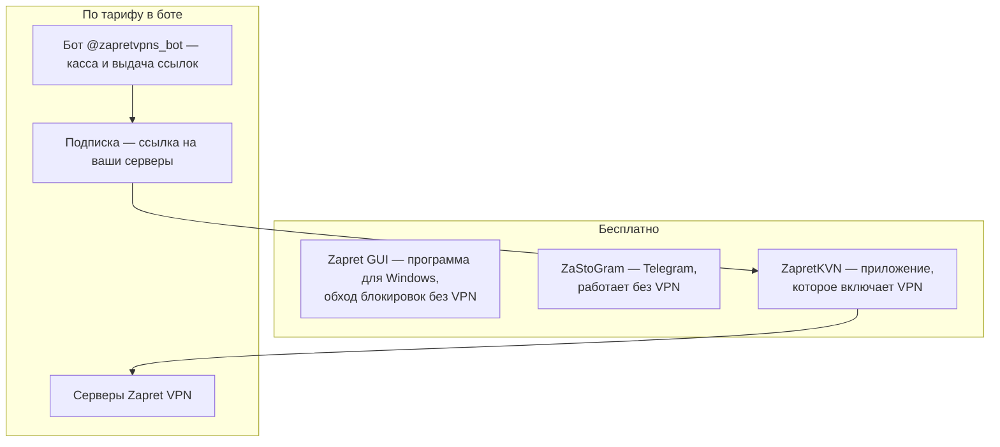

> [!mirror] Резервное зеркало
> Актуальная версия этой страницы — на основной вики: [wiki.zapret.moe/premium/glossary](https://wiki.zapret.moe/premium/glossary)

# 📘 Что есть что: Zapret VPN коротко и словарь

> [!info] О чём заметка
> Встретили в боте или в инструкции непонятное слово — найдите его здесь. Сначала — всё за минуту, дальше — словарь по темам: продукты, бот и оплата, подписки и ключи, протоколы, Telegram, приложения, сетевые слова. Пошаговое подключение — в [[Zapret/premium|гайде для новичка]], все статьи — в [[premium/guides|оглавлении]].

## Всё за минуту

У проекта Zapret две независимые части и один Telegram-клиент. Их легко спутать, поэтому сначала — что из чего состоит.

| Что | Зачем | Где | Цена |
|---|---|---|---|
| **Zapret VPN** | настоящий VPN: открывает весь интернет на любом устройстве | серверы проекта | тариф от ⚡ MasterVless (99 ₽ в месяц), советуем 💎 Vless MAX (199 ₽) |
| **Бот** [@zapretvpns_bot](https://t.me/zapretvpns_bot) | оплатить, получить ссылку-подписку, спросить поддержку | Telegram | бесплатно |
| **ZapretKVN** | приложение, в которое вставляют подписку и включают VPN | Android, Windows | бесплатно |
| **ZaStoGram** | Telegram со встроенным обходом блокировки | Android, Windows | бесплатно |
| **Zapret GUI** | бесплатный обход блокировок YouTube и Discord без VPN | Windows | бесплатно всегда |
| **Zapret Premium** | красивое оформление программы Zapret GUI | Windows | входит в любой тариф |

Главное:

- **Для VPN** нужны три вещи: тариф в боте → подписка (ссылка) → приложение. Код из Zapret GUI и Premium для VPN не нужны.
- **Любой протокол** открывает весь интернет на любой системе — различается только способ связи с сервером.
- **Бот нужен** в начале и при продлении; дальше VPN включается кнопкой в приложении.

---

## Продукты проекта

| Слово | Что значит | Где встретите |
|---|---|---|
| **Zapret, Zapret 2** | проект и его движок обхода блокировок без VPN: изменяет первые пакеты соединения так, чтобы фильтр провайдера их не узнал | названия программ, канал проекта |
| **Zapret GUI** | бесплатная программа для Windows на движке Zapret 2: обход YouTube, Discord и других сайтов без VPN | [[Zapret/download\|как скачать]] |
| **Zapret VPN** | платный VPN на серверах проекта; доступ продаёт бот | весь [[Zapret/premium\|гайд]] |
| **Zapret Premium** | оформление Zapret GUI: фоны, новогодняя тема, плашка Premium; к VPN отношения не имеет | [[premium/premium\|что даёт Premium]] |
| **ZapretKVN / Zapret KVN** | наше VPN-приложение: Android (ZapretKVN) и Windows (Zapret KVN) | [[premium/android\|Android по шагам]] |
| **ZaStoGram** | наш Telegram-клиент для Android и Windows, обходит блокировку Telegram сам | [[premium/android#ZaStoGram: Telegram, которому не нужен VPN\|что это]] |
| **status.zapret.moe** | открытая страница состояния всех серверов и протоколов | [status.zapret.moe](https://status.zapret.moe) |

## Бот и оплата

| Слово | Что значит |
|---|---|
| **Баланс** | ваш счёт в боте: сначала пополняете его по СБП, потом с него покупаете тариф |
| **Тариф** | уровень доступа: 🔒 Запретик (без VPN), ⚡ MasterVless, 🚀 MasterVless Plus, 💎 Vless MAX, 👑 Vless ULTRA. Каждый следующий включает всё из предыдущего — [[Zapret/premium#Тарифы и цены\|цены]] |
| **Срок** | на сколько куплен тариф: от 1 дня до 2 лет; месяц в боте — 30 дней |
| **Автопродление** | бот сам продлит тариф с баланса в 00:00 по Москве, если на балансе хватает денег |
| **Повысить тариф** | перейти на тариф выше с доплатой только разницы за оставшиеся дни |
| **Мастер подключения** | зелёная кнопка «🚀 Подключить устройство»: спросит устройство и выдаст нужную подписку |
| **Тикет** | обращение в поддержку внутри бота: «💬 Поддержка» → «🎫 Создать тикет»; есть с любого тарифа |
| **Поддержка Premium** | группа поддержки и прямые контакты сотрудников — с 🚀 MasterVless Plus |
| **Код привязки** | 8 символов из Zapret GUI, которые один раз связывают компьютер с вашим Telegram ради Premium-оформления. Для VPN не нужен |
| **Значки 🔒 ⚠️ ⛔ 🚧** | закрыто тарифом, временно недоступно, блокировка, вход не открывается из части сетей — [[Zapret/premium#Значки на кнопках бота\|подробно]] |

## Подписка, ключ, конфиг

| Слово | Что значит |
|---|---|
| **Подписка** | постоянная ссылка `https://…` на список ваших серверов. Её вставляют в приложение один раз; новые серверы приходят по той же ссылке |
| **Xray-подписка** | подписка с серверами VLESS — для ZapretKVN, v2rayN, Happ |
| **Hysteria 2-подписка** | подписка с серверами Hysteria 2 — для всего интернета, быстрее на плохой сети и в играх |
| **Mihomo-подписка** | подписка для приложений на движке Mihomo: VLESS и Hysteria 2 в одной ссылке, российские сайты мимо VPN |
| **Ключ** | настройки одного сервера, например ссылка `vless://…` или `hysteria2://…` |
| **Конфиг** | ключ в виде файла `.conf` — для WireGuard, AWG и роутеров |
| **Слот** | номер устройства в боте: у WireGuard, AWG и Mihomo до 10 слотов на протокол, каждому устройству свой |
| **QR-код** | та же ссылка в виде картинки — чтобы добавить подписку на телефон, когда бот открыт на компьютере |
| **Состав подписки** | какие серверы попадут в подписку: только ваши ключи, выбранные или все серверы тарифа |
| **Сменить ссылку** | выдать новую ссылку подписки вместо утёкшей; старая перестанет работать |
| **Обновить подписку** | попросить приложение заново прочитать ссылку и забрать свежий список серверов |
| **HWID** | аппаратный номер устройства. Некоторые сервисы привязывают к нему подписку; наш бот — нет |
| **Сервер** | компьютер проекта в другой стране, через который идёт ваш трафик; флаг на кнопке — его страна |

## Протоколы

**Протокол** — стандарт, по которому приложение разговаривает с сервером. Это стандарт интернета, а не часть Android или iPhone: у интернета нет операционной системы, системы строятся вокруг его стандартов. Поэтому любой протокол работает на любой системе, где есть приложение с его поддержкой, и через любой протокол открывается весь интернет. Различается только способ связи: по TCP или UDP, насколько заметно для фильтра, как держится плохая сеть.

| Слово | Что значит |
|---|---|
| **VLESS** | основной протокол: идёт по TCP, как обычные сайты, и лучше всех прячется от блокировок |
| **REALITY** | маскировка VLESS под заход на обычный популярный сайт |
| **Xray** | программа-ядро, в которой работает VLESS; отсюда название «Xray-подписка» |
| **Hysteria 2** | протокол поверх UDP и QUIC для всего интернета, как VLESS. Приоритета на игры нет: просто на плохой сети, в играх и звонках он быстрее. Не работает, если сеть режет UDP |
| **QUIC** | способ передачи по UDP, на котором работают современные сайты (HTTP/3); Hysteria 2 маскируется под него |
| **WireGuard** | простой быстрый VPN по UDP; встроен во многие системы и роутеры, но в России его часто блокируют |
| **AWG (AmneziaWG)** | WireGuard с маскировкой от фильтров. **AWG 3.0** — текущее поколение, шифрует заголовки пакетов, нужен AmneziaVPN `5.0.0.5` или новее. **AWG 2.0** — прошлое поколение для старых приложений и роутеров. **3.1** — обновление внутри третьего поколения, наши серверы уже на нём — [[premium/apps#AWG 3.0 или AWG 2.0\|сравнение]] |
| **WARP** | запасной выход через сеть Cloudflare, а не через наши серверы; один файл — одно устройство |
| **Mihomo (Clash Meta)** | не протокол, а движок приложений и формат подписки; приложения есть для всех систем — [[Zapret/premium#Mihomo — не только для iPhone\|подробно]] |
| **Sub VPN** | каталог чужих VPN-подписок в тарифах от 💎 Vless MAX; бот их не создаёт и не обслуживает |

### Протоколы рядом

| | VLESS | Hysteria 2 | WireGuard | AWG 3.0 | WARP |
|---|---|---|---|---|---|
| Как передаёт | TCP, как обычные сайты | UDP (QUIC) | UDP | UDP | UDP |
| Маскировка от блокировок | лучшая: выглядит как заход на обычный сайт | под HTTP/3 современных сайтов | нет, легко узнать | сильная: шум и шифрование заголовков | нет |
| Игры и звонки | подходит, но задержка выше, чем у протоколов на UDP | лучше всех | хорошо | хорошо | зависит от сети Cloudflare |
| Плохая сеть с потерями | средне | лучше всех | хуже | хуже | хуже |
| Если сеть режет UDP | работает | не подключится | не подключится | не подключится | не подключится |
| Что взять в боте | Xray-подписку | Hysteria 2-подписку | WireGuard-конфиг | AWG 3.0-конфиг | файл WARP |
| Приложение | ZapretKVN, v2rayN, Happ | ZapretKVN, v2rayN 7.24.9+, Throne | WireGuard, роутер | AmneziaVPN `5.0.0.5`+ | WireGuard, AmneziaVPN |
| Когда брать | по умолчанию | для всего, особенно игры и мобильный интернет | роутер, где WireGuard не блокируют | когда остальное не подключается | запасной выход |

Все пять открывают весь интернет — YouTube, Discord, Telegram и любые сайты — и работают на Android, iPhone, Windows, macOS и Linux, где есть подходящее приложение. Mihomo-подписка — не отдельный протокол: внутри неё VLESS и Hysteria 2.

## Telegram

| Слово | Что значит |
|---|---|
| **MTProto** | собственный протокол Telegram |
| **MTProxy, прокси для Telegram** | прокси, который включается прямо в Telegram: нажимаете ссылку — Telegram предлагает подключить. Остальной интернет идёт как обычно |
| **MTProxy Zig** | тот же личный MTProxy на другом сервере-движке |
| **TeleMT** | личный прокси с маскировкой под обычный HTTPS-сайт; от 💎 Vless MAX |
| **MTG** | общий прокси с маскировкой под HTTPS; бот советует заменить его на TeleMT или MTProxy |
| **Белые списки** | режим мобильного оператора, когда работают только одобренные сервисы; в боте — общие прокси, которые в таком режиме проходят |
| **WSS** | способ подключаться к Telegram через его официальные веб-шлюзы; так ZaStoGram работает без VPN — [[mtproxy/telegram-wss-transport\|подробно]] |

## Приложения

| Слово | Что значит |
|---|---|
| **Приложение, клиент** | программа на устройстве, которая включает VPN по вашей подписке или ключу |
| **ZapretKVN, Zapret KVN** | наши клиенты для Android и Windows — [[premium/android\|Android по шагам]] |
| **v2rayN, v2rayNG, Happ, V2RayTun** | сторонние клиенты для Xray-подписки — [[premium/apps\|приложения по устройствам]] |
| **Clash Mi, FlClash, Clash Verge Rev** | клиенты на движке Mihomo — для Mihomo-подписки |
| **AmneziaVPN, AmneziaWG, WG Tunnel** | клиенты для конфигов AWG и WireGuard |
| **Throne** | сторонний клиент для компьютера: Hysteria 2-подписка и AWG 3.0 |
| **Husi** | сторонний клиент для Android: Hysteria 2-подписка |

## Сетевые слова

| Слово | Что значит |
|---|---|
| **VPN** | зашифрованный туннель от устройства до сервера: провайдер видит одно соединение и не знает, какие сайты вы открываете |
| **Прокси** | посредник для отдельных программ: через него идёт только та программа, которую на него направили, — [[premium/discord\|пример с Discord]] |
| **Режим TUN (режим VPN)** | приложение создаёт в системе виртуальную сетевую карту, и через неё идёт трафик всех программ |
| **Только выбранные / Все кроме** | раздельное туннелирование в ZapretKVN: через VPN идут только отмеченные приложения или все, кроме отмеченных |
| **Российские сайты напрямую** | правило маршрутизации: банки, Госуслуги и маркетплейсы идут мимо VPN, заблокированное — через VPN |
| **TCP** | передача с подтверждением каждого пакета, как у обычных сайтов; на ней работает VLESS |
| **UDP** | передача без ожидания подтверждений — быстрее, нужна играм и звонкам; на ней работают Hysteria 2, WireGuard и AWG |
| **DNS** | «телефонная книга» интернета: превращает имя сайта в адрес. Подмена DNS — один из способов блокировки |
| **ТСПУ, DPI** | система фильтрации у провайдера, которая смотрит на пакеты и блокирует запрещённые сайты |
| **Пинг, задержка** | время ответа сервера; для игр берите ближайший сервер |
| **IP-адрес** | адрес устройства или сервера в интернете; с VPN сайты видят адрес сервера, а не ваш |

## 📚 См. также

- [[Zapret/premium|Гайд для новичка]] — четыре шага от оплаты до работающего VPN.
- [[premium/guides|📚 Все инструкции Zapret VPN]] — оглавление всех статей.
- [[premium/apps|Приложения для VPN]] — что поставить на каждое устройство.
- [[premium/android|VPN на Android по шагам]] — ZapretKVN со скриншотами.

---

> [!quote] 🤖 Эти статьи открыты — можно обучать на них ИИ
> При желании вы можете натренировать ИИ на наших статьях. Исходное форматирование доступно в Forgejo: [исходник этой заметки](https://git.zapret.moe/zapretdiscordyoutube/todo/src/branch/main/premium/glossary.md) · [скачать весь репозиторий одним zip-архивом](https://git.zapret.moe/zapretdiscordyoutube/todo/archive/main.zip).
