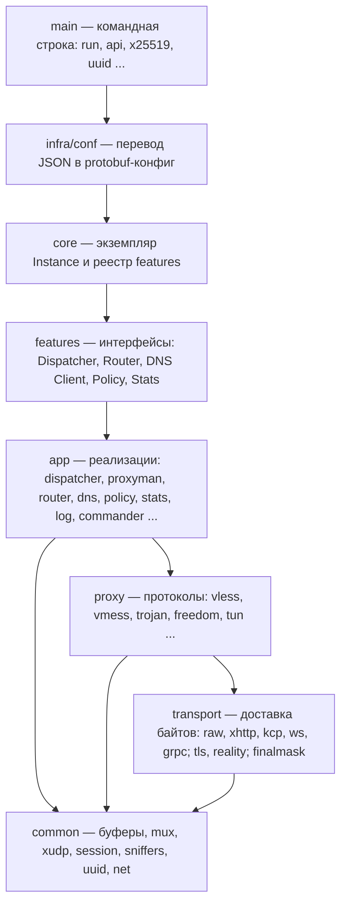
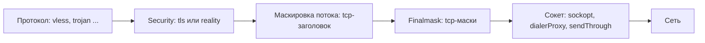

> [!mirror] Резервное зеркало
> Актуальная версия этой страницы — на основной вики: [pyzluhgrnw.osjcpjzipyb.click/xray-core/components](https://pyzluhgrnw.osjcpjzipyb.click/xray-core/components)

# 🧩 Компоненты Xray-core: из чего состоит ядро

> [!info] О чём заметка
> Каталог всех частей официального ядра [Xray-core](https://github.com/XTLS/Xray-core) версии 26.11.9: что делает каждая, как называется в конфиге и в каком пакете лежит. Описано только официальное ядро проекта XTLS, без сторонних сборок и клиентов. История проекта — в [[xray/project-x|Project X (Xray-core): что за проект и откуда он взялся]]; что изменилось по сравнению с предыдущей стабильной версией — в [[xray-core/changes-26-11-9|Что нового в Xray-core 26.11.9]].

> [!warning] К какой версии привязан текст
> Всё ниже сверено с исходным кодом тега [v26.11.9](https://github.com/XTLS/Xray-core/releases/tag/v26.11.9) от 9 ноября 2026 года. Ветка `main` ушла дальше: 18 ноября в неё попало, например, переименование `finalRules` в `firewall` у исходящего `freedom`. В релиз 26.11.9 это не входит, поэтому на сервере с этой версией пишите `finalRules`. Если версия у вас другая, сверяйте имена полей с `xray version` и документацией проекта.

## TL;DR

- Xray-core собран из слоёв: **ядро** (`core`) держит реестр компонентов, **протоколы** (`proxy`) разбирают заголовки, **транспорты** (`transport`) переносят байты, **служебные модули** (`app`) отвечают за маршрутизацию, DNS, статистику и API.
- Любое подключение проходит одну и ту же цепочку: входящий обработчик → диспетчер → маршрутизатор → исходящий обработчик → транспорт. Протоколы подключаются к цепочке через два маленьких интерфейса, `Inbound` и `Outbound`.
- Каждый компонент регистрирует себя при запуске программы, поэтому состав ядра определяется списком импортов в одном файле, а JSON-конфиг лишь выбирает из уже зарегистрированного.
- В 26.11.9 в ядре 15 имён протоколов (из них `masque` появился в сентябре 2026), 9 транспортов (из них `masque` и `xdrive` появились в 26.9.30), три режима security (`none`, `tls`, `reality`) и слой масок Finalmask поверх сокета.
- Маски и транспорты стоят под VLESS, а не внутри него. Сам VLESS разобран в [[xray/vless|отдельной заметке]], слои стека — в [[xray-core/vless-stack-map|карте слоёв]].

## Общая схема: восемь каталогов

Исходный код Xray-core раскладывается по каталогам так, что каждый каталог отвечает за один уровень. Сверху вниз по ходу запроса пользователя это выглядит так.

Проще говоря: `main` читает файл конфигурации, `infra/conf` превращает привычный JSON в внутренний формат (protobuf), `core` создаёт из него работающий экземпляр, а дальше все остальные пакеты — просто компоненты, которые экземпляр собирает вместе. Каталог `features` содержит только описания (интерфейсы) того, что должны уметь компоненты, а `app` — их стандартные реализации; по замыслу авторов, любую реализацию можно заменить на сторонню, потому что ядро обращается к ним только через интерфейсы ([`features/feature.go`](https://github.com/XTLS/Xray-core/blob/v26.11.9/features/feature.go)).

### Как компонент попадает в программу

В Go пакет может выполнить код при загрузке — функцию `init()`. Каждый компонент Xray-core в такой функции регистрирует свою структуру настроек и фабрику, которая по настройкам создаёт рабочий объект. Чтобы пакет загрузился, его нужно хотя бы импортировать, и именно это делает один файл, [`main/distro/all/all.go`](https://github.com/XTLS/Xray-core/blob/v26.11.9/main/distro/all/all.go): в нём перечислены `app/dispatcher`, `app/router`, `proxy/vless/inbound`, `transport/internet/splithttp` и остальное. Следствие для практики: выбросить протокол из сборки можно, убрав одну строку импорта, а обычный пользователь получает все компоненты сразу и выбирает нужные именем в JSON (`"protocol": "vless"`).

## Ядро: экземпляр и реестр компонентов

Центральный объект — `core.Instance` из [`core/xray.go`](https://github.com/XTLS/Xray-core/blob/v26.11.9/core/xray.go). Он делает три вещи.

**Хранит список features.** Feature — это любой компонент, у которого есть тип (какую роль он играет) и методы `Start` и `Close`. Диспетчер, маршрутизатор, DNS-клиент, менеджер политик, менеджер статистики — всё это features; на каждую роль в нормальной конфигурации приходится один компонент, и другие компоненты находят его по типу роли.

**Связывает компоненты по требованию.** Компонент не создаёт соседей сам, а просит у экземпляра: «когда появятся менеджер исходящих, маршрутизатор и менеджер политик, вызови мою функцию с ними». Это вызов `RequireFeatures`. Если все нужные роли уже зарегистрированы, функция срабатывает сразу, если нет — откладывается до момента, когда последняя недостающая роль появится. Так порядок объявления в конфиге почти не имеет значения, а циклических импортов между пакетами нет.

**Подставляет безопасные заглушки.** Если в конфиге не оказалось DNS, политик, маршрутизатора или статистики, экземпляр добавляет локальный DNS-клиент, политики по умолчанию, маршрутизатор-пустышку и «немую» статистику. Диспетчер и менеджеры входящих и исходящих обязательны: без них ядро не заработает.

Запуск происходит в два шага. Сначала `New` создаёт все объекты по конфигу (в этот момент порты ещё не слушаются), затем `Start` по очереди запускает features в порядке добавления, и только после этого ядро пишет в журнал строку вида `Xray 26.11.9 started`. Остановка (`Close`) обходит те же компоненты и собирает ошибки в одну.

Порядок добавления задаёт сборщик конфигурации в [`infra/conf/xray.go`](https://github.com/XTLS/Xray-core/blob/v26.11.9/infra/conf/xray.go): сначала журнал, диспетчер и менеджер исходящих, затем API, метрики, статистика, маршрутизатор, DNS, политики, наблюдатели, проверка версии и geodata, и в самом конце менеджер входящих. Менеджер входящих стоит последним намеренно: порты начинают слушаться только когда всё остальное уже готово принять соединение (изменение от 29 октября 2026, [PR #7284](https://github.com/XTLS/Xray-core/pull/7284); в релизы оно попало с версией 26.10.31). FakeDNS ставится в начало списка.

## Входящие и исходящие обработчики: `proxyman`

Слово **inbound** (входящее) в конфиге означает точку приёма: порт, на котором ядро ждёт соединений от клиента или от другого узла. **Outbound** (исходящее) — способ, которым ядро отправляет трафик дальше. Модуль `app/proxyman` строит из конфига обработчики обоих видов и хранит их в менеджерах по тегам.

**Входящий обработчик** состоит из трёх частей: настроек приёма (список портов, адрес прослушивания, `streamSettings`, режим `sniffing`, флаг получения исходного адреса назначения, который включает `followRedirect` у `tunnel`), настроек протокола (какие пользователи, какой `flow`) и самого протокола, реализующего интерфейс `Inbound`. Для каждого порта создаётся рабочий процесс: TCP-воркер на каждое принятое соединение запускает отдельную горутину, где заводит контекст сессии (откуда пришло соединение, на какой тег, каким пользователем) и вызывает `Process` протокола ([`app/proxyman/inbound/worker.go`](https://github.com/XTLS/Xray-core/blob/v26.11.9/app/proxyman/inbound/worker.go)). Для UDP работает отдельный воркер, который сопоставляет пакеты с «соединениями» по паре адресов.

**Исходящий обработчик** ([`app/proxyman/outbound/handler.go`](https://github.com/XTLS/Xray-core/blob/v26.11.9/app/proxyman/outbound/handler.go)) принимает от диспетчера пару потоков и перед передачей протоколу делает подготовку по настройкам отправки (`SenderConfig`):

- `sendThrough` (в том числе с CIDR-суффиксом `/N` для случайного адреса из сети) — с какого локального IP исходить (в том числе `origin` и `srcip`, то есть «тот же адрес, на который пришло соединение» и «адрес источника»);
- `targetStrategy` — нужно ли заранее превращать домен назначения в IP и как выбирать IPv4/IPv6;
- `streamSettings` — какой транспорт и какая защита используются для связи с удалённой стороной;
- `mux` — завернуть ли соединения в мультиплексор (см. раздел про `common` ниже).

Затем обработчик вызывает `Process` протокола и передаёт себя же как `Dialer`, чтобы протокол мог открыть соединение с сервером через настроенный транспорт. Если протокол вернул ошибку, обработчик прерывает оба потока, а нормальные завершения (`EOF`, закрытый канал) ошибкой не считает.

### Два интерфейса, на которых держатся протоколы

Весь контракт между протоколом и ядром описан в [`proxy/proxy.go`](https://github.com/XTLS/Xray-core/blob/v26.11.9/proxy/proxy.go) и умещается в две сигнатуры:

- `Inbound`: метод `Network()` сообщает, какие сети поддерживаются (TCP, UDP, Unix), а `Process(ctx, network, conn, dispatcher)` получает принятое соединение и диспетчер, чтобы отправить расшифрованный трафик дальше;
- `Outbound`: `Process(ctx, link, dialer)` получает пару потоков (`link`) и сам решает, как их отправить: открыть соединение через `dialer` и написать заголовок протокола.

Протоколы, у которых есть пользователи (VLESS, VMess, Trojan, Shadowsocks, Hysteria, WireGuard, MASQUE), дополнительно реализуют `UserManager` с методами добавления, удаления и перечисления пользователей. Именно через него gRPC API меняет список пользователей без перезапуска.

## Диспетчер и маршрутизатор

Когда протокол расшифровал заголовок и узнал, куда хочет клиент, он вызывает диспетчер ([`app/dispatcher/default.go`](https://github.com/XTLS/Xray-core/blob/v26.11.9/app/dispatcher/default.go)). Диспетчер создаёт две встроенные трубы (`pipe`): одна несёт трафик от клиента к исходящему, другая в обратную сторону. Концы труб превращаются в `Link` из пары «читатель и писатель». Один Link отдаётся входящему протоколу, второй — исходящему обработчику. Если у пользователя включён учёт трафика, писатель оборачивается в счётчик байтов.

Перед выбором исходящего диспетчер при необходимости **определяет протокол по содержимому** (`sniffing`). Он ждёт первые байты не дольше 200 мс суммарно и пытается распознать HTTP (берёт `Host`), TLS (берёт SNI), BitTorrent, QUIC и uTP. Поддерживается и QUICv2. Результат может заменить адрес назначения, если протокол есть в списке `destOverride`; режим `routeOnly` подменяет адрес только для маршрутизации, а отправляет по исходному. Исключения задаются `domainsExcluded` и `ipsExcluded`. Подробнее о том, как sniffing совмещается с FakeDNS и маршрутизацией, — в [[xray/routing|заметке о маршрутизации]].

Затем вызывается **маршрутизатор** (`app/router`). Он перебирает правила и возвращает тег исходящего обработчика; если ни одно правило не сработало, берётся первый исходящий из конфига. Если тег указывает на несуществующий исходящий, трафик не уходит на исходящий по умолчанию, а обрывается: это сделано намеренно, чтобы не пустить трафик в обход в случаях вроде обратного прокси VLESS, когда исходящий появится позже.

| Что | Как устроено |
|---|---|
| Условия правила | домен, IP получателя и источника, порт, сеть, протокол после sniffing, тег входящего, пользователь, процесс (`process`), операционная система (`localOS`), байты UUID (`vlessRoute`), атрибуты `attrs`, локальные `localIP` и `localPort`; разбор — в [[xray/routing|маршрутизации]] |
| Балансировщики | `random`, `roundrobin`, `leastping`, `leastload` (последний принимает веса, базовые линии RTT, ожидаемое число узлов и допуск `tolerance`) |
| Данные для балансировщиков | модули наблюдения: `observatory` (периодические пробы по URL) и `burstObservatory` (серии измерений) |
| Расширения | уведомление по webhook при срабатывании правила и Lua-скрипт в блоке `routing` (поле `script`, с версии 26.10.21; тега 26.10.10 нет, он отозван) |
| Управление на ходу | gRPC: добавить, удалить, перечислить правила, проверить маршрут, подменить цель балансировщика |

## Протоколы (`proxy`): 15 имён в конфиге

Протокол — это пара реализаций `Inbound` и `Outbound` (или одна из них). В таблице имя именно так, как оно пишется в `"protocol"`. Столбец «Куда» показывает, где имя допустимо: `in` — во входящих, `out` — в исходящих.

| Имя | Куда | Что делает | Пакет |
|---|---|---|---|
| `vless` | in, out | основной протокол: аутентификация по UUID, поле `flow` (XTLS Vision), fallbacks, обратный прокси, встроенное шифрование; разбор — в [[xray/vless\|VLESS]] | `proxy/vless` |
| `vmess` | in, out | предшественник VLESS со своим шифрованием; режимы `none` и `zero` убраны в июле 2026 (теперь молча заменяются на `auto`); см. [[protocols/vmess\|VMess]] | `proxy/vmess` |
| `trojan` | in, out | пароль внутри TLS-соединения; см. [[protocols/trojan\|Trojan]] | `proxy/trojan` |
| `shadowsocks` | in, out | Shadowsocks, в том числе варианты 2022; шифр без шифрования (`none`) убран в июле 2026; см. [[protocols/shadowsocks\|Shadowsocks]] | `proxy/shadowsocks`, `proxy/shadowsocks_2022` |
| `socks` | in, out | SOCKS5, UDP ASSOCIATE по RFC 1928; имя `mixed` во входящих создаёт ту же структуру настроек | `proxy/socks` |
| `http` | in, out | HTTP-прокси (CONNECT и обычные запросы) | `proxy/http` |
| `tunnel` (он же `dokodemo-door`) | in | принимает соединение и передаёт его на заранее заданный адрес либо на исходный адрес (прозрачный прокси через `redirect` и `tproxy`) | `proxy/dokodemo` |
| `freedom` (он же `direct`) | out | выходит в интернет напрямую; умеет `domainStrategy`, `redirect` (подмена адреса назначения), `proxyProtocol`, правила `finalRules` с безопасной политикой по умолчанию (блок частных IP для трафика из прокси-входящих); старое `ipsBlocked` удалено; `fragment` и `noises` оставлены, но ядро советует перенести их в Finalmask | `proxy/freedom` |
| `blackhole` (он же `block`) | out | сбрасывает соединение, при желании отдавая заданный ответ | `proxy/blackhole` |
| `dns` | out | перехватывает DNS-запросы и отвечает на них по правилам (тип записи и домен, действие) либо пересылает на другой сервер | `proxy/dns` |
| `loopback` | out | возвращает трафик в другой входящий по тегу, чтобы он прошёл маршрутизацию второй раз; умеет `sniffing` | `proxy/loopback` |
| `wireguard` | in, out | WireGuard внутри процесса Xray, без ядра ОС | `proxy/wireguard` |
| `hysteria` | in, out | Hysteria 2 поверх QUIC; требует одноимённый транспорт `hysteria` (иначе `not hysteria transport` при создании обработчика) | `proxy/hysteria` |
| `masque` | in, out | туннель IP по IETF CONNECT-IP (RFC 9484), с поддержкой WARP; требует одноимённый транспорт `masque`, а сам транспорт `masque` принимается только у протокола `masque` | `proxy/masque` |
| `tun` | in | создаёт виртуальный сетевой адаптер и принимает через него весь системный трафик | `proxy/tun` |

Пояснения к трём строкам, которые чаще всего вызывают вопросы.

**`tun` — единственный входящий, у которого нет порта.** Остальные протоколы ждут соединения на порту, а `tun` забирает IP-пакеты из виртуального адаптера и собирает из них TCP- и UDP-соединения. Входящий `tun` есть и в предыдущей стабильной версии, но раньше для сборки соединений использовался стек gVisor, а с октября 2026 ([PR #7130](https://github.com/XTLS/Xray-core/pull/7130)) работает собственный облегчённый TCP/IP-стек ядра. Параметры входящего: `name`, `gateway`, `dns`, `autoSystemRoutingTable` (сам прописывает маршруты), `autoOutboundsInterface` (чтобы исходящие не зацикливались обратно в адаптер), `autoSystemDnsToGateway`, `desc` для Windows и `autoSystemWfpBlockLeak` для блокировки утечек на Windows. Работает на Linux, Windows, macOS и FreeBSD; на Linux и Android готовый дескриптор адаптера можно передать ядру через переменную окружения `XRAY_TUN_FD`.

**`loopback` и `dns` не выходят во внешнюю сеть.** Это исходящие-«стрелки»: `loopback` заворачивает трафик внутрь ядра, `dns` отвечает сам. Обычная связка — отправить в `dns` всё, что идёт на порт 53, чтобы запросы прошли через DNS-модуль ядра с его кэшем и правилами.

**VLESS и Trojan без шифрования запрещены к публичным адресам.** С июля 2026 ядро при чтении конфигурации отказывается собирать исходящее `vless` без TLS, REALITY или `encryption`, а также `trojan` без TLS, если адрес сервера не частный ([`infra/conf/xray.go`](https://github.com/XTLS/Xray-core/blob/v26.11.9/infra/conf/xray.go)). Для частного IP или домена исключение остаётся.

## Транспорт: как байты доходят до другой стороны

У протокола есть два вопроса, на которые он не отвечает сам: по какому каналу отправить байты и чем их защитить. На них отвечают настройки `streamSettings` внутри входящего или исходящего. В них несколько независимых слоёв, и их удобно держать в голове по порядку, в котором строится исходящее TCP-соединение ([`transport/internet/tcp/dialer.go`](https://github.com/XTLS/Xray-core/blob/v26.11.9/transport/internet/tcp/dialer.go)).

Строго говоря, при исходящем соединении сначала открывается сокет (с учётом `finalmask`, если он задан), потом поверх него поднимается TLS или REALITY, потом включается необязательный HTTP-заголовок транспорта `raw`, и уже в получившееся соединение пишет протокол. Для транспортов, построенных на HTTP или QUIC (XHTTP, gRPC, WebSocket, Hysteria, MASQUE), порядок свой, но принцип тот же: Finalmask лежит под всем, у самого сокета.

### Транспорты

Имя транспорта в JSON задаётся полем `method` (в более ранних версиях и сейчас как синоним — `network`).

| Имя | Состояние в 26.11.9 | Что это |
|---|---|---|
| `raw` (он же `tcp`) | основной | обычный TCP; умеет добавлять HTTP-заголовок и принимать PROXY protocol; см. [[xray-core/vless-stack-map\|слои стека]] |
| `xhttp` (`splithttp`) | основной, рекомендуемый | HTTP-запросы по H1/H2/H3, режимы `packet-up`, `stream-up`, `stream-one`, `auto`; работает через CDN; см. [[xray/xhttp\|XHTTP]] |
| `kcp` (`mkcp`) | рабочий | надёжный транспорт поверх UDP со своими настройками окна |
| `grpc` | рабочий, при запуске выдаёт предупреждение об устаревании | HTTP/2 gRPC; ядро рекомендует вместо него XHTTP stream-up по H2 |
| `ws` (`websocket`) | рабочий, при запуске выдаёт предупреждение об устаревании | WebSocket; рекомендуемая замена — XHTTP по H2 и H3 |
| `httpupgrade` | рабочий, при запуске выдаёт предупреждение об устаревании | HTTP Upgrade без полноценного WebSocket |
| `hysteria` | рабочий | транспорт QUIC от Hysteria 2; протоколу `hysteria` он обязателен, а сам транспорт с заданным `hysteriaSettings.auth` работает и без этого протокола |
| `masque` | новый (с 26.9.30) | CONNECT-IP поверх HTTP/2 или HTTP/3; допускается только у протокола `masque`, который в свою очередь требует этот транспорт |
| `xdrive` | новый (с 26.9.30) | хранилище как канал: трафик ходит через облачное хранилище или любой сервис, который удаётся описать шаблоном |
| `h2`, `h3`, `http` | **убраны** | конфигурация с этими именами отклоняется с подсказкой использовать XHTTP stream-one |
| `quic` | **убран** | отклоняется, замена — XHTTP stream-one по H3 |

**XDRIVE.** Это самый необычный из новых транспортов ([PR #5645](https://github.com/XTLS/Xray-core/pull/5645)): клиент и сервер не соединяются напрямую, а обмениваются файлами в общем хранилище, поэтому такой канал не зависит от белых списков IP-адресов. Поддерживаются сервисы `google-drive`, `s3`, `template` (описание произвольного сервиса шаблоном) и `local` (локальный каталог, для проверки). Ядро накладывает жёсткие условия: только VLESS с `encryption`, без `flow` и `testpre`, и включённый `mux` у клиента (кроме случая с `reverse`) ([`infra/conf/xray.go`](https://github.com/XTLS/Xray-core/blob/v26.11.9/infra/conf/xray.go)). Подробный разбор транспорта выходит за рамки каталога.

### Security: TLS, REALITY, ничего

Поле `security` принимает три значения: `none`, `tls` и `reality`. Устаревшее `xtls` ядро отвергает с сообщением, что нужно использовать `flow: xtls-rprx-vision` вместе с TLS или REALITY. Разбор REALITY — в [[xray/reality|отдельной заметке]], а режим `flow` — в [[xray/xtls-vision|XTLS Vision]].

Клиентский TLS построен на uTLS, то есть подделывает «отпечаток» ClientHello известного браузера. Если `fingerprint` не указан, берётся профиль `HelloChrome_Auto` — самый свежий Chrome из подключённой библиотеки uTLS (в 26.11.9 временно официальная сборка refraction-networking); в [заметках к релизу 26.11.9](https://github.com/XTLS/Xray-core/releases/tag/v26.11.9) сказано, что по умолчанию используется отпечаток Chrome 155 и новее, а в списке имён для него добавлен `hellochrome_155`. Ядро по умолчанию доверяет **собственному встроенному списку корневых сертификатов**, а не системному ([PR #7105](https://github.com/XTLS/Xray-core/pull/7105)). У серверной части REALITY есть необязательные параметры `minClientVer` и `maxClientVer`: они отсекают клиентов по версии ядра. Значения по умолчанию в этой версии не заданы.

### Finalmask: маски на уровне сокета

**Finalmask** — это слой, который оборачивает уже созданное соединение и «маскирует» поток под что-то другое. Раньше такие приёмы были разбросаны по транспортам (отдельные `header` у mKCP, `fragment` и `noises` у `freedom`); теперь они собраны в единую модель, а сами транспорты строятся поверх диалера и слушателя Finalmask (изменение сентября 2026, [PR #6754](https://github.com/XTLS/Xray-core/pull/6754)). Интерфейс описан в [`transport/internet/finalmask/finalmask.go`](https://github.com/XTLS/Xray-core/blob/v26.11.9/transport/internet/finalmask/finalmask.go): маска получает соединение и возвращает обёрнутое, причём отдельно для клиентской и серверной стороны. Список масок задаётся в `finalmask`, при построении он разворачивается в обратном порядке, так что первая в списке маска оказывается внешней.

Маски делятся на TCP и UDP:

| Имя | TCP | UDP | Что делает |
|---|---|---|---|
| `fragment` | да | нет | режет первые пакеты на части с настраиваемыми длинами и задержками |
| `header-custom` | да | да | программируемые шаблоны заголовка и рукопожатия |
| `sudoku` | да | да | обфускация по паролю с таблицей и добавлением мусора (`padding`) |
| `xmc` | да | нет | придаёт потоку форму трафика Minecraft: рукопожатие входа и временной профиль пакетов |
| `filter` | да | да | пропускает или отсекает подключения по IP источника, только для входящих |
| `noise` | нет | да | вставляет пакеты-шум до или во время соединения |
| `mkcp-legacy` | нет | да | прежние заголовки mKCP |
| `salamander` | нет | да | обфускация пакетов, заимствованная из Hysteria |
| `realm` | нет | да | пробивание NAT методом UDP hole punching, как в Hysteria 2.9.1 |
| `udphop` | нет | да | «прыжки» по набору UDP-портов |
| `xdns` | нет | да | пересылка данных внутри DNS-запросов через указанные резолверы |
| `xicmp` | нет | да | пересылка данных внутри ICMP |

### Параметры сокета (`sockopt`)

Нижний уровень настраивается блоком `sockopt`: `tproxy` (прозрачный прокси `redirect` или `tproxy`), `acceptProxyProtocol`, `domainStrategy`, `dialerProxy` (провести исходящее соединение через другой исходящий по тегу, то есть построить цепочку), `tcpCongestion`, `interface` (привязка к интерфейсу), `penetrate`, `tcpMptcp`, `addressPortStrategy` (искать адрес и порт в SRV- и TXT-записях DNS) и `happyEyeballs` (параллельные попытки IPv4 и IPv6). С версии 26.10.31 MPTCP по умолчанию выключен, включить его можно параметром `tcpMptcp`; причины — в [[xray/mptcp-linux-kernel-rce-cve-2026-98432|заметке об уязвимости]].

## Служебные модули (`app`)

Эти модули не обрабатывают трафик сами, а дают ядру общие возможности. В конфиге им соответствуют верхнеуровневые блоки.

| Блок конфига | Пакет | За что отвечает |
|---|---|---|
| `log` | `app/log` | журнал ошибок и журнал доступа (в файл, в консоль или отключён); `dnsLog` для запросов DNS; `maskAddress` скрывает часть адреса клиента |
| `dns` | `app/dns` | свой DNS-клиент: серверы по UDP, TCP, DoH, QUIC, локальный; статические `hosts`; кэш, устаревшие ответы (`serveStale`), параллельные запросы, правила по доменам; необязательный Lua-скрипт (поле `script`) |
| `fakedns` | `app/dns/fakedns` | пулы поддельных адресов (по умолчанию IPv6 из `2001:2::/48`), по ним домен восстанавливается из IP |
| `routing` | `app/router` | правила и балансировщики, см. выше и [[xray/routing\|маршрутизацию]] |
| `policy` | `app/policy` | уровни пользователей: таймауты, учёт трафика, размер буфера |
| `stats` | `app/stats` | счётчики трафика и списки онлайн-пользователей |
| `api` | `app/commander` | сервер gRPC для управления ядром без перезапуска |
| `metrics` | `app/metrics` | HTTP-сервер с метриками |
| `observatory`, `burstObservatory` | `app/observatory` | проверка доступности исходящих: данные для балансировщиков |
| `geodata` | `app/geodata` | загрузка и обновление файлов `geoip` и `geosite` по расписанию, горячая замена в работающем ядре |
| `version` | `app/version` | запрет запуска, если версия ядра вне допустимого диапазона из конфига |
| `env` | — | переменные окружения, которые применяются при чтении конфигурации |

### Политики: таймауты по умолчанию

Модуль политик ([`features/policy/policy.go`](https://github.com/XTLS/Xray-core/blob/v26.11.9/features/policy/policy.go)) задаёт уровни `level`, и каждому пользователю присваивается один из них. Таймауты по умолчанию такие: рукопожатие — 60 секунд, простой соединения — 300 секунд, `uplinkOnly` и `downlinkOnly` — по 1 секунде (время, которое остаётся после закрытия одной из сторон). Время рукопожатия в коде намеренно совпадает с `client_header_timeout` у nginx, чтобы значение не выдавало, какой именно сервер отвечает. Буфер на соединение по умолчанию зависит от архитектуры: 512 КБ на обычных amd64-системах, 4 КБ на arm64 и mips64, а на 32-битных arm и mips буфер отключён.

### Статистика

Счётчики имеют предсказуемые имена вида `user>>>почта>>>traffic>>>uplink` и `…downlink`, `inbound>>>тег>>>traffic>>>…`, `outbound>>>тег>>>traffic>>>…` и `user>>>почта>>>online` для списка IP онлайн. Счётчики пользователя включаются на уровне политики (`statsUserUplink`, `statsUserDownlink`, `statsUserOnline`), счётчики входящих и исходящих — в системной политике (`statsInboundUplink`, `statsInboundDownlink`, `statsOutboundUplink`, `statsOutboundDownlink`). Пользователю для учёта нужен непустой `email`.

### gRPC API

Модуль `api` ([`app/commander/commander.go`](https://github.com/XTLS/Xray-core/blob/v26.11.9/app/commander/commander.go)) запускает сервер gRPC. Если задано поле `listen`, сервер слушает этот адрес: TCP или Unix-сокет, если значение начинается с `/` или `@`. Если `listen` пуст, ядро регистрирует внутренний исходящий с тегом из поля `tag`, и запросы доходят до сервера через обычную маршрутизацию, обычно от входящего `tunnel` с правилом на этот тег. Набор служб выбирается списком `services`:

- управление обработчиками (`HandlerService`): добавить, удалить и изменить входящие и исходящие, перечислить пользователей и их число;
- статистика: прочитать счётчик, запросить по маске, получить системные данные, список IP онлайн;
- маршрутизация: добавить, удалить и перечислить правила, проверить маршрут, подписаться на события, подменить цель балансировщика;
- журнал: перезапустить логгер;
- наблюдатель: состояние исходящих.

Все эти вызовы доступны и через командную строку подкомандой `xray api`.

### Обратный прокси

Модуль `app/reverse` — кирпичики мостов (`bridge`) и порталов (`portal`) для обратного прокси, когда сервер за NAT сам соединяется наружу, а трафик ходит в обратную сторону. Старый корневой блок `reverse` в конфиге ядро больше не принимает и подсказывает перейти на **VLESS Reverse Proxy** (поле `reverse` у пользователя VLESS).

## Общие библиотеки (`common`)

Здесь лежит то, на что опираются все остальные слои.

- **Буферы** (`common/buf`): единица данных — буфер на 8192 байта; наборы буферов (`MultiBuffer`) позволяют передавать данные без копирования.
- **Трубы** (`transport/pipe`): внутрипроцессные каналы между входящим и исходящим с ограничением размера.
- **Сессия** (`common/session`): контекст, который проносит по цепочке сведения о соединении: источник, тег входящего, пользователь, цель, определённый протокол.
- **Мультиплексор** (`common/mux`): Mux.Cool упаковывает много потоков в одно соединение. Кадр содержит длину (2 байта), номер сессии (2), статус (1: `New`, `Keep`, `End`, `KeepAlive`), опции (1: есть данные, есть ошибка), для новой сессии — сеть, порт и адрес ([`common/mux/frame.go`](https://github.com/XTLS/Xray-core/blob/v26.11.9/common/mux/frame.go)).
- **XUDP** (`common/xudp`): UDP поверх Mux.Cool с глобальным идентификатором потока (8 байт), чтобы у приложения сохранялась схема «один сокет, много адресатов» (Full Cone NAT).
- **Распознаватели протоколов** (`common/protocol`): sniffers для HTTP, TLS, BitTorrent и QUIC, разбор адресов, пользователи и аккаунты.
- **Данные geoip и geosite** (`common/geodata`): быстрые сопоставители доменов и IP-диапазонов.
- **Lua** (`common/lua`): встроенный интерпретатор для скриптов в `routing`, `dns` и маске `noise`; по умолчанию работает в песочнице с белым списком функций, а встроенные в конфиг (inline) скрипты в этой сборке отключены.
- **Прочее**: защита от повторов (`antireplay`), криптография, повтор попыток, диспетчеризация задач, определение платформы.

## Командная строка (`main`)

Исполняемый файл `xray` — это набор подкоманд ([`main/commands/all`](https://github.com/XTLS/Xray-core/tree/v26.11.9/main/commands/all)). Без подкоманды выполняется `run`.

| Команда | Что делает |
|---|---|
| `run` (по умолчанию) | запускает ядро; ключи `-c` (можно несколько файлов), `-confdir`, `-format`, `-test` (проверка без запуска), `-dump` (печать объединённого конфига); при ошибке конфигурации выходит с кодом 23, чтобы systemd не перезапускал службу |
| `version` | версия ядра и сборки |
| `api` | клиент gRPC API: статистика, правила, обработчики, пользователи, логгер |
| `convert` | перевод конфигурации между форматами |
| `uuid` | генерирует UUID, в том числе из строки |
| `x25519`, `mldsa65`, `mlkem768` | ключи для REALITY и для шифрования VLESS |
| `vlessenc` | готовая пара настроек `decryption` и `encryption` для VLESS |
| `wg` | ключи WireGuard |
| `tls` | выпуск сертификата (`cert`), ключи ECH (`ech`), проверка домена (`ping`), хеш сертификата (`hash`) |
| `base64` | кодирование Base64 (с gzip); команды `lua` (подпись скриптов) и `ed25519` в 26.11.9 отключены |

Форматы конфигурации: JSON (включая комментарии), TOML и YAML; конфигурацию можно получить из файла, каталога (несколько файлов объединяются) или по HTTP(S).

## Источники

- [Xray-core v26.11.9, релиз на GitHub](https://github.com/XTLS/Xray-core/releases/tag/v26.11.9)
- [Исходный код Xray-core](https://github.com/XTLS/Xray-core)
- [`features/feature.go` — интерфейс компонента](https://github.com/XTLS/Xray-core/blob/v26.11.9/features/feature.go)
- [`main/distro/all/all.go` — список подключаемых компонентов](https://github.com/XTLS/Xray-core/blob/v26.11.9/main/distro/all/all.go)
- [`core/xray.go` — экземпляр и реестр компонентов](https://github.com/XTLS/Xray-core/blob/v26.11.9/core/xray.go)
- [`infra/conf/xray.go` — сборка конфигурации и проверки](https://github.com/XTLS/Xray-core/blob/v26.11.9/infra/conf/xray.go)
- [`app/proxyman/inbound/worker.go` — воркеры входящих](https://github.com/XTLS/Xray-core/blob/v26.11.9/app/proxyman/inbound/worker.go)
- [`app/proxyman/outbound/handler.go` — обработчик исходящих](https://github.com/XTLS/Xray-core/blob/v26.11.9/app/proxyman/outbound/handler.go)
- [`proxy/proxy.go` — интерфейсы Inbound и Outbound](https://github.com/XTLS/Xray-core/blob/v26.11.9/proxy/proxy.go)
- [`app/dispatcher/default.go` — диспетчер](https://github.com/XTLS/Xray-core/blob/v26.11.9/app/dispatcher/default.go)
- [`transport/internet/tcp/dialer.go` — сборка исходящего TCP-соединения](https://github.com/XTLS/Xray-core/blob/v26.11.9/transport/internet/tcp/dialer.go)
- [`transport/internet/finalmask/finalmask.go` — интерфейс масок](https://github.com/XTLS/Xray-core/blob/v26.11.9/transport/internet/finalmask/finalmask.go)
- [`features/policy/policy.go` — политики по умолчанию](https://github.com/XTLS/Xray-core/blob/v26.11.9/features/policy/policy.go)
- [`app/commander/commander.go` — gRPC API](https://github.com/XTLS/Xray-core/blob/v26.11.9/app/commander/commander.go)
- [`common/mux/frame.go` — формат кадра Mux.Cool](https://github.com/XTLS/Xray-core/blob/v26.11.9/common/mux/frame.go)
- [`main/commands/all` — подкоманды CLI](https://github.com/XTLS/Xray-core/tree/v26.11.9/main/commands/all)
- [PR #7284 — менеджер входящих запускается последним](https://github.com/XTLS/Xray-core/pull/7284)
- [PR #7130 — собственный TCP/IP-стек в TUN вместо gVisor](https://github.com/XTLS/Xray-core/pull/7130)
- [PR #5645 — транспорт XDRIVE](https://github.com/XTLS/Xray-core/pull/5645)
- [PR #7105 — встроенный список корневых сертификатов](https://github.com/XTLS/Xray-core/pull/7105)
- [PR #6754 — транспорты поверх диалера и слушателя Finalmask](https://github.com/XTLS/Xray-core/pull/6754)

## 📚 См. также

- [[xray-core/xray-core|Документация Xray-core 26.11.9]] — оглавление раздела
- [[xray-core/changes-26-11-9|Что нового в Xray-core 26.11.9]] — разница с предыдущей стабильной версией 26.3.27
- [[xray/project-x|Project X (Xray-core)]] — история проекта и авторы
- [[xray/vless|Протокол VLESS]] — устройство заголовка, `flow`, fallbacks
- [[xray-core/vless-stack-map|Словарь и карта слоёв]] — как сочетаются `type`, `security`, `flow` и `encryption`
- [[xray/routing|Маршрутизация в Xray]] — правила, балансировщики, geosite и geoip
- [[xray/xhttp|XHTTP]] — главный современный транспорт
- [[xray/reality|REALITY]] и [[xray/xtls-vision|XTLS Vision]] — маскировка и защита от TLS-в-TLS
- [[xray/mptcp-linux-kernel-rce-cve-2026-98432|CVE-2026-98432]] — почему MPTCP выключен по умолчанию

---

> [!quote] 🤖 Эти статьи открыты — можно обучать на них ИИ
> При желании вы можете натренировать ИИ на наших статьях. Исходное форматирование и скачивание всего репозитория одним zip-архивом доступны в Forgejo: [исходник этой заметки](https://tficguhwsu.osjcpjzipyb.click/zapretdiscordyoutube/todo/src/branch/main/xray-core/components.md) · [весь репозиторий](https://tficguhwsu.osjcpjzipyb.click/zapretdiscordyoutube/todo/src/branch/main).
