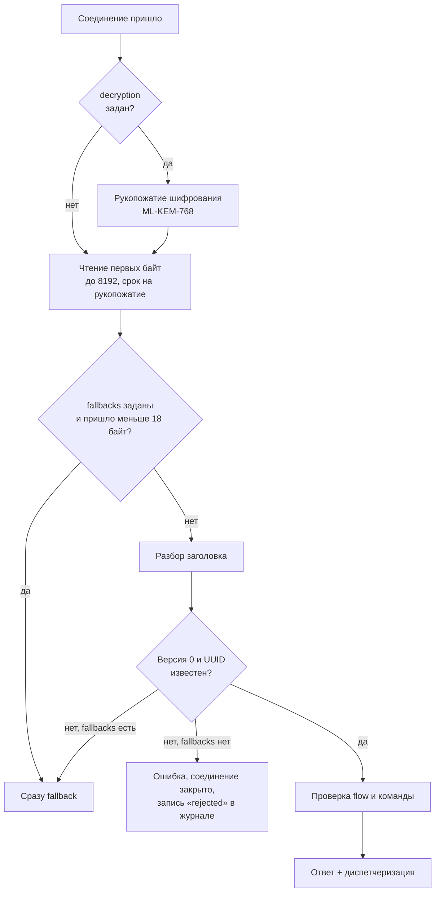

> [!mirror] Резервное зеркало
> Актуальная версия этой страницы — на основной вики: [rsewozdgoy.fuckingspeedtest.com/xray-core/vless-protocol](https://rsewozdgoy.fuckingspeedtest.com/xray-core/vless-protocol)

# 🔷 Протокол VLESS в ядре Xray-core: по исходному коду

> [!info] О чём заметка
> Полный разбор **протокола VLESS**, каким он реализован в официальном ядре [XTLS/Xray-core](https://github.com/XTLS/Xray-core) версии **26.11.9** (тег от 9 ноября 2026). Всё ниже сверено с каталогом `proxy/vless/` и соседними пакетами на этом теге. Заметка самодостаточна: все термины объясняются по ходу, другие статьи для чтения не нужны.

## Коротко

- **VLESS** — прокси-протокол. Клиент открывает соединение к серверу и в первых байтах сообщает, *кому* оно принадлежит (UUID), *что* ему нужно (TCP, UDP, Mux или реверс) и *куда* идти (адрес и порт). Дальше идёт поток данных.
- Заголовок запроса короткий: версия (всегда `0`), UUID (16 байт), длина и тело «аддонов», команда, порт, адрес. Заголовок ответа в этой версии всегда состоит из двух нулевых байт `00 00`.
- **Без `encryption` сам протокол ничего не шифрует.** Шифрование и маскировку дают слой безопасности (`security`: TLS или REALITY) и собственное шифрование VLESS (поле `encryption`). Защиту от активных проб дают fallbacks и REALITY.
- У протокола четыре команды: `0x01` TCP, `0x02` UDP, `0x03` Mux, `0x04` Rvs (обратный прокси).
- Режим потока `flow` один: `xtls-rprx-vision` (у исходящего есть вариант `xtls-rprx-vision-udp443`). Он передаётся в заголовке как protobuf-аддон и включает заполнение случайной длины, а при внутреннем TLS 1.3 — переход к прямому копированию.
- На сервере есть **fallbacks**: соединение, которое не похоже на VLESS, пересылается на обычный сервис. Это защита от активного зондирования.
- Встроенное шифрование **VLESS Encryption** (`mlkem768x25519plus`) оборачивает соединение до разбора заголовка и несовместимо с fallbacks.

## Словарь: что в этой статье чем называется

В конфигурации Xray-core три оси, не полностью независимые друг от друга (REALITY работает только с транспортами `raw`, `xhttp` и `grpc`, а Vision требует, чтобы прямо под VLESS лежало соединение TLS или REALITY — на практике транспорт `raw`, для TLS ещё `kcp` — либо VLESS Encryption), и два поля внутри протокола. Путаница между ними — самая частая причина неверных формулировок.

| Понятие | Где задаётся | Что это |
|---|---|---|
| **Протокол** | `"protocol": "vless"` у входящего или исходящего | Как обработчик читает и пишет заголовок и данные. Эта статья целиком о нём. У ядра 15 протоколов: vless, vmess, trojan, shadowsocks, socks, http, tunnel, freedom, blackhole, dns, loopback, wireguard, hysteria, masque, tun. Ещё четыре имени — синонимы: `dokodemo-door` (= tunnel), `mixed` (= socks), `direct` (= freedom), `block` (= blackhole). Имена `hysteria` и `masque` есть и среди протоколов, и среди транспортов. |
| **Транспорт** | `streamSettings.method` (принимается и имя `network`; если заданы оба, действует `method`) | По какому каналу идут байты: `raw` (он же `tcp`, значение по умолчанию), `xhttp` (синоним `splithttp`), `kcp` (`mkcp`), `grpc`, `ws` (`websocket`), `httpupgrade`, `hysteria`, `masque`, `xdrive`. |
| **Слой безопасности** | `streamSettings.security` | `none`, `tls` или `reality`. Чем защищён канал и как он выглядит снаружи. |
| **flow** | поле пользователя VLESS | Режим потока внутри протокола. Значение `xtls-rprx-vision`; у исходящего есть вариант `xtls-rprx-vision-udp443`. Не слой и не отдельный протокол. |
| **encryption / decryption** | поля VLESS (`encryption` у исходящего, `decryption` у входящего) | Собственное шифрование VLESS. Тоже поле протокола, а не слой. |

Поэтому «REALITY», «TLS» и «Vision» не называют протоколами, а «VLESS» не называют транспортом. «VLESS + REALITY + Vision» читается так: протокол `vless`, `flow` равен `xtls-rprx-vision`, `security` равен `reality`, транспорт по умолчанию `raw`.

Не являются слоями и не относятся к самому протоколу: `mux` (мультиплексор исходящего), `sniffing` (определение домена во входящем), `sockopt`, `finalmask`, `xmux`. `fallbacks` — это поле входящего VLESS, о нём ниже.

## Где это в коде

Пакет `proxy/vless/` на теге v26.11.9:

| Путь | Что внутри |
|---|---|
| `vless.go` | Константы `None = "none"` и `XRV = "xtls-rprx-vision"`, доступ к буферам TLS-соединения для Vision. |
| `account.go`, `account.proto` | Аккаунт пользователя: `id`, `flow`, `encryption`, `xorMode`, `seconds`, `padding`, `reverse`, `testpre`, `testseed`. |
| `validator.go` | Хранилище пользователей на сервере: поиск по UUID и по email. |
| `encoding/` | Кодирование и разбор заголовков запроса и ответа, аддоны, упаковка датаграмм UDP. |
| `inbound/` | Серверная сторона: разбор запроса, fallbacks, реверс. |
| `outbound/` | Клиентская сторона: подключение, заголовок, XUDP, реверс-мост. |
| `encryption/` | VLESS Encryption: клиентское и серверное рукопожатие, шифрованные записи, XOR-режимы. |

Рядом лежат: Vision в `proxy/proxy.go` (читатель, писатель и заполнение), XUDP в `common/xudp/`, кадры Mux в `common/mux/frame.go`, разбор JSON-конфигурации в `infra/conf/vless.go`, проверки допустимых сочетаний в `infra/conf/xray.go`.

## Что делает протокол и чего не делает

Делает:

1. Опознаёт пользователя по UUID в первых байтах.
2. Сообщает серверу команду и назначение.
3. При заданном `flow` передаёт режим потока и добавляет к данным заполнение.
4. Для UDP добавляет перед каждой датаграммой её длину (или переходит на XUDP).

Не делает:

- Не шифрует данные и не скрывает заголовок. Если нет TLS, REALITY или `encryption`, первые байты соединения содержат UUID и адрес назначения открытым текстом. Поэтому клиентская конфигурация проверяется при сборке: исходящее VLESS без слоя безопасности и без `encryption` к любому адресу, кроме частного IP или частного домена, ядро не принимает (раздел про конфигурацию). Сервер такую проверку не делает: входящее VLESS без защиты соединения примет.
- Не проверяет время и не защищает от повтора запроса: в заголовке нет метки времени или одноразового значения. Защита от повтора есть только у механизмов вокруг заголовка: у TLS и REALITY, а у VLESS Encryption — свежий обмен ключами в режиме 1-RTT и отказ `replay detected` для повторного 0-RTT.
- Не мультиплексирует сам. Мультиплексирование делает отдельный компонент `mux`, а VLESS лишь несёт команду `Mux`.

## Формат запроса

Клиент отправляет заголовок запроса, затем данные. Порядок полей (`encoding/encoding.go`, функция `EncodeRequestHeader`):

| Поле | Размер | Значение |
|---|---|---|
| Версия | 1 байт | Всегда `0`. Любое другое значение сервер считает не-VLESS. |
| UUID | 16 байт | Идентификатор пользователя. |
| Длина аддонов | 1 байт | `0`, если аддонов нет. Иначе длина protobuf-блока (до 255 байт). |
| Аддоны | N байт | Protobuf-сообщение `Addons` (поле `Flow`). Пишется только при `flow` `xtls-rprx-vision` или `xtls-rprx-vision-udp443`; суффикс `-udp443` отрезается, в аддоны всегда уходит `xtls-rprx-vision`. |
| Команда | 1 байт | `0x01` TCP, `0x02` UDP, `0x03` Mux, `0x04` Rvs. |
| Порт | 2 байта | Big-endian. Только для TCP и UDP. |
| Тип адреса | 1 байт | `0x01` IPv4, `0x02` домен, `0x03` IPv6. Только для TCP и UDP. |
| Адрес | 4, 1+N или 16 байт | Для домена первым идёт байт длины. |

Для команд `Mux` и `Rvs` порт и адрес **не пишутся**: сервер сам подставляет служебные имена `v1.mux.cool` и `v1.rvs.cool`. Команда вне диапазона 1–4 приводит к ошибке `invalid request address`.

Порядок «порт, потом тип адреса, потом адрес» отличается от SOCKS5, где адрес идёт перед портом: в VLESS порт идёт первым (в коде это `PortThenAddress()`).

Пример. Запрос TCP к `example.com:443` от пользователя с UUID `00112233-4455-6677-8899-aabbccddeeff` без flow:

```text
00                                              версия
00 11 22 33 44 55 66 77 88 99 aa bb cc dd ee ff UUID
00                                              длина аддонов
01                                              команда TCP
01 bb                                           порт 443
02 0b                                           тип «домен», длина 11
65 78 61 6d 70 6c 65 2e 63 6f 6d                «example.com»
```

Итого 34 байта (1+16+1+1+2+1+1+11). Запрос UDP к `1.1.1.1:53` без flow занимает 26 байт: после порта `00 35` идёт тип `01` и четыре байта адреса.

### Аддоны

Аддоны — единственный расширяемый кусок заголовка. Это protobuf-сообщение:

```proto
message Addons {
  string Flow = 1;
  bytes  Seed = 2;
}
```

Клиент пишет аддоны, только когда `flow` равен `xtls-rprx-vision` (или `xtls-rprx-vision-udp443`): тогда длина ненулевая, а тело содержит строку `xtls-rprx-vision`. Во всех остальных случаях пишется один нулевой байт. Поле `Seed` объявлено, но код его не заполняет и не использует; JSON-ключ `seed` у исходящего принимается и игнорируется (присвоение закомментировано в `infra/conf/vless.go`).

Сервер при разборе читает длину, затем тело, разбирает protobuf. Значение `Flow` на этом этапе не проверяется вовсе, проверка идёт позже (см. «Проверка flow на сервере»).

## Формат ответа

Ответ сервера начинается с заголовка: версия (копия версии запроса) и аддоны в том же формате «длина + protobuf». В этой версии сервер всегда отправляет пустые аддоны, то есть заголовок ответа — два нулевых байта `00 00`. Клиент читает версию, сверяет её с отправленной (иначе ошибка `unexpected response version`) и разбирает аддоны. После заголовка идут данные.

Заголовок ответа сервер ставит в буфер и отправляет вместе с первой непустой порцией данных ответа, а не отдельным пакетом.

## Команды

| Код | Имя в коде | Что значит |
|---|---|---|
| `0x01` | `RequestCommandTCP` | Обычное TCP-соединение к `адрес:порт`. Данные идут как есть (или через Vision). |
| `0x02` | `RequestCommandUDP` | Поток UDP-датаграмм к одному `адрес:порт`. Каждой датаграмме предшествует её длина (2 байта). |
| `0x03` | `RequestCommandMux` | Внутри соединения идёт мультиплексор Mux.Cool: много подсоединений в одном. Адрес назначения неявный, `v1.mux.cool`. Используется и для XUDP. (Обычный клиент Mux в логике ядра обращается к `v1.mux.cool` с портом 9527, XUDP — с 666; по проводу порт для этой команды не передаётся.) |
| `0x04` | `RequestCommandRvs` | Обратный прокси. Адрес неявный, `v1.rvs.cool`. |

### Данные TCP

После заголовка идут байты потока в обе стороны без обрамления. Если включён Vision, поток обёрнут в блоки заполнения (раздел про Vision).

### Данные UDP (команда `0x02`)

Каждой датаграмме предшествуют два байта длины (big-endian), затем идёт сама датаграмма. Адрес и порт назначения один на всё соединение и уже указаны в заголовке. Код записи пропускает пустые датаграммы и датаграммы длиннее 8190 байт (длина плюс два служебных байта должна помещаться в буфер 8192 байта). Код чтения принимает длину до 65535 и читает датаграмму кусками по 8192 байта, отдавая их отдельными буферами.

Из-за одного назначения на соединение у этого режима нет возможности отправлять датаграммы на разные адреса и принимать их с разных адресов (Full Cone NAT); это вывод из устройства формата, в коде об этом нет пояснения. Поэтому клиент в ряде случаев не использует команду `0x02`, а переходит на XUDP.

### XUDP: UDP через команду Mux

Клиент подменяет команду UDP на `Mux` с адресом `v1.mux.cool` и портом `666`, когда выполнено одно из условий:

- `flow` равен `xtls-rprx-vision` (или `xtls-rprx-vision-udp443`): тогда XUDP используется для любого UDP, включая порты 53 и 443. Но UDP на порт 443 без суффикса `-udp443` клиент вообще отвергает (`XTLS rejected UDP/443 traffic`), а сервер отвергает команду UDP (`0x02`), если клиент прислал flow `xtls-rprx-vision` (`xtls-rprx-vision doesn't support UDP`); без flow та же команда от пользователя с Vision принимается;
- без flow: включён режим cone (он включён по умолчанию, выключается переменной окружения `xray.cone.disabled` или `XRAY_CONE_DISABLED` со значением ровно `true`) и порт назначения не 53 и не 443. Без flow порты 53 и 443 всегда идут по обычной команде `0x02`, а при выключенном cone по ней идёт весь UDP.

Порт `666` служит внутренним признаком «это XUDP» на стороне клиента: от него зависит, какой писатель и читатель подставить. Сервер определяет XUDP иначе: см. `isMuxAndNotXUDP` в разделе про сервер.

Внутри соединения идут кадры в формате Mux (ниже), но упрощённые: идентификатор сессии нулевой, а в первом кадре после адреса добавляются 8 байт **глобального идентификатора** `GlobalID` (если буфер несёт UDP-адрес). Он нужен, чтобы сервер связал разные соединения одного клиентского UDP-сокета. Это 8-байтовый хеш BLAKE3 от строки вида `udp:IP:порт` (адрес источника); ключ — 32 байта: случайный на процесс или заданный переменной окружения `xray.xudp.basekey` (или `XRAY_XUDP_BASEKEY`; base64 RawURL, ровно 32 байта, иначе ошибка при запуске).

Идентификатор ненулевой, только если cone включён, исходная сеть — UDP и входящее — `tunnel` (внутреннее имя `dokodemo-door`), `socks`, `shadowsocks` или `tun`; иначе пишутся нули. Код записи XUDP пропускает датаграммы длиннее 7526 байт (длина плюс 666 должна помещаться в 8192).

## Кадр Mux (для команды `0x03`)

Когда в заголовке команда `0x03`, дальше по соединению идут кадры Mux.Cool (`common/mux/frame.go`):

```text
2 байта  длина метаданных (не больше 512, иначе ошибка invalid metalen)
2 байта  идентификатор сессии
1 байт   статус: 0x01 New, 0x02 Keep, 0x03 End, 0x04 KeepAlive
1 байт   опции (битовая маска): 0x01 Data, 0x02 Error
— для New, а также для Keep с UDP:
1 байт   сеть: 0x01 TCP, 0x02 UDP
2 байта  порт
N байт   адрес (тип + значение, как в заголовке)
— для New, если данные кадра — одна UDP-датаграмма с адресом (опция Data) и это не реверс-Mux: ещё 8 байт GlobalID (сервер читает их, только если после адреса осталось не меньше 8 байт; нулевой GlobalID игнорируется)
— для New в реверс-Mux (команда Rvs): вместо GlobalID — сеть, порт и адрес источника, затем локального адреса
— если опция Data:
2 байта  длина данных
N байт   данные
```

Одно VLESS-соединение с командой `0x03` несёт много независимых подсоединений (TCP и UDP) под разными идентификаторами сессий. У сервера Mux, пришедшего от пользователя с Vision, подсоединения разрешены только UDP: TCP-подсоединение рвёт всё Mux-соединение.

## Идентификация пользователя

Сервер знает пользователей из списка `settings.clients` (допустимо и имя `users`). У каждого есть:

- `id` — UUID. В JSON допускается и обычная строка: если её длина от 1 до 30 байт (именно байт, не символов: кириллица занимает по 2 байта), она преобразуется в UUID через SHA-1 (UUID версии 5 с нулевым пространством имён); если от 32 до 36 байт — из неё читаются 32 шестнадцатеричные цифры пятью группами 8-4-4-4-12 (перед каждой группой допускается один дефис), остаток строки не проверяется; не-hex символ или нехватка цифр — ошибка, хеширования в этом случае нет. Пустая строка, 31 байт и больше 36 — ошибка. Результат хранится как обычная строка UUID.
- `email` — необязательная метка (для статистики, управления через API). Должен быть уникален (проверяется только непустой), сравнивается без учёта регистра. Пользователя без `email` нельзя удалить через API, и он не входит в список и счётчик пользователей.
- `level` — уровень политики. Но заголовок сервер читает под политикой уровня 0, так как пользователь ещё неизвестен.
- `flow` — режим потока этого пользователя.
- `reverse` — настройки обратного прокси для этого пользователя.
- `testseed` — параметры заполнения Vision (см. ниже).

### Байты 7 и 8 UUID игнорируются при проверке

Хранилище пользователей (`validator.go`) перед поиском **обнуляет** байты с индексами 6 и 7 (седьмой и восьмой) у UUID: и при добавлении пользователя, и при проверке. Поэтому два UUID, различающиеся только этими двумя байтами, для сервера — один и тот же пользователь; если оба попадут в конфигурацию, второй молча заменит первого (ошибка возникает, только если совпадут `email`).

Что клиент положил в эти два байта, сервер записывает в метаданные соединения как `vlessRoute` (число из двух байт). В правилах маршрутизации есть условие `vlessRoute`, поэтому, меняя эти два байта в клиентском UUID, можно направлять разные клиентские профили в разные исходящие, не заводя отдельных пользователей. Это поле заполняет и протокол `hysteria`; остальные протоколы его не заполняют.

### Нет аутентификации сверх UUID

UUID — единственный секрет. Утечка UUID означает полную компрометацию учётной записи. Ограничений по числу одновременных подключений на уровне протокола нет.

## Входящее: что происходит с соединением

Файл `proxy/vless/inbound/inbound.go`, функция `Process`. Входящее принимает TCP и Unix-сокеты (`Network()` возвращает `TCP` и `UNIX`); UDP-сокет напрямую оно не слушает, но может работать поверх транспортов, которые дают поток (например, kcp).



Подробно по шагам:

1. **Шифрование.** Если у входящего задан `decryption`, сначала выполняется рукопожатие VLESS Encryption (ошибка: `ML-KEM-768 handshake failed`). Всё последующее читается уже расшифрованным. Это рукопожатие выполняется до установки срока на чтение заголовка и им не ограничивается.
2. **Срок на рукопожатие.** На чтение заголовка ставится срок `Timeouts.Handshake` политики уровня 0 (по умолчанию 60 секунд; значение выбрано совпадающим с `client_header_timeout` у nginx, чтобы не выдавать сервер). Заголовок читается по политике уровня 0, потому что пользователь ещё неизвестен. После успешного разбора срок снимается.
3. **Первое чтение.** Один вызов чтения в буфер на 8192 байта: берётся то, что вернул этот вызов. Ошибка чтения здесь закрывает соединение без fallback и без записи в журнал доступа (в журнал ошибок на уровне info попадает `connection ends`); байты, пришедшие вместе с ошибкой, теряются. Прочитанные байты остаются в буфере: если понадобится fallback, они будут пересланы туда целиком.
4. **Разбор заголовка.** Версия должна быть `0`, UUID должен быть в хранилище.
   - Неизвестный UUID или неверная версия: при заданных fallbacks соединение уходит на fallback; без fallbacks сервер закрывает соединение с ошибкой `invalid request user id: <uuid>` (для неверной версии — `invalid request version`) и пишет в журнал доступа отказ (`rejected`; запись не делается, если клиент просто закрыл соединение, EOF).
   - Если заголовок пришёл не целиком, сервер дочитывает его и ждёт до окончания срока на рукопожатие (при заданных fallbacks — только если первое чтение дало не меньше 18 байт; иначе сразу fallback).
   - Ошибка *после* опознания UUID (битые аддоны, неизвестная команда, неверный адрес) на fallback уже не ведёт: соединение закрывается, и отказ тоже попадает в журнал.
   - Последующие проверки (запрет forward, flow, реверс) отказ в журнал не пишут.
5. **Запрет forward для реверс-пользователей.** Если у пользователя настроен `reverse`, а команда не `Rvs`, соединение отвергается: `for safety reasons, user ... is not allowed to use forward proxy`.
6. **Проверка flow** (ниже).
7. **Ответ.** Сервер ставит в буфер заголовок ответа (`00 00`) и отправляет его вместе с первым блоком данных.
8. **Диспетчеризация.** Для `TCP` и `UDP` соединение уходит в маршрутизатор с назначением из заголовка. Для `Mux` (`v1.mux.cool`) его перехватывает обёртка диспетчера `mux.Server` и запускает серверную часть Mux; маршрутизируются уже подсоединения. Соединение с командой `Rvs` не диспетчеризуется: оно становится Mux-клиентом обработчика `reverse` (см. «Реверс-прокси»).

### Проверка flow на сервере

| Что прислал клиент | Что у пользователя на сервере | Результат |
|---|---|---|
| `xtls-rprx-vision` | `xtls-rprx-vision` | Принято. Для UDP (`0x02`) отказ: `xtls-rprx-vision doesn't support UDP`. |
| `xtls-rprx-vision` | пусто | Отказ: `account <uuid> is not able to use the flow xtls-rprx-vision`. |
| пусто | `xtls-rprx-vision`, команда TCP или Mux, не XUDP | Отказ: `account <uuid> is rejected since the client flow is empty. Note that the pure TLS proxy has certain TLS in TLS characters.` |
| пусто | пусто; либо у пользователя Vision, а команда UDP (`0x02`), XUDP или Rvs | Принято. |
| любое другое значение | любое | Отказ: `unknown request flow <значение>`. |

Для Vision сервер дополнительно проверяет, что под VLESS лежит именно TLS 1.3 или REALITY *напрямую*. Если нет, отказ с текстом `XTLS only supports TLS and REALITY directly for now.`, а при TLS ниже 1.3 — `failed to use xtls-rprx-vision, found outer tls version ...`. Исключение: при включённом VLESS Encryption сервер не требует внешнего TLS 1.3 (под VLESS лежит соединение VLESS Encryption). Клиент же, если под шифрованием всё-таки лежит TLS, по-прежнему требует от него версии 1.3. Для пользователя с Vision сервер разрешает внутри Mux только UDP (XUDP); TCP-подсоединение в Mux рвёт всё Mux-соединение (`unexpected network`).

Признак XUDP на сервере: команда `Mux`, а в байтах, оставшихся в буфере первого чтения после заголовка, идентификатор сессии равен `0 0` и байт с индексом 6 (седьмой) равен `0x02` (UDP) (`isMuxAndNotXUDP`). Если там меньше 7 байт (в том числе когда заголовок не уместился в первое чтение), соединение считается обычным Mux.

## Fallbacks

**Fallback** — это запасной адрес на сервере, на который пересылается соединение, не похожее на VLESS. Это защита от активного зондирования: проверяющий, подключившись к порту, получает ответ настоящего веб-сервера, а не обрыв.

Поля записи `fallbacks[]` (все необязательные, кроме `dest`):

| Поле | Смысл |
|---|---|
| `name` | Совпадение по SNI (имени сервера, которое прислал клиент в TLS). Пусто — запись по умолчанию, она применяется, если SNI ни с чем не совпал. SNI приводится к нижнему регистру, а `name` из конфигурации — нет, поэтому писать `name` нужно строчными буквами. |
| `alpn` | Совпадение по ALPN (согласованный протокол: `h2`, `http/1.1`). Пусто — запись по умолчанию. ALPN тоже приводится к нижнему регистру, а `alpn` из конфигурации — нет. |
| `path` | Совпадение по пути HTTP-запроса. Пусто — запись по умолчанию. Должен начинаться с `/`. |
| `dest` | Куда пересылать: порт числом (`80`) или строкой (`"80"`) — если `type` не задан, превращается в `localhost:80`; `адрес:порт`; абсолютный путь к Unix-сокету или `@имя` (абстрактный сокет). У строки `@@имя` на Linux и Android первый `@` отбрасывается, а остаток дополняется нулевыми байтами до полной длины адреса сокета (108 байт) — для совместимости с HAProxy. |
| `type` | `tcp`, `unix` или `serve`; если не задан, определяется по `dest`. Заданное вручную значение не проверяется и передаётся Go как имя сети. |
| `xver` | Версия протокола PROXY: `0` (нет), `1` или `2`. Передаёт настоящий адрес клиента. Другое значение — ошибка конфигурации. |

Как выбирается запись:

1. Берутся SNI и ALPN, если прямо под VLESS лежит соединение TLS или REALITY (транспорт `raw`, для TLS ещё `kcp`). В остальных случаях — другой слой безопасности или TLS под транспортом `ws`, `xhttp`, `grpc` и подобными — обе строки пустые.
2. Если групп с разными `name` больше одной или нет группы с пустым `name`, а SNI не совпадает ни с одним `name` точно, выбирается самое длинное `name`, входящее в SNI подстрокой. Не нашлось — берётся группа с пустым `name`; если и её нет, ошибка `failed to find the default "name" config`.
3. Затем по ALPN; нет совпадения — запись с пустым ALPN, иначе ошибка `failed to find the default "alpn" config`.
4. Затем по пути (только если в группе больше одного пути или нет пустого): ядро ищет `/` среди байтов с индексами 4–8 (с пятого по девятый), перед которым стоит пробел, и берёт путь до первого `?` или пробела; поиск ограничен первыми 64 байтами соединения. Если встретился перевод строки, данные кончились или такого `path` нет в записях, используется запись с пустым `path`. Если байт с индексом 4 равен `*` (преамбула HTTP/2 без TLS, `PRI * HTTP/2.0`), путь не разбирается. Нет и пустого `path` — ошибка `failed to find the default "path" config`.

Затем ядро подключается к `dest`: до 5 попыток, после каждой неудачной — пауза 0, 100, 200, 300 и 400 мс (последняя пауза — уже перед возвратом ошибки). При `xver` оно пишет заголовок PROXY и дальше **копирует байты в обе стороны**, начиная с уже прочитанных. При неудаче подключения ошибка `failed to dial to <dest>`.

Ограничения:

- Сервер использует fallback только пока соединение не опознано как VLESS: неизвестный UUID, неверная версия или слишком короткое первое чтение (меньше 18 байт).
- `fallbacks` нельзя сочетать с `decryption`: ошибка сборки `"fallbacks" can not be used together with "decryption"` (даже пустой массив `fallbacks: []` при заданном шифровании).
- `type: serve` ядро ставит, если `dest` равен `serve-ws-none`. В v26.11.9 это значение нигде в ядре не обрабатывается: оно передаётся стандартному `net.Dialer` как имя сети, подключение не удаётся (`failed to dial to serve-ws-none`). Использовать его не нужно.

## Поле flow и режим Vision

`flow` — режим потока. У ядра он один: `xtls-rprx-vision`. Он решает задачу «TLS внутри TLS»: если внутри защищённого соединения идёт ещё одно TLS-рукопожатие пользователя, то по размерам и порядку пакетов это видно. Vision (1) скрывает размеры первых пакетов рукопожатия, добавляя к ним заполнение случайной длины, и (2) если внутри TLS 1.3, после начала шифрованных данных перестаёт шифровать повторно и копирует байты напрямую.

В заголовке запроса клиент отправляет аддон `Flow: "xtls-rprx-vision"`. В конфигурации исходящего допустимо ещё значение `xtls-rprx-vision-udp443`: оно разрешает UDP на порт 443 (без него ядро отказывает: `XTLS rejected UDP/443 traffic`); в заголовок при этом уходит обычное `xtls-rprx-vision`, а разрешённый UDP/443 всё равно идёт как XUDP. Во входящем это значение отвергается ошибкой `VLESS users: "flow" doesn't support "xtls-rprx-vision-udp443" in this version`.

### Блок заполнения

Первое, что клиент записывает после заголовка VLESS, — блок Vision. Формат (`XtlsPadding` в `proxy/proxy.go`):

```text
16 байт  UUID пользователя — только в самом первом блоке каждого направления
1 байт   команда: 0x00 продолжать, 0x01 заполнение закончилось, 0x02 дальше напрямую
2 байта  длина содержимого
2 байта  длина заполнения
N байт   содержимое
M байт   случайное заполнение
```

Длина заполнения зависит от четырёх чисел `testseed` (по умолчанию `[900, 500, 900, 256]`; у клиента берутся из его аккаунта, у сервера — из настроек пользователя). Если содержимое короче `testseed[0]` и используется длинное заполнение, оно равно случайному числу из `[0, testseed[1])` плюс `testseed[2]` минус длина содержимого: при значениях по умолчанию содержимое вместе с заполнением занимает 900–1399 байт (весь блок с пятибайтовым заголовком — 905–1404 байта, с UUID — 921–1420). Длинное заполнение используется, если Vision увидел TLS ClientHello или ServerHello, а также всегда для пустого блока и для блока с первой записью Application Data. Иначе заполнение — случайное число из `[0, testseed[3])`. Верхняя граница: `8192 − 21 − длина содержимого`.

Vision анализирует первые 8 буферов соединения (счётчик `NumberOfPacketToFilter = 8` общий для обоих направлений), чтобы найти ClientHello и ServerHello внутреннего TLS, его версию и набор шифров; как только ServerHello разобран, анализ прекращается досрочно. От результата анализа зависят длинное заполнение, момент окончания заполнения и команда в последнем блоке: если найден ServerHello (TLS 1.2 или 1.3), заполнение продолжается до первой записи Application Data; если ServerHello не найден, заполнение заканчивается командой `0x01`, когда счётчик опускается до 1 или ниже (совместимость со старыми получателями).

Если Vision видел ClientHello или ServerHello, а очередная запись состоит только из целых TLS-записей и один из её буферов начинается с `17 03 03`, заполнение заканчивается: последний блок этой записи получает `0x02`, если внутренний TLS — 1.3 с набором шифров из `0x1301`–`0x1304` (то есть не `TLS_AES_128_CCM_8_SHA256` и не неизвестный), иначе `0x01`. После `0x02` в этом направлении отправитель и получатель перестают обрабатывать внешний TLS, REALITY или AEAD-слой VLESS Encryption и копируют байты внутреннего TLS напрямую (в режиме `random` слой XOR заголовков остаётся); каждое направление переключается отдельно. Отдельно от этого ядро может использовать splice — копирование внутри ядра Linux без участия Xray: только на Linux и Android, только в направлении от сервера к клиенту, когда соединение, в которое идёт запись, после снятия обёрток — обычный TCP-сокет, а у входящего и всех исходящих признак `CanSpliceCopy` равен 1. На сервере splice отключён для команд Mux и Rvs при Vision; на обеих сторонах — для VLESS Encryption в режиме `random` и когда под VLESS Encryption лежит не голый RAW (TCP, Unix-сокет, PROXY protocol), например другой транспорт или TLS/REALITY.

Если за 500 мс у клиента не появилось данных (и источник поддерживает чтение с таймаутом), он отправляет после заголовка пустой блок с длинным заполнением, чтобы заголовок VLESS не уходил коротким отдельным пакетом.

## Исходящее: что делает клиент

Файл `proxy/vless/outbound/outbound.go`, функция `Process`.

1. **Один сервер и один пользователь.** В `settings` либо плоский вид (`address`, `port`, `id`, `flow`, `encryption` и другие поля), либо `vnext` с ровно одним сервером и ровно одним пользователем (ноль — тоже ошибка). Больше одного нельзя: нужно несколько исходящих и балансировщик.
2. **Предсоединения (`testpre`).** Если у пользователя задано `testpre` больше нуля и нет `reverse`, обычное подключение не выполняется: соединение берётся из пула. Пул создаётся при первом запросе: `testpre` фоновых заданий, каждое держит одно готовое соединение; передав его запросу, задание ждёт 200 мс и подключается снова (неудачное подключение повторяется сразу, без паузы). Соединение годно 2 минуты с момента установки, просроченные закрываются при извлечении. Пока пул пуст, запрос ждёт без ограничения по времени: к обычному подключению клиент не переходит. В коде эта возможность помечена как пробная (комментарии `TODO`).
3. **Подключение.** Если `testpre` не используется (равен 0 или задан `reverse`), до 5 попыток; паузы после каждой попытки растут линейно: 0, 200, 400, 600, 800 мс. Не удалось — `failed to find an available destination`.
4. **Шифрование.** Если задан `encryption`, выполняется рукопожатие VLESS Encryption.
5. **Команда.** UDP превращается в `0x02`, затем, если назначение — `v1.mux.cool` или `v1.rvs.cool`, выбирается `Mux` или `Rvs`.
6. **Проверки Vision.** UDP на порт 443 без суффикса `-udp443` отвергается (`XTLS rejected UDP/443 traffic`); для TCP, Mux и Rvs проверяется, что под VLESS напрямую лежит TLS, uTLS, REALITY или VLESS Encryption. Только после этого UDP заменяется на `Mux` с портом 666 (XUDP), если flow — Vision или (включён cone, и порт не 53 и не 443); поэтому для XUDP проверка слоя не делается. Версия TLS 1.3 (для TLS и uTLS, не для REALITY) проверяется уже после отправки заголовка, при любой команде.
7. **Заголовок и первые данные.** Заголовок и первые данные клиента (ожидание до 500 мс) уходят одной записью, чтобы заголовок не выделялся отдельным коротким сообщением. Это работает, только если источник данных поддерживает чтение с таймаутом; иначе заголовок уходит отдельно. Если данных нет, а flow Vision, вставляется пустой блок заполнения.
8. **Обратный путь.** Читает заголовок ответа, затем данные.

## Реверс-прокси (команда `0x04`)

Обратный прокси позволяет серверу в закрытой сети (**мост**, outbound) выставить свои сервисы через сервер с публичным адресом (**портал**, inbound). Здесь описано только то, что делает ядро на стороне VLESS.

- На портале (входящее VLESS): у пользователя в `settings.clients[]` задано `reverse: {tag: "..."}`. Такой пользователь **не может** работать как обычный клиент, только как реверс-мост. Все соединения с командой `Rvs` от него превращаются в мультиплексор Mux, а портал регистрирует исходящий обработчик с этим `tag`; маршрутизатор может направлять трафик в него.
- На мосту (исходящее VLESS): у исходящего задан `reverse: {tag, sniffing}`, и используется плоская форма `settings`, не `vnext`. `tag` становится тегом входящего для трафика, пришедшего через мост, поэтому по нему пишут правила маршрутизации. Ядро само открывает к порталу соединения с командой `Rvs`: проверка идёт каждые 2 секунды (первая через 2 секунды после запуска), и добавляется одно новое соединение, если нет ни одного активного или в среднем приходится 17 и более подсоединений на соединение (целочисленное деление больше 16).
- Если пользователь без `reverse` отправит команду `Rvs`, сервер откажет: `reverse: user … is not allowed to create reverse proxy`.

## VLESS Encryption

**Встроенное шифрование VLESS** оборачивает соединение *до* заголовка VLESS. Имя алгоритма в конфиге — `mlkem768x25519plus`. Обмен эфемерными ключами всегда гибридный (ML-KEM-768, устойчивый к квантовым компьютерам, плюс X25519); аутентификация сервера идёт по одному из двух типов ключа: X25519 (не постквантовая) или ML-KEM-768.

### Строка конфигурации

Клиент (поле `encryption` исходящего):

```text
mlkem768x25519plus.<режим>.<0rtt|1rtt>[.<заполнение>…].<ключ>[.<ключ>…]
```

Сервер (поле `decryption` входящего):

```text
mlkem768x25519plus.<режим>.<время>[.<заполнение>…].<ключ>[.<ключ>…]
```

- `<режим>`: `native`, `xorpub` или `random`.
- `<0rtt|1rtt>` у клиента: `0rtt` — клиент после первого полного рукопожатия сохраняет билет (если сервер выдал ненулевой срок) и до его истечения начинает новые соединения сразу с данными; `1rtt` — полное рукопожатие каждый раз.
- `<время>` на сервере — срок жизни билета в секундах (суффикс `s` необязателен). Одно число N даёт случайный срок от 50 до 99 % от N (`600s` → 300–594 с); диапазон `A-B` — случайный срок в `[A, B)`. `0s` запрещает 0-RTT: сервер не хранит сессии и отвергает попытку ошибкой `0-RTT is not allowed`.
- Ключи — base64url без заполнения. Клиентский ключ — это 32 байта (публичный ключ X25519) или 1184 байта (ключ инкапсуляции ML-KEM-768). Серверный — 32 байта (приватный X25519) или 64 байта (затравка ML-KEM-768). Ключей может быть несколько (цепочка, типы можно смешивать); порядок у клиента и сервера должен совпадать, хотя бы один ключ обязателен.
- Сегменты короче 20 символов между третьим сегментом и ключами задают заполнение: тройки `вероятность-мин-макс`, чередующиеся как «длина в байтах» и «пауза в мс». Первая длина — с вероятностью 100 и значениями не меньше 35; сумма максимумов длин не больше 65553. Без заполнения действуют значения по умолчанию: длины `100-111-1111` и `50-0-3333`, пауза `75-0-111`. Вероятность `p` срабатывает как `p+1` из 100, так что `100` — всегда. Сообщение рукопожатия уходит несколькими отдельными записями в сокет: первая — всё до заполнения плюс первая часть заполнения, следующие — после пауз; каждая сторона задаёт своё заполнение. При 0-RTT заполнение не отправляется.
- `xray vlessenc` выводит две пары `decryption`/`encryption`: с аутентификацией X25519 и с ML-KEM-768 (режим `native`, `600s` у сервера и `0rtt` у клиента).

Пустое значение отвергается: на сервере `VLESS settings: please add/set "decryption":"none" to every settings`, на клиенте `VLESS users: please add/set "encryption":"none" for every user`; прочие неверные строки — `unsupported "decryption"` или `unsupported "encryption"`. Значение `none` допустимо на обеих сторонах.

### Что передаётся и как защищается

Клиент отправляет:

1. 16 случайных байт (IV).
2. По одному «реле» на каждый серверный ключ: эфемерный публичный ключ X25519 или шифртекст ML-KEM-768. Между соседними реле лежат 32 байта: хэш BLAKE3-256 следующего публичного ключа сервера, зашифрованный XOR с потоком AES-CTR, ключ которого выведен из общего секрета предыдущего реле; продолжение этого потока маскирует и первые 32 байта следующего реле. Ключ шифрования выводится из секрета последнего реле.
3. Блок обмена ключами для прямой секретности (`18 + 1184 + 32 + 16` байт): зашифрованная длина, затем ключ инкапсуляции ML-KEM-768 и публичный ключ X25519 под AEAD.
4. Заполнение (тоже под AEAD, с собственной зашифрованной длиной).

Все AEAD-ключи выводятся функцией BLAKE3 `DeriveKey` из общего секрета.

Сервер отвечает: шифртекст ML-KEM-768 и публичный ключ X25519 (`1088 + 32 + 16`), билет (16 байт под AEAD, на проводе 32 байта; в первых двух байтах — срок жизни) и заполнение. Итоговый ключ — склейка (96 байт) двух эфемерных секретов (ML-KEM-768 и X25519) и секрета последнего реле, полученного с помощью долговременного ключа сервера.

Записи после рукопожатия внешне подобны записям TLS: пять байт заголовка `17 03 03 <длина>`, затем AEAD-шифртекст. В записях, которые создаёт отправитель, длина в заголовке не больше 8208 (8192 байта открытого текста и 16 байт тега); получатель принимает 17–16640. Клиент выбирает AES-GCM, если у процессора есть аппаратная поддержка, иначе ChaCha20-Poly1305; сервер начинает с AES-GCM и, если не расшифровывается первый блок длины в клиентском сообщении, переключается на ChaCha20-Poly1305. Одноразовое значение (nonce) — счётчик; при его исчерпании ключ обновляется (на практике не достигается).

Режимы:

- `native` — реле передаются как есть: публичный ключ X25519 или шифртекст ML-KEM-768 в открытом виде (ключ X25519 отличим от случайных байт). Остальная часть рукопожатия, кроме случайного IV и хэшей между реле (они под AES-CTR), в любом режиме зашифрована AEAD.
- `xorpub` — реле дополнительно маскируются XOR с потоком AES-CTR, ключ которого выведен из публичного ключа сервера (то есть из клиентской конфигурации), поэтому реле выглядят случайными.
- `random` — как `xorpub`, плюс после рукопожатия пятибайтовые заголовки записей маскируются XOR с отдельным потоком AES-CTR, ключ которого выведен из итогового ключа соединения (у каждого направления своё начальное значение); тело уже шифртекст AEAD; TLS-подобная структура пропадает. Splice для Vision при этом отключается.

Само рукопожатие не имеет TLS-подобной структуры ни в одном режиме.

**0-RTT.** После первого полного рукопожатия сервер выдаёт билет со случайным сроком (см. выше) и хранит сессию только в памяти: после перезапуска билеты недействительны, а без перезапуска сессии удаляются примерно через максимальный срок плюс 2–3 минуты. Повторная попытка с тем же билетом и тем же секретом реле (повтор записанного клиентского сообщения) отвергается ошибкой `replay detected`. На неизвестный или истёкший билет сервер отвечает 1279–2278 случайными байтами; текущее соединение у клиента завершается ошибкой `new handshake needed`, билет помечается истёкшим, и следующее соединение делает полное рукопожатие.

## Конфигурация

### Входящее

```json
{
  "protocol": "vless",
  "settings": {
    "clients": [
      { "id": "00112233-4455-6677-8899-aabbccddeeff", "email": "user@example", "flow": "xtls-rprx-vision" }
    ],
    "decryption": "none",
    "fallbacks": [ { "dest": 80, "xver": 1 } ]
  }
}
```

| Поле | Что делает |
|---|---|
| `clients` (или `users`) | Список пользователей. Если заданы оба, действует `clients`. |
| `decryption` | **Обязательно.** `none` или строка шифрования. Без поля ядро не соберёт конфигурацию. |
| `flow` (на уровне `settings`) | Значение flow по умолчанию для пользователей, у которых свой `flow` пуст. Допустимо `xtls-rprx-vision` или пусто. |
| `fallbacks` | См. раздел выше. |
| `testseed` | Четыре числа заполнения Vision для пользователей, у которых своих меньше четырёх. Если и здесь меньше четырёх, ядро берёт встроенные 900, 500, 900, 256. Числа после четвёртого игнорируются. Значения не проверяются: ноль во втором или четвёртом числе приводит к аварийному завершению (panic в `crypto/rand.Int`). |

В пользователе: `id`, `email`, `level`, `flow`, `reverse: {tag}` (без `sniffing`), `testseed`. Поле `encryption` в пользователе входящего — ошибка.

### Исходящее

Плоская форма (только она поддерживает `reverse`):

```json
{
  "protocol": "vless",
  "settings": {
    "address": "example.org",
    "port": 443,
    "id": "00112233-4455-6677-8899-aabbccddeeff",
    "flow": "xtls-rprx-vision",
    "encryption": "none"
  },
  "streamSettings": {
    "security": "reality",
    "realitySettings": {
      "serverName": "<имя сайта-прикрытия>",
      "fingerprint": "chrome",
      "password": "<публичный ключ сервера>",
      "shortId": "<короткий идентификатор>"
    }
  }
}
```

Угловые скобки — места для ваших значений. При `"security": "reality"` сборка `streamSettings` требует `realitySettings`: без него она падает раньше всех проверок VLESS с ошибкой `REALITY: Empty "realitySettings".`. Для клиента при сборке обязателен только `password` (публичный ключ сервера, прежнее имя поля — `publicKey`); `serverName`, `shortId` и `fingerprint` (по умолчанию `chrome`) необязательны, но обычно задаются. Без слоя безопасности и без `encryption` ядро не соберёт исходящее к нечастному адресу (см. таблицу ниже).

Поля: `address`, `port`, `id`, `flow` (`xtls-rprx-vision`, `xtls-rprx-vision-udp443` или пусто), `encryption` (обязательно), `level`, `email`, `reverse`, `testpre`, `testseed`. Форма `vnext` описывает один сервер и одного пользователя вложенными списками; плоская форма имеет приоритет, если задан `address`.

### Проверки при сборке конфигурации

| Условие | Результат |
|---|---|
| Исходящее VLESS без слоя безопасности (`security` равен `none` или не задан) и без `encryption`, адрес не частный | Ошибка: `vless without TLS or other encryption is prohibited unless the server address is a private IP or domain`. Частными считаются IP из диапазонов 10/8, 172.16/12, 192.168/16, fc00::/7, loopback и link-local (100.64/10 — нет) и домены на `.lan`, `.localdomain`, `.example`, `.invalid`, `.localhost`, `.test`, `.local`, `.home.arpa`, `.internal`, а также имена без точки из латинских букв, цифр и дефиса, начинающиеся с буквы и не длиннее 63 символов. |
| `vnext` не из одного сервера или одного пользователя | Ошибка. |
| Значение `flow` не из допустимых | `VLESS users: "flow" doesn't support "…" in this version` (для `settings.flow` входящего — `VLESS "settings.flow" doesn't support "…" in this version`). |
| `fallbacks` вместе с `decryption` | Ошибка. |
| Транспорт `xdrive` | Только VLESS. У исходящего — `encryption`, без `flow` и `testpre`, включённый `mux` без отрицательных `concurrency` и `xudpConcurrency` и без `xudpProxyUDP443: "skip"` (при `reverse` не требуется). У входящего — `decryption`, без `flow`, ровно один порт. |

## Что видит наблюдатель

- **Без слоя безопасности и без `encryption`**: UUID и адрес назначения в открытом виде. Ядро запрещает такую клиентскую конфигурацию (кроме частных адресов), но сервер принять такое соединение может.
- **С TLS или REALITY**: заголовок VLESS внутри шифрованного канала.
- **Во Vision**: размеры первых пакетов скрыты заполнением; при внутреннем TLS 1.3 затем идёт переход на прямое копирование.
- **С VLESS Encryption**: после рукопожатия поток выглядит как записи TLS (`native`, `xorpub`) или как случайные байты (`random`).
- **Реакция сервера на активные пробы**: при настроенных fallbacks он отвечает как сервис из `dest`. Без fallbacks и без `decryption` он закрывает соединение при неверной версии или неизвестном UUID, а при малом объёме данных ждёт окончания срока на рукопожатие. С `decryption` проба попадает в рукопожатие VLESS Encryption: сервер ждёт нужное число байт без срока на чтение и закрывает соединение, когда данные не сходятся.

## Справочник сообщений об ошибках

Тексты из кода v26.11.9:

| Сообщение | Причина |
|---|---|
| `invalid request user id: <uuid>` | UUID нет на сервере. |
| `invalid request version` | Первый байт не `0`. |
| `failed to decode request header addons` | Аддоны повреждены или не дочитаны. |
| `invalid request from <адрес>` | Обёртка вокруг ошибок разбора заголовка (кроме обрыва EOF: тогда нет ни обёртки, ни записи в журнале); внутри — причина из строк ниже. |
| `failed to read request version`, `…user id`, `…command` | Соединение оборвалось или истёк срок на рукопожатие, не дойдя до этого поля заголовка (версия и UUID читаются так только без fallbacks). |
| `invalid request address` | Не удалось прочитать адрес назначения или неизвестный код команды. |
| `account <uuid> is not able to use the flow xtls-rprx-vision` | Клиент прислал flow, а у пользователя на сервере его нет. |
| `account <uuid> is rejected since the client flow is empty…` | У пользователя на сервере flow, а клиент без него. |
| `unknown request flow …` | Значение flow не поддерживается. |
| `xtls-rprx-vision doesn't support UDP` | Клиент с Vision отправил команду UDP. |
| `XTLS only supports TLS and REALITY directly for now.` | Под Vision не TLS, не REALITY и не VLESS Encryption. |
| `failed to use xtls-rprx-vision, found outer tls version …` | Внешний TLS не версии 1.3. |
| `failed to find an available destination` | Клиенту не удалось подключиться к серверу за 5 попыток. |
| `ML-KEM-768 handshake failed` | Рукопожатие VLESS Encryption не удалось. |
| `for safety reasons, user … is not allowed to use forward proxy` | Реверс-пользователь пробует работать как обычный клиент. |
| `unexpected response version…` | Первый байт ответа не равен версии запроса; скорее всего, на той стороне не VLESS-сервер. |

## Откуда брать

Все ссылки зафиксированы на теге v26.11.9:

- [`proxy/vless/encoding/encoding.go`](https://github.com/XTLS/Xray-core/blob/v26.11.9/proxy/vless/encoding/encoding.go): заголовки запроса и ответа.
- [`proxy/vless/encoding/addons.go`](https://github.com/XTLS/Xray-core/blob/v26.11.9/proxy/vless/encoding/addons.go): аддоны, пакеты UDP.
- [`proxy/vless/inbound/inbound.go`](https://github.com/XTLS/Xray-core/blob/v26.11.9/proxy/vless/inbound/inbound.go): серверная часть и fallbacks.
- [`proxy/vless/outbound/outbound.go`](https://github.com/XTLS/Xray-core/blob/v26.11.9/proxy/vless/outbound/outbound.go): клиентская часть.
- [`proxy/vless/encryption/`](https://github.com/XTLS/Xray-core/tree/v26.11.9/proxy/vless/encryption): шифрование.
- [`proxy/proxy.go`](https://github.com/XTLS/Xray-core/blob/v26.11.9/proxy/proxy.go): Vision.
- [`common/mux/frame.go`](https://github.com/XTLS/Xray-core/blob/v26.11.9/common/mux/frame.go) и [`common/xudp/xudp.go`](https://github.com/XTLS/Xray-core/blob/v26.11.9/common/xudp/xudp.go): кадры Mux и XUDP.
- [`infra/conf/vless.go`](https://github.com/XTLS/Xray-core/blob/v26.11.9/infra/conf/vless.go): разбор конфигурации.

## 📚 См. также

Эти заметки не нужны для понимания статьи, они лишь расширяют отдельные темы.

- [[xray-core/vless-stack-map|Словарь и карта слоёв]] — как сочетаются протокол, транспорт, security, `flow` и `encryption`
- [[xray/vless|Протокол VLESS]] — обзор для тех, кто начинает с нуля, и ссылки `vless://`
- [[xray/xtls-vision|XTLS Vision]] — подробнее о заполнении и переходе к прямому копированию
- [[xray/vless-encryption|VLESS Encryption]] — история и практика встроенного шифрования
- [[xray-core/components|Компоненты Xray-core]] — где в ядре живёт каждая возможность
- [[xray-core/changes-26-11-9|Что нового в Xray-core 26.11.9]] — что изменилось по сравнению со стабильной 26.3.27

---

> [!quote] 🤖 Эти статьи открыты — можно обучать на них ИИ
> При желании вы можете натренировать ИИ на наших статьях. Исходное форматирование и скачивание всего репозитория одним zip-архивом доступны в Forgejo: [исходник этой заметки](https://vaavlvfila.fuckingspeedtest.com/zapretdiscordyoutube/todo/src/branch/main/xray-core/vless-protocol.md) · [весь репозиторий](https://vaavlvfila.fuckingspeedtest.com/zapretdiscordyoutube/todo/src/branch/main).
