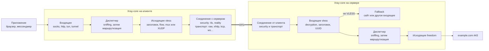
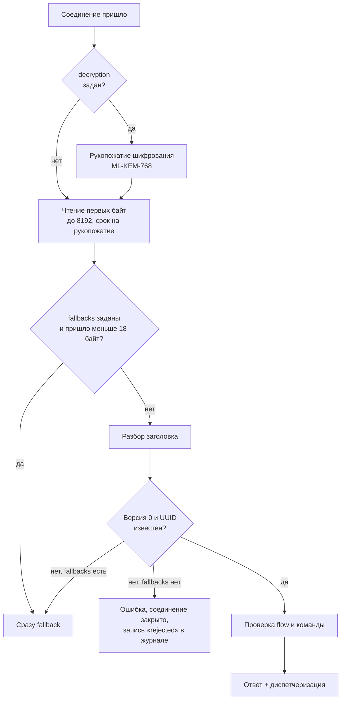
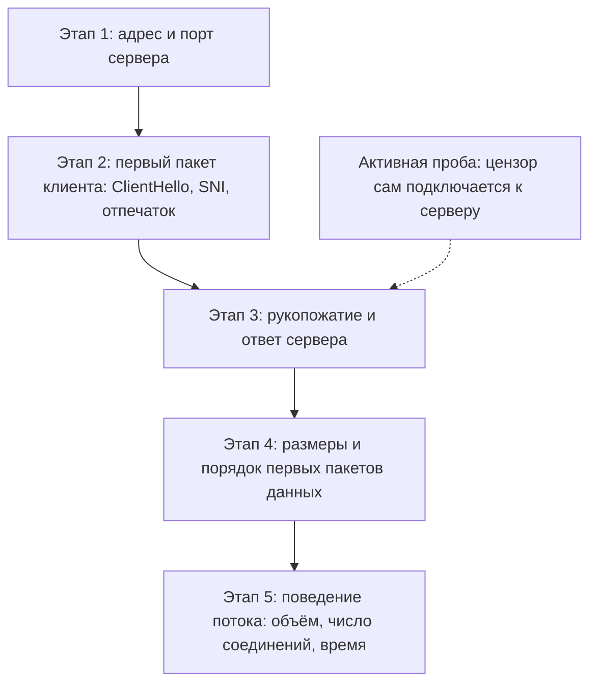

> [!mirror] Резервное зеркало
> Актуальная версия этой страницы — на основной вики: [rsewozdgoy.fuckingspeedtest.com/xray-core/vless-protocol](https://rsewozdgoy.fuckingspeedtest.com/xray-core/vless-protocol)

# 🔷 Протокол VLESS в ядре Xray-core: по исходному коду

![[vless-protocol-cover.jpg]]

> [!info] О чём заметка
> Полный разбор **протокола VLESS**, каким он реализован в официальном ядре [XTLS/Xray-core](https://github.com/XTLS/Xray-core) версии **26.11.9** (тег от 9 ноября 2026). Всё ниже сверено с каталогом `proxy/vless/` и соседними пакетами на этом теге. Заметка самодостаточна: все термины объясняются по ходу, другие статьи для чтения не нужны.

## Коротко

- **VLESS** — прокси-протокол. Клиент открывает соединение к серверу и в первых байтах сообщает, *кому* оно принадлежит (UUID), *что* ему нужно (TCP, UDP, Mux или реверс) и *куда* идти (адрес и порт). Дальше идёт поток данных.
- Заголовок запроса короткий: версия (всегда `0`), UUID (16 байт), длина и тело «аддонов», команда, порт, адрес. Заголовок ответа в этой версии всегда состоит из двух нулевых байт `00 00`.
- **Без `encryption` сам протокол ничего не шифрует.** Шифрование и маскировку дают слой безопасности (`security`: TLS или REALITY) и собственное шифрование VLESS (поле `encryption`). Защиту от активных проб дают fallbacks и REALITY.
- У протокола четыре команды: `0x01` TCP, `0x02` UDP, `0x03` Mux, `0x04` Rvs (обратный прокси).
- Режим потока `flow` один: `xtls-rprx-vision` (у исходящего есть вариант `xtls-rprx-vision-udp443`). Он передаётся в заголовке как protobuf-аддон и включает заполнение случайной длины, а при внутреннем TLS 1.3 — переход к прямому копированию.
- На сервере есть **fallbacks**: соединение, которое не похоже на VLESS, пересылается на обычный сервис. Это защита от активного зондирования.
- Встроенное шифрование **VLESS Encryption** (`mlkem768x25519plus`) оборачивает соединение до разбора заголовка и несовместимо с fallbacks.
- **Зачем он нужен:** VLESS убрал у VMess зависимость от часов и собственное шифрование, лишнее поверх TLS; шифрование и маскировку отдали слою безопасности (раздел «Зачем нужен VLESS»).
- **Блокировка по DPI.** Для VLESS с REALITY не нашлось опубликованных измерений, как его опознают GFW и ТСПУ; измерены соседние вещи: «шифрование целиком» (Wu и соавторы, 2023), TLS внутри TLS (Xue и соавторы, 2024), время двойного обхода, блокировки по адресам, объёму и числу соединений. Раздел «Как VLESS блокируют по DPI и как его находят» разделяет код, исследования, сообщения пользователей и выводы.
- **Где используется:** в ядрах Xray-core, sing-box и mihomo, в клиентах и панелях управления; у v2fly/v2ray-core v5 код есть, но объявлен устаревшим (раздел «Где VLESS используется»).

## Зачем нужен VLESS

Любому прокси-протоколу приходится решать три задачи: опознать пользователя, понять, что ему нужно, и узнать, куда направить соединение. Базовая часть VLESS решает только их. Шифрование, маскировку и защиту от зондирования исходный дизайн оставляет слою безопасности (TLS или REALITY) и отдельным механизмам (`flow`, fallbacks, а с 2025 года ещё и встроенному VLESS Encryption). Значение терминов, которые встретятся ниже, собрано в разделе «Словарь» следом за этим.

### Откуда он взялся

- Автор протокола — разработчик под псевдонимом RPRX. Первый анонс «[New Protocol] VLESS ALPHA» он опубликовал 19 июня 2020 года в репозитории v2ray/v2ray-core ([issue #2583](https://github.com/v2ray/v2ray-core/issues/2583)), подробное описание «VLESS BETA» — 16 июля 2020 года ([issue #2636](https://github.com/v2ray/v2ray-core/issues/2636)).
- Первый релиз v2fly/v2ray-core с VLESS — [v4.27.0](https://github.com/v2fly/v2ray-core/releases/tag/v4.27.0) от 6 августа 2020 года. В Xray-core VLESS есть с самого первого релиза v1.0.0 (тег от 25 ноября 2020 года): каталог `proxy/vless/` присутствует уже в нём (проверено по git-истории репозитория).

### Какие недостатки VMess он убирает

VMess — предшественник VLESS в экосистеме V2Ray. Ниже перечислено то, что сам автор называет причинами создания VLESS в двух упомянутых issues. Это слова автора, а не независимые измерения: сравнительных замеров производительности в статье нет. В тех issues под VMess автор имеет в виду прежний VMess без режима AEAD (он оговаривает это в #2583), а главный мотив там другой: VMessAEAD, по его словам, ещё тяжелее, а на доверенных каналах (TLS, внутренняя сеть) нужен более лёгкий протокол.

| У VMess | Что сделано в VLESS | Где сказано |
|---|---|---|
| Аутентификация зависит от времени. В прежнем VMess первый блок строится из UUID, `alterId` и временного фактора; в VMess AEAD отметка времени тоже проверяется (в коде Xray-core допуск около двух минут). Поэтому часы клиента и сервера должны быть близки | У VLESS нет ограничения на разницу времени между клиентом и сервером. Пользователя опознаёт UUID | issue #2583 и #2636; код `proxy/vmess/aead/authid.go` |
| Обязательное собственное шифрование. При режиме `none` в заголовке VMess остаются хеши и `aes-128-cfb`, а данные разбиваются на блоки с обфускацией shake; отключить её нельзя | В VLESS этого кода нет. Об обфускации shake поверх TLS автор пишет, что она «совсем не даёт значимых изменений и лишь снижает производительность»; шифрование он считал лишним на доверенных каналах. При уже включённом TLS замена VMess на VLESS, по его словам, даёт прирост производительности | issue #2583 (раздел о заблуждениях), #2636 (раздел «Flow») |
| Версия протокола спрятана внутри зашифрованной части запроса и не проверяется сервером, в ответе версии нет; расширяемости нет | Версия — первый байт запроса и ответа. Расширения вынесены в необязательные «аддоны» (protobuf); если аддонов нет, их длина равна 0 и затрат на protobuf нет | issue #2636 |

Официальная документация описывает VLESS так: «VLESS is a stateless lightweight transport protocol that serves as a bridge between Xray clients and servers» ([xtls.github.io](https://xtls.github.io/en/development/protocols/vless.html)): без состояния и лёгкий. Слово «transport» в этой цитате означает передачу данных между клиентом и сервером и не относится к «транспортам» конфигурации (`raw`, `xhttp`…), о которых говорится ниже. Страница сохраняет текст эпохи BETA (2020), и не все детали на ней актуальны.

### Что добавилось позже

Так как VLESS не зашивает шифрование в заголовок, под ним можно менять слой безопасности (TLS или REALITY), а вокруг заголовка со временем добавились собственные механизмы. Предшественником Vision был режим XTLS (значения `flow` `xtls-rprx-direct` и `xtls-rprx-splice`); в 26.11.9 их уже нет, остался Vision.

- **Vision (2022).** Проблема, которую решает Vision, описана в [обсуждении #1295](https://github.com/XTLS/Xray-core/discussions/1295) от 31 октября 2022 года (его написал yuhan6665, мейнтейнер Xray-core). По описанию авторов, когда внутри прокси-соединения идёт TLS (браузер к сайту по HTTPS), первые пять пакетов внутреннего рукопожатия имеют характерные длины, и по ним цензор может опознать такое соединение. Это объяснение авторов, подкреплённое слухами о блокировках, а не измерениями. Vision дополняет короткие пакеты рукопожатия до длины 900–1400 байт, а когда внутри TLS 1.3, перестаёт обрабатывать данные и только копирует их. Временны́е признаки, по словам авторов, Vision не обрабатывает: они не считают, что вывод о них уже можно делать. Введён в [PR #1235](https://github.com/XTLS/Xray-core/pull/1235) (коммит от 29 октября 2022 года), первый тег с ним — v1.6.2.
- **VLESS Encryption (2025).** Встроенное шифрование [PR #5067](https://github.com/XTLS/Xray-core/pull/5067) (коммит от 28 августа 2025 года; первый тег v25.8.29 помечен как пред-релиз, первый стабильный релиз — v25.9.5 от 5 сентября 2025 года). Автор PR пишет, что оно не предназначено для прямого обхода цензуры (для этого — REALITY, XHTTP или Vision), а подходит для CDN, ретрансляторов и каналов без TLS и хорошо сочетается с Vision.

### Что это даёт на практике

- Один и тот же заголовок можно нести поверх разных транспортов (raw, WebSocket, XHTTP и других) и под разными слоями безопасности (TLS, REALITY или без слоя); сочетания собраны в разделе «С чем VLESS работает» ниже.
- Сервер на порту 443 может одновременно быть и VLESS-сервером, и настоящим сайтом: соединения, которые не удалось опознать, уходят на fallbacks (отдельный раздел ниже).
- Тот же протокол несёт UDP (в том числе как XUDP) и обратный прокси.
- Базовый заголовок не шифруется: там, где соединение уже защищено, шифрование не добавляется, а там, где защищённого соединения нет, его можно включить (`encryption`).

> [!warning] Чего здесь нет
> Фразу «VLESS — де-факто стандарт обхода блокировок в Иране, Китае и России» в статье не используем: она встречается в блогах и на сайтах продавцов VPN, а подтверждающих её измерений мы не нашли.

## Словарь: что в этой статье чем называется

В конфигурации Xray-core три оси, не полностью независимые друг от друга (REALITY работает только с транспортами `raw`, `xhttp` и `grpc`, а Vision требует, чтобы прямо под VLESS лежало соединение TLS или REALITY — на практике транспорт `raw`, для TLS ещё `kcp` — либо VLESS Encryption), и два поля внутри протокола. Путаница между ними — самая частая причина неверных формулировок.

| Понятие | Где задаётся | Что это |
|---|---|---|
| **Протокол** | `"protocol": "vless"` у входящего или исходящего | Как обработчик читает и пишет заголовок и данные. Эта статья целиком о нём. У ядра 15 протоколов: vless, vmess, trojan, shadowsocks, socks, http, tunnel, freedom, blackhole, dns, loopback, wireguard, hysteria, masque, tun. Ещё четыре имени — синонимы: `dokodemo-door` (= tunnel), `mixed` (= socks), `direct` (= freedom), `block` (= blackhole). Имена `hysteria` и `masque` есть и среди протоколов, и среди транспортов. |
| **Транспорт** | `streamSettings.method` (принимается и имя `network`; если заданы оба, действует `method`) | По какому каналу идут байты: `raw` (он же `tcp`, значение по умолчанию), `xhttp` (синоним `splithttp`), `kcp` (`mkcp`), `grpc`, `ws` (`websocket`), `httpupgrade`, `hysteria`, `masque`, `xdrive`. |
| **Слой безопасности** | `streamSettings.security` | `none`, `tls` или `reality`. Чем защищён канал и как он выглядит снаружи. |
| **flow** | поле пользователя VLESS | Режим потока внутри протокола. Значение `xtls-rprx-vision`; у исходящего есть вариант `xtls-rprx-vision-udp443`. Не слой и не отдельный протокол. |
| **encryption / decryption** | поля VLESS (`encryption` у исходящего, `decryption` у входящего) | Собственное шифрование VLESS. Тоже поле протокола, а не слой. |

Поэтому «REALITY», «TLS» и «Vision» не называют протоколами, а «VLESS» не называют транспортом. «VLESS + REALITY + Vision» читается так: протокол `vless`, `flow` равен `xtls-rprx-vision`, `security` равен `reality`, транспорт по умолчанию `raw`.

Не являются слоями и не относятся к самому протоколу: `mux` (мультиплексор исходящего), `sniffing` (определение домена во входящем), `sockopt`, `finalmask`, `xmux`. `fallbacks` — это поле входящего VLESS, о нём ниже.

## Как это работает: путь соединения через ядро

Перед разбором байтов полезно увидеть всю цепочку. Типичный случай: на клиенте работает Xray-core с входящим `socks`, а на сервере другой экземпляр с входящим `vless` и исходящим `freedom`. Браузер открывает `https://example.com`.



Шаги этого примера:

1. Браузер подключается к входящему `socks` клиента. Входящее определяет, к какому адресу и порту хочет приложение (`example.com:443`).
2. Диспетчер клиента при включённом sniffing определяет протокол и домен по первым байтам, затем маршрутизатор выбирает исходящее. Если подходящего правила нет, берётся исходящее по умолчанию (первое в списке).
3. Исходящее `vless` устанавливает соединение с сервером: сначала транспорт и слой безопасности (TLS или REALITY), потом, если задано `encryption`, рукопожатие VLESS Encryption. После этого оно отправляет заголовок запроса (команда TCP, назначение `example.com:443`, при необходимости аддон `flow`) и начинает копировать данные.
4. Входящее `vless` сервера читает заголовок и опознаёт пользователя по UUID. Если настроены fallbacks, а первые байты не разобрались как запрос VLESS (меньше 18 байт, неверная версия или неизвестный UUID), соединение уходит на fallback (раздел ниже). Иначе запрос передаётся диспетчеру сервера.
5. Диспетчер и маршрутизатор сервера выбирают исходящее; обычно это `freedom`, который открывает обычное TCP-соединение к `example.com:443`.
6. Сервер отвечает клиенту двумя нулевыми байтами `00 00` вместе с первой порцией данных, дальше данные идут в обе стороны, пока одна из сторон не закроет соединение.

### Те же этапы по пакетам кода

Ядро проводит соединение одними и теми же этапами на обеих сторонах; различаются только протоколы на входе и выходе.

| № | Этап | Что происходит | Где в коде (тег v26.11.9) |
|---|---|---|---|
| 1 | Приём | Рабочий поток слушателя принимает соединение, собирает контекст сессии (тег входящего, адрес источника, локальный адрес, настройки sniffing) и вызывает `Process` протокола входящего, передавая ему диспетчер | `app/proxyman/inbound/worker.go` |
| 2 | Протокол входящего | Читает запрос в своём формате. У VLESS: рукопожатие `decryption`, срок на рукопожатие, разбор заголовка, поиск UUID, fallbacks, проверка `flow`; затем передача диспетчеру (для команды Rvs — реверс-мультиплексору) | `proxy/vless/inbound/inbound.go` |
| 3 | Приёмник Mux на входе | Диспетчер входящих обёрнут в `mux.Server` (серверная сторона мультиплексора): назначение `v1.mux.cool` уходит в обработчик Mux, всё остальное — дальше к диспетчеру | `common/mux/server.go`, `app/proxyman/inbound/always.go` |
| 4 | Диспетчер | Оборачивает поток; если sniffing включён, определение протокола и домена происходит здесь, до маршрутизации. С `routeOnly` подмена касается только цели для маршрутизации, а не адреса, куда пойдёт соединение (исключение: результаты fakedns и адреса из пула FakeDNS, где адрес назначения меняется всё равно) | `app/dispatcher/default.go` |
| 5 | Маршрутизация | Исходящее выбирается в таком порядке: принудительный тег из контекста, затем правила маршрутизатора, затем исходящее по умолчанию. Принудительный тег задают внутренние компоненты ядра (не `dialerProxy`). Если правило или принудительный тег указывают несуществующий тег, соединение отбрасывается, а не уходит на исходящее по умолчанию | `app/router/router.go`, `app/dispatcher/default.go` |
| 6 | Обработчик исходящего | Применяет стратегию DNS (`targetStrategy`); если включён `mux`, TCP идёт через клиент Mux, а UDP — через отдельный клиент XUDP (если задан `xudpConcurrency`) или через тот же клиент Mux; UDP на порт 443 обрабатывается по `xudpProxyUDP443` (по умолчанию отбрасывается); иначе вызывается `Process` протокола исходящего | `app/proxyman/outbound/handler.go` |
| 7 | Протокол исходящего | У VLESS: подключение через транспорт и слой безопасности, рукопожатие `encryption`, заголовок, Vision или XUDP, копирование в обе стороны | `proxy/vless/outbound/outbound.go`, `transport/internet/` |

> [!info] Особенности, которые легко упустить
> - Маршрутизатор видит только контекст сессии (тег входящего, назначение, определённый протокол и так далее), а не вид входящего протокола: любое входящее может направить трафик в исходящее VLESS по правилу.
> - Цепочка через `sockopt.dialerProxy` (VLESS поверх другого исходящего) повторно маршрутизацию не проходит: нужное исходящее вызывается напрямую по тегу.
> - Входящее VLESS слушает только TCP и Unix-сокеты; UDP приходит внутри этого потока (команда `0x02` или XUDP).

## Где это в коде

Пакет `proxy/vless/` на теге v26.11.9:

| Путь | Что внутри |
|---|---|
| `vless.go` | Константы `None = "none"` и `XRV = "xtls-rprx-vision"`, доступ к буферам TLS-соединения для Vision. |
| `account.go`, `account.proto` | Аккаунт пользователя: `id`, `flow`, `encryption`, `xorMode`, `seconds`, `padding`, `reverse`, `testpre`, `testseed`. |
| `validator.go` | Хранилище пользователей на сервере: поиск по UUID и по email. |
| `encoding/` | Кодирование и разбор заголовков запроса и ответа, аддоны, упаковка датаграмм UDP. |
| `inbound/` | Серверная сторона: разбор запроса, fallbacks, реверс. |
| `outbound/` | Клиентская сторона: подключение, заголовок, XUDP, реверс-мост. |
| `encryption/` | VLESS Encryption: клиентское и серверное рукопожатие, шифрованные записи, XOR-режимы. |

Рядом лежат: Vision в `proxy/proxy.go` (читатель, писатель и заполнение), XUDP в `common/xudp/`, кадры Mux в `common/mux/frame.go`, разбор JSON-конфигурации в `infra/conf/vless.go`, проверки допустимых сочетаний в `infra/conf/xray.go`.

## Что делает протокол и чего не делает

Делает:

1. Опознаёт пользователя по UUID в первых байтах.
2. Сообщает серверу команду и назначение.
3. При заданном `flow` передаёт режим потока и добавляет к данным заполнение.
4. Для UDP добавляет перед каждой датаграммой её длину (или переходит на XUDP).

Не делает:

- Не шифрует данные и не скрывает заголовок. Если нет TLS, REALITY или `encryption`, первые байты соединения содержат UUID и адрес назначения открытым текстом. Поэтому клиентская конфигурация проверяется при сборке: исходящее VLESS без слоя безопасности и без `encryption` к любому адресу, кроме частного IP или частного домена, ядро не принимает (раздел про конфигурацию). Сервер такую проверку не делает: входящее VLESS без защиты соединения примет.
- Не проверяет время и не защищает от повтора запроса: в заголовке нет метки времени или одноразового значения. Защита от повтора есть только у механизмов вокруг заголовка: у TLS и REALITY, а у VLESS Encryption — свежий обмен ключами в режиме 1-RTT и отказ `replay detected` для повторного 0-RTT.
- Не мультиплексирует сам. Мультиплексирование делает отдельный компонент `mux`, а VLESS лишь несёт команду `Mux`.

## Формат запроса

Клиент отправляет заголовок запроса, затем данные. Порядок полей (`encoding/encoding.go`, функция `EncodeRequestHeader`):

| Поле | Размер | Значение |
|---|---|---|
| Версия | 1 байт | Всегда `0`. Любое другое значение сервер считает не-VLESS. |
| UUID | 16 байт | Идентификатор пользователя. |
| Длина аддонов | 1 байт | `0`, если аддонов нет. Иначе длина protobuf-блока (до 255 байт). |
| Аддоны | N байт | Protobuf-сообщение `Addons` (поле `Flow`). Пишется только при `flow` `xtls-rprx-vision` или `xtls-rprx-vision-udp443`; суффикс `-udp443` отрезается, в аддоны всегда уходит `xtls-rprx-vision`. |
| Команда | 1 байт | `0x01` TCP, `0x02` UDP, `0x03` Mux, `0x04` Rvs. |
| Порт | 2 байта | Big-endian. Только для TCP и UDP. |
| Тип адреса | 1 байт | `0x01` IPv4, `0x02` домен, `0x03` IPv6. Только для TCP и UDP. |
| Адрес | 4, 1+N или 16 байт | Для домена первым идёт байт длины. |

Для команд `Mux` и `Rvs` порт и адрес **не пишутся**: сервер сам подставляет служебные имена `v1.mux.cool` и `v1.rvs.cool`. Команда вне диапазона 1–4 приводит к ошибке `invalid request address`.

Порядок «порт, потом тип адреса, потом адрес» отличается от SOCKS5, где адрес идёт перед портом: в VLESS порт идёт первым (в коде это `PortThenAddress()`).

Пример. Запрос TCP к `example.com:443` от пользователя с UUID `00112233-4455-6677-8899-aabbccddeeff` без flow:

```text
00                                              версия
00 11 22 33 44 55 66 77 88 99 aa bb cc dd ee ff UUID
00                                              длина аддонов
01                                              команда TCP
01 bb                                           порт 443
02 0b                                           тип «домен», длина 11
65 78 61 6d 70 6c 65 2e 63 6f 6d                «example.com»
```

Итого 34 байта (1+16+1+1+2+1+1+11). Запрос UDP к `1.1.1.1:53` без flow занимает 26 байт: после порта `00 35` идёт тип `01` и четыре байта адреса.

### Аддоны

Аддоны — единственный расширяемый кусок заголовка. Это protobuf-сообщение:

```proto
message Addons {
  string Flow = 1;
  bytes  Seed = 2;
}
```

Клиент пишет аддоны, только когда `flow` равен `xtls-rprx-vision` (или `xtls-rprx-vision-udp443`): тогда длина ненулевая, а тело содержит строку `xtls-rprx-vision`. Во всех остальных случаях пишется один нулевой байт. Поле `Seed` объявлено, но код его не заполняет и не использует; JSON-ключ `seed` у исходящего принимается и игнорируется (присвоение закомментировано в `infra/conf/vless.go`).

Сервер при разборе читает длину, затем тело, разбирает protobuf. Значение `Flow` на этом этапе не проверяется вовсе, проверка идёт позже (см. «Проверка flow на сервере»).

## Формат ответа

Ответ сервера начинается с заголовка: версия (копия версии запроса) и аддоны в том же формате «длина + protobuf». В этой версии сервер всегда отправляет пустые аддоны, то есть заголовок ответа — два нулевых байта `00 00`. Клиент читает версию, сверяет её с отправленной (иначе ошибка `unexpected response version`) и разбирает аддоны. После заголовка идут данные.

Заголовок ответа сервер ставит в буфер и отправляет вместе с первой непустой порцией данных ответа, а не отдельным пакетом.

## Команды

| Код | Имя в коде | Что значит |
|---|---|---|
| `0x01` | `RequestCommandTCP` | Обычное TCP-соединение к `адрес:порт`. Данные идут как есть (или через Vision). |
| `0x02` | `RequestCommandUDP` | Поток UDP-датаграмм к одному `адрес:порт`. Каждой датаграмме предшествует её длина (2 байта). |
| `0x03` | `RequestCommandMux` | Внутри соединения идёт мультиплексор Mux.Cool: много подсоединений в одном. Адрес назначения неявный, `v1.mux.cool`. Используется и для XUDP. (Обычный клиент Mux в логике ядра обращается к `v1.mux.cool` с портом 9527, XUDP — с 666; по проводу порт для этой команды не передаётся.) |
| `0x04` | `RequestCommandRvs` | Обратный прокси. Адрес неявный, `v1.rvs.cool`. |

### Данные TCP

После заголовка идут байты потока в обе стороны без обрамления. Если включён Vision, поток обёрнут в блоки заполнения (раздел про Vision).

### Данные UDP (команда `0x02`)

Каждой датаграмме предшествуют два байта длины (big-endian), затем идёт сама датаграмма. Адрес и порт назначения один на всё соединение и уже указаны в заголовке. Код записи пропускает пустые датаграммы и датаграммы длиннее 8190 байт (длина плюс два служебных байта должна помещаться в буфер 8192 байта). Код чтения принимает длину до 65535 и читает датаграмму кусками по 8192 байта, отдавая их отдельными буферами.

Из-за одного назначения на соединение у этого режима нет возможности отправлять датаграммы на разные адреса и принимать их с разных адресов (Full Cone NAT); это вывод из устройства формата, в коде об этом нет пояснения. Поэтому клиент в ряде случаев не использует команду `0x02`, а переходит на XUDP.

### XUDP: UDP через команду Mux

Клиент подменяет команду UDP на `Mux` с адресом `v1.mux.cool` и портом `666`, когда выполнено одно из условий:

- `flow` равен `xtls-rprx-vision` (или `xtls-rprx-vision-udp443`): тогда XUDP используется для любого UDP, включая порты 53 и 443. Но UDP на порт 443 без суффикса `-udp443` клиент вообще отвергает (`XTLS rejected UDP/443 traffic`), а сервер отвергает команду UDP (`0x02`), если клиент прислал flow `xtls-rprx-vision` (`xtls-rprx-vision doesn't support UDP`); без flow та же команда от пользователя с Vision принимается;
- без flow: включён режим cone (он включён по умолчанию, выключается переменной окружения `xray.cone.disabled` или `XRAY_CONE_DISABLED` со значением ровно `true`) и порт назначения не 53 и не 443. Без flow порты 53 и 443 всегда идут по обычной команде `0x02`, а при выключенном cone по ней идёт весь UDP.

Порт `666` служит внутренним признаком «это XUDP» на стороне клиента: от него зависит, какой писатель и читатель подставить. Сервер определяет XUDP иначе: см. `isMuxAndNotXUDP` в разделе про сервер.

Внутри соединения идут кадры в формате Mux (ниже), но упрощённые: идентификатор сессии нулевой, а в первом кадре после адреса добавляются 8 байт **глобального идентификатора** `GlobalID` (если буфер несёт UDP-адрес). Он нужен, чтобы сервер связал разные соединения одного клиентского UDP-сокета. Это 8-байтовый хеш BLAKE3 от строки вида `udp:IP:порт` (адрес источника); ключ — 32 байта: случайный на процесс или заданный переменной окружения `xray.xudp.basekey` (или `XRAY_XUDP_BASEKEY`; base64 RawURL, ровно 32 байта, иначе ошибка при запуске).

Идентификатор ненулевой, только если cone включён, исходная сеть — UDP и входящее — `tunnel` (внутреннее имя `dokodemo-door`), `socks`, `shadowsocks` или `tun`; иначе пишутся нули. Код записи XUDP пропускает датаграммы длиннее 7526 байт (длина плюс 666 должна помещаться в 8192).

## Кадр Mux (для команды `0x03`)

Когда в заголовке команда `0x03`, дальше по соединению идут кадры Mux.Cool (`common/mux/frame.go`):

```text
2 байта  длина метаданных (не больше 512, иначе ошибка invalid metalen)
2 байта  идентификатор сессии
1 байт   статус: 0x01 New, 0x02 Keep, 0x03 End, 0x04 KeepAlive
1 байт   опции (битовая маска): 0x01 Data, 0x02 Error
— для New, а также для Keep с UDP:
1 байт   сеть: 0x01 TCP, 0x02 UDP
2 байта  порт
N байт   адрес (тип + значение, как в заголовке)
— для New, если данные кадра — одна UDP-датаграмма с адресом (опция Data) и это не реверс-Mux: ещё 8 байт GlobalID (сервер читает их, только если после адреса осталось не меньше 8 байт; нулевой GlobalID игнорируется)
— для New в реверс-Mux (команда Rvs): вместо GlobalID — сеть, порт и адрес источника, затем локального адреса
— если опция Data:
2 байта  длина данных
N байт   данные
```

Одно VLESS-соединение с командой `0x03` несёт много независимых подсоединений (TCP и UDP) под разными идентификаторами сессий. У сервера Mux, пришедшего от пользователя с Vision, подсоединения разрешены только UDP: TCP-подсоединение рвёт всё Mux-соединение.

## Идентификация пользователя

Сервер знает пользователей из списка `settings.clients` (допустимо и имя `users`). У каждого есть:

- `id` — UUID. В JSON допускается и обычная строка: если её длина от 1 до 30 байт (именно байт, не символов: кириллица занимает по 2 байта), она преобразуется в UUID через SHA-1 (UUID версии 5 с нулевым пространством имён); если от 32 до 36 байт — из неё читаются 32 шестнадцатеричные цифры пятью группами 8-4-4-4-12 (перед каждой группой допускается один дефис), остаток строки не проверяется; не-hex символ или нехватка цифр — ошибка, хеширования в этом случае нет. Пустая строка, 31 байт и больше 36 — ошибка. Результат хранится как обычная строка UUID.
- `email` — необязательная метка (для статистики, управления через API). Должен быть уникален (проверяется только непустой), сравнивается без учёта регистра. Пользователя без `email` нельзя удалить через API, и он не входит в список и счётчик пользователей.
- `level` — уровень политики. Но заголовок сервер читает под политикой уровня 0, так как пользователь ещё неизвестен.
- `flow` — режим потока этого пользователя.
- `reverse` — настройки обратного прокси для этого пользователя.
- `testseed` — параметры заполнения Vision (см. ниже).

### Байты 7 и 8 UUID игнорируются при проверке

Хранилище пользователей (`validator.go`) перед поиском **обнуляет** байты с индексами 6 и 7 (седьмой и восьмой) у UUID: и при добавлении пользователя, и при проверке. Поэтому два UUID, различающиеся только этими двумя байтами, для сервера — один и тот же пользователь; если оба попадут в конфигурацию, второй молча заменит первого (ошибка возникает, только если совпадут `email`).

Что клиент положил в эти два байта, сервер записывает в метаданные соединения как `vlessRoute` (число из двух байт). В правилах маршрутизации есть условие `vlessRoute`, поэтому, меняя эти два байта в клиентском UUID, можно направлять разные клиентские профили в разные исходящие, не заводя отдельных пользователей. Это поле заполняет и протокол `hysteria`; остальные протоколы его не заполняют.

### Нет аутентификации сверх UUID

UUID — единственный секрет. Утечка UUID означает полную компрометацию учётной записи. Ограничений по числу одновременных подключений на уровне протокола нет.

## Входящее: что происходит с соединением

Файл `proxy/vless/inbound/inbound.go`, функция `Process`. Входящее принимает TCP и Unix-сокеты (`Network()` возвращает `TCP` и `UNIX`); UDP-сокет напрямую оно не слушает, но может работать поверх транспортов, которые дают поток (например, kcp).



Подробно по шагам:

1. **Шифрование.** Если у входящего задан `decryption`, сначала выполняется рукопожатие VLESS Encryption (ошибка: `ML-KEM-768 handshake failed`). Всё последующее читается уже расшифрованным. Это рукопожатие выполняется до установки срока на чтение заголовка и им не ограничивается.
2. **Срок на рукопожатие.** На чтение заголовка ставится срок `Timeouts.Handshake` политики уровня 0 (по умолчанию 60 секунд; значение выбрано совпадающим с `client_header_timeout` у nginx, чтобы не выдавать сервер). Заголовок читается по политике уровня 0, потому что пользователь ещё неизвестен. После успешного разбора срок снимается.
3. **Первое чтение.** Один вызов чтения в буфер на 8192 байта: берётся то, что вернул этот вызов. Ошибка чтения здесь закрывает соединение без fallback и без записи в журнал доступа (в журнал ошибок на уровне info попадает `connection ends`); байты, пришедшие вместе с ошибкой, теряются. Прочитанные байты остаются в буфере: если понадобится fallback, они будут пересланы туда целиком.
4. **Разбор заголовка.** Версия должна быть `0`, UUID должен быть в хранилище.
   - Неизвестный UUID или неверная версия: при заданных fallbacks соединение уходит на fallback; без fallbacks сервер закрывает соединение с ошибкой `invalid request user id: <uuid>` (для неверной версии — `invalid request version`) и пишет в журнал доступа отказ (`rejected`; запись не делается, если клиент просто закрыл соединение, EOF).
   - Если заголовок пришёл не целиком, сервер дочитывает его и ждёт до окончания срока на рукопожатие (при заданных fallbacks — только если первое чтение дало не меньше 18 байт; иначе сразу fallback).
   - Ошибка *после* опознания UUID (битые аддоны, неизвестная команда, неверный адрес) на fallback уже не ведёт: соединение закрывается, и отказ тоже попадает в журнал.
   - Последующие проверки (запрет forward, flow, реверс) отказ в журнал не пишут.
5. **Запрет forward для реверс-пользователей.** Если у пользователя настроен `reverse`, а команда не `Rvs`, соединение отвергается: `for safety reasons, user ... is not allowed to use forward proxy`.
6. **Проверка flow** (ниже).
7. **Ответ.** Сервер ставит в буфер заголовок ответа (`00 00`) и отправляет его вместе с первым блоком данных.
8. **Диспетчеризация.** Для `TCP` и `UDP` соединение уходит в маршрутизатор с назначением из заголовка. Для `Mux` (`v1.mux.cool`) его перехватывает обёртка диспетчера `mux.Server` и запускает серверную часть Mux; маршрутизируются уже подсоединения. Соединение с командой `Rvs` не диспетчеризуется: оно становится Mux-клиентом обработчика `reverse` (см. «Реверс-прокси»).

### Проверка flow на сервере

| Что прислал клиент | Что у пользователя на сервере | Результат |
|---|---|---|
| `xtls-rprx-vision` | `xtls-rprx-vision` | Принято. Для UDP (`0x02`) отказ: `xtls-rprx-vision doesn't support UDP`. |
| `xtls-rprx-vision` | пусто | Отказ: `account <uuid> is not able to use the flow xtls-rprx-vision`. |
| пусто | `xtls-rprx-vision`, команда TCP или Mux, не XUDP | Отказ: `account <uuid> is rejected since the client flow is empty. Note that the pure TLS proxy has certain TLS in TLS characters.` |
| пусто | пусто; либо у пользователя Vision, а команда UDP (`0x02`), XUDP или Rvs | Принято. |
| любое другое значение | любое | Отказ: `unknown request flow <значение>`. |

Для Vision сервер дополнительно проверяет, что под VLESS лежит именно TLS 1.3 или REALITY *напрямую*. Если нет, отказ с текстом `XTLS only supports TLS and REALITY directly for now.`, а при TLS ниже 1.3 — `failed to use xtls-rprx-vision, found outer tls version ...`. Исключение: при включённом VLESS Encryption сервер не требует внешнего TLS 1.3 (под VLESS лежит соединение VLESS Encryption). Клиент же, если под шифрованием всё-таки лежит TLS, по-прежнему требует от него версии 1.3. Для пользователя с Vision сервер разрешает внутри Mux только UDP (XUDP); TCP-подсоединение в Mux рвёт всё Mux-соединение (`unexpected network`).

Признак XUDP на сервере: команда `Mux`, а в байтах, оставшихся в буфере первого чтения после заголовка, идентификатор сессии равен `0 0` и байт с индексом 6 (седьмой) равен `0x02` (UDP) (`isMuxAndNotXUDP`). Если там меньше 7 байт (в том числе когда заголовок не уместился в первое чтение), соединение считается обычным Mux.

## Fallbacks

**Fallback** — это запасной адрес на сервере, на который пересылается соединение, не похожее на VLESS. Это защита от активного зондирования: проверяющий, подключившись к порту, получает ответ настоящего веб-сервера, а не обрыв.

Поля записи `fallbacks[]` (все необязательные, кроме `dest`):

| Поле | Смысл |
|---|---|
| `name` | Совпадение по SNI (имени сервера, которое прислал клиент в TLS). Пусто — запись по умолчанию, она применяется, если SNI ни с чем не совпал. SNI приводится к нижнему регистру, а `name` из конфигурации — нет, поэтому писать `name` нужно строчными буквами. |
| `alpn` | Совпадение по ALPN (согласованный протокол: `h2`, `http/1.1`). Пусто — запись по умолчанию. ALPN тоже приводится к нижнему регистру, а `alpn` из конфигурации — нет. |
| `path` | Совпадение по пути HTTP-запроса. Пусто — запись по умолчанию. Должен начинаться с `/`. |
| `dest` | Куда пересылать: порт числом (`80`) или строкой (`"80"`) — если `type` не задан, превращается в `localhost:80`; `адрес:порт`; абсолютный путь к Unix-сокету или `@имя` (абстрактный сокет). У строки `@@имя` на Linux и Android первый `@` отбрасывается, а остаток дополняется нулевыми байтами до полной длины адреса сокета (108 байт) — для совместимости с HAProxy. |
| `type` | `tcp`, `unix` или `serve`; если не задан, определяется по `dest`. Заданное вручную значение не проверяется и передаётся Go как имя сети. |
| `xver` | Версия протокола PROXY: `0` (нет), `1` или `2`. Передаёт настоящий адрес клиента. Другое значение — ошибка конфигурации. |

Как выбирается запись:

1. Берутся SNI и ALPN, если прямо под VLESS лежит соединение TLS или REALITY (транспорт `raw`, для TLS ещё `kcp`). В остальных случаях — другой слой безопасности или TLS под транспортом `ws`, `xhttp`, `grpc` и подобными — обе строки пустые.
2. Если групп с разными `name` больше одной или нет группы с пустым `name`, а SNI не совпадает ни с одним `name` точно, выбирается самое длинное `name`, входящее в SNI подстрокой. Не нашлось — берётся группа с пустым `name`; если и её нет, ошибка `failed to find the default "name" config`.
3. Затем по ALPN; нет совпадения — запись с пустым ALPN, иначе ошибка `failed to find the default "alpn" config`.
4. Затем по пути (только если в группе больше одного пути или нет пустого): ядро ищет `/` среди байтов с индексами 4–8 (с пятого по девятый), перед которым стоит пробел, и берёт путь до первого `?` или пробела; поиск ограничен первыми 64 байтами соединения. Если встретился перевод строки, данные кончились или такого `path` нет в записях, используется запись с пустым `path`. Если байт с индексом 4 равен `*` (преамбула HTTP/2 без TLS, `PRI * HTTP/2.0`), путь не разбирается. Нет и пустого `path` — ошибка `failed to find the default "path" config`.

Затем ядро подключается к `dest`: до 5 попыток, после каждой неудачной — пауза 0, 100, 200, 300 и 400 мс (последняя пауза — уже перед возвратом ошибки). При `xver` оно пишет заголовок PROXY и дальше **копирует байты в обе стороны**, начиная с уже прочитанных. При неудаче подключения ошибка `failed to dial to <dest>`.

Ограничения:

- Сервер использует fallback только пока соединение не опознано как VLESS: неизвестный UUID, неверная версия или слишком короткое первое чтение (меньше 18 байт).
- `fallbacks` нельзя сочетать с `decryption`: ошибка сборки `"fallbacks" can not be used together with "decryption"` (даже пустой массив `fallbacks: []` при заданном шифровании).
- `type: serve` ядро ставит, если `dest` равен `serve-ws-none`. В v26.11.9 это значение нигде в ядре не обрабатывается: оно передаётся стандартному `net.Dialer` как имя сети, подключение не удаётся (`failed to dial to serve-ws-none`). Использовать его не нужно.

## Поле flow и режим Vision

`flow` — режим потока. У ядра он один: `xtls-rprx-vision`. Он решает задачу «TLS внутри TLS»: если внутри защищённого соединения идёт ещё одно TLS-рукопожатие пользователя, то по размерам и порядку пакетов это видно. Vision (1) скрывает размеры первых пакетов рукопожатия, добавляя к ним заполнение случайной длины, и (2) если внутри TLS 1.3, после начала шифрованных данных перестаёт шифровать повторно и копирует байты напрямую.

В заголовке запроса клиент отправляет аддон `Flow: "xtls-rprx-vision"`. В конфигурации исходящего допустимо ещё значение `xtls-rprx-vision-udp443`: оно разрешает UDP на порт 443 (без него ядро отказывает: `XTLS rejected UDP/443 traffic`); в заголовок при этом уходит обычное `xtls-rprx-vision`, а разрешённый UDP/443 всё равно идёт как XUDP. Во входящем это значение отвергается ошибкой `VLESS users: "flow" doesn't support "xtls-rprx-vision-udp443" in this version`.

### Блок заполнения

Первое, что клиент записывает после заголовка VLESS, — блок Vision. Формат (`XtlsPadding` в `proxy/proxy.go`):

```text
16 байт  UUID пользователя — только в самом первом блоке каждого направления
1 байт   команда: 0x00 продолжать, 0x01 заполнение закончилось, 0x02 дальше напрямую
2 байта  длина содержимого
2 байта  длина заполнения
N байт   содержимое
M байт   случайное заполнение
```

Длина заполнения зависит от четырёх чисел `testseed` (по умолчанию `[900, 500, 900, 256]`; у клиента берутся из его аккаунта, у сервера — из настроек пользователя). Если содержимое короче `testseed[0]` и используется длинное заполнение, оно равно случайному числу из `[0, testseed[1])` плюс `testseed[2]` минус длина содержимого: при значениях по умолчанию содержимое вместе с заполнением занимает 900–1399 байт (весь блок с пятибайтовым заголовком — 905–1404 байта, с UUID — 921–1420). Длинное заполнение используется, если Vision увидел TLS ClientHello или ServerHello, а также всегда для пустого блока и для блока с первой записью Application Data. Иначе заполнение — случайное число из `[0, testseed[3])`. Верхняя граница: `8192 − 21 − длина содержимого`.

Vision анализирует первые 8 буферов соединения (счётчик `NumberOfPacketToFilter = 8` общий для обоих направлений), чтобы найти ClientHello и ServerHello внутреннего TLS, его версию и набор шифров; как только ServerHello разобран, анализ прекращается досрочно. От результата анализа зависят длинное заполнение, момент окончания заполнения и команда в последнем блоке: если найден ServerHello (TLS 1.2 или 1.3), заполнение продолжается до первой записи Application Data; если ServerHello не найден, заполнение заканчивается командой `0x01`, когда счётчик опускается до 1 или ниже (совместимость со старыми получателями).

Если Vision видел ClientHello или ServerHello, а очередная запись состоит только из целых TLS-записей и один из её буферов начинается с `17 03 03`, заполнение заканчивается: последний блок этой записи получает `0x02`, если внутренний TLS — 1.3 с набором шифров из `0x1301`–`0x1304` (то есть не `TLS_AES_128_CCM_8_SHA256` и не неизвестный), иначе `0x01`. После `0x02` в этом направлении отправитель и получатель перестают обрабатывать внешний TLS, REALITY или AEAD-слой VLESS Encryption и копируют байты внутреннего TLS напрямую (в режиме `random` слой XOR заголовков остаётся); каждое направление переключается отдельно. Отдельно от этого ядро может использовать splice — копирование внутри ядра Linux без участия Xray: только на Linux и Android, только в направлении от сервера к клиенту, когда соединение, в которое идёт запись, после снятия обёрток — обычный TCP-сокет, а у входящего и всех исходящих признак `CanSpliceCopy` равен 1. На сервере splice отключён для команд Mux и Rvs при Vision; на обеих сторонах — для VLESS Encryption в режиме `random` и когда под VLESS Encryption лежит не голый RAW (TCP, Unix-сокет, PROXY protocol), например другой транспорт или TLS/REALITY.

Если за 500 мс у клиента не появилось данных (и источник поддерживает чтение с таймаутом), он отправляет после заголовка пустой блок с длинным заполнением, чтобы заголовок VLESS не уходил коротким отдельным пакетом.

## Исходящее: что делает клиент

Файл `proxy/vless/outbound/outbound.go`, функция `Process`.

1. **Один сервер и один пользователь.** В `settings` либо плоский вид (`address`, `port`, `id`, `flow`, `encryption` и другие поля), либо `vnext` с ровно одним сервером и ровно одним пользователем (ноль — тоже ошибка). Больше одного нельзя: нужно несколько исходящих и балансировщик.
2. **Предсоединения (`testpre`).** Если у пользователя задано `testpre` больше нуля и нет `reverse`, обычное подключение не выполняется: соединение берётся из пула. Пул создаётся при первом запросе: `testpre` фоновых заданий, каждое держит одно готовое соединение; передав его запросу, задание ждёт 200 мс и подключается снова (неудачное подключение повторяется сразу, без паузы). Соединение годно 2 минуты с момента установки, просроченные закрываются при извлечении. Пока пул пуст, запрос ждёт без ограничения по времени: к обычному подключению клиент не переходит. В коде эта возможность помечена как пробная (комментарии `TODO`).
3. **Подключение.** Если `testpre` не используется (равен 0 или задан `reverse`), до 5 попыток; паузы после каждой попытки растут линейно: 0, 200, 400, 600, 800 мс. Не удалось — `failed to find an available destination`.
4. **Шифрование.** Если задан `encryption`, выполняется рукопожатие VLESS Encryption.
5. **Команда.** UDP превращается в `0x02`, затем, если назначение — `v1.mux.cool` или `v1.rvs.cool`, выбирается `Mux` или `Rvs`.
6. **Проверки Vision.** UDP на порт 443 без суффикса `-udp443` отвергается (`XTLS rejected UDP/443 traffic`); для TCP, Mux и Rvs проверяется, что под VLESS напрямую лежит TLS, uTLS, REALITY или VLESS Encryption. Только после этого UDP заменяется на `Mux` с портом 666 (XUDP), если flow — Vision или (включён cone, и порт не 53 и не 443); поэтому для XUDP проверка слоя не делается. Версия TLS 1.3 (для TLS и uTLS, не для REALITY) проверяется уже после отправки заголовка, при любой команде.
7. **Заголовок и первые данные.** Заголовок и первые данные клиента (ожидание до 500 мс) уходят одной записью, чтобы заголовок не выделялся отдельным коротким сообщением. Это работает, только если источник данных поддерживает чтение с таймаутом; иначе заголовок уходит отдельно. Если данных нет, а flow Vision, вставляется пустой блок заполнения.
8. **Обратный путь.** Читает заголовок ответа, затем данные.

## Реверс-прокси (команда `0x04`)

Обратный прокси позволяет серверу в закрытой сети (**мост**, outbound) выставить свои сервисы через сервер с публичным адресом (**портал**, inbound). Здесь описано только то, что делает ядро на стороне VLESS.

- На портале (входящее VLESS): у пользователя в `settings.clients[]` задано `reverse: {tag: "..."}`. Такой пользователь **не может** работать как обычный клиент, только как реверс-мост. Все соединения с командой `Rvs` от него превращаются в мультиплексор Mux, а портал регистрирует исходящий обработчик с этим `tag`; маршрутизатор может направлять трафик в него.
- На мосту (исходящее VLESS): у исходящего задан `reverse: {tag, sniffing}`, и используется плоская форма `settings`, не `vnext`. `tag` становится тегом входящего для трафика, пришедшего через мост, поэтому по нему пишут правила маршрутизации. Ядро само открывает к порталу соединения с командой `Rvs`: проверка идёт каждые 2 секунды (первая через 2 секунды после запуска), и добавляется одно новое соединение, если нет ни одного активного или в среднем приходится 17 и более подсоединений на соединение (целочисленное деление больше 16).
- Если пользователь без `reverse` отправит команду `Rvs`, сервер откажет: `reverse: user … is not allowed to create reverse proxy`.

## VLESS Encryption

**Встроенное шифрование VLESS** оборачивает соединение *до* заголовка VLESS. Имя алгоритма в конфиге — `mlkem768x25519plus`. Обмен эфемерными ключами всегда гибридный (ML-KEM-768, устойчивый к квантовым компьютерам, плюс X25519); аутентификация сервера идёт по одному из двух типов ключа: X25519 (не постквантовая) или ML-KEM-768.

### Строка конфигурации

Клиент (поле `encryption` исходящего):

```text
mlkem768x25519plus.<режим>.<0rtt|1rtt>[.<заполнение>…].<ключ>[.<ключ>…]
```

Сервер (поле `decryption` входящего):

```text
mlkem768x25519plus.<режим>.<время>[.<заполнение>…].<ключ>[.<ключ>…]
```

- `<режим>`: `native`, `xorpub` или `random`.
- `<0rtt|1rtt>` у клиента: `0rtt` — клиент после первого полного рукопожатия сохраняет билет (если сервер выдал ненулевой срок) и до его истечения начинает новые соединения сразу с данными; `1rtt` — полное рукопожатие каждый раз.
- `<время>` на сервере — срок жизни билета в секундах (суффикс `s` необязателен). Одно число N даёт случайный срок от 50 до 99 % от N (`600s` → 300–594 с); диапазон `A-B` — случайный срок в `[A, B)`. `0s` запрещает 0-RTT: сервер не хранит сессии и отвергает попытку ошибкой `0-RTT is not allowed`.
- Ключи — base64url без заполнения. Клиентский ключ — это 32 байта (публичный ключ X25519) или 1184 байта (ключ инкапсуляции ML-KEM-768). Серверный — 32 байта (приватный X25519) или 64 байта (затравка ML-KEM-768). Ключей может быть несколько (цепочка, типы можно смешивать); порядок у клиента и сервера должен совпадать, хотя бы один ключ обязателен.
- Сегменты короче 20 символов между третьим сегментом и ключами задают заполнение: тройки `вероятность-мин-макс`, чередующиеся как «длина в байтах» и «пауза в мс». Первая длина — с вероятностью 100 и значениями не меньше 35; сумма максимумов длин не больше 65553. Без заполнения действуют значения по умолчанию: длины `100-111-1111` и `50-0-3333`, пауза `75-0-111`. Вероятность `p` срабатывает как `p+1` из 100, так что `100` — всегда. Сообщение рукопожатия уходит несколькими отдельными записями в сокет: первая — всё до заполнения плюс первая часть заполнения, следующие — после пауз; каждая сторона задаёт своё заполнение. При 0-RTT заполнение не отправляется.
- `xray vlessenc` выводит две пары `decryption`/`encryption`: с аутентификацией X25519 и с ML-KEM-768 (режим `native`, `600s` у сервера и `0rtt` у клиента).

Пустое значение отвергается: на сервере `VLESS settings: please add/set "decryption":"none" to every settings`, на клиенте `VLESS users: please add/set "encryption":"none" for every user`; прочие неверные строки — `unsupported "decryption"` или `unsupported "encryption"`. Значение `none` допустимо на обеих сторонах.

### Что передаётся и как защищается

Клиент отправляет:

1. 16 случайных байт (IV).
2. По одному «реле» на каждый серверный ключ: эфемерный публичный ключ X25519 или шифртекст ML-KEM-768. Между соседними реле лежат 32 байта: хэш BLAKE3-256 следующего публичного ключа сервера, зашифрованный XOR с потоком AES-CTR, ключ которого выведен из общего секрета предыдущего реле; продолжение этого потока маскирует и первые 32 байта следующего реле. Ключ шифрования выводится из секрета последнего реле.
3. Блок обмена ключами для прямой секретности (`18 + 1184 + 32 + 16` байт): зашифрованная длина, затем ключ инкапсуляции ML-KEM-768 и публичный ключ X25519 под AEAD.
4. Заполнение (тоже под AEAD, с собственной зашифрованной длиной).

Все AEAD-ключи выводятся функцией BLAKE3 `DeriveKey` из общего секрета.

Сервер отвечает: шифртекст ML-KEM-768 и публичный ключ X25519 (`1088 + 32 + 16`), билет (16 байт под AEAD, на проводе 32 байта; в первых двух байтах — срок жизни) и заполнение. Итоговый ключ — склейка (96 байт) двух эфемерных секретов (ML-KEM-768 и X25519) и секрета последнего реле, полученного с помощью долговременного ключа сервера.

Записи после рукопожатия внешне подобны записям TLS: пять байт заголовка `17 03 03 <длина>`, затем AEAD-шифртекст. В записях, которые создаёт отправитель, длина в заголовке не больше 8208 (8192 байта открытого текста и 16 байт тега); получатель принимает 17–16640. Клиент выбирает AES-GCM, если у процессора есть аппаратная поддержка, иначе ChaCha20-Poly1305; сервер начинает с AES-GCM и, если не расшифровывается первый блок длины в клиентском сообщении, переключается на ChaCha20-Poly1305. Одноразовое значение (nonce) — счётчик; при его исчерпании ключ обновляется (на практике не достигается).

Режимы:

- `native` — реле передаются как есть: публичный ключ X25519 или шифртекст ML-KEM-768 в открытом виде (ключ X25519 отличим от случайных байт). Остальная часть рукопожатия, кроме случайного IV и хэшей между реле (они под AES-CTR), в любом режиме зашифрована AEAD.
- `xorpub` — реле дополнительно маскируются XOR с потоком AES-CTR, ключ которого выведен из публичного ключа сервера (то есть из клиентской конфигурации), поэтому реле выглядят случайными.
- `random` — как `xorpub`, плюс после рукопожатия пятибайтовые заголовки записей маскируются XOR с отдельным потоком AES-CTR, ключ которого выведен из итогового ключа соединения (у каждого направления своё начальное значение); тело уже шифртекст AEAD; TLS-подобная структура пропадает. Splice для Vision при этом отключается.

Само рукопожатие не имеет TLS-подобной структуры ни в одном режиме.

**0-RTT.** После первого полного рукопожатия сервер выдаёт билет со случайным сроком (см. выше) и хранит сессию только в памяти: после перезапуска билеты недействительны, а без перезапуска сессии удаляются примерно через максимальный срок плюс 2–3 минуты. Повторная попытка с тем же билетом и тем же секретом реле (повтор записанного клиентского сообщения) отвергается ошибкой `replay detected`. На неизвестный или истёкший билет сервер отвечает 1279–2278 случайными байтами; текущее соединение у клиента завершается ошибкой `new handshake needed`, билет помечается истёкшим, и следующее соединение делает полное рукопожатие.

## С чем VLESS работает

VLESS — одно из полей конфигурации; вокруг него лежат слой безопасности, транспорт и другие компоненты ядра. Ниже собраны допустимые сочетания по состоянию на v26.11.9. Всё взято из `infra/conf/`, `proxy/vless/` и соседних пакетов (`app/`, `common/mux/`, `transport/`); ограничения, которые срабатывают только при запуске, отмечены отдельно.

### Транспорты

Транспорт задаётся в `streamSettings.method` (или `network`) и отвечает за канал для байтов. Ядро принимает следующие значения (`infra/conf/transport_internet.go`).

| Транспорт | Работает с VLESS | REALITY | Vision (`flow`) |
|---|---|---|---|
| `raw` (он же `tcp`), по умолчанию | да | да | да, если прямо под VLESS лежит TLS 1.3 или REALITY |
| `xhttp` (`splithttp`) | да | да | нет (без VLESS Encryption) |
| `kcp` (`mkcp`) | да | нет | да, если под VLESS лежит TLS 1.3 |
| `grpc` | да, при запуске печатается предупреждение: рекомендуют XHTTP | да | нет (без VLESS Encryption) |
| `ws` (`websocket`) | да, с тем же предупреждением | нет | нет (без VLESS Encryption) |
| `httpupgrade` | да, с тем же предупреждением | нет | нет (без VLESS Encryption) |
| `hysteria` | конфигурация VLESS не отвергает; при запуске нужны TLS и `auth`. Как VLESS ведёт себя поверх него, в этой статье не проверялось | нет | нет без VLESS Encryption (по типам соединения, не запускалось) |
| `masque` | нет: только для протокола masque | нет | нет |
| `xdrive` | только VLESS: на исходящем нужны `encryption` (не `none`) и `mux` (кроме reverse), без `flow` и `testpre`; на входящем `decryption` (не `none`), без `flow` и ровно один порт (подробности в разделе про проверки конфигурации) | нет | нет: `flow` запрещён |
| `h2`, `h3`, `http`, `quic` | удалены: при сборке ошибка с указанием перейти на XHTTP | | |

Что важно:

- **Vision проверяется не при сборке конфигурации, а при запуске.** Любое сочетание `flow: xtls-rprx-vision` с транспортом и слоем безопасности собирается без ошибки (кроме транспорта `xdrive`, где `flow` запрещён уже при сборке); отказ приходит в виде `XTLS only supports TLS and REALITY directly for now.`, когда под VLESS оказывается не TLS и не REALITY. Поэтому ограничение Vision (TLS или REALITY прямо под VLESS) — это ограничение исполнения, а не конфигурации.
- **С VLESS Encryption Vision работает на любом транспорте**, но прямое копирование (splice) остаётся только на «голом» raw TCP или Unix-сокете, без TLS и REALITY под VLESS и не в режиме `random`. В режиме `xorpub` splice не отключается: он маскирует только ключи в рукопожатии, а поток данных не оборачивает.
- REALITY допускается только с транспортами `raw`, `xhttp` и `grpc` (ошибка при сборке: `REALITY only supports RAW, XHTTP and gRPC for now.`).

### Слои безопасности (`streamSettings.security`)

| Значение | Что это | Ограничения |
|---|---|---|
| `none` (или пусто) | Без защиты канала | Исходящее VLESS без защиты и без `encryption` к обычному адресу (не частному IP, включая loopback и link-local, и не частному домену) ядро собирать отказывается. На сервере такая проверка не выполняется |
| `tls` | TLS | Пустой раздел `tlsSettings` допускается |
| `reality` | REALITY | Нужен раздел `realitySettings`; транспорты только `raw`, `xhttp`, `grpc`; на входящем (оно определяется по заданному `target`) обязательны `target`, `serverNames`, `privateKey` и непустой `shortIds`, `xver` не больше 2; порт не 443 лишь вызывает предупреждение |
| `xtls` | Старый режим XTLS | Удалён: ошибка с указанием использовать `xtls-rprx-vision` поверх TLS или REALITY |

### Поля внутри протокола

- **`flow`.** Входящее и пользователь принимают пустое значение и `xtls-rprx-vision`. Исходящее принимает ещё `xtls-rprx-vision-udp443`; во входящем этот вариант не принимается.
- **`encryption` / `decryption`.** Значение `none` или строка `mlkem768x25519plus.<режим>.<…>`. `decryption`, отличное от `none`, несовместимо с `fallbacks` (ошибка при сборке, даже если список пуст). Не `none` в `encryption` снимает запрет на исходящее без TLS.
- **`vnext` исходящего.** Ровно один сервер и ровно один пользователь; для нескольких серверов нужно несколько исходящих.

### Другие компоненты ядра

| Компонент | Как соединяется с VLESS |
|---|---|
| Входящие (`socks`, `http`, `mixed`, `tunnel`, `tun`, `vless`, `vmess`, `trojan`, `shadowsocks` и другие) | Любое входящее может подать трафик в исходящее VLESS: выбор исходящего делает маршрутизатор по правилам, а не по виду протокола |
| Диспетчер и sniffing | Sniffing происходит до маршрутизации и может заменить назначение; с `routeOnly` заменяется только цель для правил (кроме fakedns) |
| Маршрутизатор | Выбирает тег исходящего; если правило указывает несуществующий тег, соединение отбрасывается |
| `mux` (мультиплексор исходящего) | TCP-соединения клиента сводятся в общие потоки через команду Mux; включение — поле `mux` исходящего. Значения `concurrency` от 0 до 128 ядро заменяет на 128 (меньший предел задать нельзя), большие сохраняются, отрицательное отключает мультиплексор |
| XUDP | UDP внутри команды Mux. Исходящее VLESS переводит UDP на XUDP, если задан `flow` (Vision, в том числе `-udp443`; UDP на порт 443 без `-udp443` при этом отвергается), либо если включён `cone` (по умолчанию да) и порт не 53 и не 443. Блок `mux` для этого не нужен |
| `freedom` | Обычное исходящее на сервере: открывает прямое соединение к цели. Комментарий в `proxy/vless/vless.go` называет такую пару типичной |
| Цепочка исходящих | Через `streamSettings.sockopt.dialerProxy`, где указан тег другого исходящего. Старое поле `proxySettings` удалено: ошибка с указанием на `dialerProxy`. На том исходящем, где задан `dialerProxy`, игнорируется `sendThrough`; у исходящего, на которое он указывает, свой `sendThrough` действует |
| `loopback` | Повторно отдаёт соединение диспетчеру под другим тегом входящего: так правила маршрутизации применяются во второй раз |
| Реверс-прокси | Пользователь VLESS с полем `reverse`: сервер принимает от него только команду `0x04` |
| Fallbacks | TCP-адрес (`dest`: порт на `localhost` или `адрес:порт`) либо Unix-сокет (путь, `@` для абстрактного сокета): веб-сервер или другое входящее Xray. Выбор по `name` (SNI), `alpn` и `path`; необязательный заголовок PROXY (`xver` 0, 1 или 2). `name` и `alpn` известны только если под VLESS лежит TLS или REALITY |

## Где VLESS используется

Состояние на 19 ноября 2026 года по страницам самих проектов. Если страница не называет VLESS прямо, так и написано.

### Ядра, которые его реализуют

| Ядро | VLESS | Vision | REALITY | XHTTP | VLESS Encryption |
|---|---|---|---|---|---|
| [Xray-core](https://github.com/XTLS/Xray-core) | входящее и исходящее | да | да | да | да |
| [sing-box](https://sing-box.sagernet.org/configuration/outbound/vless/) (SagerNet) | входящее и исходящее | да | да (раздел TLS в документации); с новыми серверами Xray-core есть проблема, см. ниже | нет в upstream: список транспортов `http`, `ws`, `quic`, `grpc`, `httpupgrade`; PR «add XHTTP transport» закрыт без слияния 22 июля 2026 года | нет в upstream: поля `encryption` в документации нет |
| [mihomo](https://wiki.metacubex.one/en/config/proxies/vless/) (MetaCubeX, Clash.Meta) | входящее и исходящее | да | да (поля `reality-opts`, `reality-config`); документация предупреждает о совместимости с новыми Xray, см. ниже | да | да (поля `encryption`, `decryption` с `mlkem768x25519plus`) |
| [v2fly/v2ray-core v5](https://www.v2fly.org/en_US/v5/config/proxy/vless.html) | код есть, документация называет его устаревшим: «VLESS is deprecated and subject to removal» | нет: в `proxy/vless` нет обработки `flow`, поле передаётся в аддонах как есть | нет: в `transport/internet` нет реализации REALITY | — | — |

Для v2fly выводы о Vision и REALITY сделаны по коду ветки master на 19 ноября 2026 года, а не по заявлению проекта.

Список ядер неполный. Помимо перечисленных VLESS независимо реализован в ядрах на Rust: [shoes](https://github.com/cfal/shoes) (по описанию репозитория, многопротокольный прокси-сервер на Rust с Vless в списке; обновлялся 16 ноября 2026 года) и [clash-rs](https://github.com/Watfaq/clash-rs) (в таблице README для `vless` указаны TLS, WebSocket, H2, gRPC и REALITY). Собственная закрытая реализация есть и в клиенте Shadowrocket. Форки (например, ядро sing-box в Hiddify) добавляют недостающие возможности, но самостоятельными реализациями не являются.

> [!warning] REALITY между разными ядрами
> Это сообщения пользователей и документации, а не заявления разработчиков Xray. В открытом issue [SagerNet/sing-box#4520](https://github.com/SagerNet/sing-box/issues/4520) (создан 11 сентября 2026 года) сообщается, что клиент sing-box получает ошибку `reality verification failed` при подключении к серверам Xray-core версии 26.9.8 и новее. По обсуждению в issue, причина — изменение в серверной части REALITY: с 8 сентября 2026 года она отвергает ClientHello без группы `X25519MLKEM768`, а профиль `chrome` в sing-box её не отправляет. В документации mihomo у `reality-opts` написано, что совместимость с версиями Xray v26.7.11 и новее не гарантируется. Если связка с сервером на Xray-core не подключается после обновления сервера, начните проверку с версий клиента и сервера.

### Клиентские приложения

Список не полный: только те, что удалось подтвердить на странице проекта или в магазине приложений.

| Приложение | Платформы | Что подтверждено на странице |
|---|---|---|
| [Hiddify](https://github.com/hiddify/hiddify-app) | Android, iOS, Windows, macOS, Linux | В README: VLESS, Reality и другие; построено на sing-box, в README упомянут и Xray-core |
| [Streisand](https://apps.apple.com/us/app/streisand/id6450534064) | iOS, iPadOS, macOS (Apple silicon), visionOS | В описании магазина: «VLESS(Reality)» |
| [V2Box](https://apps.apple.com/us/app/v2box-v2ray-client/id6446814690) | iPhone, iPad, Mac, visionOS | В описании: vless, «Support vless vision», «Support Reality (xray)» |
| [NekoRay](https://github.com/MatsuriDayo/nekoray) | Windows, Linux | VLESS в списке протоколов, ядро sing-box; репозиторий заархивирован 17 марта 2025 года |
| [v2rayN](https://github.com/2dust/v2rayN) и [v2rayNG](https://github.com/2dust/v2rayNG) | Windows, Linux, macOS; Android | В README v2rayN: ядра Xray и sing-box; в README v2rayNG: ядра Xray и v2fly. Слово VLESS в README отдельно не стоит |
| [Shadowrocket](https://apps.apple.com/us/app/shadowrocket/id932747118) | iOS | Описание в магазине VLESS не называет; в истории версий есть пункт «VLESS Vision Enhancement» |

### Панели управления серверами

Панель настраивает ядро и пользователей; сама протокол не реализует.

| Панель | Что сказано в README |
|---|---|
| [3x-ui](https://github.com/MHSanaei/3x-ui) | Панель для серверов Xray-core; среди входящих VLESS, VMess, Trojan, Shadowsocks и другие |
| [Marzban](https://github.com/Gozargah/Marzban) | Поддерживает VMess, VLESS, Trojan и Shadowsocks; построена на Xray |
| [Marzneshin](https://github.com/marzneshin/marzneshin) | То же, «as provided by xray» |
| [x-ui](https://github.com/vaxilu/x-ui) | Многопротокольная панель Xray, в списке vless; последние изменения в репозитории датируются августом 2024 года |
| [Remnawave](https://github.com/remnawave/panel) | «Built on top of Xray-core»; слово VLESS в README отдельно не стоит |

Для Marzneshin последние изменения в репозитории датируются октябрём 2025 года, остальные панели из списка обновлялись в ноябре 2026 года.

### Ссылка `vless://`

Приложения обмениваются настройками одной ссылкой. Единого стандарта нет: есть [предложение сообщества](https://github.com/XTLS/Xray-core/discussions/716) (автор DuckSoft, открыто 19 декабря 2020 года; в тексте есть пометки об изменениях, которые вносил RPRX, вплоть до 27 марта 2026 года, так что на деле это де-факто описание для Xray). Общий вид:

```text
vless://<uuid>@<адрес>:<порт>?encryption=...&security=...&type=...&flow=...#<описание>
```

По этому предложению: `encryption` — `none` или `mlkem768x25519…`; `security` — `none`, `tls` или `reality`; `type` — транспорт; `flow` — например `xtls-rprx-vision`. Два замечания: пример из самого предложения устарел (в нём `security=xtls`); в списке значений `type` есть `http`, которое ядро 26.11.9 при загрузке конфигурации отвергает (этот транспорт удалён, вместо него предлагается XHTTP stream-one H2 и H3).

### Типовые схемы развёртывания

В репозитории [XTLS/Xray-examples](https://github.com/XTLS/Xray-examples) лежат каталоги с готовыми конфигурациями. Названия, какими они были на 19 ноября 2026 года (содержимое здесь не разбиралось):

- `VLESS-TCP-XTLS-Vision-REALITY` — Vision и REALITY на транспорте `raw` (в самом файле он назван `tcp`: имена `raw` и `tcp` равнозначны);
- `All-in-One-fallbacks-Nginx` — fallbacks на nginx;
- `VLESS-XHTTP-Reality/minimal-steal_others` — XHTTP с REALITY;
- `VLESS-XHTTP3-Nginx` — XHTTP за обратным прокси nginx;
- `VLESS-WSS-Nginx` — WebSocket через nginx.

Часть примеров в этом репозитории устарела: в некоторых каталогах остались удалённые транспорты (например, HTTP/2), так что перед использованием сверяйте их с разделом «С чем VLESS работает».

## Конфигурация

### Входящее

```json
{
  "protocol": "vless",
  "settings": {
    "clients": [
      { "id": "00112233-4455-6677-8899-aabbccddeeff", "email": "user@example", "flow": "xtls-rprx-vision" }
    ],
    "decryption": "none",
    "fallbacks": [ { "dest": 80, "xver": 1 } ]
  }
}
```

| Поле | Что делает |
|---|---|
| `clients` (или `users`) | Список пользователей. Если заданы оба, действует `clients`. |
| `decryption` | **Обязательно.** `none` или строка шифрования. Без поля ядро не соберёт конфигурацию. |
| `flow` (на уровне `settings`) | Значение flow по умолчанию для пользователей, у которых свой `flow` пуст. Допустимо `xtls-rprx-vision` или пусто. |
| `fallbacks` | См. раздел выше. |
| `testseed` | Четыре числа заполнения Vision для пользователей, у которых своих меньше четырёх. Если и здесь меньше четырёх, ядро берёт встроенные 900, 500, 900, 256. Числа после четвёртого игнорируются. Значения не проверяются: ноль во втором или четвёртом числе приводит к аварийному завершению (panic в `crypto/rand.Int`). |

В пользователе: `id`, `email`, `level`, `flow`, `reverse: {tag}` (без `sniffing`), `testseed`. Поле `encryption` в пользователе входящего — ошибка.

### Исходящее

Плоская форма (только она поддерживает `reverse`):

```json
{
  "protocol": "vless",
  "settings": {
    "address": "example.org",
    "port": 443,
    "id": "00112233-4455-6677-8899-aabbccddeeff",
    "flow": "xtls-rprx-vision",
    "encryption": "none"
  },
  "streamSettings": {
    "security": "reality",
    "realitySettings": {
      "serverName": "<имя сайта-прикрытия>",
      "fingerprint": "chrome",
      "password": "<публичный ключ сервера>",
      "shortId": "<короткий идентификатор>"
    }
  }
}
```

Угловые скобки — места для ваших значений. При `"security": "reality"` сборка `streamSettings` требует `realitySettings`: без него она падает раньше всех проверок VLESS с ошибкой `REALITY: Empty "realitySettings".`. Для клиента при сборке обязателен только `password` (публичный ключ сервера, прежнее имя поля — `publicKey`); `serverName`, `shortId` и `fingerprint` (по умолчанию `chrome`) необязательны, но обычно задаются. Без слоя безопасности и без `encryption` ядро не соберёт исходящее к нечастному адресу (см. таблицу ниже).

Поля: `address`, `port`, `id`, `flow` (`xtls-rprx-vision`, `xtls-rprx-vision-udp443` или пусто), `encryption` (обязательно), `level`, `email`, `reverse`, `testpre`, `testseed`. Форма `vnext` описывает один сервер и одного пользователя вложенными списками; плоская форма имеет приоритет, если задан `address`.

### Проверки при сборке конфигурации

| Условие | Результат |
|---|---|
| Исходящее VLESS без слоя безопасности (`security` равен `none` или не задан) и без `encryption`, адрес не частный | Ошибка: `vless without TLS or other encryption is prohibited unless the server address is a private IP or domain`. Частными считаются IP из диапазонов 10/8, 172.16/12, 192.168/16, fc00::/7, loopback и link-local (100.64/10 — нет) и домены на `.lan`, `.localdomain`, `.example`, `.invalid`, `.localhost`, `.test`, `.local`, `.home.arpa`, `.internal`, а также имена без точки из латинских букв, цифр и дефиса, начинающиеся с буквы и не длиннее 63 символов. |
| `vnext` не из одного сервера или одного пользователя | Ошибка. |
| Значение `flow` не из допустимых | `VLESS users: "flow" doesn't support "…" in this version` (для `settings.flow` входящего — `VLESS "settings.flow" doesn't support "…" in this version`). |
| `fallbacks` вместе с `decryption` | Ошибка. |
| Транспорт `xdrive` | Только VLESS. У исходящего — `encryption`, без `flow` и `testpre`, включённый `mux` без отрицательных `concurrency` и `xudpConcurrency` и без `xudpProxyUDP443: "skip"` (при `reverse` не требуется). У входящего — `decryption`, без `flow`, ровно один порт. |

## Что видит наблюдатель

- **Без слоя безопасности и без `encryption`**: UUID и адрес назначения в открытом виде. Ядро запрещает такую клиентскую конфигурацию (кроме частных адресов), но сервер принять такое соединение может.
- **С TLS или REALITY**: заголовок VLESS внутри шифрованного канала.
- **Во Vision**: размеры первых пакетов скрыты заполнением; при внутреннем TLS 1.3 затем идёт переход на прямое копирование.
- **С VLESS Encryption**: после рукопожатия поток выглядит как записи TLS (`native`, `xorpub`) или как случайные байты (`random`).
- **Реакция сервера на активные пробы**: при настроенных fallbacks он отвечает как сервис из `dest`. Без fallbacks и без `decryption` он закрывает соединение при неверной версии или неизвестном UUID, а при малом объёме данных ждёт окончания срока на рукопожатие. С `decryption` проба попадает в рукопожатие VLESS Encryption: сервер ждёт нужное число байт без срока на чтение и закрывает соединение, когда данные не сходятся.

## Как VLESS блокируют по DPI и как его находят

Раздел отвечает на три вопроса: по каким признакам оборудование цензора может отличить VLESS от обычного трафика, что из этого подтверждено измерениями, а что остаётся догадкой, и как владельцу сервера увидеть, что видно снаружи у него самого. Термины объясняются по ходу. Состояние источников на 19 ноября 2026 года.

> [!warning] Главное ограничение
> Мы не нашли ни одного опубликованного измерения, где было бы показано, как именно Великий китайский файрвол (GFW) или российские ТСПУ опознают VLESS с REALITY. Всё, что об этом известно, это гипотезы, наблюдения пользователей и слова разработчиков; единственное стендовое измерение по России (статья на Хабре, один провайдер, один адрес) разобрано ниже. Строго измерены другие вещи: опознание «шифрованных целиком» потоков, опознание TLS внутри TLS, блокировки QUIC и ECH. О блокировках без опознания протокола есть в основном сообщения пользователей. Заголовки вида «VLESS заблокирован» измерениями не подкреплены: «Медиазона» в обзоре цензуры от 7 апреля 2026 года пишет, что в конце 2025 года появлялись сообщения о блокировке VLESS, но «реальность была более неоднозначной».

> [!info] Для кого раздел
> Раздел написан для владельцев серверов, которым нужно понять, что видно снаружи, и проверить это у себя. Числа и пороги взяты из открытого кода и публичных источников. Методики построения детектора или сканера здесь нет, а параметры отдельных проб в пересказе опущены.

### Как читать пометки

Утверждения помечены уровнем доказательности. Абзац без пометки относится к уровню, указанному в его заголовке.

| Пометка | Что означает |
|---|---|
| **код** | Проверено по исходникам Xray-core v26.11.9 и библиотек REALITY и uTLS, на которые он ссылается; для сторонних систем (nDPI, наборы правил Suricata) проверен их публичный код или набор правил на указанную дату. Ничего не запускалось: что получит наблюдатель на самом деле, выведено из кода, а не снято пакетами |
| **исследование** | Рецензируемая работа или измерения исследовательской группы, которая назвала данные и метод |
| **сообщение** | Наблюдение пользователя в issue, на форуме или в блоге без контролируемой проверки |
| **автор** | Слова разработчиков Xray или REALITY (RPRX, Fangliding и других) |
| **вывод** | Наш вывод из сказанного выше, прямого подтверждения у него нет |

### Словарь

- **DPI** (deep packet inspection, «глубокий разбор пакетов») — оборудование оператора связи, которое смотрит не только адреса отправителя и получателя, но и содержимое и форму пакетов. **ТСПУ** — «технические средства противодействия угрозам»: оборудование такого рода, которое российские операторы устанавливают по закону и которым управляет Роскомнадзор.
- **Пассивный анализ** — наблюдатель только смотрит на проходящий трафик. **Активное зондирование** (active probing) — цензор сам подключается к подозрительному серверу и по его ответу решает, что это за сервис.
- **TLS** — шифрование соединения, на котором держится HTTPS. **ClientHello** и **ServerHello** — первые сообщения рукопожатия TLS. ClientHello идёт открытым текстом и несёт версию, список шифров, список расширений, **ALPN** (какие протоколы поверх TLS клиент готов использовать) и **SNI** — имя сайта, к которому клиент хочет подключиться. В TLS 1.3 после ServerHello остальные сообщения рукопожатия уже зашифрованы, в TLS 1.2 сертификат сервера идёт открытым текстом.
- **Отпечаток ClientHello** — короткая строка, собранная из его полей. **JA3** строит её из версии, шифров и расширений в том порядке, как они пришли. **JA4** сортирует расширения и шифры: с версии 106 Chromium (2022 год) браузеры на его основе перемешивают порядок расширений, а JA4 сделан так, чтобы это не меняло отпечаток. Серверный аналог — **JA3S** и **JA4S**.
- **uTLS** — Go-библиотека, которая подделывает ClientHello под известный браузер. Её README прямо говорит: «Parroting could be imperfect, and there is no parroting beyond ClientHello» («подражание может быть неидеальным, а дальше ClientHello его нет»).
- **REALITY** (подробнее в заметке [[xray/reality|REALITY]]) — слой безопасности Xray, при котором сервер для постороннего выглядит как чужой настоящий сайт. Этот сайт задаётся настройкой **`dest`**: тем, кто не прошёл проверку, сервер REALITY пересылает соединение на `dest` и отдаёт настоящий ответ. **Fallbacks** — похожая настройка у VLESS с обычным TLS: запись, куда сервер пересылает соединения, которые не прошли проверку VLESS. **Vision** — режим `flow: xtls-rprx-vision`: добавляет заполнение к первым блокам данных и затем переходит на прямое копирование. Подробнее о них выше в статье.
- **Транспорты** Xray: **XHTTP** передаёт данные HTTP-запросами, **gRPC**, **WebSocket** и **httpupgrade** используют соответствующие протоколы, **mKCP** — собственный надёжный транспорт поверх UDP, **`finalmask`** — слой масок ниже TLS.
- **ASN** — номер автономной системы: сети одного оператора с общей маршрутизацией. **CDN** — сеть доставки содержимого (например, Cloudflare), в которой один адрес обслуживает множество сайтов. **ECH** (Encrypted Client Hello) — расширение TLS, шифрующее SNI. **QUIC** — транспорт на UDP с TLS 1.3 внутри. **RTT** — время кругового обхода пакета: запрос и ответ.
- **Другие прокси-протоколы**, на которых проводились цитируемые исследования: Trojan, Shadowsocks, VMess, obfs4 и Tor.
- **Способы вмешательства:** сброс (RST — пакет, разрывающий соединение), «заморозка» (пакеты молча теряются, соединение зависает), ограничение скорости, блокировка порта или IP целиком и **белый список** — режим, в котором работает только перечисленное.
- **net4people/bbs** — открытый форум, где пользователи и исследователи обсуждают цензуру; ссылки вида «#490» ведут на его темы (issues), «Xray-core #6299» — на issues репозитория Xray-core.

### Схема: на каком этапе что видно



Этапы 1–5 — независимые точки наблюдения, а не последовательные решения цензора. На этапах 1 и 5 протокол опознавать не нужно: хватает списка адресов, списка SNI или счётчика. На этапах 2–4 цензор смотрит на форму трафика; активная проба проверяет ответ сервера. В подразделах ниже: этап 2 в пп. 1–2 и 5, этап 4 в п. 3, проба в п. 4, этапы 1 и 5 в п. 6.

### Что на самом деле видно на проводе

Значения взяты из публичного кода. По ним можно оценить, что видно снаружи у вашего сервера, но они не доказывают, что цензор использует такие признаки. Все строки основаны на коде v26.11.9, если не указано иное.

| Конфигурация | Что видно в первых пакетах | Значения по умолчанию и постоянные признаки |
|---|---|---|
| VLESS без защиты (`security: none`, `encryption: none`) | Первый пакет клиента: байт версии `00`, затем 16 байт UUID открытым текстом, длина аддонов (`00` или `12` и после неё protobuf с текстом `xtls-rprx-vision`), команда, порт, тип адреса, адрес. Ответ сервера начинается с двух байт `00 00` | Версия `00` и два байта ответа не настраиваются. UUID пользователя виден целиком |
| VLESS + TLS | ClientHello. Клиент по умолчанию подделывает Chrome через uTLS (`fingerprint` по умолчанию `chrome`, в сборке 26.11.9 это Chrome 155); порядок расширений перемешивается, поэтому JA3 меняется от соединения к соединению | Список ALPN берётся из шаблона uTLS (`h2,http/1.1`). Поле `alpn` меняет его только для `raw` (ровно `["http/1.1"]`), `ws` и `httpupgrade`: у двух последних без `alpn` в ClientHello уходит `http/1.1`. В `xhttp` и `grpc` ALPN всегда из шаблона. Возобновление сессий выключено, поэтому PSK в ClientHello нет. SNI равен `serverName` или адресу сервера; если это IP, SNI не передаётся. Настоящий ECH только если задан `echConfigList`, но расширение `encrypted_client_hello` со случайным содержимым (GREASE) в ClientHello шаблона Chrome 155 есть всегда |
| VLESS + REALITY | ClientHello, который выглядит как Chrome. В поле session ID лежат 32 байта: 16 байт шифртекста (три байта версии Xray, нулевой байт, время Unix, `shortId`) и 16 байт тега AES-GCM; снаружи это случайная последовательность | Сервер сначала соединяется с сайтом `dest`, по мере чтения передаёт ему байты ClientHello (для любого клиента) и после разбора решает, свой это клиент или нет; если до `dest` не дозвониться, соединение закрывается сразу. Клиент уходит на `dest` и при версии TLS не 1.3, при SNI вне `serverNames` и при ключевых долях без X25519MLKEM768. Проверка времени (`maxTimeDiff`) по умолчанию выключена. В коде REALITY и в Xray не найдено кэша повторов ClientHello, таймаута и `SetReadDeadline` на входящем соединении (дедлайны есть только на собственных зондирующих соединениях сервера к `dest`); ограничения скорости по умолчанию нет (нулевые `limitFallbackUpload` и `limitFallbackDownload` отключают его) |
| `flow: xtls-rprx-vision` | Пока идёт фаза заполнения, каждый блок получает заголовок: 16 байт UUID (только в первом блоке каждого направления), команда, длина содержимого, длина заполнения. Короткие блоки (до 900 байт содержимого) во время внутреннего рукопожатия TLS дополняются так, что содержимое вместе с заполнением занимает 900–1399 байт (плюс 5 байт заголовка, в первом блоке ещё 16 байт UUID); для длинных блоков и для трафика без TLS внутри заполнение 0–255 байт. Фильтр просматривает первые 8 порций данных (обе стороны вместе; это порции Vision, а не пакеты TCP). После первой полной записи Application Data при внутреннем TLS 1.3 соединение переходит на прямое копирование без внешнего TLS | Числа 900, 500, 900 и 256 — значения по умолчанию (`testseed`), их можно менять. Видны размеры внешних записей, число дополненных записей и момент, когда поток перестаёт быть внешним TLS |
| VLESS Encryption (`native`, `xorpub`, `random`) | Первые 16 байт случайные, заголовка `16 03` у соединения нет. Рукопожатие 1-RTT начинается с записи не короче 1298 байт при серверном ключе X25519 и 2354 при ключе ML-KEM-768 без заполнения (с заполнением по умолчанию первая запись для X25519 получается 1409–2408 байт); при возобновлении по билету (0-RTT) первая запись всего 98 или 1154 байта плюс первая запись данных. Дальше в `native` и `xorpub` идут записи с заголовком `17 03 03` и длиной (как у TLS Application Data), а в `random` и эти 5 байт маскируются | Заполнение по умолчанию: первая часть всегда, 111–1110 байт; затем с вероятностью около 76% пауза 0–110 мс; затем вторая часть с вероятностью около 51%, 0–3332 байта. Параметры меняются в строках `encryption` и `decryption` |

Транспорты добавляют собственные признаки:

| Транспорт | Что видно | Ответ на неверный запрос |
|---|---|---|
| `xhttp` | HTTP/2 (с REALITY всегда h2). В заголовке `Referer` по умолчанию параметр `x_padding` из 100–999 символов `X` (сервер принимает 100–1000); в ответах заголовок `X-Padding`. Заголовки подделывают Chrome. Режимы: `packet-up` (много запросов POST к пути `<путь>/<идентификатор сессии>/<номер>` и отдельный GET `<путь>/<идентификатор сессии>` для загрузки), `stream-up` (один длинный POST и отдельный GET) и `stream-one` (один POST к `<путь>` в обе стороны) | Другой хост или путь: 404 без тела. Неверный padding или его отсутствие: 400 (проверяется раньше разбора сессии). Допустимый запрос без идентификатора сессии (GET или POST): 200 `text/event-stream`, соединение остаётся открытым, если режим сервера не `packet-up` |
| `grpc` | Запросы на путь `/<serviceName>/Tun` (или `TunMulti`); в 26.11.9 у `serviceName` нет значения по умолчанию (пустое имя даёт путь `//Tun`). User-Agent Chrome | Зависит от библиотеки gRPC; мы не проверяли |
| `ws` | Рукопожатие WebSocket: `Upgrade: websocket`, `Sec-WebSocket-Key`, версия 13; путь по умолчанию `/` | Другой хост или путь: 404; неудачное рукопожатие: 400 (405 для метода не GET) |
| `httpupgrade` | Запрос с `Connection: Upgrade` и `Upgrade: websocket` | Любое несовпадение: сервер закрывает TCP-соединение без HTTP-ответа |
| `kcp` (UDP) | Сегменты mKCP с 18 байтами служебных полей. Маскировку заголовка даёт UDP-маска `finalmask` `mkcp-legacy` с полем `header`: `dns`, `dtls`, `srtp`, `utp`, `wechat`, `wireguard` (без `header`: `original` или AES-128-GCM по `value`) | Для `grpc` и `kcp` реакцию сервера на неверный запрос мы не проверяли |

Отдельно про маски `finalmask` (26.11.9): это слой, который оборачивает TCP или UDP ниже TLS и REALITY. Есть маски `fragment` (дробит первые записи; в режиме `tlshello` — ClientHello), `header-custom`, `sudoku`, `xmc` (маскировка под Minecraft), а для UDP ещё `noise`, `salamander`, `xdns`, `xicmp` и другие. Что именно маска изображает, видно по её настройкам; насколько убедительно, мы не проверяли. **Автор:** RPRX в XTLS/BBS #19 (19 февраля 2026) пишет, что слой `finalmask` проект сам заявил как не обладающий устойчивостью к обнаружению.

### Реакция сервера на зонд

Если по адресу сервера приходит соединение не от клиента, ответ зависит от настройки (**код**):

| Настройка | Что получит зонд |
|---|---|
| REALITY | Любой клиент, не прошедший проверку, получает ответ сайта `dest`: сервер пересылает ему байты в обе стороны. Рукопожатие, сертификат и остальное настоящие |
| TLS + fallbacks | Соединение, где версия не `0` или UUID неизвестен, или первое чтение короче 18 байт, пересылается на цель из `fallbacks`. Если подходящей записи по `name`, `alpn` и `path` нет и нет записи по умолчанию, соединение закрывается |
| TLS без fallbacks и без `decryption` | Сервер закрывает соединение при неверной версии или неизвестном UUID, а при слишком коротком первом пакете ждёт 60 секунд (срок рукопожатия по умолчанию) |
| `decryption` (VLESS Encryption) | Fallbacks недоступны. При ошибке сервер закрывает соединение молча, не отправив ни байта; исключение — истёкший билет 0-RTT, на который он отвечает случайным блоком 1279–2278 байт. Срока ожидания на самом рукопожатии в коде не найдено |
| Незащищённый VLESS | Как «TLS без fallbacks»; кроме того, любой, кто увидит первый пакет, прочтёт UUID |

### Что известно о способах опознания

#### 1. Первые байты и «шифрование целиком»

**Исследование.** Wu и соавторы (USENIX Security 2023) показали, как GFW опознаёт «полностью зашифрованный» трафик по первому пакету клиента. Соединение пропускается, если выполняется хотя бы одно исключение:
1. среднее число единичных бит на байт первого пакета не больше 3,4 или не меньше 4,6;
2. первые 6 и больше байт печатаемые ASCII;
3. печатных байт больше половины;
4. больше 20 печатных байт подряд;
5. пакет начинается как TLS (`[\x16-\x17] \x03 [\x00-\x09]`) или HTTP.

Остальное блокируется, но не всегда: по измерениям блокировка срабатывала примерно для 26,3% соединений, пакеты от клиента к серверу отбрасывались на 120–180 секунд (по паре клиент, сервер и порт), а ответы сервера доходили. Следят только за частью адресов популярных датацентров. Работа называет затронутыми Shadowsocks, VMess и obfs4. VLESS в ней не проверялся.

**Вывод.** Первые байты VLESS с TLS или REALITY начинаются как TLS и попадают под исключение. VLESS Encryption по коду во всех режимах начинается со случайных 16 байт, поэтому без внешнего TLS или REALITY формально попадает в область этой эвристики; проверялась ли она на нём, неизвестно. **Автор:** в описании PR #5067 (28 августа 2025) RPRX пишет, что GFW уже внёс «полностью случайный вид» в чёрный список, поэтому в режиме `native` записи имеют вид TLS. Ссылок на измерения там нет; для Shadowsocks, VMess и obfs4 такую блокировку измерили Wu и соавторы.

#### 2. Отпечаток ClientHello

**Код.** Клиентский ClientHello по умолчанию подделан под Chrome 155 через uTLS, расширения перемешиваются, как в настоящем Chrome. Xray передаёт uTLS только имя сервера, список ALPN и конфигурацию ECH; шифры, версии и кривые в ClientHello определяет шаблон, поля `cipherSuites`, `minVersion`, `maxVersion` и `curvePreferences` в него не попадают.

**Сообщения и слова авторов:**
- GFW Report (анонимные авторы, 3 октября 2022): более 100 пользователей сообщили о блокировке серверов Trojan, Xray, V2Ray с TLS и WebSocket, VLESS и gRPC. Блокировали порт, а после смены порта иногда и весь IP-адрес. Доменов в DNS- или SNI-чёрных списках не было. Авторы пишут, что это «сильно указывает» на точное опознание, но отпечатки ClientHello лишь подозревают, «без эмпирических измерений».
- **Автор:** RPRX (XTLS/BBS #19, 19 февраля 2026) называет uTLS «вынужденным удобством»: он повторяет только статический отпечаток и вовсе не повторяет динамику. Он же утверждает, что GFW уже целится в отпечаток Go TLS, но данных не приводит.
- **Автор:** RPRX в Xray-core #6299 (9 июня 2026): отпечаток Chrome в Xray уже последний, но в России именно против него ограничено число TCP-соединений, и это обходится любым мультиплексированием.
- **Сообщения:** в uTLS #373 пользователь из России (Ratio2) пишет, что Xray блокировали при работающем браузере, и связывает это с расширением `pre_shared_key` в Chrome 148. Другой участник (Davoyan) показывает, что JA4 первого рукопожатия у настоящего Chrome 148 и у uTLS совпадают, а третий (re7gog) пишет, что отпечаток Chrome 133 в России «банят». Данные неоднозначны. В uTLS #397 (5 июня 2026) пользователь описывает расхождение с Chrome 141 из-за расширения `trust_anchors`; комментаторы спорят, включено ли оно у большинства установок.
- Статья hyperion_cs на Хабре (6 июня 2026) прямо привязывает российское ограничение к отпечаткам: по её описанию, оно действует на Chrome, Safari и iOS, а Firefox, Edge и Android OkHttp у большинства операторов проходят (подробнее в п. 6).

**Не доказано.** Ни один источник не показывает измерением, что цензор отличает Xray или uTLS от настоящего Chrome. Но по сообщениям из России ограничения привязаны к отпечаткам браузерных семейств, которые копирует uTLS. Опубликованных списков отпечатков JA4 для Xray или шаблонов uTLS мы не нашли.

#### 3. TLS внутри TLS и статистика размеров

Идея: если внутри прокси-соединения идёт ещё одно рукопожатие TLS (браузер к сайту по HTTPS), его размеры и порядок остаются характерными даже под шифрованием.

**Исследование.** Xue и соавторы (USENIX Security 2024) проверили 23 конфигурации и пассивно оценили детектор на отводе интернет-провайдера Merit (США): 30 дней с 16 марта 2023 года, больше 110 млн потоков. Доля найденных потоков: VLESS с TLS 74,8%, VLESS поверх WebSocket с TLS 70,7%, Trojan 73,7%, Vision с заполнением 51,3%. Для базовых конфигураций ложных срабатываний было 0,0544% TLS-потоков провайдера, для Vision с заполнением 0,1989%. Мультиплексирование снижает долю найденных больше чем на 70%. REALITY в работе не проверялся. Для TLS 1.3 детектор даёт заметно больше ложных срабатываний, поэтому, по мнению авторов, оптимальная стратегия цензора — ограничиться рукопожатиями TLS 1.2. Авторы отмечают, что в сообществе уже высказывались предположения об использовании цензором TLS-рукопожатий, но доказательств применения не приводят.

**Исследование.** Тот же первый автор с другими соавторами (NDSS 2025) предложил признак «разность RTT на транспортном и прикладном уровне»: наблюдатель у клиента видит быстрые TCP-квитанции от прокси, а ответ приложения приходит от сайта, до которого от прокси ещё дальше. На трафике провайдера Merit (10 дней, 102 млн потоков) при ложных срабатываниях в 0,6–0,7% потоков отдельный поток находится примерно в 20% случаев, а на уровне посещения сайта больше чем в 70%. Результаты для VLESS, VLESS поверх WebSocket с TLS, Vision и Shadowsocks близки. REALITY не проверялся. Разделение загрузки и выгрузки (SplitHTTP, предшественник XHTTP) дало на тесте ноль обнаружений; корреляцию между потоками авторы оставляют открытой. Мультиплексирование как единственную защиту они советуют применять с осторожностью: мультиплексированные потоки живут дольше и сами выделяются.

**Код.** В nDPI (открытая система DPI) нет протоколов VLESS, Xray и REALITY, но есть общие флаги риска: «Obfuscated TLS-in-TLS traffic» (по методу Xue и соавторов; модель рассчитана на три профиля — TLS 1.2 и TLS 1.3 Firefox и Chrome), «Obfuscated TLS traffic» и «Obfuscated TLS-in-HTTP-WebSocket traffic». Эвристики по умолчанию выключены, а в документации сказано, что при их включении возможны ложные срабатывания. Включают ли их операторы, неизвестно.

**Не доказано.** Что цензор развернул такие детекторы на живых каналах (обе работы измеряли американского провайдера, не оборудование цензора); что они работают на REALITY.

#### 4. Активное зондирование и REALITY

**Исследование.** Зондирование прокси изучено на других протоколах: Ensafi и соавторы (IMC 2015) для Tor, Alice и соавторы (IMC 2020) для Shadowsocks: 51 837 проб с 12 300 адресов в Китае, 7 типов. Для REALITY и VLESS подобной работы мы не нашли.

**Сообщения о способах отличить REALITY от сайта-цели** (параметры проб здесь опущены):
- net4people/bbs #576 (16 февраля 2026): отчёт описывает различие в том, как сервер REALITY и настоящий сайт обрабатывают повторно отправленный ClientHello: у сервера REALITY свой стек TLS на Go, у сайта чужой, и они терпят разное число «неподвигающих» записей. Проверялась версия Xray v26.2.6. Автор отчёта пишет, что найденные им уязвимости «исправлены приватно», и называет два CVE и два коммита uTLS, но это supply-chain проблемы, а исправление именно этого различия в обсуждении не названо. Независимо результат не подтверждён.
- net4people/bbs #481 (31 мая 2025): инструмент Aparecium отличает ShadowTLS v3 и REALITY по сообщениям NewSessionTicket после рукопожатия; по README, не работает, если имитируемый сервер билетов не отправляет. Fangliding в обсуждении подтвердил проблему для REALITY и описал исправление.
- Xray-core #6091 (8 мая 2026, закрыт как «не планируется»): заявление «REALITY обнаруживается на 100%» без данных. Fangliding прогнал семь некорректных записей из тестов автора заявления и нашёл единственное различие в способе закрытия соединения у стеков Go и OpenSSL, но отметил, что REALITY RST не пересылает, поэтому на практике различие может не проявиться; результат зависит и от выбранной цели `dest`.
- **Автор:** RPRX в комментарии к #6091 (9 мая 2026) перечислил известные особенности REALITY: несоответствие DNS, IP и ASN; признаки «проброса порта» (в частности то, как сообщения рукопожатия сервера разбиваются или склеиваются в TCP-пакеты); поздние признаки трафика, например максимальный размер записи и политика переключения. Он назвал их известными, но с невысоким приоритетом.
- **Автор:** главным риском ближайшего времени RPRX назвал белые списки по IP. Fangliding (Xray-core #3269, 2 декабря 2023): REALITY ведёт себя как проброс порта, и если опознание идёт не по отпечатку, то «способа бороться с этим нет».
- **Код:** при ошибке аутентификации сервер REALITY передаёт весь обмен настоящему сайту. RST он дословно не пересылает: на EOF клиента закрывает запись к `dest` (FIN), на любую ошибку, в том числе RST, закрывает соединение к `dest`, а когда поток от `dest` кончается, шлёт клиенту FIN и закрывает соединение. Будет ли на проводе RST, зависит от ядра ОС. Таймаута рукопожатия в REALITY не найдено: оборванное на полуслове соединение живёт, пока его не закроет клиент или `dest`.

**Не доказано.** Ни один источник не показывает массового применения этих проб цензором.

#### 5. Сайт `dest`, SNI и адрес

REALITY делает так, что сервер для постороннего выглядит как сайт `dest` (**автор**, README REALITY и документация). Требования авторов к `dest`: сайт за пределами сети, где блокируют, с TLS 1.3 и HTTP/2, без перенаправления на другой домен. Лучшая практика, по документации, брать сайт из той же ASN, а близкий IP в README назван более естественным.

Если `dest` стоит за CDN, сервер превращается в переадресатор для чужого сервиса, и после сканирования его могут использовать для чужих запросов. Документация советует в этом случае ограничить SNI (например, nginx перед сервером) и рандомизировать ограничения скорости пересылки: постоянное ограничение само становится отпечатком. Если включён `mldsa65`, сертификат цели должен быть длиннее 3500 байт.

Гипотеза о том, как цензор мог бы использовать расхождение между SNI и адресом: собирать пары (SNI, IP назначения), самому разрешать SNI через DNS и сравнивать результат с адресом сервера. Её излагают:
- **Автор:** Fangliding (Xray-core #3269, 2 декабря 2023): если сервер у Hetzner, а `dest` — apple.com, то очевидно, что Hetzner не предоставляет сетевые услуги Apple; серверы Azure и CDN Microsoft тоже различимы.
- **Сообщения:** участник irgfw (там же, 2025) предполагает, что иранские фильтры используют обратное DNS-сопоставление; net4people/bbs #668 (25 сентября 2026) — автор сам указал, что текст набросан с помощью ИИ, и спрашивает, видел ли кто-то такую проверку у цензора; Xray-core #2768 (2023) — предполагалась подмена адреса на результат DNS для SNI. RPRX назвал такое «теоретически осуществимым», но способным ломать обычные приложения, а mmmray в 2024 году отметил, что признаков реальной реализации нет.
- **Код:** в nDPI есть выключенная по умолчанию проверка «SNI не резолвился в этот IP» (риск `NDPI_UNRESOLVED_HOSTNAME`, параметр `hostname_dns_check`). Применяет ли её какой-либо цензор, неизвестно.

Данных о применении такой проверки против REALITY нет.

#### 6. Блокировки без опознания протокола

Эти способы не требуют от цензора опознавать протокол, но их описания в основном взяты из сообщений пользователей; измерений меньше, чем сообщений, и многие пункты привязаны к провайдеру и региону.

- **Китай, порты и IP (сообщение GFW Report, 3 октября 2022):** сначала блокируется порт, на котором слушает сервис, затем иногда и весь IP. Сообщения о скорости расходятся: в net4people/bbs #129 один пользователь (30 октября 2026) пишет, что порт VLESS с REALITY и Vision заблокировали через минуту после запуска второго сервера, а владелец сервиса (20 февраля 2024) сообщает о стабильных 3% заблокированных IP за 12 месяцев, не связывая их с REALITY.
- **Россия, заморозка после 15–20 КБ (сообщение, net4people/bbs #490, 27 июня 2025):** соединение TLS 1.3 к «подозрительному» зарубежному адресу в датацентре замирает без RST после получения от сервера примерно 15–20 КБ (по другим проверкам 14–32 КБ; по уточнению автора, около 25-го пакета в любую сторону). Автор отмечает, что подобное происходит и с TLS 1.2, и с «голым» TCP. Позднее в той же теме описаны белые списки SNI и сетей назначения; поведение зависит от региона и оператора. Автор темы — тот же hyperion-cs, чья статья на Хабре разобрана ниже, так что эти источники не независимы.
- **Россия, число соединений (сообщения):** net4people/bbs #546 (14 ноября 2025): у части домашних провайдеров VLESS с REALITY и Vision замирал, как только шли данные; автор связывал это с числом одновременных TLS-соединений, а не с пропускной способностью. Подробную хронологию, цитаты RPRX и результаты обходов см. в заметке [[xray/vless-flow-mux-russia|о flow, Mux и блокировках в России]].
- **Россия, стендовое измерение (Хабр, hyperion_cs, 6 июня 2026, обновление от 16 июня):** по описанию автора, ограничение срабатывает, если одновременно выполняются три условия. IP-адрес сервера находится в подозрительной подсети (среди названных: Selectel, Яндекс.Облако, Cloud.ru). Отпечаток ClientHello принадлежит Chrome, Safari или iOS (Firefox, Android OkHttp и Edge у большинства операторов проходят). И за 60 секунд к одному SNI было больше трёх параллельных TLS-соединений. Тогда текущие и следующие соединения замораживаются на 120 секунд; с пустым SNI ограничение не применяется. «Длинную заморозку» на 10 минут автор 16 июня счёл снятой. Проверено в браузере на одном домашнем провайдере с одного адреса; по словам автора, параметры могут отличаться по регионам и меняться со временем. Это описание поведения цензора, а не руководство по его проверке.
- **Россия, мобильные белые списки (сообщение):** в net4people/bbs #650 (вопрос от 19 августа 2026) участник vadim-tolmachev 8 октября 2026 года привёл результат «августовского парного теста» на SIM: из 28 живых серверов прошли 4, все с REALITY и разрешённым российским SNI; обычный WebSocket с разрешённым Host не прошёл ни в одном из 8 случаев. Он же предупреждает, что попадание в публичный список адресов слабое свидетельство.
- **Россия, массовые блокировки адресов (сообщение, net4people/bbs #671, 30 сентября 2026):** 4 августа и 21 сентября 2026 года заблокировали много серверов REALITY, в том числе с собственным сайтом-целью (self-steal), и даже адреса, где работал только AmneziaWG (он устойчив к зондированию), в основном у популярных VPS-провайдеров. Приложенные списки мы не видели. Это довод в пользу блокировки по адресу, а не по протоколу.
- **Иран (сообщения, net4people/bbs #277 и Xray-core #3269):** REALITY блокировали за часы или дни. В #277 (2023) автор пишет, что блокировка наступала «за часы и при малом трафике», а комментатор — что оператор режет скорость после большого трафика и блокирует IP через 2–3 дня. В #3269 пользователь описал два сервера на одном разрешённом SNI: с более чем 200 пользователями его заблокировали примерно за 2 часа, с одним-двумя пользователями он проработал неделю (сам автор называет это предположением). В той же теме, по сообщению irgfw (13 января 2025), XHTTP не блокировали, а REALITY с одним потоком блокировали за четыре дня. Контролируемых измерений нет.
- **ECH и QUIC (исследование):** по работе Niere и соавторов (FOCI 2025), ТСПУ с 5 ноября 2024 года отбрасывают ClientHello с ECH и SNI cloudflare-ech.com к адресам Cloudflare (и в TLS, и в QUIC); в Китае и Иране ECH блокируют косвенно, через цензуру DNS. GFW с апреля 2024 года блокирует QUIC по SNI (Zohaib и соавторы, USENIX Security 2025): расшифровывает Initial-пакеты QUIC версии 1 и роняет пакеты от клиента на 180 секунд. Поэтому переход на ECH или QUIC сам по себе не выводит трафик из-под фильтра.

### Сводная таблица признаков

| Признак | Кого касается | Статус |
|---|---|---|
| Первые байты, похожие на шум (энтропия) | VLESS Encryption без внешнего TLS или REALITY (в любом режиме первые 16 байт случайные) | Исследование на других протоколах; **автор** утверждает, что такой вид занесён в чёрный список; на VLESS не проверялось |
| Отпечаток ClientHello | VLESS с TLS и REALITY | Сообщения и слова авторов связывают российское ограничение с отпечатками браузеров; измерения расхождения uTLS с Chrome нет |
| TLS внутри TLS и размеры первых пакетов | VLESS с TLS, WebSocket; Vision с заполнением | Исследование (доля обнаружения 51–75%); REALITY не проверялся; применение цензором не показано |
| Разность RTT | Прокси, которые стоят дальше от пользователя, чем сайт | Исследование (NDSS 2025); разделение загрузки и выгрузки сломало приём |
| Пробы с некорректными записями, повтор ClientHello, NewSessionTicket | REALITY | Сообщения; независимого воспроизведения нет, в #481 и #6091 разработчики признали отдельные различия |
| Число TLS-соединений к одному IP | Любой TLS на 443 | Сообщения из России и одно стендовое измерение; причина спорна |
| Заморозка после 15–20 КБ | TLS и «голый» TCP к зарубежным датацентрам | Сообщения с простой проверкой; не зависит от протокола (вывод из устройства теста) |
| Списки адресов, белые списки | Любой протокол; по #650 прохождение зависит от SNI и адреса | Сообщения и журналистика; размер списков не измерен |
| Несоответствие SNI, DNS и IP | REALITY с чужим `dest` | Гипотеза; в nDPI есть выключенная проверка; применение цензором не показано |

### Что умеют готовые системы DPI

- **nDPI** (ntop): протоколов VLESS, Xray и REALITY нет; общие флаги «обфусцированный TLS» и «полностью зашифрованный трафик» и проверка «SNI не резолвился в этот IP» по умолчанию выключены (**код**, коммит `3a3f995` от 19 ноября 2026).
- **Emerging Threats Open** для Suricata (набор 7.0.3 от 18 ноября 2026): правил для VLESS, Xray, V2Ray, VMess, XTLS и Shadowsocks нет (**код**). Платные и закрытые наборы не проверялись.
- **Fortinet** (описание производителя): есть сигнатура приложения «V2Net.VPN» (категория Proxy, выпущена 31 марта 2025). Она относится к приложению, а не к протоколу.
- **JA3 и JA4:** Wireshark умеет показывать эти отпечатки (описание в документации); опубликованных списков отпечатков Xray или шаблонов uTLS мы не нашли.
- **ТСПУ:** технической документации в открытом доступе мы не нашли. Статьи на Хабре без измерений, где утверждается, что ТСПУ используют сигнатуры первых байт, JA3 и JA4, зондирование и анализ поведения, в источники не включены.

### Как проверить собственный сервер

Официального чек-листа у XTLS нет; ниже собрано из документации REALITY и кода, это наши выводы.

1. Если используется REALITY, проверьте цель: сайт с TLS 1.3 и HTTP/2, без перенаправления, желательно из той же сети (ASN). Команда `xray tls ping <домен>` из набора ядра выполняет рукопожатие с SNI и без него и печатает сертификат; документация рекомендует её для проверки поддержки X25519MLKEM768, ответа без SNI и размера сертификата.
2. Сайт за CDN делает сервер переадресатором для чужого сервиса. Если такой `dest` всё же нужен, документация советует ограничить SNI (например, nginx перед сервером) и рандомизировать значения ограничений.
3. Если задаёте `limitFallbackUpload` и `limitFallbackDownload`, не берите одинаковые значения для всех серверов: документация называет постоянное ограничение скорости отпечатком. По умолчанию ограничения нет.
4. Проверьте, что видит чужой клиент. Подключитесь обычным клиентом TLS или `curl` с подменой адреса на ваш сервер (`curl --resolve <имя>:443:<адрес сервера> https://<имя>/`) и сравните ответ с настоящим сайтом: сертификат, заголовки, содержимое. Это общая практика, а не рекомендация XTLS.
5. Если REALITY не используется, настройте fallbacks с записью по умолчанию: при её отсутствии сервер закрывает соединение, а не отдаёт сайт.
6. Не открывайте панель управления по обычному HTTP: **автор** — RPRX в net4people/bbs #448 (10 февраля 2025) писал, что пароли и ключи панелей с открытым HTTP читаются цензором (без измерений, участники обсуждения с этим спорили). Панель 3x-ui по README при установке выдаёт случайные имя пользователя, пароль и путь доступа.
7. Обновляйте ядро: отпечаток uTLS зависит от версии библиотеки (в сборке 26.11.9 `chrome` — это Chrome 155).

Заранее проверить нельзя, сработает ли у вашего провайдера блокировка по числу соединений, объёму или подсети: это выясняется только в работе.

### Что не доказано

- Как именно ТСПУ и GFW опознают REALITY: публичных измерений нет, остаются гипотезы и заявления участников.
- Что цензоры применяют детекторы TLS внутри TLS и разности RTT на живых каналах.
- Что причина блокировок в России — отпечаток, число соединений или адрес: источники расходятся, а три главных (hyperion-cs на Хабре и в #490, слова RPRX) не независимы друг от друга.
- Что выбор `dest` из той же ASN или собственного сайта защищает: данных в обе стороны нет, а по #671 собственный сайт блокировок не исключает.
- Что сменой транспорта на XHTTP можно обойти блокировку: пользовательские отчёты противоречат друг другу, исследований по XHTTP нет.
- Утверждения «VLESS — стандарт обхода» и «ТСПУ работают на нейросетях» в источниках не подкреплены данными.

### Источники раздела

- Wu и соавторы, [How the Great Firewall of China Detects and Blocks Fully Encrypted Traffic](https://www.usenix.org/system/files/usenixsecurity23-wu-mingshi.pdf), USENIX Security 2023.
- Xue и соавторы, [Fingerprinting Obfuscated Proxy Traffic with Encapsulated TLS Handshakes](https://www.usenix.org/system/files/usenixsecurity24-xue-fingerprinting.pdf), USENIX Security 2024.
- Xue, Stanley, Kumar, Ensafi, [The Discriminative Power of Cross-layer RTTs in Fingerprinting Proxy Traffic](https://www.ndss-symposium.org/wp-content/uploads/2025-966-paper.pdf), NDSS 2025.
- Niere и соавторы, [Encrypted Client Hello (ECH) in Censorship Circumvention](https://www.petsymposium.org/foci/2025/foci-2025-0016.pdf), FOCI 2025.
- Zohaib и соавторы, [Exposing and Circumventing SNI-based QUIC Censorship of the Great Firewall of China](https://gfw.report/publications/usenixsecurity25/en/), USENIX Security 2025.
- Alice и соавторы, [How China Detects and Blocks Shadowsocks](https://gfw.report/publications/imc20/en/), IMC 2020.
- GFW Report, [Large scale blocking of TLS-based censorship circumvention tools in China](https://gfw.report/blog/blocking_of_tls_based_circumvention_tools/en/), 3 октября 2022.
- net4people/bbs: [#490](https://github.com/net4people/bbs/issues/490), [#546](https://github.com/net4people/bbs/issues/546), [#481](https://github.com/net4people/bbs/issues/481), [#576](https://github.com/net4people/bbs/issues/576), [#650](https://github.com/net4people/bbs/issues/650), [#668](https://github.com/net4people/bbs/issues/668), [#671](https://github.com/net4people/bbs/issues/671), [#277](https://github.com/net4people/bbs/issues/277), [#129](https://github.com/net4people/bbs/issues/129), [#448](https://github.com/net4people/bbs/issues/448), [#417](https://github.com/net4people/bbs/issues/417).
- XTLS/Xray-core: [#3269](https://github.com/XTLS/Xray-core/discussions/3269), [#6091](https://github.com/XTLS/Xray-core/issues/6091), [#6299](https://github.com/XTLS/Xray-core/issues/6299), [#2768](https://github.com/XTLS/Xray-core/issues/2768), [PR #5067](https://github.com/XTLS/Xray-core/pull/5067); [XTLS/BBS #19](https://github.com/XTLS/BBS/issues/19).
- [Документация REALITY в Xray](https://xtls.github.io/en/config/transports/reality.html) и [README XTLS/REALITY](https://github.com/XTLS/REALITY).
- [uTLS](https://github.com/refraction-networking/utls) (README, issues [#373](https://github.com/refraction-networking/utls/issues/373) и [#397](https://github.com/refraction-networking/utls/issues/397)) и [JA4](https://github.com/FoxIO-LLC/ja4).
- [ntop/nDPI](https://github.com/ntop/nDPI), набор [Emerging Threats Open](https://rules.emergingthreats.net/open/), [запись Fortinet](https://fortiguard.fortinet.com/appcontrol/57557), [Aparecium](https://github.com/ban6cat6/aparecium).
- Статья на Хабре от hyperion_cs, [habr.com/ru/articles/1044396](https://habr.com/ru/articles/1044396/), 6 июня 2026; обзор цензуры «Медиазоны» от [7 апреля 2026](https://en.zona.media/article/2026/04/07/russian_internet_censorship_2026).
- Код Xray-core v26.11.9: [`transport/internet/reality`](https://github.com/XTLS/Xray-core/tree/v26.11.9/transport/internet/reality), [`transport/internet/tls`](https://github.com/XTLS/Xray-core/tree/v26.11.9/transport/internet/tls), [`transport/internet/splithttp`](https://github.com/XTLS/Xray-core/tree/v26.11.9/transport/internet/splithttp), [`proxy/vless/encryption`](https://github.com/XTLS/Xray-core/tree/v26.11.9/proxy/vless/encryption), [`infra/conf/transport_finalmask.go`](https://github.com/XTLS/Xray-core/blob/v26.11.9/infra/conf/transport_finalmask.go).

## Справочник сообщений об ошибках

Тексты из кода v26.11.9:

| Сообщение | Причина |
|---|---|
| `invalid request user id: <uuid>` | UUID нет на сервере. |
| `invalid request version` | Первый байт не `0`. |
| `failed to decode request header addons` | Аддоны повреждены или не дочитаны. |
| `invalid request from <адрес>` | Обёртка вокруг ошибок разбора заголовка (кроме обрыва EOF: тогда нет ни обёртки, ни записи в журнале); внутри — причина из строк ниже. |
| `failed to read request version`, `…user id`, `…command` | Соединение оборвалось или истёк срок на рукопожатие, не дойдя до этого поля заголовка (версия и UUID читаются так только без fallbacks). |
| `invalid request address` | Не удалось прочитать адрес назначения или неизвестный код команды. |
| `account <uuid> is not able to use the flow xtls-rprx-vision` | Клиент прислал flow, а у пользователя на сервере его нет. |
| `account <uuid> is rejected since the client flow is empty…` | У пользователя на сервере flow, а клиент без него. |
| `unknown request flow …` | Значение flow не поддерживается. |
| `xtls-rprx-vision doesn't support UDP` | Клиент с Vision отправил команду UDP. |
| `XTLS only supports TLS and REALITY directly for now.` | Под Vision не TLS, не REALITY и не VLESS Encryption. |
| `failed to use xtls-rprx-vision, found outer tls version …` | Внешний TLS не версии 1.3. |
| `failed to find an available destination` | Клиенту не удалось подключиться к серверу за 5 попыток. |
| `ML-KEM-768 handshake failed` | Рукопожатие VLESS Encryption не удалось. |
| `for safety reasons, user … is not allowed to use forward proxy` | Реверс-пользователь пробует работать как обычный клиент. |
| `unexpected response version…` | Первый байт ответа не равен версии запроса; скорее всего, на той стороне не VLESS-сервер. |

## Откуда брать

Все ссылки зафиксированы на теге v26.11.9:

- [`proxy/vless/encoding/encoding.go`](https://github.com/XTLS/Xray-core/blob/v26.11.9/proxy/vless/encoding/encoding.go): заголовки запроса и ответа.
- [`proxy/vless/encoding/addons.go`](https://github.com/XTLS/Xray-core/blob/v26.11.9/proxy/vless/encoding/addons.go): аддоны, пакеты UDP.
- [`proxy/vless/inbound/inbound.go`](https://github.com/XTLS/Xray-core/blob/v26.11.9/proxy/vless/inbound/inbound.go): серверная часть и fallbacks.
- [`proxy/vless/outbound/outbound.go`](https://github.com/XTLS/Xray-core/blob/v26.11.9/proxy/vless/outbound/outbound.go): клиентская часть.
- [`proxy/vless/encryption/`](https://github.com/XTLS/Xray-core/tree/v26.11.9/proxy/vless/encryption): шифрование.
- [`proxy/proxy.go`](https://github.com/XTLS/Xray-core/blob/v26.11.9/proxy/proxy.go): Vision.
- [`common/mux/frame.go`](https://github.com/XTLS/Xray-core/blob/v26.11.9/common/mux/frame.go) и [`common/xudp/xudp.go`](https://github.com/XTLS/Xray-core/blob/v26.11.9/common/xudp/xudp.go): кадры Mux и XUDP.
- [`infra/conf/vless.go`](https://github.com/XTLS/Xray-core/blob/v26.11.9/infra/conf/vless.go): разбор конфигурации.

## 📚 См. также

Эти заметки не нужны для понимания статьи, они лишь расширяют отдельные темы.

- [[xray-core/vless-stack-map|Словарь и карта слоёв]] — как сочетаются протокол, транспорт, security, `flow` и `encryption`
- [[xray/vless|Протокол VLESS]] — обзор для тех, кто начинает с нуля, и ссылки `vless://`
- [[xray/xtls-vision|XTLS Vision]] — подробнее о заполнении и переходе к прямому копированию
- [[xray/vless-flow-mux-russia|Flow, Mux и блокировки в России]] — хронология ноября 2025 года и что из неё подтверждено
- [[xray/reality|REALITY]] — как устроена маскировка под настоящий сайт
- [[xray/vless-encryption|VLESS Encryption]] — история и практика встроенного шифрования
- [[xray-core/components|Компоненты Xray-core]] — где в ядре живёт каждая возможность
- [[xray-core/changes-26-11-9|Что нового в Xray-core 26.11.9]] — что изменилось по сравнению со стабильной 26.3.27

---

> [!quote] 🤖 Эти статьи открыты — можно обучать на них ИИ
> При желании вы можете натренировать ИИ на наших статьях. Исходное форматирование и скачивание всего репозитория одним zip-архивом доступны в Forgejo: [исходник этой заметки](https://vaavlvfila.fuckingspeedtest.com/zapretdiscordyoutube/todo/src/branch/main/xray-core/vless-protocol.md) · [весь репозиторий](https://vaavlvfila.fuckingspeedtest.com/zapretdiscordyoutube/todo/src/branch/main).
