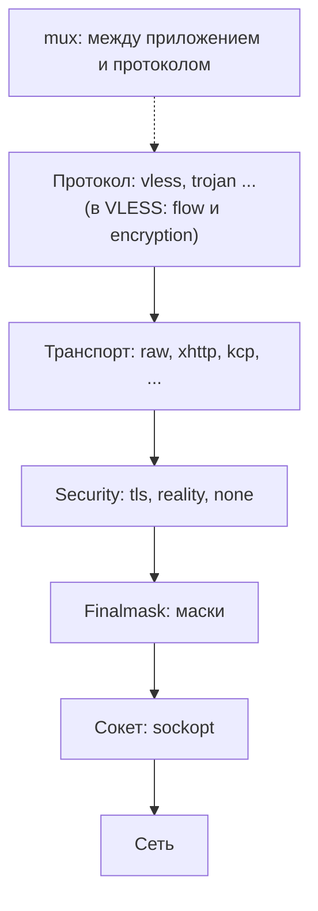

> [!mirror] Резервное зеркало
> Актуальная версия этой страницы — на основной вики: [pyzluhgrnw.osjcpjzipyb.click/xray-core/vless-stack-map](https://pyzluhgrnw.osjcpjzipyb.click/xray-core/vless-stack-map)

# 🧩 Протокол, транспорт, security, flow: словарь и карта слоёв Xray-core

> [!info] О чём заметка
> У слов «протокол», «транспорт», «шифрование» и «маскировка» в обиходе нет чётких границ: про REALITY говорят «протокол», про Vision — «шифрование», про XHTTP — то «протокол», то «транспорт», а VLESS иногда называют «транспортным протоколом». Это путаница, но не придирка: от неё зависит, в какое поле конфига вписать значение и что с чем можно сочетать. Здесь для каждого слова даны определение **по коду ядра** и место в JSON-конфиге, затем разобраны сочетания, которые работают и не работают, и условия, при которых включается splice. Описано только официальное ядро [XTLS/Xray-core](https://github.com/XTLS/Xray-core) версии 26.11.9 (тег от 9 ноября 2026), все ссылки на исходники закреплены за этим тегом. Весь список компонентов — в [[xray-core/components|каталоге компонентов]], что изменилось в версии — в [[xray-core/changes-26-11-9|заметке об изменениях]].

## TL;DR

- **Протокол** — значение поля `protocol` у входящего или исходящего (`vless`, `vmess`, `trojan`, `freedom` и ещё 11 имён). Он отвечает на вопрос «как обработчик разбирает соединение и куда его направляет» (для VLESS: кто вы и куда доставить трафик).
- **Транспорт** — значение `streamSettings.method` (старое имя `network` работает как синоним): `raw`, `xhttp`, `kcp`, `grpc`, `ws`, `httpupgrade`, `hysteria`, `masque`, `xdrive`. Он отвечает на вопрос «по какому каналу идут байты».
- **Security** — значение `streamSettings.security`: `none`, `tls` или `reality`. Оно отвечает на вопрос «чем защищён и как выглядит канал». TLS и REALITY в ядре **не транспорты**: они стоят на той же полке и взаимозаменяемы.
- **Flow и encryption — не слои стека, а поля самого VLESS.** `flow` (режим потока, например Vision) и `encryption`/`decryption` (шифрование VLESS) задаются внутри `settings` протокола, а не в `streamSettings`. Vision — значение `flow`: он не протокол, не транспорт и не шифр.
- **Два имени и одно слово двоякие.** `hysteria` и `masque` одновременно имя протокола и имя транспорта, и работают только вместе. А слово «протокол» не всегда означает поле `protocol`: сам код называет транспорт «transport protocol».
- **Сочетания проверяются в трёх местах.** Часть ошибок ядро находит при чтении конфига (например, `fallbacks` вместе с `decryption`, REALITY на WebSocket), часть при создании обработчика на старте (протокол `hysteria` без транспорта `hysteria`), часть только в момент соединения (например, Vision на WebSocket без шифрования VLESS).
- **Vision и splice — разные вещи.** Vision работает, когда соединение уже TLS или REALITY либо включено шифрование VLESS: ядро смотрит на тип соединения, а не на имя транспорта. Splice (копирование данных внутри ядра ОС) включается в гораздо более узком наборе условий и только в направлении ответа, от адреса назначения к тому, кто подключился.

## Как в нашей вики называть вещи

Эти формулировки приняты для всех заметок раздела, чтобы одно и то же называлось одинаково. В скобках — поле конфига, по которому слово можно проверить.

| Говорим | Не говорим | Почему |
|---|---|---|
| протокол VLESS, протокол Trojan (`protocol`) | «транспортный протокол VLESS» | VLESS ничего не доставляет сам: он только называет пользователя и адрес назначения |
| транспорт XHTTP, транспорт WebSocket (`method`) | «протокол XHTTP», «протокол WebSocket» | это способ доставки байт |
| слой безопасности REALITY, слой безопасности TLS (`security`) | «протокол REALITY», «транспорт REALITY», «транспорт TLS» | это замена TLS на той же оси |
| режим потока Vision (`flow`) | «протокол Vision», «шифрование Vision» | Vision только решает, как передавать уже зашифрованный поток |
| шифрование VLESS (`encryption`, `decryption`) | «слой encryption» | это поля внутри протокола, а не отдельный слой |
| Hysteria 2: протокол `hysteria` с транспортом `hysteria` | «протокол Hysteria» без пары | одно без другого ядро не запустит |

Слово «слой» в заметках оставлено для разговора о схеме «байты идут снизу вверх через несколько обработчиков». В конфиге Xray «слоями» эти обработчики не названы, поэтому в таблицах ниже используется «поле» и «значение».

## Где что лежит в конфиге

Лучше всего термины видны на самом конфиге. Исходящее VLESS в упрощённой записи выглядит так (комментарии добавлены для пояснения, в настоящем JSON их быть не должно):

```jsonc
{
  "outbounds": [{
    "protocol": "vless",                // ПРОТОКОЛ
    "settings": {                       // настройки протокола
      "address": "example.com",
      "port": 443,
      "id": "UUID-пользователя",
      "flow": "xtls-rprx-vision",       // режим потока: поле VLESS
      "encryption": "none"              // шифрование VLESS: поле VLESS
    },
    "streamSettings": {                 // как соединение доходит до сервера
      "method": "raw",                  // ТРАНСПОРТ
      "security": "reality",            // СЛОЙ БЕЗОПАСНОСТИ
      "realitySettings": { },           // настройки выбранного security
      "rawSettings": { },               // настройки выбранного транспорта
      "finalmask": { },                 // маски поверх сокета
      "sockopt": { }                    // параметры сокета
    },
    "mux": { "enabled": false }         // мультиплексор исходящего
  }]
}
```

Из этого скелета следует главное правило: **у протокола и у `streamSettings` разные поля, и их нельзя путать.** Поле `flow` в `streamSettings` не прочитается, а поле `security` внутри `settings` не прочитается тоже. В коде это три разные структуры: [`StreamConfig`](https://github.com/XTLS/Xray-core/blob/v26.11.9/infra/conf/transport_internet.go) для `streamSettings`, [настройки VLESS](https://github.com/XTLS/Xray-core/blob/v26.11.9/infra/conf/vless.go) для `settings` и [общая конфигурация входящих и исходящих](https://github.com/XTLS/Xray-core/blob/v26.11.9/infra/conf/xray.go) для `mux` и `sniffing`.

В классической записи исходящего адрес и пользователь лежат во вложенном `vnext[].users[]`, а в упрощённой всё сразу в `settings`. Вложенность отличается (в классической записи ровно один сервер и один пользователь), а владелец поля нет: `flow` и `encryption` в любом случае принадлежат пользователю VLESS. Во входящем VLESS есть две особенности. Шифрование задаётся одним полем `decryption` для всего входа (в пользователях `encryption` указывать нельзя, ядро отвергает такую запись), а `flow` указывается у каждого пользователя (общее значение можно задать и на уровне `settings` входящего). Поля `encryption` в исходящем и `decryption` во входящем обязательны: пустое значение ядро отвергает, нужно писать `none`.

### Словарь одним взглядом

| Слово | Что это в Xray | Где в конфиге | Значения в 26.11.9 | Чем не является |
|---|---|---|---|---|
| **Протокол** | реализация `proxy.Inbound` и/или `proxy.Outbound` | `protocol` | 15 имён, подробнее ниже | способом доставки байт |
| **Транспорт** | реализация канала поверх сокета | `streamSettings.method` (`network`) | 9 имён, подробнее ниже | защитой и маскировкой |
| **Security** | защита канала | `streamSettings.security` | `none`, `tls`, `reality` | транспортом и шифрованием VLESS |
| **Flow** | режим передачи потока внутри VLESS | `settings.flow` пользователя | пусто, `xtls-rprx-vision` (у клиента ещё `xtls-rprx-vision-udp443`) | шифром, протоколом, транспортом |
| **Шифрование VLESS** | своё шифрование внутри протокола | `encryption` (исходящее), `decryption` (входящее) | `none` или строка из `xray vlessenc` | `security` |
| **Fallbacks** | куда отправить соединение, которое не похоже на протокол | `settings.fallbacks` входящего VLESS и Trojan | список назначений | маскировкой снаружи |
| **Mux** | мультиплексор исходящего (Mux.Cool, XUDP) | `mux` исходящего | включён или нет, число потоков | частью VLESS и частью `streamSettings` |
| **XMUX** | пул HTTP-соединений транспорта XHTTP | `xhttpSettings.xmux` | лимиты соединений | Mux.Cool |
| **Finalmask** | маски на самом нижнем уровне, над сокетом | `streamSettings.finalmask` | TCP- и UDP-маски | транспортом и security |
| **Sockopt** | параметры сокета | `streamSettings.sockopt` | `mark`, `tproxy`, `dialerProxy` и другие | транспортом |
| **Sniffing** | определение домена по началу потока | `sniffing` входящего | включено или нет | маршрутизацией |

## Протокол

Протоколом ядро называет обработчик `Inbound`, `Outbound` или оба сразу из пакета `proxy`: он принимает соединение (или создаёт исходящее), разбирает собственный заголовок и передаёт содержимое дальше. У части протоколов есть только одна сторона: `freedom`, `blackhole`, `dns` и `loopback` бывают только исходящими, `tun` и `tunnel` только входящими. Имена регистрируются в [`infra/conf/xray.go`](https://github.com/XTLS/Xray-core/blob/v26.11.9/infra/conf/xray.go).

Протоколов 15 (во входящих есть ещё синоним `mixed` для `socks`): `vless`, `vmess`, `trojan`, `shadowsocks`, `socks`, `http`, `tunnel` (он же `dokodemo-door`), `freedom` (`direct`), `blackhole` (`block`), `dns`, `loopback`, `wireguard`, `hysteria`, `masque`, `tun`. Таблица с назначением каждого — в [[xray-core/components|каталоге компонентов]].

Важная деталь: в списке есть не только «прокси-протоколы» в бытовом смысле. `freedom` просто выходит в сеть, `blackhole` сбрасывает соединение, `dns` отвечает сам. «Протокол» в терминах ядра — это любой обработчик, который можно вписать в `protocol`, а не только то, что шифрует и пересылает.

Что в VLESS задаёт сам протокол, разобрано в [[xray/vless|заметке про VLESS]]. Для карты важно, что именно ему принадлежит:

- аутентификация по UUID и заголовок: версия (всегда `0`), UUID, команда (`1` TCP, `2` UDP, `3` Mux, `4` reverse), порт и адрес;
- `flow`: режим передачи потока (Vision);
- `encryption` и `decryption`: своё шифрование, добавленное в код 28 августа 2025 (в релиз попало 5 сентября; [[xray/vless-encryption|VLESS Encryption]]);
- `fallbacks`: что делать с соединением, которое не похоже на VLESS.

Сам VLESS ничего не шифрует и не прячет: он только говорит, кто вы и куда нужно доставить трафик. Защита и маскировка берутся из `security`, из `encryption` или из обоих.

## Транспорт

Транспортом ядро называет способ, которым байты доходят до другой стороны: что именно открывается поверх сокета, как оформляется поток и как он ведётся через сеть. Имя задаётся в `streamSettings.method`. Разбор имён выполняет [`TransportProtocol.Build`](https://github.com/XTLS/Xray-core/blob/v26.11.9/infra/conf/transport_internet.go): регистр букв не важен, а у части имён есть синонимы.

| Имя | Синонимы | Состояние в 26.11.9 | Блок настроек |
|---|---|---|---|
| `raw` | `tcp` | основной | `rawSettings`, `tcpSettings` |
| `xhttp` | `splithttp` | основной, ядро рекомендует его вместо трёх устаревших | `xhttpSettings` |
| `kcp` | `mkcp` | рабочий | `kcpSettings` |
| `grpc` | | рабочий, при запуске ядро печатает предупреждение об устаревании | `grpcSettings` |
| `ws` | `websocket` | то же предупреждение | `wsSettings` |
| `httpupgrade` | | то же предупреждение | `httpupgradeSettings` |
| `hysteria` | | рабочий, **только в паре с протоколом `hysteria`** | `hysteriaSettings` |
| `masque` | | новый, **только в паре с протоколом `masque`** | `masqueSettings` |
| `xdrive` | | новый, только для VLESS с шифрованием, без `flow`, с включённым `mux` у клиента | `xdriveSettings` |
| `h2`, `h3`, `http` | | **убраны**, конфиг с ними отклоняется; замена — `xhttp` в режиме `stream-one` | |
| `quic` | | **убран**, замена — `xhttp` в режиме `stream-one` по H3 | |

Четыре уточнения, которые снимают типичную путаницу.

**`method` и `network`.** С версии 26.7.11 имя поля `network` в `streamSettings` заменено на `method` ([PR #6426](https://github.com/XTLS/Xray-core/pull/6426)), старое имя продолжает работать и молча читается как синоним; если указаны оба, побеждает `method`. Переименовано **только** поле `streamSettings`. В `dokodemo`, `freedom`, `shadowsocks`, маршрутизации и DNS поле `network` означает другое (TCP или UDP) и осталось прежним, а у `shadowsocks` слово `method` — это название шифра.

**Синонимы существовали и раньше.** Название `raw` появилось в сентябре 2024, а `websocket` и `mkcp` ядро понимает с 2020 года. Поэтому утверждение «канонические имена сменились в 2026 году» можно отнести только к документации, в коде ни одно из имён не считалось «главным».

**Предупреждение, а не удаление.** Для `grpc`, `ws` и `httpupgrade` ядро при чтении конфига печатает предупреждение «deprecated, not recommended for using and might be removed» с советом перейти на XHTTP. Сроков удаления нет. Текст предупреждения впервые появился в декабре 2024 в более жёсткой форме и был смягчён в версии 26.1.23.

**`h2`, `quic` и `xtls` как отдельные значения не существуют.** HTTP/2 как транспорт убран в декабре 2024, QUIC как транспорт — в сентябре 2024; в версии 26.11.9 оба имени приводят к ошибке чтения конфига. Старое значение `security: xtls` отвергается тоже: вместо него нужно писать `flow: xtls-rprx-vision` вместе с TLS или REALITY.

Подробнее о каждом транспорте: XHTTP — [[xray/xhttp|XHTTP]], остальные — в [[xray-core/components|каталоге компонентов]].

### Двойные имена: Hysteria и MASQUE

Имена `hysteria` и `masque` существуют **дважды**: как значение `protocol` и как значение `streamSettings.method`. Это две разные части ядра, и работают они только вместе. Протокол `hysteria` в коде проверяет, что у соединения именно транспорт `hysteria`, иначе возвращает ошибку `not hysteria transport` ([`proxy/hysteria/server.go`](https://github.com/XTLS/Xray-core/blob/v26.11.9/proxy/hysteria/server.go), [`client.go`](https://github.com/XTLS/Xray-core/blob/v26.11.9/proxy/hysteria/client.go)); у протокола `masque` та же проверка и то же сообщение с обратным именем. Транспорт `masque` ядро, наоборот, принимает только у обработчика с протоколом `masque`, и во входящем, и в исходящем (при чтении конфига). Транспорту `masque` обязателен `security: tls`. Для `hysteria` значение `version` обязано быть `2`.

Практический вывод: в конфиге Hysteria 2 нужно написать оба значения, и `protocol: "hysteria"` с `version: 2`, и `streamSettings.method: "hysteria"`. Если указать только протокол, ядро остановится с ошибкой `not hysteria transport` (для `masque` — аналогично). Транспорт `hysteria` не равен «транспорту QUIC»: транспорт `quic` убран, а `hysteria` — отдельная реализация.

## Security

Поле `streamSettings.security` принимает три значения. Это ответ на вопрос «чем защищён канал и как он выглядит снаружи».

| Значение | Что делает | Замечание |
|---|---|---|
| `none` | ничего не добавляет | допустимо у протоколов с собственным шифрованием, а у исходящих VLESS без шифрования и Trojan без TLS — только для частных адресов, см. ниже |
| `tls` | обычный TLS; клиентский отпечаток ClientHello подделывается библиотекой uTLS | на сервере нужны домен и сертификат; `fingerprint` и ECH — параметры TLS |
| `reality` | модификация TLS 1.3: сервер выглядит как чужой настоящий сайт | не работает с `ws`, `httpupgrade`, `kcp`, `hysteria`, `masque`, `xdrive` |

Что из этого важно для терминологии:

- **REALITY — это `security`, а не транспорт и не протокол.** В конфиге он задаётся значением `security: "reality"` и настройками `realitySettings`, а совместим только с тремя транспортами: `raw`, `xhttp` и `grpc` (сообщение ядра: `REALITY only supports RAW, XHTTP and gRPC for now.`). Вопрос «REALITY или TLS» — это выбор значения одного и того же поля.
- **`fingerprint` и ECH принадлежат слою security.** `fingerprint` задаётся в `tlsSettings` и `realitySettings`, ECH только в `tlsSettings`; ни то ни другое не лежит в `settings` протокола или в блоке транспорта.
- **`security` и `encryption` отвечают за разные вещи.** `security` защищает канал между клиентом и сервером на стороне транспорта, `encryption` шифрует сам VLESS. Если между вами и сервером есть посредник, который завершает внешний TLS (CDN, транзитный узел), он видит заголовок VLESS открытым; `encryption` закрывает именно это. Разбор — в [[xray/vless-encryption|VLESS Encryption]].

## Режим потока (`flow`) и шифрование VLESS: поля протокола

Эти два поля чаще всего путают со слоями стека, хотя в конфиге они лежат в `settings` протокола. Из-за этого они ведут себя иначе, чем `method` и `security`: ядро проверяет согласованность Vision с транспортом и security не при чтении конфига, а в момент, когда соединение уже создано (часть других сочетаний, например правила `xdrive`, проверяется при чтении).

### `flow` и Vision

Допустимые значения: пусто и `xtls-rprx-vision` на сервере; у клиента добавляется `xtls-rprx-vision-udp443`. Любое другое значение отвергают и сервер, и клиент ошибкой `"flow" doesn't support … in this version`. Суффикс `-udp443` существует только у клиента и перед отправкой обрезается: сервер всегда видит обычный `xtls-rprx-vision`.

Vision решает одну задачу: убрать характерную сигнатуру **TLS внутри TLS**. Браузер открывает HTTPS-соединение, прокси заворачивает его в свой канал, и по длинам первых пакетов вложенного рукопожатия видно, что внутри второй TLS. Vision до рукопожатия добивает пакеты случайной набивкой, а потом, когда внутри пошёл TLS 1.3, передаёт данные без повторного шифрования. Подробности по байтам — в [[xray/xtls-vision|заметке про Vision]]. Границы ответственности такие:

- Vision **ничего не шифрует** и работает поверх уже установленной защиты (TLS, REALITY или `encryption`).
- Vision **не прячет** объёмы и тайминги и не делает прокси невидимым.
- Vision — не протокол и не транспорт, а значение поля протокола VLESS.

Как работает набивка в 26.11.9 (по [коду Vision](https://github.com/XTLS/Xray-core/blob/v26.11.9/proxy/proxy.go)): пороги по умолчанию `900 500 900 256`; для пакета короче 900 байт, пока ядро ещё в режиме длинной набивки, добавляется случайное число байт, чтобы пакет стал размером около 900–1400; в остальных случаях добавляется до 255 байт. Набивка заканчивается на первой завершённой записи прикладных данных внутреннего TLS либо, если внутри не TLS, после 8 просмотренных пакетов. Переход к прямому копированию происходит, только если внутри TLS 1.3 и шифр не `TLS_AES_128_CCM_8_SHA256`; для TLS 1.2 набивка заканчивается, а прямого копирования нет.

### Что значит пустой `flow`

Пустой `flow` — нормальная рабочая настройка, а не «безопасный режим по умолчанию»: двойное шифрование сохраняется, набивки нет, ядро помечает соединение как непригодное для ускорения. Сервер с Vision отклоняет такого клиента сообщением «`account … is rejected since the client flow is empty`» (но только для TCP и Mux, не для UDP и XUDP). Ядро предупреждало об устаревании VLESS без `flow` с 18 января 2026 года (пре-релиз v26.1.18), а в сборке v26.3.23 предупреждение убрали (в списке изменений v26.3.27: «Remove "with no flow" warning for now»). Сейчас такая конфигурация поддерживается, даты удаления нет. История споров вокруг неё вынесена в [[xray/vless-flow-mux-russia|отдельную заметку]].

### `encryption` и `decryption`

Шифрование VLESS (режим `mlkem768x25519plus`) — это поля протокола: клиент указывает `encryption`, сервер `decryption`, пару строк генерирует `xray vlessenc`. Они сняли две привязки: Vision стал доступен на любом транспорте, а запрет на VLESS без защиты (действует с июля 2026) обходится именно шифрованием VLESS. Ограничение одно: `decryption` нельзя использовать вместе с `fallbacks`, и ядро при этом **не запускается** (`"fallbacks" can not be used together with "decryption"`; триггер — любое заданное значение `fallbacks`, даже пустой список).

## Что не является слоем

Часть полей лежит рядом со слоями, но не образует отдельного слоя.

**`mux` (Mux.Cool).** Мультиплексор исходящего, поле `mux` лежит на одном уровне с `protocol` и `streamSettings`, а не внутри протокола и не внутри транспорта. Он работает с несколькими протоколами. Для UDP при Vision включать его не нужно: VLESS-клиент сам упаковывает UDP в команду Mux (XUDP). Не путать с двумя другими вещами с похожим названием: **XMUX** — пул HTTP-соединений транспортов XHTTP, MASQUE и XDrive (`xhttpSettings.xmux`, а также `masqueSettings` и `xdriveSettings`), а `smux`, `yamux`, `h2mux` — мультиплексоры семейства sing-box, несовместимые с Mux.Cool на уровне кадров.

**`finalmask`.** Маски на самом нижнем уровне, над сокетом: они лежат в `streamSettings`, но не относятся ни к транспорту, ни к security. Полный перечень — в [[xray-core/components|каталоге компонентов]].

**`sockopt`.** Параметры сокета (`mark`, `tproxy`, `dialerProxy`, `tcpFastOpen` и другие), тоже в `streamSettings`.

**`sniffing`.** Определение домена по первым байтам. Это настройка **входящего**, а не слоя стека; результат участвует в маршрутизации.

**`fallbacks`.** Настройка входящего VLESS и Trojan: что делать с соединением, которое не похоже на протокол. В схему «снизу вверх» не вписывается.

### Условная цепочка обработчиков

На схеме показана условная цепочка обработчиков исходящего соединения: сверху то, что видит приложение, снизу то, что уходит в сеть. Finalmask и сокет нарисованы как звенья цепочки, хотя слоями в смысле словаря не являются. Порядок тоже условный: в коде у каждого транспорта (raw, xhttp, ws, grpc и остальных) TLS или REALITY поднимается внутри его собственного дилера, а не отдельным общим шагом.



## Какие сочетания работают

Проверка срабатывает в одном из трёх мест: при чтении конфига (Xray не стартует либо отклоняет входящий или исходящий), при создании обработчика на старте ядра или при создании соединения (ядро работает, а конкретное соединение рвётся с ошибкой). Ниже таблицы для первого и третьего места, а второе описано сразу под первой таблицей.

### Проверки при чтении конфига

| Сочетание | Результат | Сообщение или причина |
|---|---|---|
| `fallbacks` и `decryption` | Xray не стартует | `"fallbacks" can not be used together with "decryption"` |
| REALITY и транспорт не `raw`, `xhttp`, `grpc` | конфиг отклонён | `REALITY only supports RAW, XHTTP and gRPC for now.` |
| `security: xtls`, транспорты `h2`, `h3`, `http`, `quic` | конфиг отклонён | убранные возможности, с подсказкой замены |
| `flow`, не равный пустому или `xtls-rprx-vision` (у сервера) | конфиг отклонён | `"flow" doesn't support … in this version` |
| VLESS без шифрования и без TLS/REALITY, а также Trojan без TLS в исходящем на публичный адрес | исходящее не собирается | VLESS без шифрования разрешён только на частный IP-адрес, loopback, link-local или домен из встроенного списка частных доменов |
| `xdrive` не с VLESS, с `flow`, без шифрования VLESS, с `testpre`; у исходящего без включённого `mux` (если нет `reverse`); у входящего с несколькими портами | конфиг отклонён | у транспорта жёсткие требования |
| транспорт `masque` у обработчика без протокола `masque` (и во входящем, и в исходящем) | конфиг отклонён | они работают только вместе |

Строка про VLESS без шифрования действует с июля 2026 (первая версия с проверкой — 26.7.11). `security: none` защитой не считается. До версии 26.9.9 в классической записи `vnext[].users[]` проверка не видела поле `encryption` пользователя и ошибочно отвергала исходящее с шифрованием VLESS без TLS; исправлено в [PR #6741](https://github.com/XTLS/Xray-core/pull/6741). Входящий VLESS такую схему пока принимает: проверка стоит только в исходящих.

Третье место, в котором ядро находит ошибку, — создание обработчика при запуске. Так отвергаются протокол `hysteria` без транспорта `hysteria` и протокол `masque` без транспорта `masque` (`not hysteria transport`, `not masque transport`).

### Проверки в момент соединения

| Сочетание | Результат | Что происходит |
|---|---|---|
| Vision и соединение, которое не TLS, не REALITY и без шифрования VLESS | соединение рвётся | `XTLS only supports TLS and REALITY directly for now.` |
| Vision и внешний `tls` не версии 1.3 | соединение рвётся | `failed to use xtls-rprx-vision, found outer tls version …` |
| Сервер Vision, клиент с пустым `flow` (TCP или Mux, не XUDP) | соединение отклонено | `…rejected since the client flow is empty…` |
| Сервер без `flow`, клиент с Vision | соединение отклонено | `…not able to use the flow xtls-rprx-vision` |
| TCP-запрос внутри Mux при Vision | рвётся всё мультиплексированное соединение | `unexpected network`, код сервера Mux ожидает только UDP |
| UDP-команда напрямую при Vision | сервер отклоняет | `xtls-rprx-vision doesn't support UDP`; Xray-клиент до этого не доходит, см. ниже |

Строка про Vision и транспорт часто сбивает с толку: сообщение `XTLS only supports TLS and REALITY directly for now` по-прежнему живёт в коде, но стало **последней ветвью** проверки. Сначала ядро смотрит, не включено ли шифрование VLESS, потом TLS, потом REALITY, и только если ничего не подошло, выдаёт эту ошибку. Текст не менялся с апреля 2023, поэтому читать его буквально нельзя: фраза «only TLS and REALITY» перестала быть правдой, когда появилось шифрование VLESS.

### Матрица транспорта, security, encryption и flow

| Транспорт | `security` | `encryption` | `flow` | Работает? | Что получаем |
|---|---|---|---|---|---|
| `raw` | `reality` или `tls` | `none` | `xtls-rprx-vision` | ✅ | Классика: маскировка, набивка рукопожатия, при условиях ниже ещё splice |
| `raw` | `reality` или `tls` | `none` | пусто | ✅ | Работает, TLS-в-TLS не скрыт, ускорения нет |
| `xhttp`, `ws`, `grpc` | `tls` (REALITY не для `ws`) | `none` | пусто | ✅ | Проход через CDN, Vision недоступен |
| `xhttp`, `ws`, `grpc` | `tls` (REALITY не для `ws`) | `none` | `xtls-rprx-vision` | ❌ в момент соединения | `XTLS only supports TLS and REALITY directly for now.` |
| `xhttp`, `ws`, `grpc` | `tls` | VLESS Encryption | `xtls-rprx-vision` | ✅ | Vision поверх CDN-транспорта, splice недоступен |
| `raw` | `none` | VLESS Encryption | `xtls-rprx-vision` | ✅ | Без внешнего TLS: шифрует сам VLESS |
| `raw` | `reality` | VLESS Encryption | `xtls-rprx-vision` | ✅ | Двойная защита, splice отключается |
| любой | любой | VLESS Encryption на входящем | любой | ❌ при `fallbacks` | Xray не стартует |

Строка, ради которой матрица нужна: **`xhttp` с Vision без VLESS Encryption не работает, а с ним работает.** Точная формулировка документации: XTLS доступен в двух случаях, `TCP + TLS/REALITY` либо шифрование VLESS, и во втором случае «ограничений на нижележащий транспорт нет». Привязки Vision к прямому TCP больше нет; от неё осталась только привязка **splice** к прямому TCP.

> [!warning] Vision и UDP: что реально происходит
> В списке запретов нередко упоминают «Vision не поддерживает UDP». Для Xray-клиента это не так: при Vision он сам превращает UDP-запрос в команду Mux к служебному имени `v1.mux.cool:666`, и UDP едет через XUDP внутри мультиплексора. Прямую UDP-команду при Vision сервер действительно отклоняет, но Xray-клиент её не отправляет, так что ошибка достижима только для клиента на другом ядре. QUIC на порт 443 Vision блокирует на стороне клиента (`XTLS rejected UDP/443 traffic`), чтобы браузер откатился на HTTPS поверх TCP; значение `xtls-rprx-vision-udp443` снимает эту блокировку, и такой UDP тоже уходит через XUDP.

## Когда включается splice

`splice(2)` — системный вызов Linux, который пересылает данные между сокетами внутри ядра ОС без копирования в память процесса. Он даёт Xray с Vision почти нулевые накладные расходы. Splice — премия за самую простую конфигурацию, а не свойство Vision: когда между Vision и сокетом появляется ещё что-то, ускорение пропадает, а **сам Vision продолжает работать**.

Условия в 26.11.9 (по [`CopyRawConnIfExist`](https://github.com/XTLS/Xray-core/blob/v26.11.9/proxy/proxy.go)):

| Условие | Splice |
|---|---|
| Linux или Android; принимающий сокет — настоящий TCP-сокет | ✅ |
| `flow=xtls-rprx-vision`, внутри TLS 1.3, шифр не `TLS_AES_128_CCM_8_SHA256` | ✅ |
| VLESS Encryption поверх прямого TCP при `security: none`, режим `native` или `xorpub` | ✅ |
| VLESS Encryption в режиме `random` | ❌ — есть отдельный XOR-слой |
| VLESS Encryption, а поверх него TLS, REALITY, XHTTP, WebSocket | ❌ — под шифрованием уже не голый TCP |
| Транспорт `xhttp`, `ws`, `grpc`, `kcp` | ❌ |
| Пустой `flow` | ❌ |
| Соединение внутри Mux | ❌ — код Mux безусловно запрещает |
| Внутри TLS 1.2 или шифр `TLS_AES_128_CCM_8_SHA256` | ❌ |
| Направление «клиент → сервер» | ❌ — в коде промоушен закомментирован пометкой `TODO: enable uplink splice` |

Splice выполняется только там, где ядро читает данные из одного сокета и сразу пишет в другой. Таких мест два: путь ответа в исходящем `freedom` (сервер, выходящий в интернет) и читатель ответа в исходящем VLESS (клиент, пишущий в сокет входящего). Путь `freedom` можно отключить переменной окружения `XRAY_BUF_SPLICE` (по умолчанию он включён). Что происходит на промежуточном узле цепочки из нескольких VLESS-узлов, в коде отдельно не оговорено и замерами не проверялось.

Две оговорки. Во-первых, `xorpub` splice **не ломает**, хотя его часто записывают в один ряд с `random`: отдельный XOR-слой создаёт только `random`, `xorpub` лишь маскирует публичные ключи внутри рукопожатия. Во-вторых, «голый TCP» не совсем голый, если включены TCP-маски `finalmask`: ядро разворачивает те, у которых `Splice()` возвращает истину.

## Mux и Vision

Формального запрета в конфиге нет. Поле `mux` для UDP при Vision не нужно: VLESS-клиент сам упаковывает UDP в команду Mux (`v1.mux.cool:666`, XUDP), поэтому сервер Vision принимает команду Mux, но допускает внутри неё только UDP. Если включить `mux` в исходящем с Vision, TCP-запросы тоже уйдут в Mux, и сервер отвергает их ошибкой `unexpected network`, которая закрывает **всё** мультиплексированное соединение. Серверный Mux-воркер дополнительно безусловно отключает splice. Практический вывод: Mux и Vision в одном профиле дают не ускорение, а стабильные отказы для TCP.

С этой особенностью связан слух «без flow в России блокировки обходятся лучше». По первоисточникам помогало сокращение числа TLS-соединений к одному адресу, а Mux, который для этого включали, на практике требовал отказа от Vision. Что именно подтверждено, а что нет, разобрано в [[xray/vless-flow-mux-russia|отдельной заметке]].

## Где слова путают сами авторы

Часть путаницы — не вина читателя: слова «протокол», «транспорт», «слой» в самом проекте употребляются свободно. Чтобы не споткнуться о них в чужих текстах, вот самые частые случаи.

| Где встречается | Что написано | Что на самом деле |
|---|---|---|
| Структура официальной документации | страницы TLS и REALITY лежат в разделе «Конфигурация транспорта», подраздел «Безопасность транспорта» | это значения `security`, а не транспорты; документация называет REALITY «схемой защиты транспорта», то есть защитой, а не транспортом |
| Исходный код | тип `TransportProtocol`, поле `protocol_name`, ошибка `unknown transport protocol` | внутри кода транспорт назван «transport protocol»; это не то же самое, что `protocol` в конфиге. «Протокол транспорта» допустимо как точное имя типа |
| Названия в обиходе | «протокол XHTTP», «протокол WebSocket» | транспорты |
| Названия в обиходе | «протокол REALITY», «протокол XTLS» | REALITY — значение `security`; XTLS — исторически название технологии, сегодня означает режим `flow` |
| Конфиг | `method` | у `streamSettings` это транспорт, у `shadowsocks` — шифр |
| Конфиг | `network` | у `streamSettings` — синоним `method` (транспорт), у `dokodemo`, `freedom`, маршрутизации и DNS — TCP или UDP |
| Старое название | SplitHTTP | прежнее имя транспорта XHTTP, остаётся синонимом; не отдельная технология |
| Ссылка `vless://` | параметр `type` | параметр ссылки, а не ядра: в Xray-core нет разбора `vless://`; клиенты кладут его в `method` |
| Слово «слой» | «пять слоёв стека», «слой encryption» | у ядра три места для настроек (протокол, `streamSettings`, исходящее/входящее целиком); `flow` и `encryption` лежат в протоколе |
| Слово «мультиплексор» | Mux.Cool, XMUX, `smux`/`yamux`/`h2mux` | три разных механизма |
| Слово «Hysteria» | протокол и транспорт | оба, см. выше |
| Слово «шифрование» | `security` против `encryption` | разные поля с разным назначением |

Эти расхождения — причина, по которой в заметках раздела принято «Как в нашей вики называть вещи» (выше): всегда называть и слово, и поле конфига, по которому его можно проверить.

## Как собрать конфиг под задачу

- **Свой сервер, прямое подключение, максимум скорости.** Транспорт `raw`, `security: reality`, `flow: xtls-rprx-vision`, `encryption: none`. Vision разворачивает соединение до сырого сокета, на сервере с `freedom` включается splice.
- **Через CDN (Cloudflare).** Транспорт `xhttp`, `security: tls`, VLESS Encryption, `flow: xtls-rprx-vision` и XMUX. Шифрование здесь не роскошь: без него CDN читает UUID и адреса назначения. `ws` тоже работает, но ядро печатает для него предупреждение об устаревании, а REALITY с ним не собрать.
- **Транзит через чужой узел, каскад, окружение без TLS.** Любой транспорт, VLESS Encryption, `security` может быть `none`: запрет на VLESS без шифрования снимает именно шифрование.
- **Максимальная совместимость с разнородными клиентами.** `raw`, `reality`, `encryption: none`, `flow` по возможности `xtls-rprx-vision`. Клиенты на ядре sing-box не поймут VLESS Encryption.
- **Hysteria 2.** Пара `protocol: "hysteria"` и `method: "hysteria"` в одном обработчике.

## Частые заблуждения

> [!warning] «REALITY уже шифрует, значит `encryption` не нужен»
> Верно, пока между вами и сервером нет посредника, который расшифровывает внешний слой. Через CDN или транзитный узел REALITY и TLS заканчиваются **не на вашем сервере**, и заголовок VLESS с UUID и адресом назначения виден открыто.

> [!warning] «Включу `encryption` вместо REALITY, станет незаметнее»
> Наоборот. VLESS Encryption не меняет внешний вид соединения, а при `security: none` поток выглядит как случайные байты, которые энтропийные классификаторы выделяют.

> [!warning] «Vision — это шифрование»
> Нет. Vision — правило передачи уже зашифрованного потока. Название сбивает с толку буквами «TLS» в слове XTLS. Значения слова разведены в [[xray/xtls-vision|заметке про Vision]].

> [!warning] «Vision работает только на TCP»
> Так было до 28 августа 2025 (дата коммита; в релиз изменение вошло 5 сентября). Сейчас Vision работает на прямом TCP с TLS или REALITY **или** на любом транспорте при включённом VLESS Encryption. Привязкой к голому TCP осталась только **splice**.

> [!warning] «Mux.Cool — часть VLESS»
> Mux лежит в исходящем и не принадлежит ни VLESS, ни `streamSettings`. Он работает и с другими протоколами.

## 📚 См. также

- [[xray-core/components|Компоненты Xray-core]]: каталог всех протоколов, транспортов, масок и служебных модулей
- [[xray-core/changes-26-11-9|Что нового в Xray-core 26.11.9]]: что ломает старые конфиги
- [[xray/vless|VLESS]]: формат заголовка, `fallbacks`, Mux и XUDP
- [[xray/xtls-vision|XTLS и Vision]]: механика набивки и три значения слова «XTLS»
- [[xray/reality|REALITY]]: устройство слоя безопасности
- [[xray/xhttp|XHTTP]]: транспорт, XMUX и режимы
- [[xray/vless-encryption|VLESS Encryption]]: шифрование VLESS
- [[xray/vless-flow-mux-russia|Flow, Mux и блокировки в России]]: проверенная история слуха «без flow лучше»

## Источники

Все ссылки закреплены за тегом v26.11.9.

- [`infra/conf/transport_internet.go`](https://github.com/XTLS/Xray-core/blob/v26.11.9/infra/conf/transport_internet.go): `TransportProtocol.Build`, `StreamConfig`, проверка `security`
- [`infra/conf/vless.go`](https://github.com/XTLS/Xray-core/blob/v26.11.9/infra/conf/vless.go): `flow`, `encryption`, `decryption`, `fallbacks`
- [`infra/conf/xray.go`](https://github.com/XTLS/Xray-core/blob/v26.11.9/infra/conf/xray.go): реестр протоколов, `mux`, проверки сочетаний, `validateXDrive`
- [`proxy/hysteria/server.go`](https://github.com/XTLS/Xray-core/blob/v26.11.9/proxy/hysteria/server.go), [`client.go`](https://github.com/XTLS/Xray-core/blob/v26.11.9/proxy/hysteria/client.go): проверка `not hysteria transport`
- [`proxy/vless/inbound/inbound.go`](https://github.com/XTLS/Xray-core/blob/v26.11.9/proxy/vless/inbound/inbound.go), [`outbound/outbound.go`](https://github.com/XTLS/Xray-core/blob/v26.11.9/proxy/vless/outbound/outbound.go): проверки Vision в момент соединения
- [`proxy/proxy.go`](https://github.com/XTLS/Xray-core/blob/v26.11.9/proxy/proxy.go): набивка Vision, `CopyRawConnIfExist`
- [`proxy/freedom/freedom.go`](https://github.com/XTLS/Xray-core/blob/v26.11.9/proxy/freedom/freedom.go): путь ответа, где включается splice
- [`common/mux/server.go`](https://github.com/XTLS/Xray-core/blob/v26.11.9/common/mux/server.go): код сервера Mux

---

> [!quote] 🤖 Эти статьи открыты — можно обучать на них ИИ
> При желании вы можете натренировать ИИ на наших статьях. Исходное форматирование и скачивание всего репозитория одним zip-архивом доступны в Forgejo: [исходник этой заметки](https://tficguhwsu.osjcpjzipyb.click/zapretdiscordyoutube/todo/src/branch/main/xray-core/vless-stack-map.md) · [весь репозиторий](https://tficguhwsu.osjcpjzipyb.click/zapretdiscordyoutube/todo/src/branch/main).
