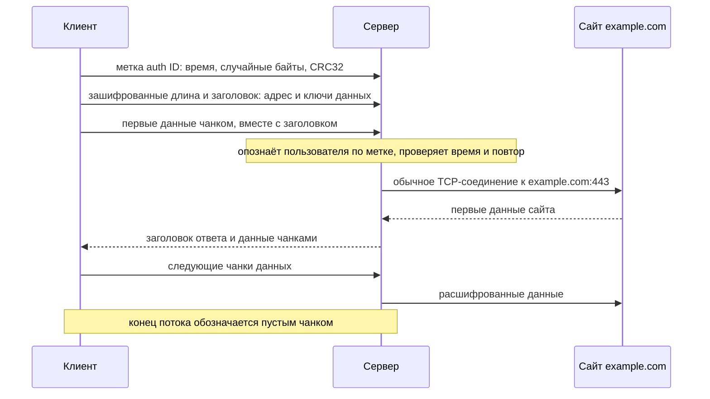
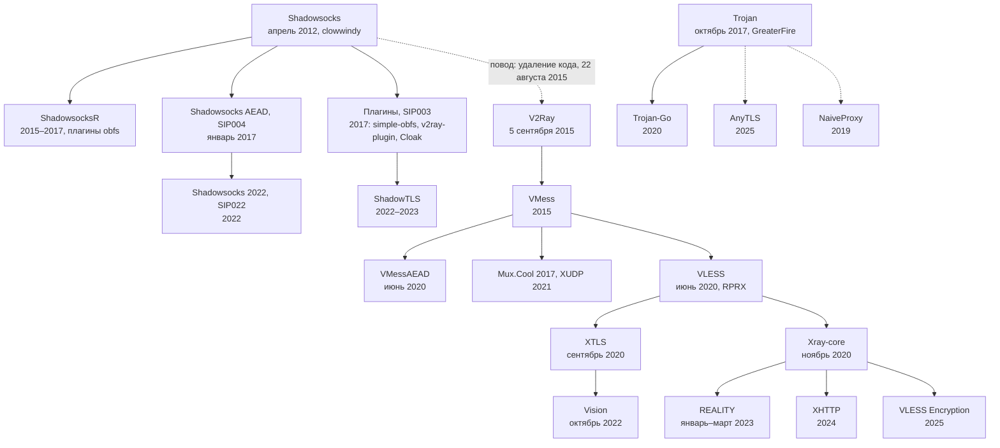
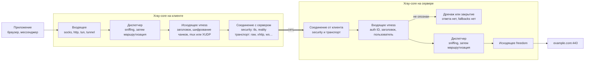

> [!mirror] Резервное зеркало
> Актуальная версия этой страницы — на основной вики: [rsewozdgoy.fuckingspeedtest.com/xray-core/vmess-protocol](https://rsewozdgoy.fuckingspeedtest.com/xray-core/vmess-protocol)

# 🔶 Протокол VMess в ядре Xray-core: по исходному коду

> [!info] О чём заметка
> Полный разбор **протокола VMess**, каким он реализован в официальном ядре [XTLS/Xray-core](https://github.com/XTLS/Xray-core) версии **26.11.9** (тег от 9 ноября 2026). Статья идёт с нуля: сначала задача, которую решает любой прокси-протокол, потом история (откуда взялся VMess, при чём тут Shadowsocks и почему появился VLESS), потом устройство по байтам, путь соединения через ядро, защита от зондирования, использование и обнаружение. Всё о коде сверено с каталогом `proxy/vmess/` и соседними пакетами на этом теге.

## Коротко

Этот список — выжимка для тех, кто уже знает термины. Если вы новичок, читайте подряд с раздела «Какую задачу решает прокси-протокол»: там каждое слово объясняется до того, как им воспользуются.

- **VMess** — прокси-протокол из проекта V2Ray (первый коммит репозитория — 5 сентября 2015 года). Клиент открывает соединение к серверу и сообщает, *кому* оно принадлежит (по UUID: длинному случайному идентификатору пользователя из 16 байт, который знают только клиент и сервер), *что* ему нужно (TCP: обычное надёжное соединение, как у сайтов; UDP: отдельные пакеты, как в играх и звонках; Mux: несколько соединений внутри одного) и *куда* идти (адрес и порт). В отличие от VLESS, VMess **шифрует сам**: и заголовок, и данные.
- **Предок VLESS.** VLESS (более поздний протокол того же семейства) придуман в 2020 году как «урезанный VMess» для каналов, которые и так защищены шифрованием TLS (тем же, которым защищены обычные сайты): автор убрал из него шифрование, зависимость от часов и лишние вычисления. VMess остался в ядре как более старый и тяжёлый вариант.
- **С Shadowsocks у VMess общий повод, а не общий код.** По первоисточникам, V2Ray начали через две недели после того, как автор Shadowsocks удалил свой код (22 августа 2015 года); первый README прямо называет это причиной. Но формат VMess другой, кода Shadowsocks в нём нет, а AEAD-шифры данных у VMess появились раньше, чем у Shadowsocks (раздел «Откуда взялся VMess»).
- **Вся ветка протоколов.** Статья прослеживает цепочку Shadowsocks → VMess → VLESS и их потомков: у каждого звена есть причина появления, и почти всегда это слабость предыдущего (таблица «слабость → ответ» в разделе «Вся ветка протоколов»).
- **В v26.11.9 остался только «VMessAEAD».** Старая схема с MD5 и `alterId` удалена из Xray-core в релизе v1.8.3 (19 июня 2023 года). Поля `alterId` в коде нет совсем; ненулевое значение в старом конфиге молча игнорируется.
- **Заголовок запроса:** 16 байт auth ID (метка «кто и когда»: время, случайные байты и контрольная сумма CRC32, зашифрованные шифром AES), зашифрованная длина заголовка, 8 случайных байт (nonce, «число для одного раза») и сам зашифрованный заголовок. Для домена `example.com` это 115–130 байт на проводе; у VLESS — 34 байта.
- **Время обязательно:** сервер принимает auth ID, если часы клиента отличаются не больше чем на 120 секунд, и запоминает уже виденные auth ID, чтобы не принять повтор.
- **Данные** идут кусками (чанками), каждый из которых зашифрован шифром с проверкой подлинности (AEAD: AES-128-GCM или ChaCha20-Poly1305), длина куска замаскирована, к нему добавлено 0–63 случайных байта. Режимов без шифрования данных (`none`, `zero`) в 26.11.9 нет.
- **Нет fallbacks** (у VLESS соединение, не похожее на протокол, сервер передаёт настоящему сайту; у VMess так нельзя). На неверный заголовок сервер не отвечает как сайт: при соединении без TLS он читает и выбрасывает от 54 до 3382 байт (это называется дренажем) и закрывает соединение, под TLS и REALITY закрывает сразу.
- **Не поддерживает** `flow` (Vision) и обратный прокси (команда Rvs, VLESS Reverse). Работает под TLS и REALITY и почти с любым транспортом, кроме `xdrive` и `masque` (конфигурация с ними отвергается); REALITY в конфигурации вообще разрешён только поверх `raw`, `xhttp` и `grpc`.
- **В ядре помечен устаревшим:** с января 2026 года при запуске печатается предупреждение «The feature VMess (with no Forward Secrecy, etc.) is deprecated…» и совет перейти на VLESS Encryption.
- **В проектах Zapret:** клиенты ZapretKVN (приложения проекта Zapret для обхода блокировок, для Windows и Android) принимают `vmess://` и узлы VMess из подписок и исполняют их на официальном Xray-core v26.11.9 (с 16 ноября 2026 года; раньше VMess шёл через sing-box, другое ядро с открытым кодом). Основной протокол подписок сервиса — VLESS (раздел «Где VMess используется»).

## Какую задачу решает прокси-протокол

Перед байтами и историей нужно понять, чего вообще пытается добиться любой протокол такого рода. Дальше по очереди вводятся основные понятия; каждое объясняется до того, как им начнут пользоваться.

**Прокси.** Приложение (браузер, мессенджер) хочет открыть соединение к сайту, но напрямую это невозможно (сайт заблокирован) или небезопасно (за соединением следят). Тогда между ними ставят посредника — **прокси-сервер** на другой машине. Приложение (точнее, программа-клиент рядом с ним) соединяется с этим сервером, а уже сервер открывает соединение к нужному сайту и переправляет байты туда и обратно. Для сайта источником соединения становится сервер.

**Протокол.** Клиенту и серверу нужно заранее договориться, в каком виде идут байты по соединению между ними: что идёт в самом начале, где кончается служебная часть и начинаются данные. Такая договорённость о формате байтов и называется **протоколом**. VMess — одна из таких договорённостей; Shadowsocks (более ранний и простой протокол), VLESS (облегчённый преемник VMess) и Trojan (протокол, маскирующийся под обычный сайт) — другие. Все они разобраны ниже. В Xray-core протокол выбирается полем `protocol` у входящего или исходящего соединения, и ядро умеет несколько протоколов одновременно.

**Три вопроса.** Чтобы переслать соединение, серверу в первых же байтах нужно узнать три вещи: *кто* это (чьё это соединение, чтобы пускать только своих), *что* ему нужно (TCP-соединение: надёжный поток байт, так работают сайты и почта; датаграммы UDP: отдельные пакеты без гарантии доставки, так работают игры и звонки; или что-то ещё) и *куда* (адрес и порт сайта). Любой прокси-протокол отвечает на эти три вопроса; различия — в том, как именно.

**Тайна.** Соединение между клиентом и сервером идёт через сети, где за ним могут наблюдать. Если оно открытое, наблюдатель увидит и адрес сайта, и данные. Поэтому протоколу нужно **шифрование**: преобразование, которое делает байты нечитаемыми без секретного ключа. VMess делает его сам; у VLESS такого шифрования в самом протоколе нет, его дают слои под протоколом (TLS, REALITY).

**Свои и чужие.** Сервер открыт для всей сети, и к нему подключается кто угодно, в том числе тот, кто просто проверяет: «что это за сервис?» Такая проверка называется **активным зондированием** (active probing): наблюдатель сам посылает серверу подобранные байты и смотрит, как тот ответит. Сервер, который по-особому реагирует на неверный заголовок, выдаёт себя. Вторая угроза — **повтор** (replay): наблюдатель записывает настоящий запрос клиента и посылает его снова, чтобы получить тот же ответ или опознать сервер. Чтобы отсеять повторы, протоколу полезна привязка ко времени: старый запрос уже не подходит. Эта привязка — характерная черта VMess, и из-за неё часы клиента и сервера должны быть синхронны.

**Ключ и шифр.** Шифрование работает с секретом, который называется **ключом**: это набор байт, без которого зашифрованное нельзя вернуть в исходный вид. Конкретный способ шифрования называется **шифром**. В VMess их два: AES (стандарт, который быстро считается на процессорах с аппаратной поддержкой) и ChaCha20 (быстр и там, где такой поддержки нет). Шифр шифрует данные блоками фиксированного размера (у AES блок равен 16 байтам), а **режим** говорит, как соединять блоки между собой. У AES режимов много: GCM (с проверкой подлинности, см. следующий шаг) и CFB (старый, без проверки) встретятся дальше.

**Проверка подлинности: AEAD.** Одного шифрования мало: нападающий может незаметно поменять байты в записанном потоке. Поэтому современные шифры рядом с зашифрованными данными кладут короткий **проверочный тег**. Если хоть один байт по дороге изменён, тег не сойдётся, и получатель отбросит блок целиком. Шифры с такой проверкой называют **AEAD** («шифрование с проверкой подлинности»). AES-GCM и ChaCha20-Poly1305 относятся к ним, а AES-CFB нет. Проще говоря: AEAD не только прячет содержимое, но и не даёт подделать его незаметно.

**Хеш, контрольная сумма, nonce.** **Хеш** (MD5, SHA-256) превращает любые данные в короткий отпечаток фиксированной длины; обратно из отпечатка данные не восстановить, а любое изменение данных меняет отпечаток целиком. **HMAC** — хеш, в который подмешан секретный ключ: без ключа его не подделать. **Контрольная сумма** (CRC32, FNV) — более простой отпечаток, который не защищает от нападающего, но быстро показывает, что данные расшифрованы верно. **Nonce** («number used once», «число для одного раза») — значение, которое вместе с данным ключом используют только один раз, чтобы одинаковые сообщения при шифровании выглядели по-разному; у шифров в режимах с проверкой подлинности повтор пары «ключ + nonce» разрушает защиту. **Вектор инициализации** (IV) — то же самое по смыслу: случайная добавка к ключу. **KDF** (функция вывода ключей) получает из одного секрета множество разных ключей, каждый для своей цели.

**TLS, рукопожатие и транспорт.** **TLS** — шифрование, которым защищены обычные сайты (значок замка в браузере). Перед передачей данных стороны делают **рукопожатие**: обмениваются первыми служебными сообщениями и договариваются о шифре и ключах. В рукопожатии клиент открытым текстом называет имя сайта (**SNI**) и список прикладных протоколов, которые умеет использовать (**ALPN**). Прокси-протокол можно пустить внутри TLS: снаружи это тогда выглядит как обычное обращение к сайту. **Транспорт** — способ упаковать байты прокси-протокола для передачи: например, WebSocket и gRPC превращают их в обычный веб-обмен, который проходит через **CDN** (сети серверов вроде Cloudflare, стоящие перед сайтами).

**Кто наблюдает.** В статье «цензором» называется любая система, которая опознаёт и блокирует прокси. **DPI** (deep packet inspection, «глубокий анализ пакетов») — оборудование оператора, которое смотрит не только на адреса, но и на форму и содержимое трафика. В России такое оборудование называют **ТСПУ** («технические средства противодействия угрозам»), в Китае систему блокировок называют **GFW** (Great Firewall, «Великий китайский файрвол»).
## Идея VMess

Прежде чем разбирать байты, полезно понять замысел целиком на простой модели. Это упрощённая картина: точные размеры и порядок полей — в разделах ниже.

**Один общий секрет — UUID.** У каждого пользователя есть **UUID**: 16 байт, которые записывают как строку вида `b831381d-6324-4d53-ad4f-8cda48b30811`. Его знают и клиент, и сервер, больше его не знает никто. Это и логин, и пароль одновременно: кто знает UUID, тот «свой».

**Из UUID получают ключ, а сам UUID по сети не идёт.** Обе стороны одинаково вычисляют из UUID 16-байтовый **ключ команд** (в коде `cmdKey`): к 16 байтам UUID дописывают фиксированную строку-соль `c48619fe-8f02-49e0-b9e9-edf763e17e21` (постоянную добавку, из-за которой результат не совпадёт с результатами других систем, где тот же UUID тоже превращают в ключ) и от получившегося считают хеш MD5: необратимое «сжатие» данных в короткий отпечаток (см. раздел о задаче протокола). Дальше все шифры строятся на этом ключе, а сам UUID по сети не передаётся.

**Метка «кто и когда».** Первое, что клиент отправляет, — 16 байт **auth ID**. Внутри (до шифрования) лежит текущее время, четыре случайных байта и контрольная сумма CRC32 (число, которое считают по данным: после расшифровки верным ключом оно сойдётся с данными, а после расшифровки чужим окажется случайным). Метка зашифрована шифром AES на ключе, выведенном из ключа команд. Проще говоря: если расшифрованное сошлось с контрольной суммой, значит, ключ верный и пользователь найден. Сервер, получив 16 байт, пробует расшифровать их ключом каждого своего пользователя. Если контрольная сумма сошлась, значит, ключ верный: пользователь найден. Затем сервер сверяет время (не слишком ли оно далеко от его собственных часов) и не видел ли он уже эту метку. Так отсеиваются чужие и повторы.

**Заголовок запроса зашифрован.** После метки идёт сам запрос: назначение, команда и два свежих случайных секрета для этого соединения — ключ и вектор инициализации для данных (случайная добавка к ключу, благодаря которой одинаковые данные в разных соединениях шифруются по-разному). Он зашифрован ключом, который выводится из ключа команд, метки и ещё восьми случайных байт; поэтому наблюдатель не видит ни адреса, ни команды.

**Данные идут кусками.** Поток после заголовка режется на **чанки** (куски до 8110 байт полезных данных); каждый чанк зашифрован отдельно и снабжён проверочным тегом, а его длина скрыта маской. Ключ для данных — тот самый случайный секрет из заголовка.

**Ответ вычисляется из запроса.** Сервер выводит ключи ответа хешем SHA-256 от ключа и вектора запроса, поэтому заранее договариваться о них не нужно. Он возвращает короткий зашифрованный заголовок (внутри — один случайный байт, который клиент выбрал в запросе, как подтверждение) и затем зашифрованные чанки.

Всё вместе на одной схеме: кто кому что отправляет и в каком порядке.



Вот почему VMess называют протоколом «со своим шифрованием»: в нём работает полный набор из шести свойств, и ему не нужен слой TLS под собой, чтобы скрыть содержимое. А вот чего у VMess нет: прямой связи с настоящим сайтом. Сервер, получив неверную метку, не может «прикинуться» веб-сервером; об этом подробно в разделе «Что делает сервер с плохим заголовком».

## Откуда взялся VMess

### Предшественник: Shadowsocks (2012–2015)

**Shadowsocks** — прокси, с которого в этой истории всё началось. Его автор — разработчик под псевдонимом clowwindy: первый коммит репозитория shadowsocks/shadowsocks датирован 20 апреля 2012 года, первые слова README: «shadowsocks is a lightweight tunnel proxy which can help you get through firewalls» («лёгкий туннельный прокси, помогающий обходить файрволы»; по git-истории репозитория). Устроен он очень просто: по [официальному описанию](https://shadowsocks.org/doc/what-is-shadowsocks.html), это «secure split proxy loosely based on SOCKS5», адреса в нём записываются в формате SOCKS5 (давнего стандарта прокси: тип адреса, сам адрес, порт), а рукопожатия нет, то есть до данных нет обмена служебными сообщениями: поток начинается со случайной соли (набора случайных байт, чтобы одинаковые сообщения шифровались по-разному; у других шифров ту же роль играет вектор инициализации), и дальше идут зашифрованные данные. Ключ получается из общего пароля клиента и сервера. «Кто это» определяется тем, что запрос удалось расшифровать этим паролем.

22 августа 2015 года clowwindy [написал в issue shadowsocks-iOS](http://web.archive.org/web/20150822042959/https://github.com/shadowsocks/shadowsocks-iOS/issues/124), что к нему приходила полиция и потребовала удалить код: «Two days ago the police came to me and wanted me to stop working on this. Today they asked me to delete all the code from GitHub. I have no choice but to obey» («Два дня назад ко мне пришла полиция и потребовала прекратить эту работу. Сегодня меня попросили удалить весь код с GitHub. У меня нет выбора, кроме как подчиниться»). Репозиторий был очищен (в README осталась одна строка «Removed according to regulations.»), разработку, по пересказам, продолжили соавторы. Сейчас на странице issue этот комментарий не отображается в загружаемой части страницы, поэтому он цитируется по архивной копии Wayback Machine.

### V2Ray (5 сентября 2015)

Через две недели, 5 сентября 2015 года, в git появляется первый коммит репозитория V2Ray (автор записан как «V2Ray», сообщение «init»). Это ключевое место истории, поэтому его слова стоит привести дословно. В первом README автор пишет по-китайски, что это «набор инструментов для обхода блокировок, упрощающий и позволяющий повторно использовать другие такие инструменты и ускоряющий дальнейшую разработку», что поддержка протоколов открытая и «совместима с ShadowSocks и GoAgent» (GoAgent — ещё один инструмент обхода блокировок, у которого тоже принудительно удалили код), и объясняет мотив: «Я обычный разработчик, сам обходил блокировки и от этих инструментов не зависел, но история с принудительным удалением кода ShadowSocks и GoAgent была такой отвратительной, что я не мог не сделать что-то» (перевод с китайского; оригинал: «ShadowSock 和 GoAgent 被迫删除代码的事件实在太恶心，不得不做点什么了»). Англоязычный README от 18 сентября 2015 года формулирует цель так: «V2Ray provides building blocks for network proxy, tunnel protocol development. It aims for easy further development of proxy software, to help people fight against internet censorship».

Автор известен только под именами, записанными в git: Darien Raymond (2693 коммита с 26 ноября 2015 по 28 февраля 2019; ещё 49 коммитов записаны как «DarienRaymond» без пробела), Victoria Raymond (19 коммитов, с 18 сентября 2018), Claire Raymond (октябрь 2015). Пол, имя и число людей за этими именами не подтверждены ни одним первоисточником. Название «V2Ray» автор в первом README объясняет так: «V2» — от ракеты V-2, «Ray» — луч, «новое поколение инструментов обхода блокировок». Расшифровки названия VMess («V… Message» и подобных) в первоисточниках найти не удалось: ближайшее — слова «VMess-сообщение» в первом документе протокола.

### Первый VMess и как он менялся (2015–2016)

Документ протокола в репозитории существует с первого коммита. В версии от 5 сентября 2015 года аутентификатор — это просто `md5(ID пользователя + 'ASK')`: статичные 16 байт без привязки ко времени. Через девять дней, 14 сентября 2015 года (коммит `7fef2025` «Update doc»), он заменён на «hash на основе времени»: HMAC-MD5 от UTC-времени с точностью до секунды, причём время берётся случайно в пределах 30 секунд вокруг текущего. Часть команд шифруется AES-128 (режим в [документе](https://github.com/v2fly/v2ray-core/commit/7fef20258e450b28891e469293cd19d9f3bd301b) не назван) с ключом `md5(ID + 'c48619fe-8f02-49e0-b9e9-edf763e17e21')`, данные — AES-128-CFB. Причину смены автор в коммите не указал. Проще говоря: сначала метка была одним и тем же числом в каждом соединении, и её можно было записать и повторить; через девять дней её сделали зависимой от времени, и старая запись быстро переставала подходить. Эта длинная UUID-строка-соль дожила до сегодняшнего дня: Xray-core 26.11.9 до сих пор выводит из UUID пользователя ключ именно так (раздел «Формат запроса»).

Остальные вехи этого периода (по git-истории и тегам V2Ray): 9 января 2016 года (по времени автора; по UTC 8 января) — поле `alterId` (дополнительные ID пользователя, «чтобы дополнительно затруднить обнаружение», как сказано в руководстве); 27–29 января 2016 года — Shadowsocks добавлен в V2Ray как *отдельный* поддерживаемый протокол (первый коммит [«R.I.P Shadowsocks»](https://github.com/v2fly/v2ray-core/commit/2e866be18150d436469cd4015ebc4894b13ef667) — 27 января, TCP и UDP — 28 января, OTA и включение в релиз — 29 января; в релиз v1.6 это вошло, по [официальной таблице версий](https://github.com/v2ray/manual/blob/master/zh_cn/chapter_00/01_versions.md) — «серверная сторона поддерживает Shadowsocks», 1 февраля 2016); 11 декабря 2016 года (v2.10) — для **данных** VMess появились режимы AES-128-GCM и ChaCha20-Poly1305 с проверкой тега (AEAD, см. раздел о задаче протокола). Заголовок при этом оставался на старой схеме (ключи на MD5, шифрование AES-CFB без проверки подлинности) вплоть до 2020 года.

### Был ли VMess построен на основе Shadowsocks или вместо него

Этот вопрос задают чаще всего, поэтому ответ собран отдельно, с разделением на документы, слова автора и выводы.

- **Автор (первый README, 5 сентября 2015):** мотив V2Ray — удаление кода Shadowsocks и GoAgent; обещана совместимость с Shadowsocks. Слов «VMess заменяет Shadowsocks» у него нет, и сам VMess в README ещё даже не назван.
- **Документ:** V2Ray реализует Shadowsocks как один из своих протоколов (с января 2016 года) рядом с VMess, а не вместо него. Руководство V2Ray: «V2Ray может одновременно включать поддержку нескольких протоколов, включая Socks, HTTP, Shadowsocks, VMess».
- **Код и формат (вывод по спецификациям):** общего кода нет, форматы разные. У Shadowsocks адрес записан по правилам SOCKS5 (типы 1, 3, 4), у VMess — собственные типы 1, 2, 3 и заголовок с версией, ключом и вектором данных. Пользователь в Shadowsocks опознаётся по общему паролю, в VMess — по UUID и времени. Блоки данных устроены по-разному.
- **AEAD «в стиле Shadowsocks»?** Нет: AES-128-GCM и ChaCha20-Poly1305 появились в VMess 11 декабря 2016 года (v2.10), а AEAD в Shadowsocks предложен 12 января 2017 года ([SIP004](https://github.com/shadowsocks/shadowsocks-org/issues/30), номер 4 в списке предложений по улучшению Shadowsocks, Shadowsocks Improvement Proposals). Конструкции блоков и вывод ключей отличаются.
- **«Время и UUID придуманы против проб на Shadowsocks»?** Первоисточниками не подтверждено. Проба на потоковые шифры Shadowsocks описана в августе 2015 года, V2Ray стартовал в сентябре, но ни README, ни коммит от 14 сентября 2015 года связи не называют.

Итог: **VMess — не потомок кода Shadowsocks и не его «замена по документам»; это самостоятельный протокол, возникший как альтернатива сразу после ухода автора Shadowsocks**. Связь по мотиву и по времени прямая, по коду её нет. Позднее, 1 июня 2020 года, участник под именем p4gefau1t в [обсуждении #711 «Некоторые незрелые соображения о дизайне нового VMess»](https://github.com/v2ray/discussion/issues/711) предложил для VMess тот же путь, что прошёл Shadowsocks (AEAD-шифры против зондирования): «Shadowsocks после этого ввёл режим шифрования AEAD для решения этой проблемы. Я думаю, мы можем взять это на заметку и ориентироваться на это». Эту идею позднее реализовали как VMessAEAD, но, по документу, со своим выводом ключей.

> [!info] Как читать даты этого раздела
> Даты коммитов в git проставляет их автор, а не сервер. Там, где это возможно, они сверены с тегами релизов, архивом Wayback Machine и независимыми источниками. Дата 18 сентября 2015 года — это дата тега `v0.1` (автоматические релизы), а не первого коммита. Расхождения в пересказах (20 или 22 августа 2015 года для ухода clowwindy), вероятно, связаны с тем, что «два дня назад» в его комментарии относится к визиту полиции; сам комментарий датирован 22 августа.

### Проблема 2020 года и VMessAEAD

31 мая 2020 года пользователь p4gefau1t опубликовал в репозитории V2Ray [issue #2523](https://github.com/v2ray/v2ray-core/issues/2523) с названием «Дефекты дизайна и реализации протокола vmess позволяют активное зондирование и опознание сервера (с PoC)». Суть, по тексту issue: заголовок команд шифровался режимом AES-CFB, который не проверяет целостность, поэтому нападающий может менять байты в записанном заголовке, а сервер всё равно принимает его; зная 16 байт аутентификации, можно 30 секунд подряд менять 38 байт и повторно воспроизводить запрос. Особое место — поле заполнения: сервер читал заданное в заголовке число байт до проверки. Более сильную атаку (около 16 проб, почти без ложных срабатываний) предложил участник studentmain. Автор issue сразу назвал решение: «шифровать команды режимом AEAD, например GCM, а не CFB». Проще говоря: заголовок был зашифрован, но не заверен. Нападающий мог менять отдельные байты в записанном запросе и по реакции сервера (принял, закрыл сразу, закрыл позже) понять, что перед ним VMess. Поэтому новую схему построили на шифрах с проверкой тега: подменённый байт теперь отвергается целиком.

Что было дальше (по релизам и issue проекта):

- 1 июня 2020 года (v4.23.3) — аварийная заплатка («emergency fix for VMess weakness described in v2ray#2523»); 3 июня (v4.23.4) — дальнейшие исправления после второго issue (#2539): отныне сервер применяет дренаж (англ. drain, «осушать»): неопознанное соединение он не закрывает сразу, а какое-то время читает и выбрасывает приходящие байты и лишь потом закрывает, так что по моменту закрытия VMess не отличить от других сервисов (подробности в разделе «Что делает сервер с плохим заголовком»), а срок рукопожатия поднят с 4 до 60 секунд, чтобы сервер был похож на обычный TCP-сервер.
- 6 июня 2020 года — первый коммит эксперимента «VMess AEAD»; 10 июня (релизы серии v4.24, теги v4.24.0, v4.24.1 и v4.24.2 вышли в этот день) — режим можно включить опцией. Реализацию написал Xiaokang Wang (Shelikhoo), документ с описанием дизайна оформил участник kslr ([v2fly-github-io #20](https://github.com/v2fly/v2fly-github-io/issues/20), 7 августа 2020 года). Вводная фраза документа: заголовок VMess «всё ещё использует MD5 + AES-CFB и не может гарантировать собственную целостность».
- 9 сентября 2020 года (тег v4.28.0 от 11 сентября): «VMess AEAD будет использоваться, когда `alterId` равен 0». Поэтому правило «`alterId` должен быть 0» из старых инструкций — след этого решения: значение `0` было переключателем нового режима.
- Xray-core: форк v1.0.0 от 25 ноября 2020 года сделан от v2fly-core с коммита `9a03cc5` и уже содержит VMessAEAD. Дальше шла отмена старого режима: предупреждение о выводе из эксплуатации (v1.4.5, 23 сентября 2021 года), принудительное включение AEAD с 1 января 2022 года и физическое удаление в **v1.8.3 (19 июня 2023 года)**, о чём сказано в релизе [v1.8.3](https://github.com/XTLS/Xray-core/releases/tag/v1.8.3): «移除 Vmess md5 (alterId)». Сам коммит «Clean legacy vmess (#2199)» датирован 12 июня 2023 года и удалил 764 строки кода (добавив 153).

### VLESS: «урезанный VMess»

1 июня 2020 года, на следующий день после issue про зондирование, разработчик под псевдонимом RPRX [предложил в issue #2526](https://github.com/v2ray/v2ray-core/issues/2526) «протокол нового поколения на основе TLS» VLESS; 5 июня появился [более подробный проект #2547](https://github.com/v2ray/discussion/issues/768) с парой «VMore» (усиленный VMess для ненадёжных каналов) и «VLess» (облегчённый VMess для доверенных каналов), а 19 июня и 16 июля вышли [ALPHA (#2583)](https://github.com/v2ray/v2ray-core/issues/2583) и [BETA (#2636)](https://github.com/v2ray/v2ray-core/issues/2636). В #2547 (теперь [discussion #768](https://github.com/v2ray/discussion/issues/768)) автор называет VLess «урезанным VMess» («阉割版 VMess»): «专用于可信通路的 VLess 是无需任何 HASH、加密等多余计算的阉割版 VMess, 注重性能». Расшифровки самого слова «VLESS» (V + less) он не даёт, поэтому «less» здесь толкование статьи. Первый релиз v2fly с VLESS — [v4.27.0](https://github.com/v2fly/v2ray-core/releases/tag/v4.27.0) от 6 августа 2020 года, в Xray-core VLESS есть с v1.0.0.

Причины, которые назвал автор (это его слова, а не измерения): большую часть проблем безопасности уже решает TLS 1.3; «голые» (без TLS сверху) VMess и Shadowsocks имеют узнаваемый признак, по которому, по словам автора, цензор научился опознавать протокол; VMess возник в 2015 году, когда TLS был ещё мало распространён, а TLS 1.3 не вышел; на доверенных каналах (TLS, внутренняя сеть) нужен лёгкий протокол. Подробный сравнительный разбор того, что у VMess убрано в VLESS, — в разделе «VMess и VLESS».

Кроме того, в обсуждениях в [обсуждении v2fly-core #2110](https://github.com/v2fly/v2ray-core/discussions/2110) (7 июня 2024) встречается утверждение, что VLESS придумал не V2Ray, а «его ответвление Xray выпустило первым» (в оригинале «VLESS不是v2ray首创的，是v2ray的一个社区分支Xray先推出的»). Оно неверно: VLESS предложен в v2ray/v2ray-core #2526 (1 июня 2020 года) и вышел в v2fly v4.27.0 (6 августа 2020 года), раньше Xray-core (25 ноября 2020 года).

### Xray-core и судьба VMess в двух ветках

Ядро Xray-core появилось в ноябре 2020 года на фоне спора о лицензии XTLS (технологии, которую RPRX разработал для VLESS): сопровождающий пакета V2Ray для Debian поднял вопрос, что лицензия XTLS не является свободной, сначала в репозитории XTLS ([XTLS/Go #9](https://github.com/XTLS/Go/issues/9), 6 ноября 2020), затем в репозитории V2Ray ([v2ray-core #2789](https://github.com/v2ray/v2ray-core/issues/2789), 7 ноября 2020). V2Ray решил убрать XTLS из кода (релиз v4.33.0, 20 ноября 2020 года), а RPRX 25 ноября выпустил Xray-core v1.0.0 с VLESS, XTLS и Trojan. Оценки мотивов сторон расходятся, в статье они не разбираются. Для VMess важен результат: два проекта получили общую родословную до 2020 года и дальше разошлись. В v2ray-core (ветка v5 от v2fly) VMess остаётся, а VLESS помечен в документации как устаревший; в Xray-core VMess стал устаревающим, а VLESS — основным.

### Линия времени

![[vmess-timeline.png]]
*Хронология по эпохам; подробная таблица с источниками — ниже.*

| Дата | Событие | Проверка |
|---|---|---|
| 20 апреля 2012 | Первый коммит Shadowsocks (clowwindy) | git |
| 22 августа 2015 | Автор Shadowsocks: полиция, удаление кода | архив Wayback, git |
| 5 сентября 2015 | Первый коммит V2Ray; в README мотив «удаление Shadowsocks и GoAgent» | git |
| 14 сентября 2015 | В протоколе VMess статичный `md5(ID+'ASK')` заменён на аутентификатор по времени (HMAC-MD5, ±30 с) | git |
| 9 января 2016 | Поле `alterId` | git |
| 11 декабря 2016 | v2.10: AES-GCM и ChaCha20-Poly1305 для данных VMess (в официальной таблице версий — 12 декабря) | тег |
| 12 января 2017 | SIP004: AEAD для Shadowsocks | issue shadowsocks-org #30 |
| 31 мая 2020 | issue #2523: активное зондирование VMess | issue |
| 1 и 3 июня 2020 | v4.23.3 и v4.23.4: заплатки (дренаж, срок рукопожатия 60 с) | релизы |
| 10 июня 2020 | Серия v4.24: VMessAEAD можно включить | релиз |
| 19 июня, 16 июля 2020 | VLESS ALPHA и BETA (RPRX) | issues #2583, #2636 |
| 6 августа 2020 | v4.27.0: первый релиз v2fly с VLESS | релиз |
| 11 сентября 2020 | v4.28.0: при `alterId` = 0 используется VMessAEAD | релиз |
| 25 ноября 2020 | Xray-core v1.0.0 (уже с VMessAEAD и VLESS) | тег |
| 1 января 2022 | Xray: принудительное включение AEAD для VMess | релизные заметки |
| 12 июня 2023 | Xray: коммит удаления старого режима (#2199) | git |
| 19 июня 2023 | Xray-core v1.8.3: `alterId` и MD5-режим удалены | релиз |
| 23 января 2026 | v26.1.23: предупреждение, что VMess устаревает | релиз |
| 7 июля 2026 | [v26.7.11](https://github.com/XTLS/Xray-core/releases/tag/v26.7.11): убраны значения `none` и `zero` для `security` | git |

## Вся ветка протоколов: Shadowsocks, VMess, VLESS и их потомки

История выше рассказывает, откуда взялся один VMess. Но он только звено цепочки, и понять его место проще, если увидеть всю ветку целиком. У каждого протокола в семействе есть причина появления: слабость предыдущего или новая задача. Сначала карта целиком, затем потомки Shadowsocks, потомки VMess, потомки VLESS, ветка Trojan и сравнение трёх главных протоколов.

### Карта: кто из кого вышел

Названия на схеме расшифрованы в подразделах ниже, сейчас достаточно увидеть форму дерева. Сплошная стрелка означает «развитие или ответ на слабость»; пунктир у V2Ray и у ветки Trojan означает «общий мотив или соседний ответ на ту же задачу, а не развитие» (раздел «Был ли VMess построен на основе Shadowsocks»).



![[vmess-family-tree.png]]
*Вся ветка протоколов: четыре линии развития с датами и причинами появления каждого звена.*

### Слабость и ответ: почему появлялся каждый следующий протокол

Чтобы запомнить дерево, достаточно запомнить принцип: **в этом семействе почти каждый новый протокол или режим появляется как ответ на конкретную слабость предыдущего**. Это упрощённая картина (были и другие причины, например лицензионный спор вокруг XTLS), но она хорошо объясняет порядок появления. Даты и ссылки — в подразделах ниже.

| Слабость (кто и когда заметил) | Ответ | Ветка |
|---|---|---|
| Потоковые шифры Shadowsocks не проверяют целостность, сервер можно опознать зондированием (BreakWa11, август 2015) | Одноразовая аутентификация OTA (ноябрь 2015), форк ShadowsocksR (2015), затем AEAD-шифры (SIP004, январь 2017) | Shadowsocks |
| Некоторые провайдеры начали необоснованно ограничивать трафик (QoS); дешёвое решение — вставлять поддельные заголовки (декабрь 2016) | Плагины SIP003 (январь 2017): simple-obfs, затем v2ray-plugin, Cloak | Shadowsocks |
| Повторы и зондирование против AEAD-редакции Shadowsocks (по тексту спецификации SIP022: «для лучшей защиты от активных проб»); отдельно IMC 2020 (октябрь 2020) показала, как GFW опознаёт Shadowsocks по первому пакету | Shadowsocks 2022 (SIP022, 2022): ключи вместо паролей, полная защита от повторов | Shadowsocks |
| Голые Shadowsocks и VMess похожи на случайные байты; их блокируют как «полностью шифрованный трафик» (с ноября 2021) | Обёртки: TLS, WebSocket, плагины, ShadowTLS | Все |
| Заголовок VMess: MD5 и AES-CFB без проверки целостности, активное зондирование (issue #2523, 31 мая 2020) | VMessAEAD (июнь–сентябрь 2020) | VMess |
| VMess тяжёл и «создаёт особенность» поверх TLS, зависит от часов (RPRX, июнь 2020) | VLESS (июнь–август 2020) | VLESS |
| Две TLS при проксировании HTTPS: лишнее шифрование (RPRX, 2020) | XTLS (сентябрь 2020) | VLESS |
| Длины первых пакетов внутреннего TLS выдают прокси (так объяснено в обсуждении #1295 через два дня после выхода Vision) | Vision (29 октября 2022) | VLESS |
| Для TLS нужны домен и сертификат, отпечаток TLS сервера выдаёт прокси | REALITY (март 2023) | VLESS |
| У WebSocket и gRPC заметные признаки, не каждый CDN их пропускает | XHTTP (2024) | VLESS |
| У VMess, Shadowsocks и VLESS без TLS нет прямой секретности | VLESS Encryption (август 2025) | VLESS |
| FullCone UDP был невозможен для VLESS, VMess и Mux (до [v1.3.0](https://github.com/XTLS/Xray-core/releases/tag/v1.3.0)) | XUDP (февраль 2021) | V2Ray |
| Создатели Shadowsocks «изобретают криптографию заново» (klzgrad, ноябрь 2017) | Trojan: жить внутри настоящего TLS (15 октября 2017; обоснование дано через месяц после выхода) | Trojan |
| TLS внутри TLS и отпечаток клиента у прокси на TLS | NaiveProxy (2019), ShadowTLS (2022), restls (2023), AnyTLS (2025) | Trojan, Shadowsocks |
| Лицензия XTLS не свободная, V2Ray убрал XTLS (ноябрь 2020; по версии одной из сторон) | Xray-core как отдельное ядро (ноябрь 2020) | V2Ray → Xray |

Ниже ветки по очереди. Каждый подраздел отвечает на три вопроса: какая была проблема, что сделали, когда и кто.

### Потомки Shadowsocks

Shadowsocks устроен просто, и значительная часть его последующей истории — это заплатки к двум слабым местам этой простоты. Чтобы понять потомков, достаточно двух фактов. **Факт 1:** вся защита держится на общем пароле и на шифре, а рукопожатия нет. **Факт 2:** первые шифры Shadowsocks были *потоковыми* (stream ciphers): они шифруют байты, но не проверяют, что их не изменили по дороге. Поэтому нападающий мог менять байты в записанном соединении и по реакции сервера понимать, что перед ним Shadowsocks (это та же слабость, что позже нашли у заголовка VMess).

**ShadowsocksR (breakwa11, 2015–2017): форк с плагинами, а не «исправление».** В августе 2015 года разработчик под псевдонимом breakwa11 описал слабость потоковых шифров Shadowsocks (так её датирует работа [IMC 2020](https://gfw.report/publications/imc20/en/): «In August 2015, BreakWa11 discovered an active-probing vulnerability in Shadowsocks stream ciphers»; оригинальный текст автора при проверке не открылся). Он сделал форк ShadowsocksR: первый коммит 8 июня 2015 года, плагины обфускации — с 11 сентября 2015 года, имитация TLS (`tls1.2_ticket_auth`) — с 17 апреля 2016 года, режим `auth_chain_a` — с 25 апреля 2017 года. Архитектура разделяла два плагина: `protocol` (аутентификация, `auth_*`) и `obfs` (маскировка, `http_simple`, `tls1.2_ticket_auth`). Проще говоря: ShadowsocksR добавил к Shadowsocks два сменных модуля, один проверяет подлинность клиента, второй переодевает трафик во что-то безобидное, например в поддельный HTTP или TLS. а сама уязвимость потоковых шифров (нет проверки целостности) позднее подтвердилась: по [Fifield, 2023](https://eprint.iacr.org/2023/1362), «проблемы потоковых шифров Shadowsocks слишком глубоки, чтобы их исправить», их объявили устаревшими и рекомендовали AEAD (у Fifield эта фраза стоит в разборе «оракула расшифровки» Zhiniang Peng 2020 года; работа breakwa11 в ней не упоминается). 27 июля 2017 года breakwa11 сделал последний коммит и остановил проект; обстоятельства известны лишь по пересказам, и здесь не воспроизводятся. Форк продолжили под именем ssrr (первый коммит Akkariiin 29 июля 2017 года, последний 16 октября 2022 года).

**OTA и AEAD: как Shadowsocks научился проверять целостность.** Первая попытка — одноразовая аутентификация (OTA, документ от 14 ноября 2015 года): к каждому блоку добавлялся проверочный код. Позднее выяснилось, что OTA сам уязвим (длины блоков остались незащищёнными). Настоящий ответ — **AEAD-шифры** (шифрование с проверкой подлинности; термин введён в разделе «Идея VMess»). Их предложил участник Mygod в [issue #30 репозитория shadowsocks-org](https://github.com/shadowsocks/shadowsocks-org/issues/30) 12 января 2017 года («Use AEADs to replace stream cipher + OTA»); в нём отмечено, что формат блоков — «original idea by @breakwa11 and @Noisyfox». Поддержка в shadowsocks-libev — 25 января 2017 года, релиз v3.0.0 — 1 февраля, спецификация — 2 февраля 2017 года. Потоковые шифры объявлены [устаревшими](https://shadowsocks.org/doc/stream.html) («Stream ciphers are completely broken and will be removed soon»). Отдельно в феврале 2020 года Zhiniang Peng (Qihoo 360 Core Security) показал «атаку перенаправления» на потоковые шифры: сервер невольно расшифровывал чужие перехваченные данные и отдавал результат нападающему, которому пароль не известен (такой сервер называют «оракулом расшифровки»); на AEAD атака не работает, потому что подменённый блок отвергается по тегу.

**Плагины SIP003 (2017): «менять сам протокол неприлично».** 13 декабря 2016 года Max Lv (madeye) в [issue #26](https://github.com/shadowsocks/shadowsocks-org/issues/26) предложил обфускацию заголовков («Recently, QoS of some ISPs becomes unreasonable»: провайдеры стали по-разному ограничивать трафик, и поводом был именно QoS, то есть правила, по которым оператор приоритизирует или режет разные виды трафика, а не блокировки GFW). 4 января 2017 года он же в [issue #28](https://github.com/shadowsocks/shadowsocks-org/issues/28) предложил общий механизм плагинов: «it's dirty to hack original shadowsocks protocol for additional transport features» («править сам протокол ради дополнительных транспортных возможностей неприлично»). Плагин работает как туннель: Shadowsocks передаёт ему свои байты, а плагин решает, как доставить их по сети. Поддержка — в libev с 8 января 2017 года (первый релиз с ней — v2.6.1, 8 января 2017, [запись в журнале изменений](https://github.com/shadowsocks/shadowsocks-libev/blob/v3.0.0/debian/changelog); v3.0.0 от 1 февраля 2017 доработал схему SIP003 для автономного режима obfsproxy). Известные плагины:

| Плагин | Что делает | Даты |
|---|---|---|
| simple-obfs | Вставляет поддельные заголовки HTTP или TLS | Первый коммит 31 декабря 2016; помечен устаревшим 14 января 2019: «Deprecated. Followed by v2ray-plugin» (причина в README не названа) |
| v2ray-plugin | WebSocket, WebSocket + TLS, QUIC на основе кода V2Ray | Первый коммит 8 января 2019, v1.0 от 18 января 2019 |
| GoQuiet, затем Cloak | Имитация TLS; Cloak: «для стороннего наблюдателя сервер Cloak неотличим от невинного веб-сервера» | GoQuiet 15 февраля 2018; Cloak 5 октября 2018, v1.0.0 22 января 2019 |
| kcptun, gost-plugin, xray-plugin | Туннель поверх KCP; туннель GOST; транспорты Xray | kcptun 2017, gost-plugin 10 января 2020, xray-plugin 19 февраля 2021 |

Механизм плагинов 2017 года закрепил идею «упаковать трафик во что-то, похожее на сайт»: тот же ход, что у V2Ray со своими транспортами (подраздел о потомках VMess ниже).

**Реализации.** У Shadowsocks много клиентов и серверов (shadowsocks-libev, shadowsocks-rust, Outline). Защиту от повторов они получили в 2020 году, в Outline с версии 1.1.0 (февраль 2020), в shadowsocks-rust с v1.8.5 (январь 2020); все эти сроки взяты из работы IMC 2020. (Остальной список коммитов и дат удалить.) shadowsocks-libev (C; первый коммит 21 мая 2012 года сделал сам clowwindy, с 26 декабря 2012 года в проекте работает Max Lv (первый его коммит; он остаётся сопровождающим)), shadowsocks-rust (первый коммит 15 октября 2014 года; релиз v1.15.0 с протоколом SS2022 — 17 декабря 2022 года), go-shadowsocks2 (Rio, 4 февраля 2017 года), **Outline** (Jigsaw, подразделение Alphabet: первый коммит сервера 13 марта 2018 года; серверная часть на Go `outline-ss-server` — с 19 апреля 2018 года; в README `outline-server`: «AEAD ciphers are mandatory», «Probing resistance mitigates detection techniques», «Protection against replayed data»). В Outline в версии 1.1.0 (февраль 2020 года) появилась опция защиты от повторов данных клиента; защита от повторов данных сервера — в сентябре 2020 года, в shadowsocks-rust — в v1.8.5 в январе 2020 года (по ссылкам работы IMC 2020). Shadowsocks есть и в sing-box (3 июля 2022 года) и в Xray-core.

**Shadowsocks 2022 (SIP022): новая редакция.** Спецификацию написал участник database64128 (репозиторий Shadowsocks-NET/shadowsocks-specs; первый коммит 20 апреля 2022 года по UTC). 15 мая 2022 года в протокол внесли несовместимое изменение «для лучшей защиты от активных проб». Что изменено, по тексту спецификации: вместо паролей с хешированием — криптографически стойкие ключи (`2022-blake3-aes-128-gcm`, `2022-blake3-aes-256-gcm`), вывод ключей через BLAKE3 вместо HKDF-SHA1, обязательная полная защита от повторов («allows and mandates full replay protection»), UDP по сессиям; вдохновлено WireGuard. Прямой секретности нет («does not provide forward secrecy»). Связь с работой IMC 2020 в тексте спецификации не заявлена; новая редакция отвечает на известные проблемы AEAD-версии: повторы и зондирование. Релиз shadowsocks-rust v1.15.0-alpha.1 — 8 мая 2022 года.

**Контекст блокировок.** Работа [IMC 2020](https://gfw.report/publications/imc20/en/) (7 октября 2020 года) показала, что GFW «использует длину и энтропию первого пакета в каждом соединении, чтобы опознать вероятный Shadowsocks» (энтропия — мера «случайности» байтов: у зашифрованных данных она высокая; IMC — научная конференция Internet Measurement Conference) и затем шлёт семь типов зондирующих проб. Работа [USENIX Security 2023](https://www.usenix.org/conference/usenixsecurity23/presentation/wu-mingshi) описала правило, с начала ноября 2021 года пассивно блокирующее «полностью шифрованный» трафик (затронуты Shadowsocks, VMess и Obfs4). Обход, описанный в работах, — добавить к первым байтам префикс, похожий на разрешённый протокол, или изменить долю единичных битов.

**ShadowTLS, restls, AnyTLS: «настоящий TLS как плащ».** Идея следующего поколения: если трафик, похожий на случайный, блокируют, пусть он выглядит как настоящее рукопожатие TLS чужого сайта.

- **[[protocols/shadowtls|ShadowTLS]]** (разработчик ihciah, Rust): v1 — первый коммит 25 августа 2022 года; цель — обмануть цензора, просто пропуская через сервер настоящее рукопожатие TLS чужого сайта; v1 предполагал, что наблюдатель видит только рукопожатие, а не последующий трафик, не зондирует и не перехватывает поток. v2 (3 октября 2022 года) добавил вызов-ответ против зондирования. v3 (тег v0.2.14 от 12 февраля 2023 года; документ от 6 февраля 2023 года): поток аутентифицируется, чтобы устоять против повторов, подмены, нарезки и перестановки данных; в документе указано, что эта часть проекта основана на restls.
- **restls** (3andne): первый коммит 1 февраля 2023 года; «протокол, который может замаскировать трафик прокси под обычный TLS»; цель — «ломать признаки вроде TLS in TLS».
- **AnyTLS** (первый коммит 9 февраля 2025 года; в sing-box с 20 февраля 2025 года, стабильный выпуск v1.12.0 от 4 августа 2025 года): «прокси-протокол, который пытается смягчить проблему отпечатка вложенного рукопожатия TLS (TLS in TLS)»: гибкая набивка и мультиплексирование, схема набивки обновляется с сервера. Личность автора не подтверждена.

### Потомки ветки V2Ray: что из VMess выросло дальше

Выше рассказано, как появился сам VMess. У него есть свои «дети» и «внуки»: каждый появился как ответ на конкретную проблему. Для каждого ниже по порядку: какая была проблема, что сделали, когда и кто. Даты проверены по git-истории и релизам, цитаты взяты из документов проектов.

#### Транспорты: как спрятать VMess в обычный веб-трафик

Голый VMess выглядит как случайные байты, и с тех пор его стали упаковывать в TLS и веб-транспорты (в документации V2Ray причина создания транспортов не названа; в таблице версий они описаны как «новые носители»). Его нужно было «упаковать» во что-то, что похоже на обычный сайт. Для этого V2Ray по очереди получил набор **транспортов** (способов, которыми байты идут между клиентом и сервером). Проще говоря: транспорт отвечает на вопрос, в какую упаковку завернуть байты VMess, чтобы они прошли по сети. WebSocket упаковывает их в долгоживущее веб-соединение (на таких обычно работают онлайн-чаты), gRPC и HTTP/2 в обычные веб-запросы; всё это проходит через веб-серверы и CDN (сети серверов вроде Cloudflare, стоящие перед сайтами).

| Транспорт | Кто и когда | Что даёт (по документации V2Ray) |
|---|---|---|
| mKCP | Xiaokang Wang (Shelikhoo), коммиты 11 июня 2016, v1.17 от 19 июня 2016 | «шлёт больше трафика ради меньшей задержки»; основан на протоколе KCP |
| WebSocket | Xiaokang Wang, коммиты 13 августа 2016; в таблице версий v2.2 от 19 сентября 2016 | соединение «может быть проксировано HTTP-сервером, например Nginx» |
| HTTP/2 | Darien Raymond, коммит 1 марта 2018, v3.17 от 13 апреля 2018 | то же через Nginx; обязателен TLS |
| QUIC | Darien Raymond, коммит 21 ноября 2018, v4.7 от 30 ноября 2018 | мультиплексирование поверх UDP, экспериментальный |
| gRPC | v2fly: коммит 11 марта 2021 (v4.36.0); Xray: коммит 14 марта 2021 (v1.4.0). Идея — проект Qv2ray/gun «Toy gRPC Tunnel over CloudFlare» | работа через CDN Cloudflare |

Оговорка по WebSocket: тег `v2.2` в git создан 3 октября 2016 года, а официальная таблица версий указывает 19 сентября, поэтому надёжнее говорить «август–сентябрь 2016».

Так родилась классическая схема 2017–2021 годов **VMess + WebSocket + TLS + Nginx**: Nginx (популярный веб-сервер) принимает обычное HTTPS-соединение на порту 443 и снимает с него TLS, а запросы по выбранному пути (например, `/ws`) передаёт ядру на локальном порту; для постороннего наблюдателя это обычный сайт. Руководство Toutyrater/v2ray-guide «WebSocket+TLS+Web» описывает её с ноября 2017 года (дата самой первой версии статьи не подтверждена).

Дальше Xray упростил набор транспортов. QUIC и DomainSocket удалены в v24.9.7 (7 сентября 2024 года; в заметках релиза: двоичный файл стал меньше на 1 МБ), HTTP/2 удалён (коммит от 2 декабря 2024 года, первый релиз с ним — v24.12.15 от 15 декабря: «Migrated to XHTTP "stream-one" mode»), добавлен HTTPUpgrade (v1.8.9, 10 марта 2024 года), а транспорт TCP получил имя `raw` (v24.9.30). Причину удаления QUIC первоисточником подтвердить не удалось: ссылка из коммита ведёт на страницу, которая на 21 ноября 2026 года отдаёт 404; известна лишь замена («SplitHTTP H3», слова RPRX). В документации Xray сегодня у WebSocket и gRPC стоит рекомендация перейти на XHTTP, а страницы `quic`, `http` и `h2` состоят из одной строки «See XHTTP: Beyond REALITY». Поле `network` с версии 26.7.11 называется `method` (оба имени читаются).

#### Mux.Cool: одно соединение вместо многих

**Проблема.** Для каждого нового TCP-соединения приходится заново проходить рукопожатие, и в связке с TLS и WebSocket оно заметно по времени. **Ответ.** Мультиплексирование: несколько независимых потоков данных идут по одному установленному соединению. **Mux.Cool** написал Darien Raymond: первые заготовки — 30 января 2017 года, объявлен в версии v2.22 от 8 апреля 2017 года, а в v2.23 (15 апреля) убрана прежняя настройка `connectionReuse` «в пользу Mux». Цель в документации названа прямо: «Mux is designed to reduce TCP handshake latency. It is NOT for high throughput» (уменьшить задержку рукопожатия, а не повысить пропускную способность); при скачивании больших файлов он обычно медленнее обычного соединения. Связь с VMess + WebSocket + TLS как причиной создания в документах не названа.

#### XUDP: UDP без потерянных портов

**Проблема.** Игры и голосовая связь идут по UDP. Домашний роутер подменяет адрес и порт отправителя (эта подмена называется NAT), и от настроек роутера зависит, кто сможет отвечать клиенту. В режиме **full cone** внешний порт, однажды открытый клиентом, принимает ответы от любых адресов; игры и приложения с P2P на этом полагаются. В Xray v1.2 FullCone был реализован для Shadowsocks и Trojan, а в релизе v1.3.0 написано: «VLESS, VMess, Mux из-за структуры протокола пока не могут реализовать FullCone». **Ответ.** RPRX расширил Mux.Cool: служебное сообщение `Keep` стало нести адрес и порт UDP так же, как `New`. Это назвали **XUDP**. Коммиты — 11 февраля 2021 года, тег v1.3.0 — 12 февраля, страница релиза на GitHub — 14 февраля. Вторая версия с глобальным идентификатором (клиент считает уникальный ID источника, а сервер по нему возвращает тот же порт при переподключении) вышла в v1.8.1 (17 апреля 2023 года). XUDP есть и в sing-box (12 сентября 2022 года; ещё одно ядро с открытым кодом), и в mihomo (19 сентября 2022 года; бывшее Clash.Meta, ядро для клиентов Clash), а в v2fly (сообщество, продолжившее развитие V2Ray) нет: там для UDP есть `packetaddr`. QUIC как причина создания XUDP в источниках не указан.

#### Режимы `none` и `zero`, идея «VMore»

В 2016 году в VMess уже был режим `none` (без шифрования данных с проверкой целостности), а Shelikhoo в 2021 году добавил `zero` (ни шифрования, ни проверки целостности): в v2fly — 1 марта 2021 года (v4.35.0), в Xray — v1.4.0. Оба режима рассчитаны на работу под защищённым TLS-каналом, то есть на ту же идею, что привела к VLESS. В Xray оба удалены коммитом от 7 июля 2026 года (v26.7.11), после слов RPRX: «ими никто не пользуется». **VMore** — «усиленный VMess для ненадёжных каналов» из того же обсуждения, где родился VLESS (5 июня 2020 года), — реализован не был: поиск по git-истории Xray и v2fly по слову «vmore» пуст.

### Потомки ветки VLESS: каждое звено — ответ на слабость предыдущего

VLESS убрал из VMess шифрование и часы. Но «слабость → ответ» на этом не кончилась: каждое следующее изменение в семействе вызвано новой проблемой, которую заметили на практике.

**XTLS (11 сентября 2020, RPRX): «две TLS» — это лишнее шифрование.** Когда внутри прокси-соединения идёт HTTPS, данные шифруются дважды: внутренним TLS самого сайта и внешним TLS прокси. Автор XTLS написал: это «на деле два слоя TLS … со второго внутреннего TLS data record данные не шифруются повторно, а пересылаются напрямую», и заявил, что для маршрутизаторов, серверов и других промежуточных устройств накладные расходы на шифрование [снижаются](https://github.com/rprx/v2ray-vless/releases) «более чем на 90 %». Первоначальный мотив XTLS — производительность, а не борьба с цензором. В v2fly XTLS был добавлен 21 сентября 2020 года (v4.29.0) и убран 20 ноября 2020 года (v4.33.0) из-за лицензии; в Xray он был с первого релиза.

**Vision (29 октября 2022, [v1.6.2](https://github.com/XTLS/Xray-core/releases/tag/v1.6.2)): TLS внутри TLS стал признаком.** По описанию [обсуждения #1295](https://github.com/XTLS/Xray-core/discussions/1295) (yuhan6665, 31 октября 2022), длины первых пяти пакетов внутреннего рукопожатия узнаваемы; поэтому Vision дополняет короткие пакеты до 900–1400 байт, а внутренний TLS 1.3 после этого копирует напрямую. Прежние режимы XTLS (Origin, Direct, Splice) были сложнее и требовали правленой библиотеки TLS; они удалены в [v1.8.0](https://github.com/XTLS/Xray-core/releases/tag/v1.8.0), и единственным семейством значений `flow` остался `xtls-rprx-vision` (с вариантом `xtls-rprx-vision-udp443`, который пропускает UDP/443 внутри соединения). Независимая оценка: работа [Xue и соавторов (USENIX Security 2024)](https://www.usenix.org/conference/usenixsecurity24/presentation/xue-fingerprinting) показала, что вложенное рукопожатие TLS можно опознавать по порядку и направлению пакетов даже после дополнения пакетов (размеры при этом не используются). Для XTLS-Vision их детектор находил около 51 % потоков (для обычного VMess без обёртки около 77 %), а верхняя оценка ложных срабатываний на трафике интернет-провайдера составила 0,1989 %. То есть цензору стало труднее, но не невозможно.

**REALITY (29 января 2023 первый коммит, Xray v1.8.0 от 9 марта 2023): сервер без домена и сертификата.** Для TLS нужны домен и сертификат, а отпечаток TLS самого сервера (набор признаков его рукопожатия: версии, шифры, их порядок) может выдать прокси. REALITY заимствует настоящее рукопожатие TLS чужого сайта-цели, а «своих» клиентов узнаёт по скрытой аутентификации. Релиз v1.8.0: «无需买域名 消除服务端 TLS 指纹 可指定 SNI 安全性超越常规 TLS» («не нужно покупать домен, убирает TLS-отпечаток сервера, можно указать SNI, безопасность превосходит обычный TLS»); RPRX в обсуждении: «REALITY — это просто TLS 1.3 с изменённым способом аутентификации». В sing-box REALITY — с 25 февраля 2023 года, в mihomo — с 8 марта 2023 года. Отдельной научной работы про REALITY нет: идея изложена в README, релизе и документации.

**XHTTP (mmmray, PR #3412 влит 18 июня 2024; название XHTTP — v24.10.31): заметные признаки WebSocket и gRPC и проход через больше CDN.** Мотив из PR: «транспорт, который проходит больше CDN; CDN не обязан поддерживать websocket». Режимы появлялись по версиям: XMUX — v24.9.16, `stream-up` и `packet-up` — v24.11.11, `stream-one` — v24.11.30; обход обнаружения CDN по шаблону x_padding — v26.1.31 (причина — российские CDN блокировали POST с таким шаблоном). Мотивы автора из [обсуждения #4113](https://github.com/XTLS/Xray-core/discussions/4113) (5 декабря 2024): TLS-в-TLS обнаруживается «по одному соединению», CDN буферизует запросы. Расхождение в источниках: «Большая история» Xray называет релиз SplitHTTP v1.8.16, по git коммит впервые вошёл в v1.8.15 (18 июня 2024 года).

**VLESS Encryption (PR #5067, 28 августа 2025; стабильно v25.9.5 от 5 сентября 2025).** Проблема: VLESS вне TLS ничего не шифрует, а у VMess и Shadowsocks нет прямой секретности (forward secrecy: если постоянный ключ когда-нибудь утечёт, записанный ранее трафик всё равно не расшифровать). Решение: гибридный ключевой обмен ML-KEM-768 + X25519 (рассчитан на устойчивость к будущим квантовым компьютерам) и 0-RTT (клиент отправляет данные сразу с первым сообщением, не ожидая ответа) с защитой от повторов. Идея «шифрование снаружи VLESS» заявлена ещё в 2020 году, реализована через пять лет. Обратный прокси появился отдельным PR #5101 (влит 9 сентября 2025, вошёл в v25.9.10 от 10 сентября; описание релиза лежит в v25.9.11), а не в #5067. С версии 26.1.23 при запуске с VMess ядро советует перейти на VLESS Encryption.

**Что ещё Xray добавил рядом:** Trojan (с v1.0.0), Shadowsocks 2022 (код добавлен 23 мая 2022, релиз [v1.5.6](https://github.com/XTLS/Xray-core/releases/tag/v1.5.6) — 28–29 мая 2022; код написан автором sing-shadowsocks), Hysteria 2 (v26.1.13, 13 января 2026; оригинальный Hysteria — отдельная ветка, не потомок V2Ray).

**VLESS в других ядрах.** v2fly: первый коммит VLESS в v2fly — 28 июля 2020 года (в основную ветку влит 29 июля, PR #66) (первый релиз v4.27.0), а в документации v5 от 8 сентября 2022 года помечен: «VLESS is deprecated and subject to removal. Please consider using the Trojan protocol» (причина в документации не названа; обсуждения участников называют отсутствие сопровождающего, RPRX считает решение политическим, а «Xray-core will NEVER remove VLESS» — его слова от 9 апреля 2023 года). sing-box: VLESS-клиент и XUDP — 12 сентября 2022 года (1.1-beta4), сервер с Vision и REALITY — 25 февраля 2023 года (1.2-beta5). mihomo: VLESS есть в ветке Meta с июля 2021 года (даты релизов не сверялись).

**Формат ссылок.** Для VMess де-факто стандарт — Base64-JSON из v2rayN (автор и дата первой версии не подтверждены; уже в декабре 2018 года в v2ray-core #1487 жаловались на несовместимые варианты `vmess://`). Для VMessAEAD и VLESS DuckSoft (участник Qv2ray) предложил общий стандарт 19 декабря 2020 года (в части VMess он описывает только «VMess AEAD», старую форму с `alterId` исключает; более раннее предложение единой схемы `vmess://` — [v2ray-core #1487](https://github.com/v2ray/v2ray-core/issues/1487), 25 декабря 2018), и он развивался вместе с протоколом: отпечаток клиента `fp` (1 февраля 2023), REALITY (`pbk`, `sid`, `spx`; 19 марта 2023), транспорты HTTPUpgrade (5 марта 2024) и XHTTP (18 июня 2024, затем `mode` и `extra`), шифрование VLESS Encryption (`encryption=mlkem768x25519…`; 18 января 2026). Текст стандарта сейчас лежит в [обсуждении #716](https://github.com/XTLS/Xray-core/discussions/716).

### Ветка Trojan и прокси «под настоящим TLS»

Эта ветка идёт с другой стороны. Shadowsocks и VMess пытались сделать трафик *неотличимым от случайного*; Trojan предложил противоположное: сделать его *неотличимым от HTTPS*.

**Идея.** Документация Trojan ([overview](https://trojan-gfw.github.io/trojan/overview)): люди считали, что сильное шифрование и случайная обфускация обманут цензора, «но Trojan делает прямо противоположное: он имитирует самый распространённый через стену протокол, HTTPS, чтобы заставить GFW думать, что это HTTPS». Первый коммит `trojan-gfw/trojan` — 15 октября 2017 года, автор под именем GreaterFire; первый тег v0.1.0 — 21 октября 2017 года, v1.0.0 — 21 марта 2018 года, последний релиз v1.16.0 — 10 июня 2020 года (по UTC на странице релиза; тег поставлен 9 июня по тихоокеанскому времени).

**Устройство.** После обычного рукопожатия TLS клиент отправляет пароль в виде отпечатка SHA-224, записанного 56 шестнадцатеричными символами, затем перевод строки, запрос с адресом назначения в формате SOCKS5, снова перевод строки и данные. Сервер, получивший заголовок неверной формы, перенаправляет соединение на заданный адрес (по умолчанию `127.0.0.1:80`), то есть работает как обычный веб-сервер: *это то, чего у VMess нет*.

**Обоснование.** В обсуждении дизайна ([issue #14](https://github.com/trojan-gfw/trojan/issues/14), 16 ноября 2017 года) участник klzgrad (автор NaiveProxy) написал: «The Shadowsocks specification has been reinventing cryptography to make up for apparent vulnerabilities from various probing attacks» («Спецификация Shadowsocks раз за разом изобретает криптографию заново, чтобы залатать очевидные уязвимости от зондирования») и «The obvious solution is to obfuscate above the transport layer inside real TLS» («Очевидное решение: маскироваться выше транспортного уровня внутри настоящего TLS»). VMess в этом обсуждении не упомянут: критика направлена на Shadowsocks и Tor PT (obfs4, ScrambleSuit).

**Потомки и родственники.**

- **Trojan-Go** (p4gefau1t): первый коммит 18 марта 2020 года, последний релиз v0.10.6 — 14 сентября 2021 года; добавил мультиплексирование, маршрутизатор, WebSocket поверх TLS для CDN, AEAD-слой поверх Trojan. Имя автора совпадает с именем пользователя, который в 2020 году нашёл уязвимость VMess (issue #2523), — тот же GitHub-псевдоним, но других подтверждений того, что это один человек, нет.
- **Trojan в других ядрах:** v2fly (v4.30.0, 2 октября 2020 года; код участника maskedeken), Xray-core (есть с v1.0.0, 25 ноября 2020 года), sing-box (8 августа 2022 года).
- **NaiveProxy** (klzgrad): первый тег от 15 января 2019 года; использует сетевой стек Chromium, чтобы «замаскировать трафик с сильной устойчивостью к цензуре и малой обнаруживаемостью»; рассчитан на отпечаток TLS-клиента, активное зондирование («application fronting») и анализ длин пакетов.
- **Hysteria и TUIC** — ветка на QUIC, не родственная V2Ray. Hysteria (первый коммит 9 апреля 2020 года; Hysteria 2 — `app/v2.0.0` от 1 сентября 2023 года): «оптимизирован для нестабильных соединений»; сервер версии 2 «ведёт себя как обычный HTTP/3-сервер». TUIC (первый коммит 22 декабря 2021 года; версия 5 — 8 июня 2023 года): цели — проксирование TCP и UDP с 0-RTT и совместимость с Full Cone NAT.

### Три главных протокола рядом

Теперь, когда видна вся ветка, три главных протокола стоит сравнить прямо. Таблица описывает исходный замысел каждого и текущую реализацию в Xray-core (для Shadowsocks — по спецификациям).

| | Shadowsocks | VMess | VLESS |
|---|---|---|---|
| Появился | 20 апреля 2012 (clowwindy) | 5 сентября 2015 (V2Ray) | июнь 2020 (RPRX), в Xray с 25 ноября 2020 |
| Повод | Обход блокировок простым зашифрованным туннелем | Набор инструментов V2Ray после удаления кода Shadowsocks и GoAgent; свой протокол с UUID и временем | Слабости VMess и распространение TLS 1.3: протокол без собственного шифрования |
| Кто это | Общий пароль | UUID; метка со временем и CRC32 | UUID в заголовке внутри защищённого канала |
| Шифрование | В самом протоколе (AEAD, стандарт с 2017 года) | В самом протоколе (AEAD-заголовок и данные) | Нет; даёт TLS, REALITY или VLESS Encryption |
| Часы | Не нужны (SS 2022: нужны, 30 секунд) | Нужны (120 секунд в Xray) | Не нужны |
| Ответ на пробу | Остаётся на реализации | Молчание или дренаж; fallbacks нет | Fallbacks: ответ как у настоящего сайта; REALITY |
| Выглядит как | Случайные байты | Случайные байты (без обёртки) | То, что даёт слой под ним: TLS, REALITY, XHTTP |
| Главные потомки | ShadowsocksR, AEAD, плагины, SS 2022, ShadowTLS | VMessAEAD, Mux.Cool, XUDP, VLESS | XTLS, Vision, REALITY, XHTTP, VLESS Encryption |
| Состояние в Xray 26.11.9 | Поддерживается; предупреждение об устаревании | Поддерживается; предупреждение об устаревании | Рекомендуемый протокол |

**Что объединяет все три.** Все они отвечают на одни и те же три вопроса (кто, что, куда) и решают одну проблему — не дать цензору понять, что перед ним прокси. Различаются они ответом на вопрос «как скрыть»: Shadowsocks и VMess прячут трафик *внутри самого протокола* (шифрование делает байты случайными), VLESS *отдаёт маскировку слою под собой*. Для каждой из этих стратегий цензоры со временем находили способ опознания, и появлялась следующая версия.

> [!warning] Границы утверждений
> Статья не утверждает, что какой-то протокол «безопасен» или «заблокирован»: измерения у каждого свои (раздел «Как VMess опознают и блокируют»). Датировки «слабость → ответ» взяты из первоисточников; где причина не названа самим автором (например, почему simple-obfs заменили v2ray-plugin, или почему v2fly объявил VLESS устаревшим), в тексте так и сказано.

## Из чего состоит соединение в Xray-core

Чтобы дальше не путать слова, стоит зафиксировать, из чего состоит соединение в Xray-core. В конфигурации три оси (они не полностью независимы друг от друга) и ещё ряд служебных полей.

| Понятие | Где задаётся | Что это |
|---|---|---|
| **Протокол** | `"protocol": "vmess"` у входящего или исходящего | Как обработчик читает и пишет заголовок и данные. Эта статья целиком о нём. У ядра около полутора десятков протоколов (VLESS, VMess, Trojan, Shadowsocks, SOCKS, HTTP, WireGuard, Hysteria и служебные вроде `freedom` и `blackhole`); полный список лежит в `main/distro/all/all.go`. |
| **Транспорт** | `streamSettings.method` (принимается и имя `network`) | По какому каналу идут байты: `raw` (он же `tcp`, по умолчанию), `xhttp` (`splithttp`), `kcp` (`mkcp`), `grpc`, `ws` (`websocket`), `httpupgrade`, `hysteria`, `masque`, `xdrive`. |
| **Слой безопасности** | `streamSettings.security` | `none`, `tls` или `reality`: чем защищён канал и как он выглядит снаружи. |
| **Мультиплексор Mux** | `mux` у исходящего | Объединяет много логических соединений в одно физическое. Не слой и не протокол. |
| **Sniffing** | `sniffing` у входящего | Ядро заглядывает в первые байты соединения и определяет, какой домен или протокол внутри (например, имя сайта из рукопожатия TLS), чтобы выбрать маршрут. |

Поэтому «TLS», «REALITY» и «WebSocket» не называют протоколами, а «VMess» не называют транспортом. «VMess + WebSocket + TLS» читается так: протокол `vmess`, транспорт `ws`, слой безопасности `tls`.

Поля VLESS `flow` (Vision) и `encryption` у VMess отсутствуют: это поля протокола VLESS, и в аккаунте VMess их нет. Собственное шифрование VMess — не отдельное поле, а часть протокола; единственная настройка к нему — `security` пользователя (какой шифр данных использовать клиенту).

## Как это работает: путь соединения через ядро

Перед разбором байтов полезно увидеть всю цепочку. Типичный случай: на клиенте работает Xray-core с входящим `socks`, на сервере другой экземпляр с входящим `vmess` и исходящим `freedom`. Браузер открывает `https://example.com`.



![[vmess-connection-path.png]]
*Путь одного запроса: клиент, сеть, сервер, сайт; что видит наблюдатель и что происходит с неопознанным соединением.*

Что происходит в этом примере:

1. Браузер подключается к входящему `socks` клиента. Входящее определяет, к какому адресу и порту хочет приложение (`example.com:443`).
2. Диспетчер клиента при включённом sniffing определяет протокол и домен по первым байтам, затем маршрутизатор выбирает исходящее. Если подходящего правила нет, берётся исходящее по умолчанию (первое в списке).
3. Исходящее `vmess` устанавливает соединение с сервером: сначала транспорт и слой безопасности (TLS или REALITY). Затем оно строит заголовок: auth ID, зашифрованную длину, восемь случайных байт, зашифрованный заголовок с командой и адресом назначения. Первую порцию данных клиент ждёт до 100 миллисекунд, чтобы отправить её вместе с заголовком, затем начинает копировать данные, нарезая их на зашифрованные чанки.
4. Входящее `vmess` сервера читает 16 байт auth ID и ищет пользователя: пробует ключ каждого. Если пользователь не найден, время вне окна или метка уже была, ответа не будет: сервер читает и выбрасывает ещё до нескольких килобайт (при голом TCP; всего 54–3382 байта, считая 16 байт auth ID) или сразу закрывает соединение (раздел о пробах). Иначе он расшифровывает заголовок и получает команду и адрес.
5. Диспетчер и маршрутизатор сервера выбирают исходящее; обычно это `freedom`, который открывает обычное TCP-соединение к `example.com:443`.
6. Сервер не отправляет заголовок ответа, пока от сайта не придёт первая порция данных (или пока поток не завершится): затем он отдаёт зашифрованный заголовок ответа (38 байт) и данные чанками. Дальше данные идут в обе стороны, пока одна из сторон не закроет соединение; завершение потока обозначается пустым чанком.

### Те же этапы по пакетам кода

Ядро проводит соединение одними и теми же этапами на обеих сторонах; различаются только протоколы на входе и выходе.

| № | Этап | Что происходит | Где в коде (тег v26.11.9) |
|---|---|---|---|
| 1 | Слушатель | Рабочий поток слушателя порта принимает соединение; транспорт выбирается по имени (`raw`, `ws`, `grpc`…) | `app/proxyman/inbound/worker.go`, `transport/internet/tcp_hub.go` |
| 2 | Слой безопасности | Для `raw` при настроенном TLS соединение оборачивается в `tls.Server`, при REALITY — в `reality.Server`; VMess получает уже расшифрованное соединение и о слое ничего не знает | `transport/internet/tcp/hub.go` |
| 3 | Контекст сессии | Назначается идентификатор сессии, собираются тег входящего, адрес источника, локальный адрес, настройки sniffing; затем вызывается `Process` протокола, которому передаётся диспетчер | `app/proxyman/inbound/worker.go` |
| 4 | Приёмник Mux | Диспетчер входящего обёрнут в `mux.Server`: соединение с условной целью `v1.mux.cool` (не настоящий сайт, а служебное имя-метка «здесь мультиплексор») уходит в обработчик Mux, остальное идёт дальше | `common/mux/server.go`, `app/proxyman/inbound/always.go` |
| 5 | Протокол входящего | Ставит срок на рукопожатие, разбирает заголовок (раздел «Формат запроса»), подбирает пользователя, определяет политику по уровню пользователя и передаёт запрос диспетчеру | `proxy/vmess/inbound/inbound.go`, `proxy/vmess/encoding/server.go` |
| 6 | Диспетчер | Создаёт пару каналов, считает трафик по email пользователя (только если у пользователя задан email и политика его уровня включает статистику), при включённом sniffing параллельно (в отдельной горутине, то есть лёгком потоке выполнения языка Go) читает первые байты и при совпадении подменяет цель (с `routeOnly` только для маршрутизации) | `app/dispatcher/default.go` |
| 7 | Маршрутизация | Принудительный тег из контекста, затем правила маршрутизатора, затем исходящее по умолчанию. Тег, которого нет, приводит к закрытию соединения | `app/router/router.go`, `app/dispatcher/default.go` |
| 8 | Обработчик исходящего | Применяет стратегию DNS (`targetStrategy`), при включённом `mux` направляет в клиент Mux или XUDP, иначе вызывает `Process` протокола исходящего | `app/proxyman/outbound/handler.go` |
| 9 | Протокол исходящего | У VMess: подключение через транспорт и слой безопасности, заголовок запроса, тело, чтение ответа, копирование в обе стороны | `proxy/vmess/outbound/outbound.go`, `proxy/vmess/encoding/client.go` |

> [!info] Особенности, которые легко упустить
> - Маршрутизатор видит только контекст сессии (тег входящего, адреса и порты источника и назначения, сеть, определённый при sniffing протокол, email пользователя и т. п.), а не вид протокола входящего: любое входящее может направить трафик в исходящее VMess по правилу.
> - В Xray-core настройки таймаутов и буферов (политика) привязаны к «уровню» пользователя (`level`, число в конфигурации). Пока сервер читает заголовок, он ещё не знает, кто подключился, поэтому рукопожатие всегда ограничено политикой уровня 0. Срок по умолчанию — 60 секунд.
> - Входящее VMess слушает только TCP и Unix-сокеты. UDP приходит внутри этого потока: командой `0x02` или через Mux и XUDP.
> - Для входящего VMess исходящее `freedom` по умолчанию блокирует соединения на частные адреса (правило добавлено 2 мая 2026 года, тег v26.5.3).

## Формат запроса: от ключа к байтам

Это главный раздел статьи. Он идёт в том порядке, в котором клиент собирает запрос; все размеры проверены по коду `proxy/vmess/aead/` и `proxy/vmess/encoding/`. Все числа длиннее одного байта записываются в сетевом порядке (big-endian): старший байт идёт первым. Например, число 4660 (`0x1234`) в сети выглядит как байты `12 34`, а не `34 12`. («По проводу» и «на проводе» ниже значит «в том виде, в каком байты идут по сети».)

![[vmess-request-layout.png]]
*Начало запроса VMess на проводе и размеры полей для домена example.com.*

### Ключ команд и вывод ключей

Ключ команд (`cmdKey`) получают так: к 16 байтам UUID (именно к байтам, не к тексту) дописывают ASCII-строку `c48619fe-8f02-49e0-b9e9-edf763e17e21`, и от результата берут MD5 (`common/protocol/id.go`). Эту же строку-соль использовала самая первая версия VMess в 2015 году.

Дальше из ключа команд выводят все остальные ключи функцией вывода ключей (KDF, key derivation function). Проще говоря, эта функция берёт один секрет (ключ команд) и набор меток (строки и данные соединения) и выдаёт ключ, годный только для своей цели и своего соединения. Внутри, в `proxy/vmess/aead/kdf.go`, она устроена как вложенные друг в друга HMAC-SHA256 (хеш SHA-256 с подмешанным секретом): корневой слой использует ключ-строку `VMess AEAD KDF`, и каждый элемент «пути» оборачивает функцию ещё одним слоем. Для понимания достаточно одного: каждый ключ зависит от того, для чего он нужен (строки-метки) и от данных соединения (auth ID и случайные байты). Метки в `aead/consts.go` (кроме последней: строка `auth_len` записана прямо в `encoding/client.go` и `encoding/server.go`):

| Метка | Для чего |
|---|---|
| `AES Auth ID Encryption` | Ключ AES для шифрования auth ID |
| `VMess Header AEAD Key_Length`, `VMess Header AEAD Nonce_Length` | Ключ и nonce шифрования длины заголовка запроса |
| `VMess Header AEAD Key`, `VMess Header AEAD Nonce` | Ключ и nonce шифрования заголовка запроса |
| `AEAD Resp Header Len Key`, `AEAD Resp Header Len IV` | Ключ и nonce шифрования длины заголовка ответа |
| `AEAD Resp Header Key`, `AEAD Resp Header IV` | Ключ и nonce шифрования заголовка ответа |
| `auth_len` | Ключ длины в экспериментальном режиме AuthenticatedLength |

> [!warning] Что не проверено
> Тестовых векторов (эталонных пар «вход — выход») для KDF в репозитории нет: тесты в `aead/*_test.go` лишь шифруют и расшифровывают круг. Описание вложенности следует тексту `kdf.go`; побайтовое совпадение с результатом работы ядра не пересчитывалось, а Go-тулчейна для запуска при проверке не было.

**Nonce** (число для одного раза, см. раздел о задаче протокола) VMess получает из KDF от данных, уникальных для каждого соединения.

![[vmess-key-derivation.png]]
*Из одного UUID выводятся ключи для метки, длины и заголовка: цепочка HMAC-SHA256 с разными метками.*

### Auth ID: 16 байт «кто и когда»

Auth ID строится в `aead/authid.go`. До шифрования это 16 байт:

| Смещение | Размер | Что |
|---|---|---|
| 0 | 8 | Время Unix в секундах (int64, big-endian) с часов клиента |
| 8 | 4 | Случайные байты |
| 12 | 4 | CRC32 (вариант IEEE) от первых 12 байт |

Эти 16 байт шифруются **одним блоком** AES-128 (то, что в литературе называют режимом ECB для единственного блока) с ключом `KDF16(cmdKey, "AES Auth ID Encryption")`; `KDF16` — первые 16 байт результата KDF. Один блок — потому что ровно 16 байт и вмещает блок AES. Шифрование одиночного блока без связи с соседними в литературе называют режимом ECB. Обычно ECB считают плохим режимом: одинаковые блоки дают одинаковый шифртекст, и это видно снаружи. Здесь блок один, а время (с точностью до секунды) и четыре случайных байта делают совпадение двух auth ID маловероятным (порядка 1 из 2³² в пределах одной секунды), так что такой утечки нет.

Что даёт такая метка серверу:

- **Опознание пользователя.** Сервер расшифровывает 16 байт ключом каждого пользователя и сверяет CRC32. У чужого ключа расшифровка выглядит случайным мусором, и CRC почти наверняка не сходится: шанс случайного совпадения — 1 из 2³². Метка с верным CRC означает, что ключ найден.
- **Проверку времени.** Время внутри метки не должно отличаться от часов сервера больше чем на 120 секунд (раздел «Время и повторы»).
- **Защиту от повтора.** Увиденная метка запоминается.

### Зашифрованная длина заголовка (18 байт)

Размер заголовка запроса зависит от адреса и заполнения, а серверу нужно знать, сколько байт читать дальше; поэтому сначала отправляется длина, и тоже зашифрованная (открытая длина стала бы заметным признаком протокола): два байта (uint16, целое число от 0 до 65535), зашифрованные AES-128-GCM и дополненные 16 байтами тега, итого 18 байт. Ключ — `KDF16(cmdKey, "VMess Header AEAD Key_Length", authID, nonce8)`, nonce — первые 12 байт `KDF(cmdKey, "VMess Header AEAD Nonce_Length", authID, nonce8)`, в роли AAD (дополнительных данных: они не шифруются и передаются отдельно, но тег проверяет и их) выступает сам auth ID, так что длину нельзя незаметно перенести под чужой auth ID.

### Connection nonce (8 байт)

Восемь случайных байт идут открытым текстом; они подмешиваются в KDF и поэтому делают ключи уникальными для каждого соединения (вместе с четырьмя случайными байтами внутри auth ID).

### Зашифрованный заголовок

Сам заголовок шифруется AES-128-GCM: ключ `KDF16(cmdKey, "VMess Header AEAD Key", authID, nonce8)`, nonce — 12 байт от `KDF(cmdKey, "VMess Header AEAD Nonce", authID, nonce8)`, AAD — auth ID. К длине добавляется 16 байт тега.

### Что идёт по проводу

```
[ auth ID               16 байт  ]   одним блоком AES
[ длина заголовка       18 байт  ]   2 байта + тег 16
[ connection nonce       8 байт  ]   открытым текстом
[ заголовок           N+16 байт  ]   зашифрованные N байт + тег
[ тело ...                      ]   AEAD-чанки (раздел «Данные»)
```

### Что внутри заголовка

Расшифровав заголовок, сервер читает поля в таком порядке (`encoding/client.go`, `encoding/server.go`):

| Смещение | Размер | Поле | Пояснение |
|---|---|---|---|
| 0 | 1 | Версия | Всегда `1`; сервер её **не проверяет**, а только запоминает |
| 1 | 16 | IV данных запроса | Случайный вектор инициализации для данных |
| 17 | 16 | Ключ данных запроса | Случайный ключ для данных |
| 33 | 1 | V | Случайный «байт ответа»: сервер вернёт его, клиент проверит |
| 34 | 1 | Opt | Биты опций: `0x01` ChunkStream, `0x04` ChunkMasking, `0x08` GlobalPadding, `0x10` AuthenticatedLength (бит `0x02` устарел); что означает каждая опция, сказано в разделе «Данные: AEAD-чанки» |
| 35 | 1 | P и шифр | Старшие 4 бита — длина заполнения P (0–15), младшие 4 — тип шифра (3 — AES-128-GCM, 4 — ChaCha20-Poly1305) |
| 36 | 1 | Зарезервировано | Нуль; сервер игнорирует |
| 37 | 1 | Команда | `0x01` TCP, `0x02` UDP, `0x03` Mux |
| 38 | 2 | Порт | Для Mux не пишется |
| 40 | 1 | Тип адреса | 1 — IPv4, 2 — домен, 3 — IPv6 |
| 41 | N | Адрес | IPv4 — 4 байта, IPv6 — 16, домен — 1 байт длины и имя |
| … | P | Заполнение | Случайные байты; сервер читает и отбрасывает |
| … | 4 | FNV-1a | 32-битная контрольная сумма всех предыдущих байт заголовка (big-endian) |

Подробности, которые важны на практике:

- **Тип шифра на проводе.** Значение `auto` в заголовок не попадает: клиент подставляет конкретный шифр заранее (раздел о шифрах данных). Сервер не принимает «неизвестный» и «auto» и отвечает ошибкой «unknown security type».
- **Версия не проверяется.** Сервер её записывает, но нигде не сравнивает с единицей; это отличие от VLESS, где версия — первый байт запроса, и по ней сервер отсеивает чужие соединения.
- **Для Mux** порт и адрес в заголовок не пишутся; сервер подставляет домен `v1.mux.cool` и порт 0.
- **Минимальное чтение сервера** после расшифровки — 38 байт; адрес и заполнение читаются следом.
- **Ошибки адреса отложены.** Если адрес не разобрался, сервер не сразу прерывает разбор: он выдаст ошибку «invalid remote address» только после проверки FNV.
- **Клиент ждёт первую порцию данных до 100 мс** (`CopyOnceTimeout`), чтобы отправить её в том же пакете, что и заголовок.

### Размер заголовка на проводе

Открытый заголовок занимает 38 байт, плюс порт (2), тип адреса (1), адрес, заполнение P (0–15) и FNV (4). На проводе к нему добавляется ещё 58 байт: auth ID (16) + длина (18) + nonce (8) + тег (16). Расчёт по коду для типичных назначений:

| Назначение | Открытый заголовок | На проводе |
|---|---|---|
| Домен `example.com` (11 символов) | 57 + P | 115–130 байт |
| IPv4 | 49 + P | 107–122 байта |
| IPv6 | 61 + P | 119–134 байта |
| Mux (без адреса) | 42 + P | 100–115 байт |

У VLESS заголовок запроса для того же домена занимает 34 байта (версия, UUID, длина аддонов, команда, порт, тип, длина и имя адреса) и вообще не шифруется самим протоколом.

## Формат ответа

Ответ сервера устроен проще запроса, но по тем же принципам.

1. **Ключи ответа выводятся из ключей запроса.** `responseBodyKey` — первые 16 байт SHA-256 от ключа данных запроса; `responseBodyIV` — первые 16 байт SHA-256 от вектора запроса. Предварительных договорённостей не требуется.
2. **Открытый заголовок ответа** — четыре байта: V (тот самый случайный байт из запроса), Opt (в этой версии 0), команда (0) и длина данных команды (0). Команд ответа в 26.11.9 нет: код сборки возвращает «неизвестная команда», и записывается пара нулей.
3. **Шифрование.** Длина (число 4, два байта) шифруется AES-128-GCM с ключом `KDF16(responseBodyKey, "AEAD Resp Header Len Key")` и nonce из `KDF(responseBodyIV, "AEAD Resp Header Len IV")`, без AAD; затем идёт заголовок на ключах `AEAD Resp Header Key` и `AEAD Resp Header IV`. Итого на проводе **18 + 20 = 38 байт**; у VLESS ответ — два нулевых байта.
4. **Клиент** читает 18 байт, расшифровывает длину, читает заголовок, проверяет, что первый байт равен V, читает Opt, и если команда ненулевая, пытается её разобрать (ошибка разбора игнорируется).
5. **Сервер не отправляет ответ, пока цель не пришлёт данные.** Заголовок ответа складывается в буферизованный писатель, а чтение блокируется до первой порции данных от цели. Если цель закроется или даст ошибку, не прислав ни байта, буфер всё равно сбрасывается отложенным `Flush`, и клиент получает 38-байтный заголовок без данных.

> [!info] Мёртвый код про AES-CFB в ответе
> В `client.go` и `server.go` создаётся поток AES-CFB и записывается в поля `responseReader` и `responseWriter`, но тело читается и пишется через исходные читатель и писатель. Из этого следует, что ответ **не** шифруется AES-CFB; это остаток старого кода. Вывод основан на чтении кода (проверка запуском не выполнялась).

## Данные: AEAD-чанки

После заголовка идёт тело. Оно режется на **чанки**: самостоятельно зашифрованные куски. Формат чанка (`common/crypto/auth.go`, `chunk.go`):

```
[ длина          2 байта ]   значение = размер (шифртекст + тег) + заполнение; замаскировано
[ шифртекст + тег  N+16  ]   AES-128-GCM или ChaCha20-Poly1305
[ заполнение      P байт ]   случайные байты открытым текстом (0–63)
```

По порядку:

**Шифр.** В 26.11.9 два шифра данных: AES-128-GCM и ChaCha20-Poly1305. Любой другой шифр отвергается ещё при разборе заголовка (ошибка «unknown security type»); ветка «invalid option: Security» в функциях чанков защитная и на практике недостижима. Режимов `none`, `zero` и AES-CFB нет. Ключ для AES-128-GCM — 16-байтовый ключ данных из заголовка; для ChaCha20-Poly1305 нужен 32-байтовый ключ, он получается как `MD5(key16) || MD5(MD5(key16))` (знак `||` значит «приписать одно за другим»: два хеша по 16 байт склеены в 32 байта) (`encoding/auth.go`). AAD нет.

**Выбор шифра, `auto`.** Если пользователь оставил `security: auto`, клиент один раз при загрузке аккаунта выбирает AES-128-GCM если процессор умеет считать AES аппаратно (ядро проверяет флаги процессоров amd64, arm64, s390x и ppc64; точный перечень флагов смотрите в коде), иначе ChaCha20-Poly1305, который быстр и без такой поддержки. Сервер этого выбора не знает: он принимает любой из двух шифров, который клиент записал в заголовок.

**Nonce чанка.** 12 байт: двухбайтный счётчик чанка (начинается с 0, увеличивается на 1; отдельный для каждого направления) плюс байты 2–11 вектора инициализации. Тип счётчика — `uint16`, и проверки переполнения в коде нет: после 65536 чанков счётчик снова равен 0. Влияние этого на безопасность в разборе не оценивалось.

**Маскирование длины (ChunkMasking, `0x04`).** Проще говоря: длину перед отправкой «замазывают» маской. Маска берётся из потока псевдослучайных байт: SHAKE128 (хеш-функция, которая из короткого «зерна» выдаёт сколько угодно байт) инициализируют вектором данных, и обе стороны получают одинаковую последовательность. Длину складывают с очередными двумя байтами маски операцией XOR (побитовое «исключающее или»; применив ту же маску ещё раз, получаем исходное число). Снаружи длина чанка не видна как открытое число. Клиент включает этот бит всегда.

**Заполнение (GlobalPadding, `0x08`).** Длина заполнения берётся из того же потока SHAKE128 по модулю 64, то есть 0–63 байта на чанк; порядок потребления слов потока: сначала длина заполнения, затем маска длины. Бит включается клиентом всегда при маскировании и шифрах AES/ChaCha; если сервер получит заполнение без маскирования, он ответит ошибкой.

**Размер чанка.** Буфер ядра — 8192 байта, поэтому полезных данных в чанке при режиме по умолчанию (с заполнением) не больше 8192 − 16 − 2 − 64 = 8110 байт (без заполнения было бы 8174, при AuthenticatedLength — 8094); читатель принимает и чанки побольше (до 65535).

**Конец потока.** Пустой чанк (ноль байт полезных данных) читатель считает признаком конца. Клиент и сервер отправляют его в конце, если в запросе включён бит ChunkStream и не включён эксперимент `NoTerminationSignal` (клиент ChunkStream ставит всегда, сервер повторяет условие по биту из запроса).

**UDP и TCP.** Для TCP кусок данных режется на чанки; для UDP каждая датаграмма — отдельный чанк.

**Аутентифицированная длина (AuthenticatedLength, `0x10`).** Экспериментальный режим: длина шифруется отдельным AEAD (ключ `KDF16(requestBodyKey, "auth_len")`), и поле длины занимает 18 байт вместо 2. Включается только полем `experiments` у клиента. Особенность по коду: для ответа ключ и вектор длины берутся из запроса, а не из ключей ответа; для безопасности это не оценивалось.

**Что клиент шлёт по умолчанию.** `Opt = 0x01 | 0x04 | 0x08 = 0x0D` (с экспериментом — `0x1D`). Сервер бит ChunkStream при разборе тела не проверяет: тело всегда состоит из AEAD-чанков. Старых режимов без AEAD в потоке больше нет.

## Время и повторы

В VMess три механизма отбрасывают «лишние» запросы.

1. **Окно времени.** Сервер вычисляет разницу между временем в auth ID и своим временем; если она больше **120 секунд** в любую сторону, метка отвергается с ошибкой «invalid timestamp, perhaps unsynchronized time» (`aead/authid.go`). Отрицательное время — отдельная ошибка. В интернете часто пишут про 90 секунд: так было в документации старой схемы, а в коде 26.11.9 стоит 120.
2. **Фильтр повторов auth ID.** `antireplay.NewMapFilter(120)`: два словаря, которые меняются каждые 120 секунд, так что запись живёт от 120 до 240 секунд. В фильтр попадают только метки, у которых совпали CRC и время, поэтому случайный мусор его не засоряет. Фильтр один на весь входящий.
3. **История сессий.** `SessionHistory` хранит тройку (UUID пользователя, ключ данных, вектор данных) три минуты, чистка раз в 30 секунд. Повтор вызывает ошибку «duplicated session id, possibly under replay attack».

**Что будет при расхождении часов больше 120 секунд.** Сервер видит ошибку времени, но снаружи она неотличима от «неизвестный пользователь» (одна ветка кода): срабатывает дренаж или закрытие. Клиент видит обрыв без ответа. В журнале доступа сервера появляется запись `rejected` с причиной. Время сервера клиент не проверяет. Это и есть самая известная бытовая проблема VMess: сервер жив, UUID верный, а соединение не устанавливается из-за часов; проверка времени на обеих сторонах решает вопрос.

## Команды: TCP, UDP и Mux

В заголовке VMess три команды (`common/protocol/headers.go`):

| Команда | Что значит |
|---|---|
| `0x01` TCP | Обычное TCP-соединение к адресу из заголовка |
| `0x02` UDP | Один адресат на соединение; каждая датаграмма — отдельный чанк |
| `0x03` Mux | Мультиплексированное соединение (адреса в заголовке нет) |

Любое другое значение (в том числе `0x04` Rvs из VLESS) сервер отвергает: адрес для такой команды он не читает, поэтому обычно сначала не сходится контрольная сумма FNV («invalid auth, but this is a AEAD request»), а «invalid remote address» появляется, только если контрольная сумма всё же верна. Команды `Switch Account` и динамического порта, которые были в старых версиях VMess, из кода убраны: сервер не посылает клиенту команд, а в `commands.go` остались заглушки.

**UDP и XUDP.** Если включён режим cone (по умолчанию да; отключается переменной окружения `XRAY_CONE_DISABLED=true`) и UDP-цель не использует порты 53 (DNS, запросы имён) и 443 (по этому порту работает QUIC; причина исключения в коде не названа), клиент превращает UDP-команду в Mux: адрес `v1.mux.cool`, порт 666, тело оборачивается в пакетный писатель XUDP с глобальным идентификатором. Идентификатор формируется только для входящих `dokodemo-door` (tunnel), `socks`, `shadowsocks` и `tun`, и только если источник соединения — UDP; иначе идентификатор нулевой. Порт 666 и адрес `v1.mux.cool` — внутренний признак клиента: в заголовок запроса для команды Mux они не пишутся. Порты 53 и 443 идут обычной командой UDP.

**Mux.** Клиентский мультиплексор при `"mux": {"enabled": true}` делает цель с адресом `v1.mux.cool`, и VMess ставит команду `0x03`. На сервере любой входящий обёрнут в `mux.Server`, поэтому Mux работает для VMess так же, как для любого другого протокола. Формат кадров Mux общий для протоколов и описан в `common/mux/frame.go`.

## Пользователи, аккаунт и `alterId`

### Что такое аккаунт VMess

Аккаунт пользователя в `proxy/vmess/account.proto` состоит из трёх полей: `id` (UUID), `security_settings` (шифр данных; в JSON — поле `security`) и `tests_enabled` (в JSON — строка `experiments`). В памяти ядра аккаунт хранит UUID, выбранный шифр и два флага экспериментов. Рядом с аккаунтом у пользователя есть общие поля `email` (метка для статистики и журнала) и `level` (номер уровня политики таймаутов).

- **`security` у входящего не работает.** Поле разбирается, но сервер его не использует: в коде комментарий «Only applies to client side». Шифр выбирает клиент, а сервер принимает любой из двух.
- **`experiments`** — строка, в которой ищутся подстроки `AuthenticatedLength` и `NoTerminationSignal` (проверка `strings.Contains`). Первую читает только клиент (она включает бит `0x10` в заголовке), вторую читают обе стороны (убирает завершающий пустой чанк).
- **`clients` и `users`.** У входящего список пользователей можно назвать `clients` или `users` (оба имени принимаются; если заданы оба, действует `clients`; `users` появилось 7 мая 2026 года, тег v26.5.9).
- **`default.level`** читается из конфигурации, но практически ни на что не влияет: функция, которая его использует, в дереве исходного кода нигде не вызывается. Это остаток старого кода.

### Откуда берётся UUID

Поле `id` разбирается функцией `uuid.ParseString` (`common/uuid/uuid.go`) и превращается в канонический UUID. Если в `id` записана строка, которая не похожа на UUID, ядро не обязательно откажет: строка длиной 32–36 символов разбирается как обычный UUID (дефисы необязательны); строка длиной от 1 до 30 символов тоже принимается: ядро превращает её в UUID хешем SHA-1 (способ называется UUIDv5); пустая строка, строки длиной 31 и от 37 символов дают ошибку «invalid UUID». Это удобно для коротких паролей, но делает их слабыми: пароль из нескольких символов угадывается подбором, а у VMess единственный секрет — как раз UUID. Для настоящих серверов нужен случайный UUID (например, из `xray uuid`).

> [!warning] Единственный секрет и нет forward secrecy
> Знания ключа команд (то есть UUID) достаточно, чтобы войти на сервер и расшифровать записанный раньше трафик, если у атакующего есть его запись. Протокол не использует обмен ключами, который давал бы **прямую секретность** (forward secrecy: расшифровка прошлого трафика невозможна даже при утечке постоянного ключа). Именно это ядро и имеет в виду, когда пишет в предупреждении «with no Forward Secrecy». У VLESS Encryption такая защита есть.

### Как сервер находит пользователя

Валидатор (`proxy/vmess/validator.go`, тип `TimedUserValidator`) хранит список пользователей и карту «ключ команд → расшифровщик auth ID». Поиск (`Match` в `aead/authid.go`) делает **перебор всех пользователей**: для каждого расшифровывает блок AES и сверяет CRC32; результат первого совпавшего возвращается сразу. Стоимость растёт линейно с числом пользователей. Замеров в статье нет: «насколько это заметно» зависит от числа пользователей и процессора, и это не проверялось.

Управление «на лету» (через gRPC `HandlerService`): входящее реализует интерфейс управления пользователями (`AddUser`, `RemoveUser`, `GetUser`, `GetUsers`, `GetUsersCount`). Дубликат `email` при добавлении — ошибка. Пользователей без `email` нельзя удалить по API, потому что они не попадают в таблицу по email. Если у двух пользователей одинаковый UUID, второй перезаписывает первого в карте, и удаление одного убирает ключ у обоих (вывод по коду).

### `alterId`: что это было и что с ним теперь

**Что это было.** `alterId` (в JSON старых конфигов `"alterId": 64`) — число дополнительных идентификаторов, которые порождались из основного UUID. Сервер заранее считал хеши для каждого из них и обновлял их по времени, клиент брал очередной для каждого соединения. Идея, по словам руководства V2Ray: «чтобы дополнительно затруднить обнаружение». На практике схема была громоздкой, а в 2020 году выяснилось, что и небезопасной (см. раздел об истории).

**Что стало.** С 12 июня 2023 года (первый тег — v1.8.3) в Xray-core нет ни поля `alterId`, ни старого «временного» валидатора, ни AES-CFB-заголовка, ни переменных окружения `xray.vmess.aead.forced` и `xray.vmess.aead.disabled`: AEAD включён всегда и выключить его нельзя. В 26.11.9 `grep` по всему дереву исходного кода на `alterId` и `alter_id` ничего не находит.

**Что будет со старым конфигом.** Поле `alterId` в JSON просто не объявлено ни в одной структуре, и стандартный разборщик `encoding/json` игнорирует такие ключи: ни ошибки, ни предупреждения нет. Клиент при этом всегда отправит новый AEAD-заголовок. Это вывод из чтения кода, запуском он не проверялся.

- *Новое ядро со старым конфигом:* работает, если сервер понимает AEAD (Xray с поддержкой AEAD (пакет `aead` есть уже в v1.2.0) и V2Ray с версии 4.28 при `alterId` = 0).
- *Старый клиент (заголовок HMAC-MD5 + AES-CFB) к новому серверу:* первые 16 байт не проходят проверку CRC, и сервер видит «invalid user»: ответа нет, соединение закрывается. В журнале сервера: `proxy/vmess/inbound: invalid request from <адрес> > proxy/vmess/encoding: invalid user > user do not exist`.

Из этого и вытекает бытовое правило «`alterId` должен быть 0». Для ядра Xray 26.11.9 оно выполняется само собой; а вот клиенты ZapretKVN при импорте VMess-ссылки с `aid` больше нуля отклоняют её (сообщение «VMess с alterId > 0 … ядро Xray не поддерживает: нужен сервер с alterId=0»).

## Что делает сервер с плохим заголовком

Если сервер на неверный заголовок отвечает как-то по-особому, активная проба (см. раздел о задаче протокола) его опознает. Поэтому реакция на плохой заголовок — часть дизайна. В 26.11.9 она устроена так (все номера — `proxy/vmess/inbound/inbound.go` и `encoding/server.go`).

![[vmess-bad-header.png]]
*Реакция сервера на плохой заголовок: все причины отказа ведут в одну ветку, ответа нет.*

1. **Срок на рукопожатие.** Перед разбором сервер ставит срок чтения, по умолчанию 60 секунд (политика уровня 0; значение выровнено с `client_header_timeout` в nginx). Срок снимается только после успешного разбора.
2. **Сначала 16 байт.** Сервер читает ровно 16 байт auth ID. Если ничего не приходит, соединение висит до 60 секунд; если пришло меньше 16 байт и сторона закрыла соединение, сразу ошибка «failed to read request header» (дренажа нет; если не пришло ни одного байта и это чистый конец потока, записи `rejected` в журнале доступа нет; если пришло от 1 до 15 байт, ошибка — «unexpected EOF», и запись `rejected` появляется).
3. **Одна ветка на все причины.** Неизвестный пользователь, плохая контрольная сумма, время вне окна и повтор auth ID приводят к одной и той же ошибке «invalid user». Снаружи они не различаются.
4. **Дренаж.** После такой ошибки сервер **читает и выбрасывает** байты от клиента, пока не прочитает определённый объём, и только потом закрывает соединение. Зачем (вывод; в коде причина прямо не названа, но к тому же ведёт заплатка v4.23.4 июня 2020 года из раздела об истории): если закрывать соединение сразу после 16 байт, то по моменту закрытия и по числу принятых байт можно отличить VMess от других сервисов; одинаковое «прочитал заданный объём и закрыл» для любой пробы такой возможности лишает.

   Объём дренажа складывается так: 54 байта (16 + 38) плюс `BaseDrainSize` (детерминированно из «зерна»: от 0 до 3265) плюс `RandDrainRolled` (случайная добавка на каждое соединение; её верхняя граница тоже берётся из зерна и лежит в пределах от 1 до 64, то есть добавка получается от 0 до 63). Итого от 54 до 3382 байт, считая от начала соединения (вместе с уже прочитанными 16 байтами auth ID). **Зерно** (`GetBehaviorSeed`) — CRC64 от HMAC-SHA256 над UUID всех пользователей, добавленных до первого соединения; значит, основная часть числа **постоянна** для данного сервера и набора пользователей, а случайна лишь малая добавка. Если зерно равно 0, оно случайное.
5. **Если клиент прислал меньше нужного,** сервер ждёт добор до срока в 60 секунд и закрывает. Если прислал не меньше, закрывает сразу после дренажа. Ни в одной из этих веток ответ не отправляется.
6. **Дренаж работает не всегда.** Он включается, только если до `Process` дошло *голое* TCP- или Unix-соединение. Если сверху TLS, REALITY, WebSocket, gRPC, XHTTP и т. д. либо включён accept proxy protocol (режим, при котором перед ядром стоит другой сервер, например балансировщик нагрузки, и в начале соединения сообщает настоящий адрес клиента), сервер сразу возвращает ошибку, и соединение закрывается без дренажа. Иначе говоря, в самой частой на практике схеме (VMess под TLS) этот механизм не действует: за поведение отвечает внешний слой.
7. **Валидный auth ID, но битый заголовок.** Ошибки расшифровки длины и заголовка возвращаются с признаком «дренировать»; автоматический тест (`aead/encrypt_test.go`) портит каждый из первых 61 байт и проверяет, что признак выставлен.
8. **Задержек нет.** В коде VMess нет ни `sleep`, ни случайной паузы: защита — дренаж и 60-секундный срок (вывод по коду).
9. **Клиент зеркален.** При плохом ответе клиент тоже дренирует соединение с параметрами 18 байт и пределами 3266 и 64.

### Почему у VMess нет fallbacks

У входящего VLESS есть поле `fallbacks`: соединение, не похожее на VLESS, пересылается на обычный сервис (например, на сайт), и проба получает настоящий ответ. У входящего VMess такого поля нет ни в JSON, ни в прото-описании, ни в обработчике. По коду причины видны такие (это **вывод**, а не слова разработчиков):

- Первые байты VLESS распознаются *без секрета*: версия и UUID лежат открыто, и по ним сервер понимает «это не VLESS». У VMess первые 16 байт — блок AES, и «похож ли на VMess» выясняется только перебором расшифровки ключом каждого пользователя.
- VLESS сохраняет сырые первые байты и может отправить их заново настоящему сайту; VMess читает 16 байт во временный буфер и затем очищает его.
- VLESS берёт SNI и ALPN у соединения TLS или REALITY для выбора цели; VMess к состоянию TLS не обращается.

Следствие для проб: VMess отдаёт им молчание или обрыв; настоящий сайт на порту получается лишь за счёт внешнего слоя (например, REALITY или веб-сервера перед VMess), а не самого протокола.

### Что видит проба

| Что делает проба | Что делает сервер VMess (v26.11.9) |
|---|---|
| Подключилась и молчит | Ждёт до 60 секунд, затем закрывает |
| Послала меньше 16 байт и закрыла | Сразу ошибка чтения заголовка, дренажа нет |
| Послала 16 и больше случайных байт по голому TCP | Читает и выбрасывает 54–3382 байта, закрывает, ответа нет |
| То же под TLS, REALITY, WebSocket, gRPC, XHTTP | Закрывает сразу, без дренажа и без ответа |
| Повторила записанный запрос в пределах окна | Фильтр повторов отвергает auth ID: та же ветка «invalid user» |
| Послала запрос с отличием часов больше 120 секунд | Ошибка времени, наружу выглядит как «invalid user» |

## Исходящее: что делает клиент

Порядок работы `outbound.Process` (`proxy/vmess/outbound/outbound.go`):

1. Проверяется, что задана цель. Затем клиент подключается с повторами (5 попыток; пауза после неудачи растёт линейно: 0, 200, 400, 600 и 800 мс, хотя функция называется `ExponentialBackoff`) через заданный транспорт и слой безопасности.
2. Команда выбирается по цели: сеть UDP — команда `0x02`, цель `v1.mux.cool` — `0x03`, иначе `0x01`.
3. Выставляются опции: ChunkStream всегда; ChunkMasking и GlobalPadding всегда для шифров AES и ChaCha (`auto` к этому моменту уже заменён конкретным шифром); AuthenticatedLength только при `experiments`.
4. Из UUID выводится «зерно» дренажа (`HMAC("VMessBF", UUID)`).
5. Создаётся клиентская сессия с ключами и векторами данных, строится заголовок, затем тело; первая порция данных ждёт до 100 мс.
6. Параллельно читается заголовок ответа (проверяется байт V) и тело ответа.
7. В конце клиент отправляет пустой чанк как признак завершения (если не включён `NoTerminationSignal`).

Политика (таймауты, буфер) берётся по уровню пользователя. Один исходящий VMess соответствует одному серверу и одному пользователю: в конфигурации «vnext» должен содержать ровно одну запись с ровно одним пользователем (иначе ошибка сборки; ограничение с версии 25.10.15).

## С чем VMess работает

VMess получает от нижних слоёв обычное соединение и ничего не знает о том, что под ним. Ограничения на сочетания в конфигурации (`infra/conf/xray.go`) следующие:

| Что | Совместимость с VMess |
|---|---|
| Транспорты `raw`, `xhttp`, `kcp`, `grpc`, `ws`, `httpupgrade`, `hysteria` | Запрета на уровне конфигурации нет (для `grpc`, `ws` и `httpupgrade` при загрузке конфигурации печатается предупреждение об устаревании); работоспособность каждой пары в рантайме не проверялась |
| Транспорт `masque` | Только для протокола masque: конфигурация с VMess даёт ошибку «the masque transport can only be used by the masque inbound» (для исходящего — «…outbound») |
| Транспорт `xdrive` | Только для VLESS: конфигурация с VMess даёт ошибку |
| Слой безопасности TLS | Работает; самая частая схема на практике (`ws` + `tls`), но транспорт `ws` в 26.11.9 при запуске печатает предупреждение «The feature WebSocket transport (with ALPN http/1.1, etc.) is deprecated…» с советом перейти на XHTTP |
| Слой безопасности REALITY | Запрета для VMess в конфигурации нет (но REALITY вообще разрешён только поверх `raw`, `xhttp` и `grpc`: «REALITY only supports RAW, XHTTP and gRPC for now.»); клиенты ZapretKVN принимают `tls=reality` в VMess-ссылке; запуск VMess + REALITY в этой работе не проверялся |
| `flow` (Vision) | **Нет**: у аккаунта VMess нет поля `flow`, а реализация Vision вызывается только из кода VLESS |
| Mux и XUDP | Работают; команда `0x03` и общий XUDP |
| Fallbacks | **Нет** (см. выше) |
| Splice (режим, в котором ядро операционной системы копирует байты между двумя соединениями само, минуя программу; даёт выигрыш в скорости) | Не применяется: VMess объявляет, что копирование напрямую невозможно |

Транспорты `http`, `h2` и `quic` Xray-core удалил для всех протоколов; клиенты ZapretKVN отвергают VMess с такими значениями и просят у провайдера ссылку с `type=xhttp`.

## Конфигурация

Ниже минимальные примеры, чтобы увидеть, где какие поля стоят. UUID в них вымышленный: для своего сервера нужен случайный (команда `xray uuid`).

**Входящее (сервер).** Поле списка пользователей называется `clients` или `users`:

```json
{
  "inbounds": [
    {
      "tag": "vmess-in",
      "listen": "0.0.0.0",
      "port": 443,
      "protocol": "vmess",
      "settings": {
        "clients": [
          { "id": "b831381d-6324-4d53-ad4f-8cda48b30811", "email": "user1" }
        ]
      },
      "streamSettings": {
        "network": "ws",
        "security": "tls",
        "wsSettings": { "path": "/ws" },
        "tlsSettings": {
          "certificates": [
            { "certificateFile": "/etc/ssl/fullchain.pem", "keyFile": "/etc/ssl/privkey.pem" }
          ]
        }
      }
    }
  ]
}
```

**Исходящее (клиент).** Плоская форма с версии 25.10.15; прежняя вложенная форма `vnext` → `users` тоже работает, но в ней должна быть ровно одна запись и ровно один пользователь:

```json
{
  "outbounds": [
    {
      "tag": "vmess-out",
      "protocol": "vmess",
      "settings": {
        "address": "vmess.example.com",
        "port": 443,
        "id": "b831381d-6324-4d53-ad4f-8cda48b30811",
        "security": "auto"
      },
      "streamSettings": {
        "network": "ws",
        "security": "tls",
        "wsSettings": { "path": "/ws" },
        "tlsSettings": { "serverName": "vmess.example.com" }
      }
    }
  ]
}
```

Что важно в этих примерах:

- Секция `settings` описывает только протокол: UUID, шифр, уровень, email. Транспорт и слой безопасности вынесены в `streamSettings`.
- В исходящем `security` — шифр данных (`auto`, `aes-128-gcm`, `chacha20-poly1305`). Любое другое значение молча превращается в `auto`.
- `alterId` в этих примерах нет и быть не должно: ядро его не знает.
- В `streamSettings` имя `network` принимается как синоним `method` (если заданы оба, действует `method`).

### Ссылка `vmess://`

Для переноса настроек на клиент пользуются ссылками `vmess://`. Это не часть протокола, а соглашение клиентов, и их два.

- **Де-факто стандарт v2rayN (версия 2).** Ссылка — `vmess://` и Base64 (способ записать любые байты обычными буквами и цифрами) от JSON-объекта (текстового набора пар «имя: значение») с полями `v` (версия, «2»), `ps` (название), `add` (адрес), `port`, `id` (UUID), `aid` (`alterId`), `scy` (шифр, по умолчанию `auto`), `net` (транспорт), `type` (тип маскировки; для некоторых транспортов хранит режим), `host`, `path`, `tls`, `sni`, `alpn`, `fp` и другие. Описание — на [странице v2rayN](https://github.com/2dust/v2rayN/wiki/Description-of-VMess-share-link). Пример на ней устарел: в нём `aid` равен 100, а `scy` — `zero`.
- **Предложение XTLS/Xray-core #91.** [Issue #91](https://github.com/XTLS/Xray-core/issues/91) (DuckSoft, 19 декабря 2020 года) предлагает единый URI-формат для VMessAEAD и VLESS вида `vmess://uuid@host:port?параметры#описание`; про `alterId` там сказано, что «старый VMess из-за фатальных проблем дизайна больше не подходит для использования и распространения». Парсер v2rayN понимает и этот вид: если в строке есть `@`, он разбирает её как URI, иначе как Base64-JSON.

От `vless://` ссылка VMess отличается тем, что в формате v2rayN все параметры лежат внутри JSON под другими именами (`net` вместо `type`, `tls` вместо `security`, `scy` вместо `encryption`), а `type` хранит не транспорт, а тип маскировки.

**Что допустимо сегодня в таких ссылках:** `aid` — только `0` или поле отсутствует; `scy` — `aes-128-gcm`, `chacha20-poly1305` или `auto` (значения `none` и `zero` Xray 26.x молча превращает в `auto`, а сервер на запрос с ними отвечает ошибкой); `net` — `tcp`/`raw`, `ws`, `httpupgrade`, `grpc`, `xhttp` (значения `h2`, `quic`, `http` ядро удалило). Панель 3x-ui при разборе чужой ссылки с `scy` `none` или `zero` ставит `auto`.

## Где VMess используется

### В ядрах и клиентах

VMess по-прежнему поддерживают четыре рассмотренных ядра (по состоянию на 21 ноября 2026 года), но по-разному. Xray-core — официальное ядро; v2fly/v2ray-core — продолжение исходного V2Ray; sing-box и mihomo (бывший Clash.Meta) — независимые ядра, на которых работают многие клиенты:

| Ядро | Что с VMess | Чем отличается |
|---|---|---|
| **Xray-core** 26.11.9 | Только AEAD-заголовок; `alterId` удалён (v1.8.3, 19 июня 2023); `none` и `zero` убраны (v26.7.11) | Предупреждение «deprecated» при запуске; XUDP через Mux; нет `packetaddr` |
| **v2fly/v2ray-core** (v4 и v5) | AEAD и устаревший MD5-режим; с 1 января 2022 сервер по умолчанию отвергает MD5-клиентов (отключается переменной `v2ray.vmess.aead.forced=false`) | Режимы `none` и `zero` есть; в документации написано 90 секунд, в коде допуск 120; XUDP нет; `packetaddr` реализован не как параметр VMess-клиента, а как общий механизм обработчика исходящих, поэтому клиент sing-box с `packet_encoding: packetaddr` может работать против сервера v2fly |
| **sing-box** (проверено на v1.14.4) | Оба режима: `alter_id` 0 — AEAD, 1 и больше — устаревший | При `security: auto` и включённом TLS **подставляет `zero`**; параметры `global_padding`, `authenticated_length`, `packet_encoding` (`packetaddr`, `xudp`); свой мультиплексор `multiplex` (sing-mux), который сервер Xray не понимает |
| **mihomo (Clash.Meta)** | Оба режима: поля `alterId`, `cipher`, `packet-encoding`, `xudp`, `global-padding`, `authenticated-length` | В образцовом конфиге во всех примерах стоит `alterId: 32`; подмены `auto` на `zero` в коде нет |

Клиенты (по README проектов): v2rayN и v2rayNG работают на Xray и других ядрах, Hiddify и NekoBox — на sing-box (Hiddify и с Xray), Clash Verge Rev и FlClash — на mihomo, Shadowrocket (закрытый код) VMess в описании по имени не называет. Панели управления: 3x-ui и Marzban создают VMess-входящие (Marzban пишет в ссылки `aid` = 0 и `scy` = `auto`; 3x-ui `aid` в ссылку не пишет, а `scy` берёт из настроек клиента, подставляя `auto` только вместо пустого значения, `none` и `zero`; в подписках Clash обе панели ставят `alterId` = 0), а в Remnawave VMess в списке управляемых протоколов нет.

**Совместимость между ядрами: что ломается.** Формат AEAD-заголовка во всех этих ядрах один и тот же (проверено по коду), но на практике ломаются следующие места. Это выводы из чтения кода обеих сторон, на стенде связки не запускались.

- **`alterId` больше 0 у клиентов sing-box и mihomo.** Такой клиент отправляет устаревший заголовок, и сервер Xray отвечает «invalid user > user do not exist». Пример из образцового конфига mihomo (`alterId: 32`), скопированный как есть, именно так и ломается. Лечение: `alterId: 0`. Клиент Xray поле просто не читает, поэтому там ошибка не проявится.
- **`security: auto` у sing-box с TLS.** Клиент подставляет `zero`; в sing-vmess и `none`, и `zero` уходят в сеть байтом 5, и Xray 26.11.9 такой байт не принимает («unknown security type»; байт 6 он тоже не принимает). Лечение: указать явно `aes-128-gcm` или `chacha20-poly1305`.
- **`none` и `zero` у mihomo и v2fly** ломаются так же. Панель 3x-ui подстраховывается и превращает их в `auto`.
- **`packetaddr` для UDP** выбирается как параметр VMess в sing-box (`packet_encoding`) и mihomo (`packet-encoding: packetaddr`); в Xray его нет, для Xray нужен `xudp`.
- **Свой `multiplex` из sing-box** сервер Xray не понимает; на клиенте Xray включается `mux` (Mux.Cool).
- **Старые AEAD-клиенты 2020 года.** Релиз v4.27.0 сделал AEAD несовместимым со старыми версиями («needs both client and server to be the same version»), а v4.28.1 исправил ошибку в использовании IV; об этом известно только по заметкам к релизам.

### В проектах Zapret: ZapretKVN и подписки

> [!info] Отдельная оговорка про этот раздел
> Остальная статья описывает только официальное ядро Xray-core. Этот раздел — сознательное исключение: в нём описано, как VMess используется в клиентах и сервисе проекта Zapret. Данные взяты из публичных заметок вики и публичных репозиториев клиентов; сведения о конкретных серверах не использовались.

**Клиенты ZapretKVN (Windows и Android) принимают VMess.** Они импортируют ссылки `vmess://` и узлы VMess из подписок. В документации Android перечислено: «VLESS, VMess, Trojan, Shadowsocks, Hysteria2 и TUIC URI»; в Windows-клиенте то же, плюс независимые outbound-ы из JSON Xray и sing-box.

**VMess в этих клиентах исполняет официальный Xray-core.** С 16 ноября 2026 года (Windows 0.8.81, Android 0.6.29) протоколы VLESS, VMess и Trojan идут через Xray-core v26.11.9, а sing-box остаётся «прокладкой» (в клиентах это не стандартный sing-box, а его форк sing-box-extended v1.14.3-extended-2.7.3): он отвечает за TUN, маршруты, DNS и защищённые сокеты. Причина записана в коммите Windows-клиента: у sing-box не было транспорта XHTTP для VMess и Trojan и он лишь приближённо воспроизводил остальные транспорты, тогда как Xray запускает любой свой протокол поверх любого транспорта. До 16 ноября 2026 года VMess в клиентах шёл через sing-box (например, коммит Android от 25 июля 2026 года «Extend XHTTP transport to Trojan and VMess imports»). Благодаря переходу к VMess применимы те же настройки маскировки, что и к VLESS: Xray mux, смена соединений XHTTP, фрагментация, пакеты-обманки.

**Ограничения при импорте** (по коду клиентов):

- ссылка с `aid` больше 0 отвергается (Android при импорте, Windows при проверке узла перед запуском): «VMess с alterId > 0 (старый протокол без AEAD) ядро Xray не поддерживает: нужен сервер с alterId=0»;
- транспорты `http`, `h2`, `h3`, `quic` Xray удалил. Android-клиент отвергает такую ссылку при импорте и советует попросить у провайдера ссылку с `type=xhttp`; Windows-клиент при импорте такие ссылки не отвергает, и запустить их не даёт уже само ядро Xray (ошибка «removed feature»);
- `allowInsecure` без пина сертификата не передаётся в ядро: проверка сертификата не отключается никогда. Ссылка при этом импортируется (Android показывает предупреждение), но сертификат сервера проверяется обычным образом, поэтому сервер с самоподписанным сертификатом не подключится (в VMess-ссылке отпечатка `pcs` обычно нет, и закрепить сертификат, как у VLESS, не получается);
- значение `tls=reality` в `vmess://` принимается обоими клиентами, но трактуется по-разному: Android передаёт ссылку в Xray как слой REALITY (читаются `pbk`, `sid`, `spx`), а Windows превращает `reality` в обычный `tls` (ключи REALITY из такой ссылки не читаются).

**Какие протоколы выдают подписки сервиса.** По публичным описаниям сервиса основной протокол подписок — **VLESS** (REALITY, XHTTP, gRPC, TCP): в описании Xray-подписки в боте сказано «Одна личная ссылка со всеми серверами VLESS, доступными по вашему тарифу», а в таблице приложений — «все ваши серверы VLESS одной ссылкой» (тариф «Vless MAX» назван по протоколу). Описание личного кабинета говорит иначе: страница Xray-подписки — «единой ссылки на серверы VLESS, VMess и Trojan», страница ключей по серверам — «отдельный ключ VLESS, VMess или Trojan на одном сервере». Клиентский код в комментарии замечает, что подписка продукта VLESS «также несёт строки Trojan/Shadowsocks/VMess» (`The VLESS product's subscription also carries Trojan/Shadowsocks/VMess lines`). То есть VMess **возможен** как тип ключа. В единственном публичном примере подписи к файлу ключей одного сервера («Всего: 17 (VLESS: 16, TROJAN: 1)») VMess нет. Какие именно серверы отдают VMess и отдают ли сейчас, по публичным источникам не установлено; объяснения, зачем VMess вообще оставлен в кабинете, в источниках нет.

**Зачем VMess в проектах Zapret** (по выводам из источников, прямого заявления о поддержке VMess ради конкретной цели в источниках нет): VMess остаётся нужным там, где пользователь приносит чужой узел — старый сервер, купленная подписка стороннего провайдера (VMess + WebSocket + TLS, часто за CDN), панель, создающая VMess-входящие, клиент без VLESS. Клиенту выгодно принять такую ссылку, а не отказать.

> [!warning] Что не используется как факт
> - Утверждение «VMess заблокирован в РФ с сентября 2025 года», которое встречается в пересказах, ничем не подтверждено, и статья не использует его как факт (раздел «Как VMess опознают и блокируют»).

## Как VMess опознают и блокируют

Раздел различает пять уровней достоверности: **код** (прочитано в исходниках), **исследование** (рецензируемая работа или публикация группы исследователей), **сообщение** (наблюдение пользователя без контролируемой проверки), **автор** (слова разработчиков), **вывод** (вывод автора статьи без прямого подтверждения). **Прямых измерений «ТСПУ или GFW опознаёт VMess» не найдено.**

### Активное зондирование 2020 года (код, автор, исследование)

Об этом уже шла речь в разделе об истории: [issue #2523](https://github.com/v2ray/v2ray-core/issues/2523) (31 мая 2020) показал, что сервер с VMess по голому TCP можно опознать повторным воспроизведением. Автор issue пишет: «攻击者可以通过重放攻击的方式准确判定是否为vmess服务» («атакующий может повторным воспроизведением точно определить, что это vmess»). Механика: первые 16 байт действовали 30 секунд и могли использоваться повторно; сервер читал `P+4` байта до проверки контрольной суммы, так что по числу принятых до закрытия байт можно было узнать `P` (длину заполнения, от 0 до 15); отправка 16 вариантов даёт устойчивый признак «это VMess». Сам автор оговорил, что комбинации поверх TLS (`tls+vmess`) напрямую не затронуты, и RPRX сформулировал принцип: «после TLS не надо думать о признаках заголовка VMess и повторных воспроизведениях».

Второй вектор описал nametoolong в [#2539](https://github.com/v2ray/v2ray-core/issues/2539) (3 июня 2020): по реакции сервера на изменение 49-го байта и по числу «проглоченных» байт при переборе 256 значений. В обсуждении он же отметил, что после выбора «зерна» дренажа `BaseDrainSize` и `RandDrainMax` постоянны для сервера и их можно измерять по нескольким соединениям; это позволяет опознать конкретный сервер, но надёжное «это VMess» остаётся неточным («there is no protocol that is completely unidentifiable»). Эта же схема дренажа действует и в Xray 26.11.9.

[Сводка GFW Report от 16 июня 2020 года](https://gfw.report/blog/v2ray_weaknesses/en/) подтверждает слабости (допуск времени до 120 секунд, проверка суммы после чтения `P+4` байт, фильтр повторов обходится изменением шифртекста ключа; «VMess fell into the same pitfall as Shadowsocks OTA mode did») и честно оговаривается: «we do not know whether the GFW uses active probing against VMess protocol». Подтверждений, что GFW применял эти пробы к VMess на практике, не найдено.

### Работы о полностью шифрованном трафике (исследование)

- **IMC 2020, [«How China Detects and Blocks Shadowsocks»](https://gfw.report/publications/imc20/en/).** Работа о Shadowsocks. VMess в ней не измерялся и упоминается трижды: как пример хорошей защиты от повторов («similar to what VMess servers do»), как вероятная будущая цель («they are likely to be detected, too» — это предположение авторов, а не измерение) и в предложении проверить, использует ли GFW слабость VMess, найденную в июне 2020 года («We want to test if this vulnerability has actually been exploited by the GFW»; результата такой проверки в работе нет). Отдельно, без слова «VMess», в обзоре литературы сказано, что серверы V2Ray сталкивались с повторными воспроизведениями с 2017 года. Измеренные цифры (число проб, типы, задержки) относятся только к Shadowsocks, поэтому работа не подтверждает, что GFW зондирует VMess.
- **USENIX Security 2023, [Wu и соавторы](https://www.usenix.org/conference/usenixsecurity23/presentation/wu-mingshi), «How the Great Firewall of China Detects and Blocks Fully Encrypted Traffic».** В аннотации среди затронутых протоколов названы Shadowsocks, VMess и Obfs4, но измерения шли в основном на случайных данных (авторы пишут, что, «beyond using actual circumvention tools», отправляли случайные байты), а отдельных измерений VMess-трафика в работе нет. Во введении авторы ссылаются на сообщения пользователей от 6 ноября 2021 года о блокировке их серверов Shadowsocks и VMess. Правила блокировки (Алгоритм 1 в статье): первый TCP-пакет клиента пропускается, если выполняется хотя бы одно из пяти исключений (оформить подсписком: среднее число единичных битов на байт не больше 3,4 или не меньше 4,6; первые шесть и более байт — печатные ASCII-символы; печатных байт больше 50 %; подряд идущих печатных байт больше 20; совпадение с отпечатком TLS или HTTP); иначе пакет блокируется, вероятностно и только для части адресов. (среднее число единичных битов на байт ≤ 3,4 или ≥ 4,6; первые шесть и более байт — печатные ASCII; больше 50 % печатных байт; больше 20 подряд идущих печатных байт; совпадение с отпечатком TLS или HTTP), иначе блокируется (вероятностно и только для части адресов). **Вывод (наш):** первый пакет клиента голого VMess — это 16 байт auth ID, зашифрованная длина и nonce, то есть байты случайной формы; шанс, что первые шесть байт окажутся печатными, около 0,26 %, поэтому голый VMess почти не попадает ни под одно исключение и должен считаться «полностью зашифрованным». Прямого измерения именно на VMess нет. Условия: TCP от клиентов в Китае к определённым диапазонам адресов; UDP не блокировался.
- **USENIX Security 2024, [Xue и соавторы](https://www.usenix.org/conference/usenixsecurity24/presentation/xue-fingerprinting), «Fingerprinting Obfuscated Proxy Traffic with Encapsulated TLS Handshakes».** VMess тестировался прямо. Доля верно опознанных потоков (TPR, true positive rate) у классификатора C1 (одного из методов опознавания, описанных в работе): чистый VMess 0,77, VMess по WebSocket 0,78, VMess по TLS 0,74, VMess по WebSocket по TLS 0,69 с набивкой и 0,86 без неё; для сравнения VLESS по TLS 0,75 и Trojan по TLS 0,74. Мультиплексирование снижает долю опознанных потоков (при 8 потоках — 0,13–0,17), но не решает проблему сама. Вывод авторов: «We are able to detect over 70% of flows generated by any of the four most widely used obfuscated proxy protocols, specifically vmess, shadowsocks, vless, and trojan». О встроенной набивке VMess: «the padding size is drawn from a limited range of 0-63 bytes», и «simple random padding schemes… doesn't render detection infeasible». **Условия:** лаборатория и 30 дней трафика интернет-провайдера Merit Network в США (36 ТБ в сутки), доля ложных срабатываний 0,0544 %. GFW в работе не проверялся. Метод опирается на то, что внутри туннеля идёт рукопожатие TLS самого пользователя, и это относится к любому «прокси внутри TLS», а не только к VMess.
- **NDSS 2025, Xue и соавторы, [«The Discriminative Power of Cross-layer RTTs in Fingerprinting Proxy Traffic»](https://www.ndss-symposium.org/ndss-paper/the-discriminative-power-of-cross-layer-rtts-in-fingerprinting-proxy-traffic/).** VMess входит в список проверенных протоколов, но метод не зависит от протокола (разница RTT транспорта и приложения); цифры по VMess отдельно найти не удалось.
- **Fifield, [«Comments on certain past cryptographic flaws…»](https://www.bamsoftware.com/papers/fep-flaws/fep-flaws.pdf)** (12 сентября 2023). Ретроспективный разбор, раздел 4 «VMess header malleability» («податливость заголовка VMess»: байты зашифрованного заголовка можно менять так, что он остаётся принятым): уязвимость заключалась в представлении данных в зашифрованном заголовке и во взаимодействии разборщика с сетью; в v4.23.4 сервер закрывает соединение по таймеру даже без полного хеша и не закрывает сразу при неверной проверке. Автор оговаривается, что VMess не всегда виден в сети: он может быть внутренним протоколом внутри WebSocket или QUIC.

### Сообщения о блокировках (сообщение)

Все следующие пункты — наблюдения пользователей без контролируемой проверки.

- **Китай, с 3 октября 2022 года (сводка от 4 октября, комментарии — до середины октября).** [Сводка GFW Report (net4people/bbs #129)](https://github.com/net4people/bbs/issues/129): более 100 пользователей сообщили о блокировке TLS-серверов; названы trojan, Xray, «V2Ray TLS+Websocket», VLESS и gRPC; слова «VMess» в сводке нет. Авторы сводки предполагают, что блокировка связана с отпечатками TLS, но без измерений. В комментариях картина противоречивая: у одного пользователя «vmess+ws+tls, работал два года» порт 443 блокировали дважды за два дня и затем разблокировали; у другого десять VPS с vmess+tls+web «пока без потерь»; ещё один пользователь написал, что SS-AEAD и Trojan пережили блокировку заметно лучше, чем VMess+TLS, а те же серверы с VMess без TLS продолжали работать, и предположил особенность TLS-реализации VMess, но к 16 октября блокировали и его Trojan-серверы, так что вывод о «признаках VMess» не следует ([комментарий](https://github.com/net4people/bbs/issues/129#issuecomment-1267877929), 5 октября 2022); ещё один писал, что «vmess+ws и vless+ws без TLS живы, как только включил TLS, сразу ложится»; после проксирования через Cloudflare заблокированное соединение «восстановилось» без других изменений, и участник счёл гипотезу об отпечатке TLS «не вполне надёжной». **Вывод:** о VMess+WS+TLS осенью 2022 года есть лишь разрозненные и противоречивые сообщения, механизм не установлен; писать «в Китае блокируют VMess+WS+TLS по длинам пакетов» нельзя.
- **Иран, 2022–2024.** В декабре 2022 года в [net4people/bbs #166](https://github.com/net4people/bbs/issues/166) один пользователь написал, что «VMess + TLS + H2, похоже, больше не подключается в Иране», после перехода на VLESS с `xtls-rprx-vision` соединение появилось, но в сетях MTN и TCI стало очень медленным (причина осталась неизвестной; догадки в ветке названы гипотезами). В мае 2024 года в [#363](https://github.com/net4people/bbs/issues/363#issuecomment-2119153156) (участник irgfw, 19 мая) написали, что в Иране наблюдают такие же блокировки, «кроме части про порт», и что, помимо Shadowsocks и VMess, затронуты и все комбинации VLESS (с TLS и без).
- **Россия, апрель–май 2024 года.** В [net4people/bbs #363](https://github.com/net4people/bbs/issues/363) (13 мая 2024 года) пересказана тема форума NTC «Неработоспособность шифрованных протоколов (ShadowSocks/VMESS) (25.05.2024 +)» (в английской подписи рядом стоит дата 2024-04-25, поэтому «25.05» в заголовке, по-видимому, опечатка автора темы): блокировка, по пересказу, опирается не на признаки внешнего протокола, а на характер HTTPS-трафика внутри туннеля, как в работе Xue и соавторов; один из наблюдаемых шаблонов — клиент отправляет не меньше трёх пакетов размером от 411 байт, а сервер отправляет пакеты чаще клиента. Измерения других участников (Outline) касались именно Shadowsocks и показали зависимость от диапазона адресов сервера, порта и размера первого пакета; блокировался ли VMess при тех же условиях, в #363 не измерено. Первоисточник (тема форума NTC) недоступен автору статьи, сведения даны в пересказе net4people/bbs #363. **Прямого публичного измерения «ТСПУ опознаёт VMess» нет.**

### Что из этого следует (вывод)

- **Голый VMess** (без TLS и WebSocket) выглядит как случайные байты. Это признак для правил «полностью зашифрованный трафик» (Wu и соавторы), а старые версии к тому же уязвимы к активному зондированию. Современный сервер (AEAD, дренаж) закрывает известные пробы, но отвечает на них молчанием, а не сайтом.
- **VMess + TLS/WebSocket** работает как «прокси внутри TLS»: публично показано, что такие потоки различимы по форме рукопожатия внутри туннеля (лаборатория в США). Что цензоры применяют именно этот признак к VMess, не показано.
- **Опасные утверждения, которые не стоит повторять:** «VMess блокируют в Китае по длинам пакетов» (нет измерения), «GFW зондирует VMess» (авторы сводки 2020 года сами написали, что не знают), «VMess заблокирован в РФ с сентября 2025 года» (нет источника).

## VMess и VLESS

Ниже сравнение двух протоколов в одном ядре (по коду v26.11.9) и затем с соседями.

| Свойство | VMess | VLESS |
|---|---|---|
| Шифрование | Встроенное: заголовок всегда зашифрован AES-128-GCM (ключ из UUID), данные в чанках — AES-128-GCM или ChaCha20-Poly1305 по выбору `security` | В самом протоколе нет: шифрует слой безопасности (TLS, REALITY); опционально VLESS Encryption |
| Время | Обязательно: ±120 секунд в auth ID | Нет: поиск только по UUID |
| Защита от повтора | Фильтр auth ID 120–240 секунд и история сессий 3 минуты | Нет на уровне протокола |
| Заголовок запроса | Зашифрован; 115–130 байт для домена `example.com` (для IPv4 — 107–122) | Открытый: 34 байта для домена, 26 для IPv4, 38 для IPv6 |
| Заголовок ответа | 38 байт, зашифрован | 2 байта: версия и длина аддонов |
| Накладные на данные | Каждый чанк: 2 (длина) + 16 (тег) + заполнение 0–63; чанк до 8110 байт | Нет собственных (Vision добавляет свой блок заполнения) |
| Поиск пользователя | Перебор всех пользователей, O(N) | Поиск по UUID в карте |
| Fallbacks | Нет | Есть |
| Flow (Vision) | Нет | `xtls-rprx-vision` |
| Команды | TCP, UDP, Mux | TCP, UDP, Mux, Rvs |
| Состояние в ядре | Помечен устаревшим (предупреждение при запуске) | Рекомендуемый протокол |
| Установка соединения (домен `example.com:443`) | Запрос 115–130 байт + ответ 38 | Запрос 34 + ответ 2 |

И с соседями по материалам спецификаций (то, что подтверждено источниками):

| Параметр | Shadowsocks AEAD (2017) | Shadowsocks 2022 | VMess (AEAD, Xray) | VLESS | Trojan |
|---|---|---|---|---|---|
| Шифрование | AEAD, подключ через HKDF-SHA1 от общего ключа и соли | AEAD, BLAKE3 вместо HKDF-SHA1 | Заголовок и данные AEAD | Нет в протоколе (TLS/REALITY) | Нет в протоколе (настоящий TLS) |
| Кто это | Общий пароль | Общий ключ; тип, метка времени и длина в первом сообщении | UUID; auth ID со временем | UUID открытым текстом внутри защищённого канала | SHA-224 пароля в hex, 56 байт |
| Время | Нет в спецификации | Да: сообщения старше 30 секунд — повтор | Да: ±120 секунд | Нет | Нет в протоколе |
| Защита от проб | Требуется лишь уникальная соль, остальное на реализации | Полная защита повторов обязательна | Фильтр повторов и дренаж; молчание | Fallbacks и REALITY | Чужие соединения уходят на заданный сервер |
| Маскировка | Случайные байты | Случайные байты | Случайные байты без обёртки; обёртка TLS/WS снаружи | Вне протокола: TLS, REALITY, XHTTP | Настоящий TLS |

Накладные расходы «в процентах» для этих протоколов в источниках не найдены; даны только размеры полей. Документация Xray отмечает, что VMess и Shadowsocks защищают данные, «но не имеют прямой секретности в стиле TLS 1.3» («lack TLS 1.3-style forward secrecy»).

### Что говорят сами авторы

- **Xray-core:** в коде — предупреждение «The feature VMess (with no Forward Secrecy, etc.) is deprecated, not recommended for using and might be removed. Please migrate to VLESS Encryption as soon as possible.» [Релиз v26.1.23](https://github.com/XTLS/Xray-core/releases/tag/v26.1.23) (23 января 2026): «Config: Add Warning for deprecated features (allowInsecure, Shadowsocks, VMess, Trojan, VLESS without flow)». В v26.11.9 такое же предупреждение («…is deprecated, not recommended for using and might be removed») печатают и Shadowsocks, и Trojan, и транспорты WebSocket, gRPC, HTTPUpgrade; предупреждения для VLESS без `flow` в коде v26.11.9 нет. На странице VMess в документации xtls.github.io этого нет; в README Xray-core слова VMess нет вовсе. [RPRX 10 июня 2026 года](https://github.com/XTLS/Xray-core/pull/6303#issuecomment-4669861181): «VMess 的 none 和 zero 直接删了吧都没人用» («VMess none и zero просто удалите, ими никто не пользуется»).
- **v2fly:** `alterId` «рекомендуемое значение 0 включает VMessAEAD»; процесс отказа от MD5 в документации назван «запущенным»; VMess остаётся в документации проекта первым в списке протоколов и не помечен устаревшим.
- **sing-box:** «Legacy protocol support (VMess MD5 Authentication) is provided for compatibility purposes only, use of alterId > 1 is not recommended»; объявления «VMess устарел» нет.
- **mihomo:** VMess остаётся полноценным типом.

## Стоит ли использовать VMess сегодня

Практический ответ: **для новых серверов нет, для совместимости да, с оговорками.** Причины видны из кода и истории выше.

- **Новый сервер:** VLESS с REALITY или TLS (и при необходимости Vision) решает ту же задачу короче: у него нет зависимости от часов, нет лишнего шифрования поверх уже защищённого канала, а у входящего есть fallbacks. Сам Xray-core пишет, что VMess не рекомендуется, и предлагает VLESS Encryption.
- **Старый сервер или чужая подписка:** VMess работает, но нужно проверить пять вещей: `alterId` равен `0` (или поля нет), шифр указан явно (`aes-128-gcm` или `chacha20-poly1305`, особенно если клиент sing-box), часы синхронизированы с точностью до минуты, ядра обновлены (старые сборки несут давно исправленные ошибки), VMess обёрнут в TLS с транспортом (голый VMess выглядит как «полностью шифрованный» трафик, который, по работе Wu и соавторов, блокирует GFW; для ТСПУ прямых измерений нет).
- **Если сервер без AES-ускорения:** `auto` смотрит на процессор клиента, а не сервера; документация Xray предупреждает, что на слабом сервере AES-128-GCM может быть заметно медленнее ChaCha20, поэтому `chacha20-poly1305` стоит поставить вручную.
- **Если нужна устойчивость к DPI:** VMess сам по себе не решает ни «прокси внутри TLS» (рукопожатие TLS пользователя просвечивает), ни «полностью шифрованный трафик» без обёртки; публичных данных о том, что цензоры применяют эти признаки именно к VMess, нет (раздел выше).

## Справочник сообщений об ошибках

Тексты ошибок, которые встречаются в логах Xray-core 26.11.9 с VMess, и что они обычно значат:

| Сообщение | Где | Что значит |
|---|---|---|
| `proxy/vmess/inbound: invalid request from <адрес> > proxy/vmess/encoding: invalid user > user do not exist` | Журнал сервера | Auth ID не подошёл ни одному пользователю: неверный UUID, старый клиент (`alterId` > 0 или заголовок MD5), мусорные данные или проба |
| `invalid timestamp, perhaps unsynchronized time` | Журнал сервера (вместе с «invalid user») | Часы клиента и сервера расходятся больше чем на 120 секунд |
| `duplicated session id, possibly under replay attack, but this is a AEAD request` | Журнал сервера | Повтор записанного запроса или повторное использование ключа и вектора |
| `unknown security type` | Журнал сервера | Клиент указал шифр, которого нет в списке: `none`, `zero` или `auto` (клиент sing-box с TLS) |
| `invalid remote address` | Журнал сервера | Адрес в заголовке не разобрался при верной контрольной сумме (например, домен с недопустимыми символами или неизвестный тип адреса); для неизвестной команды чаще срабатывает «invalid auth, but this is a AEAD request» |
| `invalid option: Security` | Любая сторона | Защитная ветка в функциях чанков (`default` в `switch` по шифру); в обычной работе недостижима: неподдерживаемый шифр на сервере даёт раньше «unknown security type» |
| `invalid option: RequestOptionGlobalPadding` | Журнал сервера | Заполнение без маскирования длины |
| `failed to read request header` | Журнал сервера | Соединение закрыто раньше, чем пришло 16 байт |
| `VMess settings: "vnext" should have one and only one member…` | Запуск клиента | В `vnext` не одна запись (несколько или ни одной, например в конфиге без `address` и без `vnext`) |
| `VMess vnext: "users" should have one and only one member…` | Запуск клиента | В записи `vnext` не ровно один пользователь (несколько или пустой список) |
| `The feature VMess (with no Forward Secrecy, etc.) is deprecated…` | Запуск, любая сторона | Предупреждение, не ошибка |

## Попробовать самому: учебный скрипт

Чтобы увидеть формат своими глазами, ниже короткий скрипт на Python (нужен пакет `cryptography`). Он собирает начало запроса VMessAEAD для заданных UUID, домена и порта: ключ команд, метку auth ID, зашифрованные длину и заголовок. Это учебная модель, не клиент: она не отправляет ничего в сеть.

```python
#!/usr/bin/env python3
"""Учебная модель начала запроса VMessAEAD, как её собирает Xray-core 26.11.9.
Нужен пакет cryptography. Запуск: python3 vmess_demo.py <UUID> <домен> <порт>"""
import hashlib, hmac, os, struct, sys, time, zlib
from cryptography.hazmat.primitives.ciphers import Cipher, algorithms, modes
from cryptography.hazmat.primitives.ciphers.aead import AESGCM

SALT = b"c48619fe-8f02-49e0-b9e9-edf763e17e21"   # соль для ключа команд


def hmac_over(prev, key):
    """HMAC-SHA256, где вместо SHA-256 стоит прежний «хеш» prev (блок 64 байта)."""
    key = key.ljust(64, b"\0")
    return lambda m: prev(bytes(b ^ 0x5C for b in key) + prev(bytes(b ^ 0x36 for b in key) + m))


def kdf(key, *path):
    """Вложенный HMAC: корень «VMess AEAD KDF», каждый элемент path — ещё один слой."""
    h = lambda m: hmac.new(b"VMess AEAD KDF", m, hashlib.sha256).digest()
    for p in path:
        h = hmac_over(h, p)
    return h(key)


def fnv1a32(data):
    x = 0x811C9DC5
    for b in data:
        x = ((x ^ b) * 0x01000193) & 0xFFFFFFFF
    return x


def build_request(user_uuid, host, port):
    cmd_key = hashlib.md5(bytes.fromhex(user_uuid.replace("-", "")) + SALT).digest()

    # Внутренний заголовок: что именно клиент просит у сервера.
    body_iv, body_key = os.urandom(16), os.urandom(16)
    pad = os.urandom(os.urandom(1)[0] % 16)                 # набивка 0–15 байт
    name = host.encode()
    inner = (bytes([1]) + body_iv + body_key              # версия, IV и ключ данных
             + bytes([os.urandom(1)[0]])                   # V: проверочный байт ответа
             + bytes([0x05])                               # Opt: чанки + маскирование длины
             + bytes([len(pad) << 4 | 3])                  # набивка и шифр 3 = AES-128-GCM
             + bytes([0, 1])                               # резерв, команда 1 = TCP
             + struct.pack(">H", port)                     # порт идёт раньше адреса
             + bytes([2, len(name)]) + name                # тип 2 = домен
             + pad)
    inner += struct.pack(">I", fnv1a32(inner))              # контрольная сумма FNV-1a

    # Метка «кто и когда»: время, 4 случайных байта, CRC32, один блок AES-128.
    raw = struct.pack(">q", int(time.time())) + os.urandom(4)
    raw += struct.pack(">I", zlib.crc32(raw))
    enc = Cipher(algorithms.AES(kdf(cmd_key, b"AES Auth ID Encryption")[:16]), modes.ECB()).encryptor()
    auth_id = enc.update(raw) + enc.finalize()

    nonce = os.urandom(8)                                   # nonce соединения
    def seal(key_salt, iv_salt, data):
        key = kdf(cmd_key, key_salt, auth_id, nonce)[:16]
        iv = kdf(cmd_key, iv_salt, auth_id, nonce)[:12]
        return AESGCM(key).encrypt(iv, data, auth_id)       # auth_id идёт как AAD
    enc_len = seal(b"VMess Header AEAD Key_Length", b"VMess Header AEAD Nonce_Length",
                   struct.pack(">H", len(inner)))
    enc_hdr = seal(b"VMess Header AEAD Key", b"VMess Header AEAD Nonce", inner)
    return auth_id + enc_len + nonce + enc_hdr


if __name__ == "__main__":
    uuid_, host, port = sys.argv[1], sys.argv[2], int(sys.argv[3])
    req = build_request(uuid_, host, port)
    print(len(req), "байт:", "16 + 18 + 8 +", len(req) - 42)
    print(req.hex())
```

Запуск и вывод для примера из статьи (UUID из примера, `example.com`, порт 443; число байт каждый раз немного разное из-за случайной набивки):

```text
$ python3 vmess_demo.py b831381d-6324-4d53-ad4f-8cda48b30811 example.com 443
116 байт: 16 + 18 + 8 + 74
```

**Как проверено.** Скрипт сверялся с настоящим кодом: запрос, собранный им, подали на вход функциям `NewAuthIDDecoder` и `OpenVMessAEADHeader` из пакета `proxy/vmess/aead` тега v26.11.9. Метка разобралась (время совпало с текущим), заголовок расшифровался без ошибки и содержал именно те поля, что собрал скрипт: версию 1, команду TCP, порт 443 и домен `example.com`. Выводы ключей (`cmdKey`, `KDF16` и многослойный `KDF`) совпали с Go-реализацией побайтно. Размер запроса для домена `example.com` по скрипту получается от 115 до 130 байт, как и в таблице раздела «Формат запроса».

## Где это в коде

Пакет `proxy/vmess/` на теге v26.11.9:

| Путь | Что внутри |
|---|---|
| `vmess.go` | Только комментарий пакета (6 строк). |
| `account.go`, `account.proto` | Аккаунт: `id`, настройки `security`, флаг экспериментов; в памяти — UUID, выбранный шифр и два флага экспериментов. |
| `validator.go` | `TimedUserValidator`: список пользователей на сервере и поиск по auth ID. |
| `aead/` | `consts.go` (строки-соли вывода ключей), `kdf.go` (вывод ключей), `authid.go` (построение, разбор и проверка auth ID, фильтр повторов), `encrypt.go` (сборка и разбор зашифрованного заголовка). |
| `encoding/` | `client.go` (клиентская сессия: заголовок запроса, разбор ответа, тело), `server.go` (серверная сессия: разбор запроса, дренаж, история сессий), `auth.go` (FNV-1a, ключ ChaCha20, маскирование длины), `encoding.go` (версия, порт и адрес), `commands.go` (заглушки команд ответа). |
| `inbound/`, `outbound/` | Обработчики сервера и клиента, прото-описания настроек. |

Рядом лежат: JSON-конфигурация в `infra/conf/vmess.go`, команды, опции и вывод ключа команд в `common/protocol/{headers.go,id.go}`, разбор UUID в `common/uuid/uuid.go`, AEAD-чанки в `common/crypto/{auth.go,chunk.go}`, дренаж в `common/drain/drainer.go`, фильтр повторов в `common/antireplay/`, Mux в `common/mux/`, XUDP в `common/xudp/`, регистрация протокола в `main/distro/all/all.go`.

### Два ключевых куска кода

Вывод ключей (`proxy/vmess/aead/kdf.go`, тег v26.11.9): каждый элемент `path` оборачивает предыдущий HMAC ещё одним HMAC. Обёртка `hash2` нужна только затем, чтобы стандартная библиотека Go не отвергла «одинаковые» хеши (внутренний и внешний слой используют один и тот же объект).

```go
func KDF(key []byte, path ...string) []byte {
	hmacf := hmac.New(sha256.New, []byte(KDFSaltConstVMessAEADKDF))

	for _, v := range path {
		first := true
		hmacf = hmac.New(func() hash.Hash {
			if first {
				first = false
				return hash2{hmacf}
			}
			return hmacf
		}, []byte(v))
	}
	hmacf.Write(key)
	return hmacf.Sum(nil)
}
```

Построение метки auth ID (`proxy/vmess/aead/authid.go`): 8 байт времени, 4 случайных байта и CRC32 по этим 12 байтам, всё это шифруется одним блоком AES-128 на ключе, выведенном из ключа команд.

```go
func CreateAuthID(cmdKey []byte, time int64) [16]byte {
	buf := bytes.NewBuffer(nil)
	common.Must(binary.Write(buf, binary.BigEndian, time))
	var zero uint32
	common.Must2(io.CopyN(buf, rand3.Reader, 4))
	zero = crc32.ChecksumIEEE(buf.Bytes())
	common.Must(binary.Write(buf, binary.BigEndian, zero))
	aesBlock := NewCipherFromKey(cmdKey)
	if buf.Len() != 16 {
		panic("Size unexpected")
	}
	var result [16]byte
	aesBlock.Encrypt(result[:], buf.Bytes())
	return result
}
```

## Откуда брать

- Исходный код: [XTLS/Xray-core, тег v26.11.9](https://github.com/XTLS/Xray-core/tree/v26.11.9/proxy/vmess), каталог `proxy/vmess/`; JSON-конфигурация — `infra/conf/vmess.go`.
- Описание формата у проекта V2Ray: [v2fly.org, протокол VMess](https://www.v2fly.org/en_US/developer/protocols/vmess.html). Страница формата в документации Xray ([xtls.github.io](https://xtls.github.io/en/development/protocols/vmess.html)) до сих пор описывает старый заголовок (MD5, AES-CFB, AlterID) и не упоминает AEAD, поэтому для актуального формата ориентироваться нужно на код.
- Описание `vmess://`-ссылок: [wiki v2rayN](https://github.com/2dust/v2rayN/wiki/Description-of-VMess-share-link) и [XTLS/Xray-core #91](https://github.com/XTLS/Xray-core/issues/91).

## Источники

- [XTLS/Xray-core — официальное ядро](https://github.com/XTLS/Xray-core)
- [Shadowsocks, «What is Shadowsocks» — официальное описание](https://shadowsocks.org/doc/what-is-shadowsocks.html)
- [clowwindy, 22 августа 2015 — комментарий в shadowsocks-iOS #124 (архив Wayback Machine)](http://web.archive.org/web/20150822042959/https://github.com/shadowsocks/shadowsocks-iOS/issues/124)
- [V2Ray, 14 сентября 2015 — коммит 7fef2025: описание команд и данных VMess](https://github.com/v2fly/v2ray-core/commit/7fef20258e450b28891e469293cd19d9f3bd301b)
- [V2Ray, 27 января 2016 — коммит «R.I.P Shadowsocks»](https://github.com/v2fly/v2ray-core/commit/2e866be18150d436469cd4015ebc4894b13ef667)
- [V2Ray — официальная таблица версий (руководство, китайский)](https://github.com/v2ray/manual/blob/master/zh_cn/chapter_00/01_versions.md)
- [Mygod, 12 января 2017 — SIP004, AEAD для Shadowsocks (shadowsocks-org #30)](https://github.com/shadowsocks/shadowsocks-org/issues/30)
- [p4gefau1t, 1 июня 2020 — обсуждение v2ray/discussion #711 о новом дизайне VMess](https://github.com/v2ray/discussion/issues/711)
- [p4gefau1t, 31 мая 2020 — issue v2ray-core #2523: активное зондирование VMess](https://github.com/v2ray/v2ray-core/issues/2523)
- [kslr, 7 августа 2020 — документ о дизайне VMessAEAD (v2fly-github-io #20)](https://github.com/v2fly/v2fly-github-io/issues/20)
- [Xray-core, релиз v1.8.3 — удаление alterId и MD5-режима](https://github.com/XTLS/Xray-core/releases/tag/v1.8.3)
- [RPRX, 1 июня 2020 — предложение VLESS (v2ray-core #2526)](https://github.com/v2ray/v2ray-core/issues/2526)
- [RPRX, 5 июня 2020 — проект VMore и VLess (discussion #768)](https://github.com/v2ray/discussion/issues/768)
- [RPRX, 19 июня 2020 — VLESS ALPHA (v2ray-core #2583)](https://github.com/v2ray/v2ray-core/issues/2583)
- [RPRX, 16 июля 2020 — VLESS BETA (v2ray-core #2636)](https://github.com/v2ray/v2ray-core/issues/2636)
- [v2fly, 6 августа 2020 — релиз v4.27.0 с VLESS](https://github.com/v2fly/v2ray-core/releases/tag/v4.27.0)
- [v2fly-core, обсуждение #2110 (7 июня 2024)](https://github.com/v2fly/v2ray-core/discussions/2110)
- [XTLS/Go #9 — спор о лицензии XTLS](https://github.com/XTLS/Go/issues/9)
- [v2ray-core #2789, 7 ноября 2020 — лицензия XTLS](https://github.com/v2ray/v2ray-core/issues/2789)
- [Xray-core, релиз v26.7.11 — удаление none и zero, network → method](https://github.com/XTLS/Xray-core/releases/tag/v26.7.11)
- [Xray-core, релиз v1.3.0 — XUDP](https://github.com/XTLS/Xray-core/releases/tag/v1.3.0)
- [GFW Report, 7 октября 2020 — «How China Detects and Blocks Shadowsocks» (IMC 2020)](https://gfw.report/publications/imc20/en/)
- [Fifield, 2023 — «Comments on certain past cryptographic flaws affecting fully encrypted censorship circumvention protocols» (IACR ePrint 2023/1362)](https://eprint.iacr.org/2023/1362)
- [Shadowsocks — документ о потоковых шифрах](https://shadowsocks.org/doc/stream.html)
- [Max Lv, 13 декабря 2016 — обфускация заголовков, shadowsocks-org #26](https://github.com/shadowsocks/shadowsocks-org/issues/26)
- [Max Lv, 4 января 2017 — плагины SIP003, shadowsocks-org #28](https://github.com/shadowsocks/shadowsocks-org/issues/28)
- [shadowsocks-libev — журнал изменений (SIP003, версия 2.6.1)](https://github.com/shadowsocks/shadowsocks-libev/blob/v3.0.0/debian/changelog)
- [Wu и соавторы, USENIX Security 2023 — «How the Great Firewall of China Detects and Blocks Fully Encrypted Traffic»](https://www.usenix.org/conference/usenixsecurity23/presentation/wu-mingshi)
- [RPRX, сентябрь 2020 — релиз «VLESS XTLS»](https://github.com/rprx/v2ray-vless/releases)
- [Xray-core, релиз v1.6.2 — Vision](https://github.com/XTLS/Xray-core/releases/tag/v1.6.2)
- [yuhan6665, 31 октября 2022 — обсуждение Xray-core #1295 о Vision](https://github.com/XTLS/Xray-core/discussions/1295)
- [Xray-core, релиз v1.8.0 — REALITY](https://github.com/XTLS/Xray-core/releases/tag/v1.8.0)
- [Xue и соавторы, USENIX Security 2024 — «Fingerprinting Obfuscated Proxy Traffic with Encapsulated TLS Handshakes»](https://www.usenix.org/conference/usenixsecurity24/presentation/xue-fingerprinting)
- [RPRX, 5 декабря 2024 — обсуждение Xray-core #4113 об XHTTP](https://github.com/XTLS/Xray-core/discussions/4113)
- [Xray-core, релиз v1.5.6 — Shadowsocks 2022](https://github.com/XTLS/Xray-core/releases/tag/v1.5.6)
- [v2ray-core #1487, 25 декабря 2018 — предложение единой схемы vmess://](https://github.com/v2ray/v2ray-core/issues/1487)
- [DuckSoft, 19 декабря 2020 — стандарт ссылок VLESS (обсуждение Xray-core #716)](https://github.com/XTLS/Xray-core/discussions/716)
- [Документация Trojan — обзор](https://trojan-gfw.github.io/trojan/overview)
- [klzgrad, 16 ноября 2017 — обсуждение дизайна Trojan (trojan #14)](https://github.com/trojan-gfw/trojan/issues/14)
- [wiki v2rayN — формат ссылки vmess://](https://github.com/2dust/v2rayN/wiki/Description-of-VMess-share-link)
- [DuckSoft, 19 декабря 2020 — предложение единого URI, Xray-core #91](https://github.com/XTLS/Xray-core/issues/91)
- [nametoolong, 3 июня 2020 — второй вектор зондирования, v2ray-core #2539](https://github.com/v2ray/v2ray-core/issues/2539)
- [GFW Report, 16 июня 2020 — «Summary on Recently Discovered V2Ray Weaknesses»](https://gfw.report/blog/v2ray_weaknesses/en/)
- [Xue и соавторы, NDSS 2025 — «The Discriminative Power of Cross-layer RTTs in Fingerprinting Proxy Traffic»](https://www.ndss-symposium.org/ndss-paper/the-discriminative-power-of-cross-layer-rtts-in-fingerprinting-proxy-traffic/)
- [Fifield, 12 сентября 2023 — «Comments on certain past cryptographic flaws…» (PDF)](https://www.bamsoftware.com/papers/fep-flaws/fep-flaws.pdf)
- [GFW Report, 4 октября 2022 — сводка net4people/bbs #129 о блокировках TLS-серверов](https://github.com/net4people/bbs/issues/129)
- [betaxab, 5 октября 2022 — комментарий в net4people/bbs #129](https://github.com/net4people/bbs/issues/129#issuecomment-1267877929)
- [net4people/bbs #166 — Иран, декабрь 2022](https://github.com/net4people/bbs/issues/166)
- [irgfw, 19 мая 2024 — комментарий в net4people/bbs #363 об Иране](https://github.com/net4people/bbs/issues/363#issuecomment-2119153156)
- [net4people/bbs #363 — шифрованные протоколы в России, май 2024](https://github.com/net4people/bbs/issues/363)
- [Xray-core, релиз v26.1.23 — предупреждение об устаревании VMess](https://github.com/XTLS/Xray-core/releases/tag/v26.1.23)
- [RPRX, 10 июня 2026 — комментарий в Xray-core PR #6303 об удалении none и zero](https://github.com/XTLS/Xray-core/pull/6303#issuecomment-4669861181)
- [XTLS/Xray-core, тег v26.11.9 — каталог proxy/vmess](https://github.com/XTLS/Xray-core/tree/v26.11.9/proxy/vmess)
- [v2fly.org — описание протокола VMess](https://www.v2fly.org/en_US/developer/protocols/vmess.html)
- [xtls.github.io — описание протокола VMess](https://xtls.github.io/en/development/protocols/vmess.html)

## 📚 См. также

Эти заметки не нужны для понимания статьи, они лишь расширяют отдельные темы.

- [[xray-core/vless-protocol|Протокол VLESS в ядре: по исходному коду]] — прямой наследник VMess: заголовок, `flow`, fallbacks, как его блокируют по DPI
- [[xray-core/vless-stack-map|Словарь и карта слоёв]] — как сочетаются протокол, транспорт, security, `flow` и `encryption`
- [[xray-core/xray-core|Документация Xray-core 26.11.9]] — оглавление набора
- [[protocols/vmess|VMess: краткая справка]] — короткая заметка и практические советы
- [[protocols/shadowsocks|Shadowsocks]] — предшественник и родственник VMess
- [[protocols/trojan|Trojan]] — соседняя ветка «прокси под настоящим TLS»
- [[protocols/shadowtls|ShadowTLS]], [[protocols/anytls|AnyTLS]], [[protocols/naiveproxy|NaiveProxy]], [[protocols/tuic|TUIC]] — потомки и родственники, упомянутые в разделе о ветке протоколов
- [[protocols/00-overview|Обзор протоколов]] — какое ядро что поддерживает
- [[xray/authors-v2ray-xray|Кто стоит за V2Ray и Xray]] и [[xray/v2fly-vs-xray|v2fly против Xray]] — история проектов
- [[xray/xtls-vision|XTLS Vision]], [[xray/reality|REALITY]], [[xray/vless-encryption|VLESS Encryption]] — потомки VLESS подробнее
- [[VLESS/dpi-tls-june-2026|VLESS + TLS: DPI-почерк]] — как обнаруживают «прокси внутри TLS»
- [[ZapretKVN/zapret-kvn-windows|ZapretKVN для Windows]] и [[ZapretKVN/android|ZapretKVN для Android]] — клиенты, которые принимают VMess

---

> [!quote] 🤖 Эти статьи открыты — можно обучать на них ИИ
> При желании вы можете натренировать ИИ на наших статьях. Исходное форматирование и скачивание всего репозитория одним zip-архивом доступны в Forgejo: [исходник этой заметки](https://vaavlvfila.fuckingspeedtest.com/zapretdiscordyoutube/todo/src/branch/main/xray-core/vmess-protocol.md) · [весь репозиторий](https://vaavlvfila.fuckingspeedtest.com/zapretdiscordyoutube/todo/src/branch/main).
